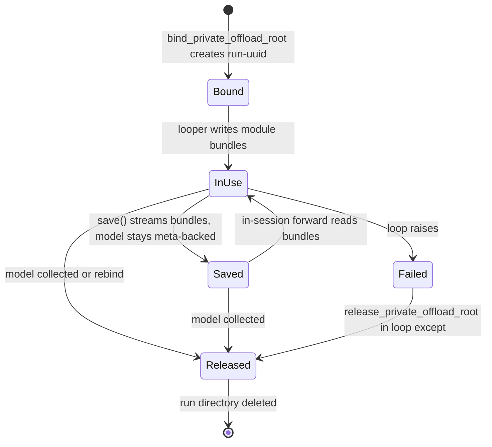
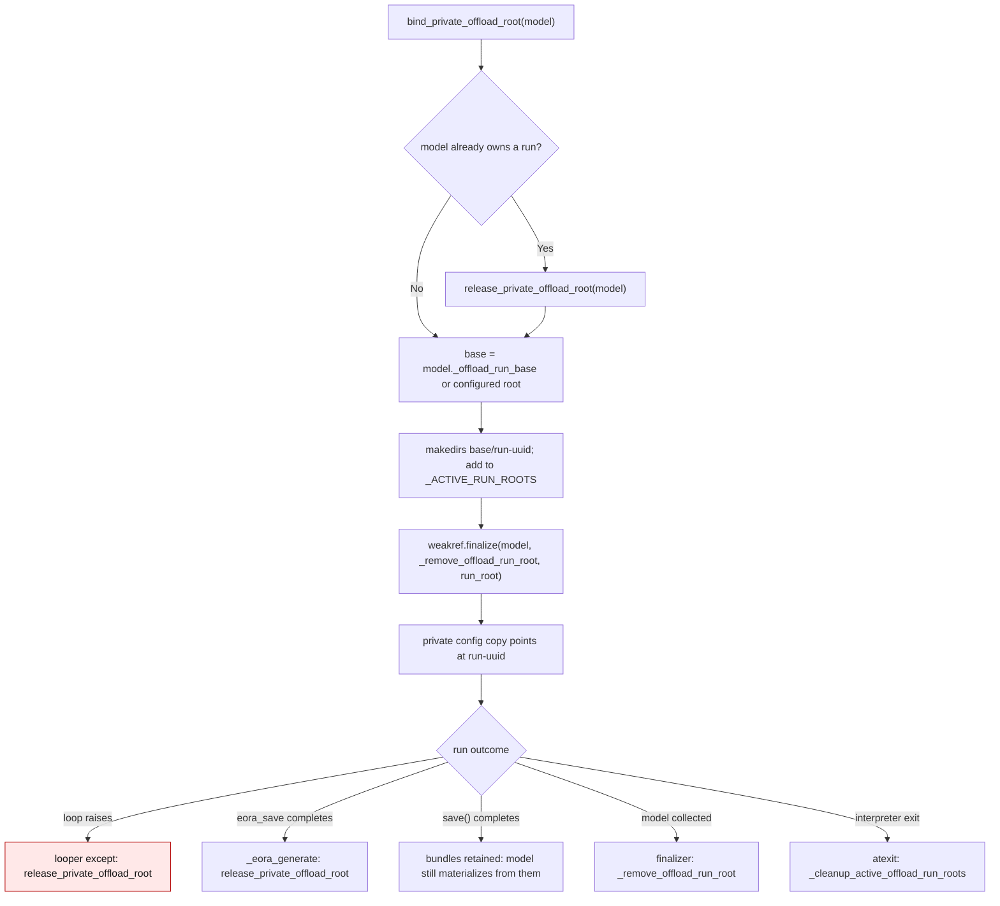

# Offload run directories

`QuantizeConfig.offload_to_disk_path` (or the automatic
`/tmp/gptqmodel_*` directory) is a **root**, not a bundle directory. Every
quantization run creates one private child, `run-<uuid16>`, and writes all of
that run's module bundles beneath it. The isolation is required: bundle
directory names are derived from the module path alone, so two models sharing
one config would otherwise overwrite each other's finalized bundles and the
second `save()` would silently write the first model's weights ([#4202],
[PR #4297]).

The run directory is scratch space owned by the model that created it. It is
removed when that model is collected, when the quantization run fails, and
before the same model binds another run. The auto temporary root keeps its
existing interpreter-exit cleanup; a run directory under an explicit root is
removed by the same ownership rule.

## Lifecycle

`release_private_offload_root()` detaches the model's finalizer, drops the
ownership attributes, and calls `_remove_offload_run_root()`, which only
discards the path from `_ACTIVE_RUN_ROOTS` and runs `shutil.rmtree(...,
ignore_errors=True)`. It is therefore safe from a finalizer thread and at
interpreter shutdown. A model that cannot be weakly referenced (a lightweight
test double) has no per-model finalizer; the module-level `atexit` hook is the
last-resort net.

## Why `save()` does not delete the run directory

`save_quantized()` resolves every meta module through
`get_state_dict_for_save(model, offload_root=...)`, streams the tensors to the
checkpoint, and clears the temporary state dict. It does **not** materialize
the quantized modules back into memory. The modules stay on the meta device
with their accelerate offload hook pointing at the run directory, so an
in-session `model.generate()` after `save()` still reads those bundles (for
example `tests/test_planar_model_e2e.py`). Deleting the directory at the end of
`save()` would turn a supported in-session forward into a `FileNotFoundError`.
The bundles are released at teardown, which is when the model stops being able
to use them.

## Before and after

| Mechanism | Before | After |
| --- | --- | --- |
| Run directory creation | `bind_private_offload_root()` created `run-<uuid16>` and stored the private config (`gptqmodel/utils/offload.py:79-110` at `0b7582fea`) | Same isolation, plus ownership attributes and a `weakref.finalize` (`gptqmodel/utils/offload.py:133`) |
| Model teardown | Nothing removed the directory; an explicit root grew by one full model per run | The finalizer removes it when the model is collected |
| Failed quantization | Nothing removed the directory | `ModuleLooper.loop()` (`gptqmodel/looper/module_looper.py:1889`) and `WeightOnlyLooper.loop()` (`gptqmodel/looper/weight_only_looper.py:904`) release it in the failure branch |
| Same model, new run | A second run nested its directory inside the previous private path, and the old path was never removed | The previous root is released before the new sibling is created |
| EoRA generation | The extra looper run directory was never removed | `_eora_generate()` releases it after `eora_save()` (`gptqmodel/models/base.py:2898`) |
| Interpreter exit | Auto temporary root removed, explicit run directory leaked | `atexit` removes any run directory this process still owns |

## Failure and ambiguity contract

| Situation | Behavior |
| --- | --- |
| Quantization loop raises (including a checkpoint stop) | Run directory is deleted; published checkpoint artifacts are store-owned copies and resume recreates the disposable indexes |
| `save()` raises | Run directory is kept so the caller can retry the save; teardown removes it later |
| `save()` succeeds | Run directory is kept because the live model still reads it |
| Model is not weak-referenceable | No per-model finalizer; `atexit` removes anything left |
| Process is killed with `SIGKILL` | Out of scope: no Python cleanup hook runs. The directory remains under the explicit root |

The introducing change is [PR #4297] for isolation and this page's change for
the cleanup contract ([#4368]).

[#4202]: https://github.com/ModelCloud/GPTQModel/issues/4202
[#4368]: https://github.com/ModelCloud/GPTQModel/issues/4368
[PR #4297]: https://github.com/ModelCloud/GPTQModel/pull/4297
