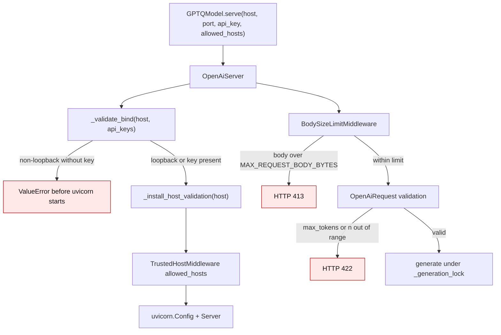
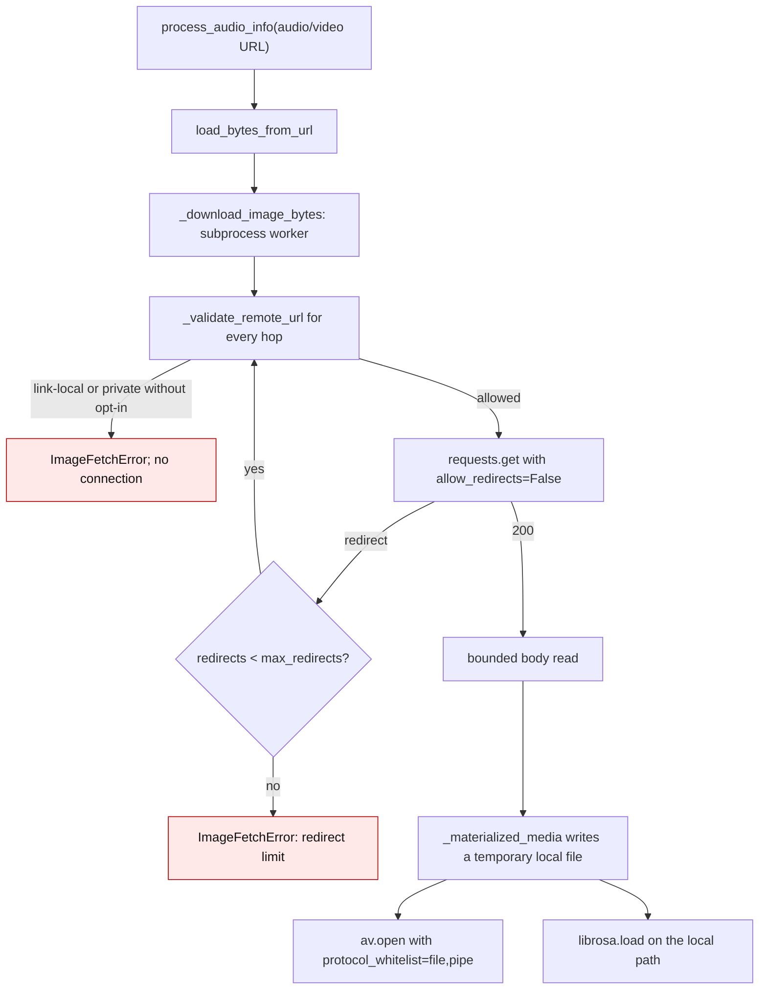

# OpenAI server exposure and media fetch bounds

`GPTQModel.serve()` starts an inference HTTP server, and multimodal
calibration reads audio, video, and image URLs from an untrusted dataset. Both
surfaces used to trust their input more than they should:

1. `serve()` defaulted to an unauthenticated `0.0.0.0:80` listener with no
   request bounds and no Host-header validation.
2. Audio/video URLs were handed straight to `audioread`/ffmpeg and PyAV, which
   fetch with no timeout, byte cap, or protocol restriction. Image fetches were
   bounded but followed redirects to any destination and opened local files
   without the pixel limit.

The current contract is fail-closed: a network listener without a key is
refused, request sizes are bounded, a loopback listener validates the Host
header, and every remote media fetch uses the same bounded worker with
per-hop destination validation.

## 1. Listener and request contract

`serve()` and `OpenAiServer.start()` now call `_validate_bind()` before
uvicorn is configured. A non-loopback host without `api_key` raises
`ValueError`; an explicit `api_key` keeps the documented public deployment
working. `_install_host_validation()` adds Starlette's
`TrustedHostMiddleware`; a loopback bind accepts only `localhost`, `127.0.0.1`
and `::1`, so a DNS-rebinding page that resolves its own hostname to loopback
is rejected with HTTP 400.

`OpenAiRequest` bounds `max_tokens` to `MAX_COMPLETION_TOKENS` and `n` to
`MAX_CHOICES`; `messages` is bounded to `MAX_MESSAGES`, and
`BodySizeLimitMiddleware` caps the whole body at `MAX_REQUEST_BODY_BYTES`
(including chunked bodies).

## 2. Media fetch contract

`load_bytes_from_url()` runs the existing subprocess worker
(`_download_image_bytes` → `_image_fetch_worker` →
`_download_image_bytes_in_worker`) and returns raw bytes.
`load_image_from_url()` decodes those bytes; `audio.process_audio_info()` uses
the same bytes for audio and video calibration.

`_address_is_blocked()` always rejects link-local addresses (the cloud
metadata range) and rejects loopback/private addresses unless the caller passes
`allow_private_addresses=True`. Redirects are followed manually so each hop is
validated, and `DEFAULT_IMAGE_FETCH_MAX_REDIRECTS` bounds the chain.
`fetch_image()` applies the same pixel limit to local paths, `file://` URLs and
base64 data that it already applied to downloaded images.

## 3. Before / after

Line numbers are from audit revision `93d3ae7a`.

| Surface | Before | After |
| --- | --- | --- |
| Default bind | `DEFAULT_HOST = "0.0.0.0"` (`gptqmodel/utils/openai_server.py:35`) | `"127.0.0.1"`; `serve()` default matches (`gptqmodel/models/base.py:3168`) |
| Exposed bind without key | `_warn_if_exposed()` warned but started (`gptqmodel/utils/openai_server.py:424-446`) | `_validate_bind()` raises `ValueError` before uvicorn starts |
| Host header | none | `TrustedHostMiddleware`; loopback binds accept only loopback names |
| Request bounds | `max_tokens: int = 256`, `n: int = 1`, no body cap (`gptqmodel/utils/openai_server.py:219-226`) | pydantic bounds plus `BodySizeLimitMiddleware` |
| Audio/video URL | `audioread.ffdec.FFmpegAudioFile(path)` (`gptqmodel/utils/audio.py:86-110`) | `load_bytes_from_url` then a temporary local file |
| Video probe | `av.open(video_path)` before the scheme check (`gptqmodel/utils/audio.py:35`) | fetched bytes → local file, `av.open(..., options={"protocol_whitelist": "file,pipe"})` |
| Image redirects | `requests.get` follows them (`gptqmodel/utils/image.py:147`) | manual `allow_redirects=False` loop, per-hop validation, redirect cap |
| Image SSRF | no destination filtering | link-local always rejected; loopback/private need `allow_private_addresses=True` |
| Local images | `Image.open` without a pixel check (`gptqmodel/utils/image.py:468-476`) | `_open_local_image` enforces `max_pixels` |

## 4. Failure contract

| Situation | Result |
| --- | --- |
| `serve(host="0.0.0.0")` with no key | `ValueError`; server never starts |
| `serve(host="0.0.0.0", api_key="...")` | starts; API paths require the bearer token |
| Loopback bind receives `Host: evil.example` | HTTP 400 from `TrustedHostMiddleware` |
| `max_tokens` above `MAX_COMPLETION_TOKENS` or `n` above `MAX_CHOICES` | HTTP 422 |
| Request body above `MAX_REQUEST_BODY_BYTES` | HTTP 413 |
| Media URL resolves to `169.254.169.254` | `ImageFetchError` before connecting |
| Media URL resolves to a private/loopback host | rejected unless `allow_private_addresses=True` |
| Redirect chain longer than the limit | `ImageFetchError: exceeded the N redirect limit` |
| Local image above the pixel limit | `ImageFetchError` before `load()` |

Regression coverage lives in `tests/test_openai_server_contract.py`,
`tests/test_image_fetch.py`, and `tests/test_media_fetch.py`. The fix for issue
#3970 introduced this contract.
