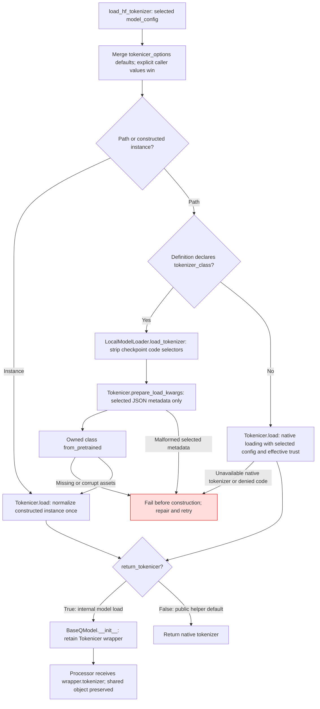

<!-- SPDX-FileCopyrightText: 2026 ModelCloud.ai -->
<!-- SPDX-License-Identifier: Apache-2.0 -->

# Definition-owned tokenizer construction and normalization

GPT-QModel selects the definition's tokenizer class before normalizing its
instance. `LocalModelLoader.load_tokenizer` delegates legacy special-token
metadata preparation to `Tokenicer.prepare_load_kwargs`, then calls only the
package-owned class. Checkpoint `auto_map`, `trust_remote_code` and
`code_revision` cannot replace that class. Native tokenizer paths without an
owned class retain the selected model config and disable checkpoint Python
when the model has a local loader.

Preloading reads tokenizer JSON as data and preserves asset-selection kwargs
and explicit caller overrides. Reusable repairs belong in Tokenicer;
source vocabularies, BOS/EOS behavior and source-specific serialization belong
in their packaged tokenizer classes.

`LocalModelLoader.tokenicer_options` declares immutable normalization defaults
as option pairs. `load_hf_tokenizer` merges them with `setdefault`: an explicit
caller value, including `False` or `None`, wins. These options reach
`Tokenicer.load` for owned, native and already-constructed tokenizers; they do
not enter an owned tokenizer constructor. Options cannot replace the selected
config or checkpoint-code permission. Historical SentencePiece conversion is
an explicit provider profile, never inferred here from a model name or asset
hash. Tokenicer owns the conversion and its native-provider eligibility gate.



| Before | After | Code evidence |
| --- | --- | --- |
| Owned constructors received legacy dictionary-valued special tokens directly | Prepare metadata through the upstream API before construction | `models/local.py:72-80` |
| Internal loaders returned a normalized native tokenizer, and the constructor normalized it again | Internal calls request the wrapper; the constructor retains it | `utils/hf.py:2802-2845`, `models/loader.py` calls with `return_tokenicer=True`, `models/base.py:1054-1056` |
| A generic processor fixture inherited a release-specific tokenizer binding | Explicitly declare the fixture's generic tokenizer; retain separate real-release source tests | `tests/test_local_processor_loading.py`, `tests/test_internlm_tokenizers_local_port.py` |

The dependency floor is `tokenicer>=0.0.19`. The API ships in
[Tokenicer 0.0.19](https://github.com/ModelCloud/Tokenicer/releases/tag/v0.0.19),
including the changes from merged [PR #66](https://github.com/ModelCloud/Tokenicer/pull/66).
The published [PyPI source archive](https://pypi.org/project/tokenicer/0.0.19/)
was downloaded, SHA-256 verified and installed directly for release validation:
`aa2ca0a70ec1103ccfa98090d9e195417a673206ae142b34ece555e6b1d19bef`.
Published 0.0.18 lacks this API. Earlier source-candidate measurements below
remain identified by their tested revision.

The release includes the Baichuan precedence repair described below and
an explicit `normalize_sentencepiece` profile, defaulting to `False` upstream.
InternVL declares `True` for its historical native Llama/Phi variants; the
Tokenicer provider/class gate preserves InternLM2, Qwen and unrelated native
tokenizers. Caller overrides remain authoritative. Revision, subfolder and
other selected asset options reach Tokenicer for paths and constructed instances.
An arbitrary remote JSON-only instance created outside this selection context
cannot reveal its original revision: supply that revision explicitly instead
of assuming the repository's default branch.

## Validation

An earlier combined suite passed **296 tests, no skips** in 24.34 seconds
(15 warnings). The current consumer/config/InternLM/norm-teacher and guard
batch passes **288 tests, one optional PEFT skip** in 31.90 seconds. The
profile-forwarding and tokenizer-consumer batch passes **48 tests, no skips**
in 3.62 seconds. These batches overlap and are not additive.
Restoring the prior `load_hf_tokenizer` implementation in memory produces
**six intended failures and six controls passing in 0.19s**: package defaults
are missing, or the profile option leaks into the owned constructor. The
profile cases also pin native/owned/instance identity, explicit False/None,
exact IDs/decode, once-only wrapping and rejection of security/config keys.

```bash
OMP_NUM_THREADS=1 MKL_NUM_THREADS=1 PYTHON_GIL=0 \
  /home/ubuntu/.venvs/gptqmodel-tf5/bin/python -s -m pytest -q --tb=short -ra -o addopts= \
  tests/test_local_tokenicer_options.py tests/test_local_tokenizer_loading.py
```
The public suite checks owned class selection, hostile checkpoint metadata,
legacy special-token flags and decode, input-asset immutability, subfolders,
missing/corrupt asset repair/retry, native return types and one normalization
per model load. The quantized consumer packs real AWQ linears and performs two
safetensors save/load cycles with identical token IDs, wrapper ownership and
logits. Removing preloading reproduces the legacy token-list construction
failure. Restoring the old native-tokenizer return reproduces duplicate
normalization in dense and quantized public loads (five failing cases in
0.45 seconds). Removing preloading fails at the intended native
`List[Union[str, AddedToken]]` check in 0.47 seconds.

Candidate `c14e1c8` exposed three Baichuan2-7B public failures: conflicting
legacy special-token flags split embedded EOS instead of producing source IDs
`[1, 46955, 2, 0]`. Upstream Tokenicer candidate
`b330955a1feb5c0841cb12cea14717a843e4edbc` restores the legacy map's precedence
while preserving explicit callers and modern decoder metadata. The integrated
Baichuan model/tokenizer/rotary, profile and shared-tokenizer run now passes
**206 tests, no skips, two warnings in 46.58 seconds**, with unchanged Baichuan
code, source IDs and assertions. The 89 real-tokenizer cases independently
pass on the same upstream pin. These measurements preceded the published
Tokenicer 0.0.19 qualification.

The final `4f23746c7` source candidate also passes **673 tests, no skips,
two warnings in 114.24 seconds** on the integrated checkout. This combines the
unchanged Baichuan source/reload cases with InternLM tokenizers, ChatGLM,
DeepSeek-V3, MOSS and the generic tokenizer/profile consumers:

```bash
OMP_NUM_THREADS=1 MKL_NUM_THREADS=1 PYTHON_GIL=0 python -s -m pytest -q \
  --tb=short -ra -o addopts= -o log_cli=false \
  tests/test_baichuan_tokenizer.py tests/test_baichuan_local_port.py \
  tests/module_tree/test_baichuan_local_port.py tests/test_baichuan_rotary_buffers.py \
  tests/test_local_tokenicer_options.py tests/test_local_tokenizer_loading.py \
  tests/test_internlm_tokenizers_local_port.py tests/test_chatglm_local_port.py \
  tests/test_deepseek_v3_local_port.py tests/test_moss_local_port.py
```

```bash
OMP_NUM_THREADS=1 MKL_NUM_THREADS=1 PYTHON_GIL=0 python -s -m pytest -q \
  --tb=short -ra -o addopts= tests/test_baichuan_tokenizer.py \
  tests/test_baichuan_local_port.py tests/module_tree/test_baichuan_local_port.py \
  tests/test_baichuan_rotary_buffers.py tests/test_local_tokenicer_options.py \
  tests/test_local_tokenizer_loading.py
```

```bash
PYTHON_GIL=0 /home/ubuntu/.venvs/gptqmodel-tf5/bin/python -s -m pytest \
  tests/test_local_tokenizer_loading.py tests/test_local_model_loading.py \
  tests/test_local_processor_loading.py tests/test_trust_remote_code_isolation.py \
  tests/test_internlm_tokenizers_local_port.py tests/test_internlm_local_port.py \
  tests/test_internlm2_local_port.py tests/module_tree/test_internlm_local_port.py \
  tests/module_tree/test_internlm2_local_port.py tests/test_local_model_paths.py \
  -q --tb=short -ra -o addopts=
```

Qualification uses Python 3.14.6t with `PYTHON_GIL=0`, Torch 2.15 CPU,
Transformers 5.23.0, Tokenicer candidate 0.0.19 and SentencePiece 0.2.1.
It does not qualify GPU execution, trained-checkpoint quality or concurrent
model execution. Real-release source contracts are in each port's provenance
and tokenizer reference.
