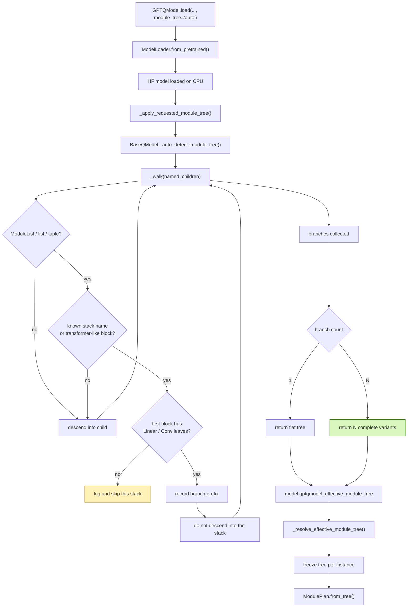
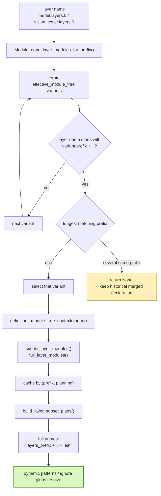
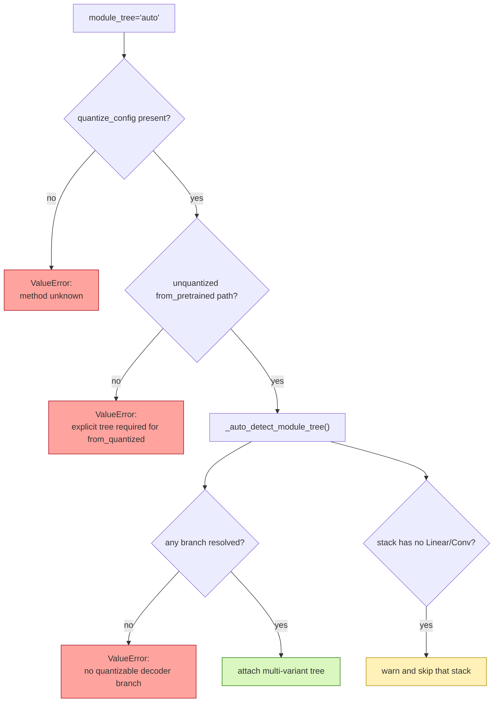

# Parallel module trees

Some checkpoints expose more than one decoder stack as **concurrent siblings**
under the root module. A text/vision OCR model can look like
`model`, `vision_tower`, `lm_head`; thinker/talker pairs have the same shape.
Those stacks are not alternatives for different layer types — they are all
quantizable in the same run.

GPT-QModel represents each stack as one complete `module_tree` variant. A
variant is a full prefix ending at the decoder `#` boundary:

```python
module_tree = [
    ["model", "layers", "#", {...text leaves...}],
    ["vision_tower", "layers", "#", {...vision leaves...}],
]
```

The declaration format already supported this shape. The gap was the structural
**auto-detection** helper: it probed a fixed candidate list and returned the
first match, so an unregistered model could only expose one branch. This page
describes the discovery and per-branch resolution added for
[issue #1998](https://github.com/ModelCloud/GPTQModel/issues/1998).

## What changed

| Area | Before | After |
| --- | --- | --- |
| Auto-detection (`gptqmodel/models/base.py:6053`) | Fixed candidate list; first matching `ModuleList` wins. | Recursive structural walk; every concurrent decoder stack becomes a variant. |
| Unknown-model loading (`gptqmodel/models/loader.py:1550`) | Fail-closed with no way to opt into detection. | Explicit `module_tree="auto"` opt-in; default remains fail-closed. |
| Layer leaf resolution (`gptqmodel/looper/module_looper.py:2125`) | One flat union of every variant's leaves applied to every layer. | Each layer uses the variant that owns its prefix. |
| Subset planning (`gptqmodel/looper/stage_subset.py:665`) | Sibling-only leaves were requested from the wrong branch. | Branch-local `simple_layer_modules` / `full_layer_modules`. |
| Hook skipping (`gptqmodel/looper/stage_layer.py:660`) | One global `:!` set. | Per-branch `:!` set for decoder layers. |
| Failure contract | A candidate with no leaves silently fell through to `None`. | Actionable `ValueError` when no branch is resolvable. |

## Discovery flow

`GPTQModel.load(..., module_tree="auto")` reaches
`ModelLoader.from_pretrained`, which calls `_apply_requested_module_tree`
after the dense model is loaded and before `BaseQModel.__init__` resolves the
tree.



The walk is structural, not a fixed path list:

- A sequence is considered when it is a `ModuleList`, list, or tuple with a
  module first element.
- The first element must own `nn.Linear`, `nn.Conv1d`, or `nn.Conv2d` leaves.
- The sequence must either use a known decoder-stack name (`layers`, `h`,
  `blocks`, `block`) or contain a transformer-like child (`attn`, `mlp`,
  `ffn`, `mixer`, ...).
- Once a stack is found the walk does **not** descend into its blocks. This
  prevents a nested expert `ModuleList` from being mistaken for a second
  decoder stack.

Historical candidate paths keep their priority when several stacks exist, so
a single-branch model still returns the same flat tree as before.

## Per-branch leaf resolution

A flat union of every variant's leaves is wrong when the branches declare
different projections. A text branch can have `mlp.up_proj` / `mlp.down_proj`
while a vision branch has `mlp.fc1` / `mlp.fc2`. Applying the union to every
layer asks a text layer to resolve `mlp.fc1`, which fails (or silently skips
when `layer_modules_strict=False`).

`ModuleLooper.layer_modules_for_prefix()` resolves the variant whose decoder
prefix contains the layer name. `stage_subset.build_layer_subset_plans()` and
`stage_layer.run_layer_stage()` use that branch-local declaration.



The full dotted layer name is preserved end to end. `model.layers.0` and
`vision_tower.layers.0` are distinct layer names, so layer indices, `dynamic`
patterns, ignore/disable globs, and per-module configs keep resolving without a
branch-index rewrite.

## Failure and ambiguity contract



| Situation | Behavior |
| --- | --- |
| Unknown model, no `module_tree` argument | `ValueError`; fail-closed default is unchanged. |
| `module_tree="auto"`, one stack | Returns the historical flat tree. |
| `module_tree="auto"`, N stacks | Returns N complete variants with full prefixes. |
| `module_tree="auto"`, no stack | `ValueError` naming the model type and the two remedies. |
| `module_tree="auto"` on `from_quantized` | `ValueError`; quantized weights no longer expose dense `Linear` leaves. |
| Several variants share one decoder prefix | Falls back to the historical merged declaration instead of picking one alternative. |
| Explicit list/tuple `module_tree` | Attached to the loaded model before tree resolution. |

## Usage

Unregistered model with concurrent text and vision stacks:

```python
from gptqmodel import BACKEND, GPTQModel, QuantizeConfig

model = GPTQModel.load(
    "path-or-repo",
    quantize_config=QuantizeConfig(bits=4, group_size=128, device="cuda:0"),
    backend=BACKEND.AUTO,
    module_tree="auto",
)
```

Explicit declaration, for a branch shape discovery cannot infer:

```python
module_tree = [
    ["model", "layers", "#", {"self_attn": ("q_proj:0", "o_proj:1"),
                              "mlp": ("up_proj:0", "down_proj:1")}],
    ["vision_tower", "layers", "#", {"self_attn": ("q_proj:0", "o_proj:1"),
                                     "mlp": ("fc1:0", "fc2:1")}],
]

model = GPTQModel.load("path-or-repo", quantize_config=..., module_tree=module_tree)
```

The same tree can be attached directly to a loaded model before the wrapper is
constructed:

```python
model.gptqmodel_effective_module_tree = module_tree
```

## Not supported

- **Quantized checkpoints.** `module_tree="auto"` requires the dense source
  model; pass an explicit tree to `from_quantized`.
- **MoE leaf discovery.** Auto-detection maps direct transformer parents
  (`self_attn`, `mlp`, ...). A branch whose routed experts are nested below
  those parents needs an explicit `:moe` declaration; the detector does not
  invent expert paths.
- **Same-prefix alternatives.** If several variants declare the same decoder
  prefix (alternative layer types), the looper keeps the historical merged
  declaration rather than selecting one alternative per layer.
- **Non-sequence stacks.** A decoder exposed as a single module or
  `nn.Sequential` is not detected as a branch. Declare it explicitly.

## Tests

| Test | Invariant |
| --- | --- |
| `tests/module_tree/test_auto_detect.py::test_auto_detect_discovers_every_concurrent_branch` | Two sibling stacks produce two variants. |
| `tests/module_tree/test_auto_detect.py::test_auto_detected_parallel_tree_resolves_every_prefixed_layer` | Both prefixes and every layer name are reachable. |
| `tests/module_tree/test_auto_detect.py::test_each_branch_keeps_its_own_leaf_declaration` | A text layer never requests a vision-only leaf and vice versa. |
| `tests/module_tree/test_auto_detect.py::test_auto_module_tree_requires_an_unquantized_source_and_resolvable_branch` | The fail-closed errors are actionable. |
| `tests/module_tree/test_module_tree_variants.py` | Existing explicit multi-variant trees still resolve. |
| `tests/test_tiny_moe_quant_smoke.py` | Single-branch full quantization still passes. |
