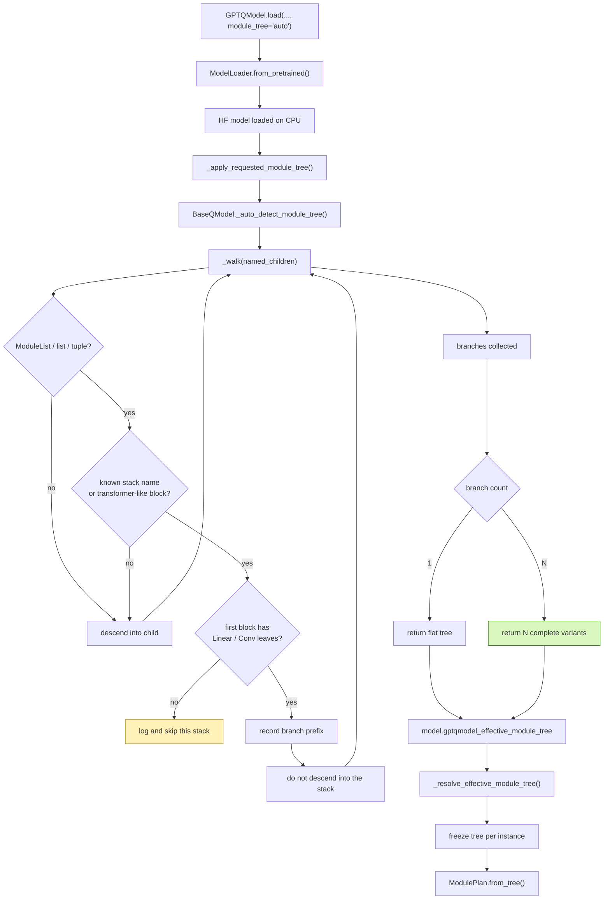
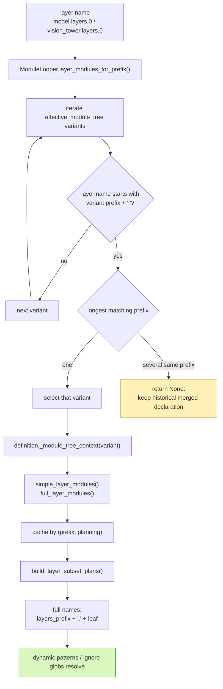
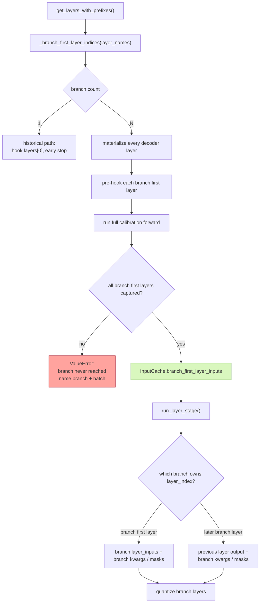
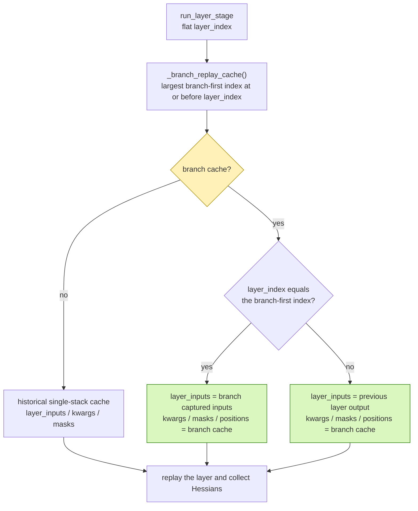
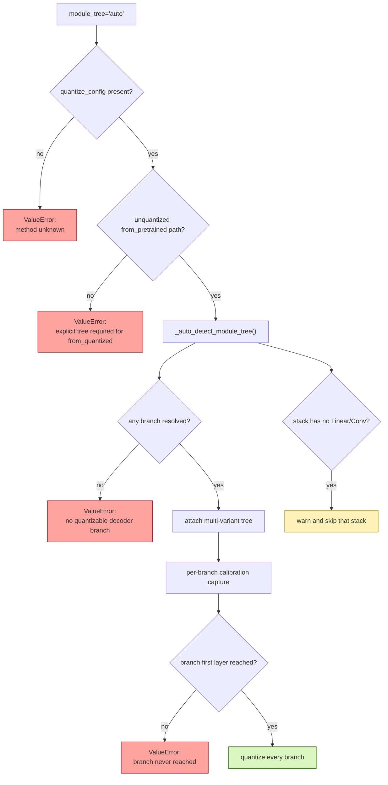

# Parallel module trees

Some checkpoints expose more than one decoder stack as **concurrent siblings**
under the root module. A text/vision OCR model can look like
`model`, `vision_tower`, `lm_head`; thinker/talker pairs have the same shape.
Those stacks are not alternatives for different layer types.

GPT-QModel represents each stack as one complete `module_tree` variant. A
variant is a full prefix ending at the decoder `#` boundary:

```python
module_tree = [
    ["model", "layers", "#", {...text leaves...}],
    ["vision_tower", "layers", "#", {...vision leaves...}],
]
```

A concurrent tree is quantizable in one run only when the calibration forward
executes **each stack's first layer**. Discovery, per-branch leaves, and
per-branch calibration are all required: without the last one, the vision stack
is replayed on the text decoder's final hidden state and its GPTQ Hessians are
built from the wrong activations. A stack that the calibration data never
reaches is now rejected instead of being silently calibrated on another stack.

This page covers the discovery and per-branch resolution added for
[issue #1998](https://github.com/ModelCloud/GPTQModel/issues/1998) and the
per-branch calibration added for
[issue #4116 item 1](https://github.com/ModelCloud/GPTQModel/issues/4116).

## What changed

| Area | Before | After |
| --- | --- | --- |
| Auto-detection (`gptqmodel/models/base.py:6118`) | Fixed candidate list; first matching `ModuleList` wins. | Recursive structural walk; every concurrent decoder stack becomes a variant. |
| Unknown-model loading (`gptqmodel/models/loader.py:1579`) | Fail-closed with no way to opt into detection. | Explicit `module_tree="auto"` opt-in; default remains fail-closed. |
| Layer leaf resolution (`gptqmodel/looper/module_looper.py:2133`) | One flat union of every variant's leaves applied to every layer. | Each layer uses the variant that owns its prefix. |
| Subset planning (`gptqmodel/looper/stage_subset.py`) | Sibling-only leaves were requested from the wrong branch. | Branch-local `simple_layer_modules` / `full_layer_modules`. |
| Hook skipping (`gptqmodel/looper/stage_layer.py`) | One global `:!` set. | Per-branch `:!` set for decoder layers. |
| Calibration capture (`gptqmodel/looper/stage_inputs_capture.py:136`) | One pre-hook on `layers[0]`; `StopForward` after the first text layer. | One pre-hook per branch first layer; full forward; per-branch caches. |
| Replay boundary (`gptqmodel/looper/stage_layer.py:908`) | Every layer replayed on the previous layer's output. | Every layer replays with the context of the branch that owns it; only a branch's first layer restarts from that branch's captured inputs. |
| Unreachable branch | Silently calibrated on another branch's activations. | `ValueError` naming the branch and calibration batch. |

## Discovery flow

`GPTQModel.load(..., module_tree="auto")` reaches
`ModelLoader.from_pretrained`, which calls `_apply_requested_module_tree`
after the dense model is loaded and before `BaseQModel.__init__` resolves the
tree.



The walk is structural, not a fixed path list:

- A sequence is considered when it is a `ModuleList`, list, or tuple with a
  module first element.
- The first element must own `nn.Linear`, `nn.Conv1d`, or `nn.Conv2d` leaves.
- The sequence must either use a known decoder-stack name (`layers`, `h`,
  `blocks`, `block`) or contain a transformer-like child (`attn`, `mlp`,
  `ffn`, `mixer`, ...).
- Once a stack is found the walk does **not** descend into its blocks. This
  prevents a nested expert `ModuleList` from being mistaken for a second
  decoder stack.

Historical candidate paths keep their priority when several stacks exist, so
a single-branch model still returns the same flat tree as before.

## Per-branch leaf resolution

A flat union of every variant's leaves is wrong when the branches declare
different projections. A text branch can have `mlp.up_proj` / `mlp.down_proj`
while a vision branch has `mlp.fc1` / `mlp.fc2`. Applying the union to every
layer asks a text layer to resolve `mlp.fc1`, which fails (or silently skips
when `layer_modules_strict=False`).

`ModuleLooper.layer_modules_for_prefix()` resolves the variant whose decoder
prefix contains the layer name. `stage_subset.build_layer_subset_plans()` and
`stage_layer.run_layer_stage()` use that branch-local declaration.



The full dotted layer name is preserved end to end. `model.layers.0` and
`vision_tower.layers.0` are distinct layer names, so layer indices, `dynamic`
patterns, ignore/disable globs, and per-module configs keep resolving without a
branch-index rewrite.

## Per-branch calibration capture

`get_layers_with_prefixes()` concatenates the variants into one flat layer
list. `_branch_first_layer_indices(layer_names)` finds the index where the
prefix changes. A single-stack model keeps the historical early-stop capture:
hook `layers[0]`, capture one batch, raise `StopForward`.

A multi-stack model cannot early-stop at the first stack, because the later
stack's real input is produced by the model forward, not by the first stack.
The capture stage therefore:

1. Materializes every decoder layer so the full forward can execute.
2. Registers one pre-hook on each branch's first layer.
3. Runs the calibration forward once per batch.
4. Captures each branch's first-layer inputs, attention mask, position ids and
   replay kwargs into `InputCache.branch_first_layer_inputs`.
5. Raises `StopForward` once every branch's first layer has been captured.
6. Raises `ValueError` if any branch's first layer was not reached in a batch.



The replay stage resolves the branch that **owns** the flat `layer_index` from
`InputCache.branch_first_layer_inputs`; see
[per-layer branch replay context](#per-layer-branch-replay-context). The
branch's first layer restarts from that branch's captured `layer_inputs`, and
every layer in the branch replays with that branch's `layer_input_kwargs`,
`position_ids` and `attention_masks`. The old behavior fed
`vision_tower.layers.0` the text decoder's last hidden state and the text
attention mask.

## Per-layer branch replay context

`_branch_replay_cache()` (`gptqmodel/looper/stage_layer.py:79`) is the single
owner-resolution rule. A layer belongs to the branch with the largest captured
first-layer index that is still at or before it. That branch supplies the
layer's replay kwargs, attention masks and position ids. Only the branch's
first layer also restarts from the branch's captured `layer_inputs`; later
layers consume the previous layer's output, which is what carries the
quantized activations forward.



Before #4150, only a branch's first layer was looked up in
`branch_first_layer_inputs`. `receive_layer_inputs()` refreshes only the
top-level `layer_inputs`, so the top-level `layer_input_kwargs`,
`position_ids` and `attention_masks` kept the **first** branch's values for
every later layer. A vision tower's layer 1 therefore replayed with the text
decoder's `attention_mask` instead of its own `cu_seqlens`.

| Mechanism | Before | After |
| --- | --- | --- |
| Branch lookup (`stage_layer.py:917`) | `branch_caches.get(layer_index)`; hit only at a branch's first layer. | `_branch_replay_cache(branch_caches, model_layer_index)`; hit for every layer in the branch. |
| `layer_inputs` | Branch inputs at a boundary, otherwise top-level previous output. | Unchanged: branch inputs at a boundary, otherwise previous output. |
| `layer_input_kwargs` / `position_ids` / `attention_masks` | Top-level cache (first branch) for every layer after a boundary. | Owning branch's cache for every layer in that branch. |
| Single-stack model | Top-level cache. | Unchanged: `branch_first_layer_inputs` is `None`, so the helper returns no branch and the top-level cache is used. |

### Cost and scope

- Multi-branch capture materializes all decoder layers and runs the full model
  forward once per calibration batch. The single-stack path keeps the
  early-stop optimization and is byte-identical.
- A branch is identified by a prefix change in the flattened layer names. The
  registered multi-variant trees (`mllama`, `qwen2.5-omni`, `qwen3-omni`,
  `hrm_text`) are layout alternatives where only one stack exists in the live
  model, so they take the single-stack path and are unaffected.
- A recurrent branch that invokes its first layer more than once per sample is
  captured once per batch at the first invocation.

## Failure and ambiguity contract



| Situation | Behavior |
| --- | --- |
| Unknown model, no `module_tree` argument | `ValueError`; fail-closed default is unchanged. |
| `module_tree="auto"`, one stack | Returns the historical flat tree; early-stop capture unchanged. |
| `module_tree="auto"`, N stacks | Returns N complete variants with full prefixes. |
| `module_tree="auto"`, no stack | `ValueError` naming the model type and the two remedies. |
| `module_tree="auto"` on `from_quantized` | `ValueError`; quantized weights no longer expose dense `Linear` leaves. |
| Several variants share one decoder prefix | Falls back to the historical merged declaration instead of picking one alternative. |
| Explicit list/tuple `module_tree` | Attached to the loaded model before tree resolution. |
| Calibration forward never reaches a branch first layer | `ValueError` naming the branch and batch; no branch is calibrated on another branch's activations. |

## Usage

Unregistered model with concurrent text and vision stacks:

```python
from gptqmodel import BACKEND, GPTQModel, QuantizeConfig

model = GPTQModel.load(
    "path-or-repo",
    quantize_config=QuantizeConfig(bits=4, group_size=128, device="cuda:0"),
    backend=BACKEND.AUTO,
    module_tree="auto",
)
```

The calibration data must execute each declared stack. For a text/vision model,
that means examples carrying the image inputs the model forward consumes; a
text-only sample that never runs the vision tower is rejected with an actionable
error rather than silently quantizing it from text hidden states.

Explicit declaration, for a branch shape discovery cannot infer:

```python
module_tree = [
    ["model", "layers", "#", {"self_attn": ("q_proj:0", "o_proj:1"),
                              "mlp": ("up_proj:0", "down_proj:1")}],
    ["vision_tower", "layers", "#", {"self_attn": ("q_proj:0", "o_proj:1"),
                                     "mlp": ("fc1:0", "fc2:1")}],
]

model = GPTQModel.load("path-or-repo", quantize_config=..., module_tree=module_tree)
```

The same tree can be attached directly to a loaded model before the wrapper is
constructed:

```python
model.gptqmodel_effective_module_tree = module_tree
```

## Not supported

- **Quantized checkpoints.** `module_tree="auto"` requires the dense source
  model; pass an explicit tree to `from_quantized`.
- **Unreachable branches.** A branch whose first layer is never executed by the
  calibration forward is rejected. Provide calibration data that exercises it,
  or remove the branch from the tree.
- **MoE leaf discovery.** Auto-detection maps direct transformer parents
  (`self_attn`, `mlp`, ...). A branch whose routed experts are nested below
  those parents needs an explicit `:moe` declaration; the detector does not
  invent expert paths.
- **Same-prefix alternatives.** If several variants declare the same decoder
  prefix (alternative layer types), the looper keeps the historical merged
  declaration rather than selecting one alternative per layer.
- **Non-sequence stacks.** A decoder exposed as a single module or
  `nn.Sequential` is not detected as a branch. Declare it explicitly.
- **Deferred packed-floatx branches.** Multi-branch capture materializes every
  decoder layer before the forward. A branch that only supports deferred
  packed-floatx materialization may fail at that boundary; declare it in a
  separate run or extend the model's `prepare_input_capture_layer`.

## Tests

| Test | Invariant |
| --- | --- |
| `tests/module_tree/test_auto_detect.py::test_auto_detect_discovers_every_concurrent_branch` | Two sibling stacks produce two variants. |
| `tests/module_tree/test_auto_detect.py::test_auto_detected_parallel_tree_resolves_every_prefixed_layer` | Both prefixes and every layer name are reachable. |
| `tests/module_tree/test_auto_detect.py::test_each_branch_keeps_its_own_leaf_declaration` | A text layer never requests a vision-only leaf and vice versa. |
| `tests/module_tree/test_parallel_branch_calibration.py::test_parallel_branch_calibration_uses_each_branch_inputs` | Equal-width and different-width branches are calibrated on their own inputs; no vision input equals a text output. |
| `tests/module_tree/test_parallel_branch_calibration.py::test_parallel_branch_calibration_fails_when_branch_is_unreached` | A text-only forward raises the actionable branch/batch error. |
| `tests/module_tree/test_module_tree_variants.py` | Existing explicit multi-variant trees still resolve. |
| `tests/test_tiny_moe_quant_smoke.py` | Single-branch full quantization still passes. |
