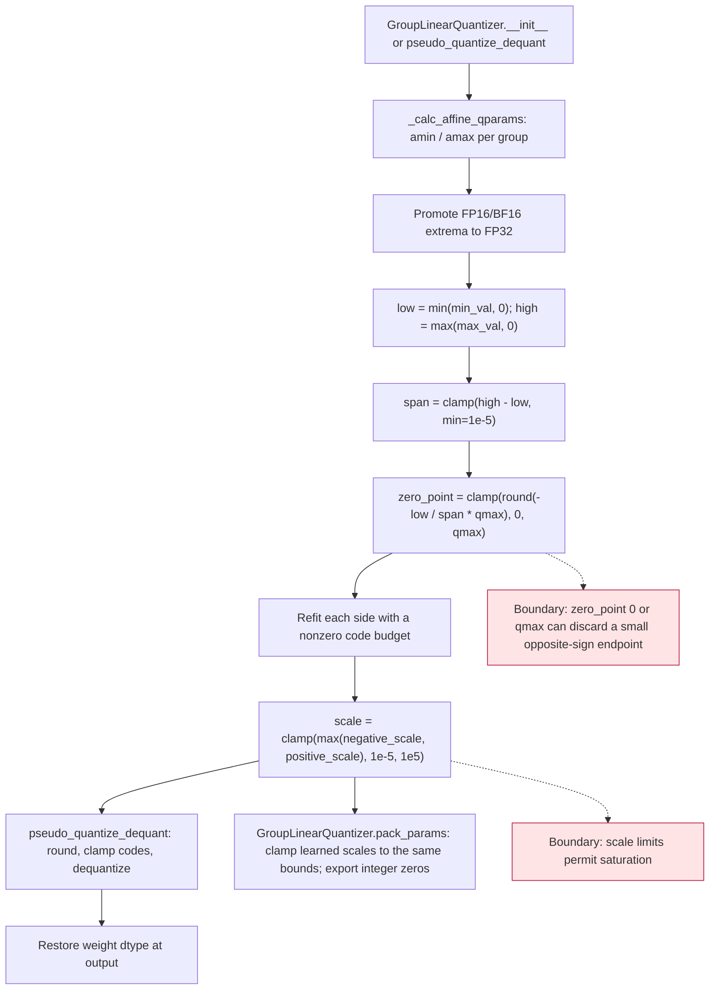
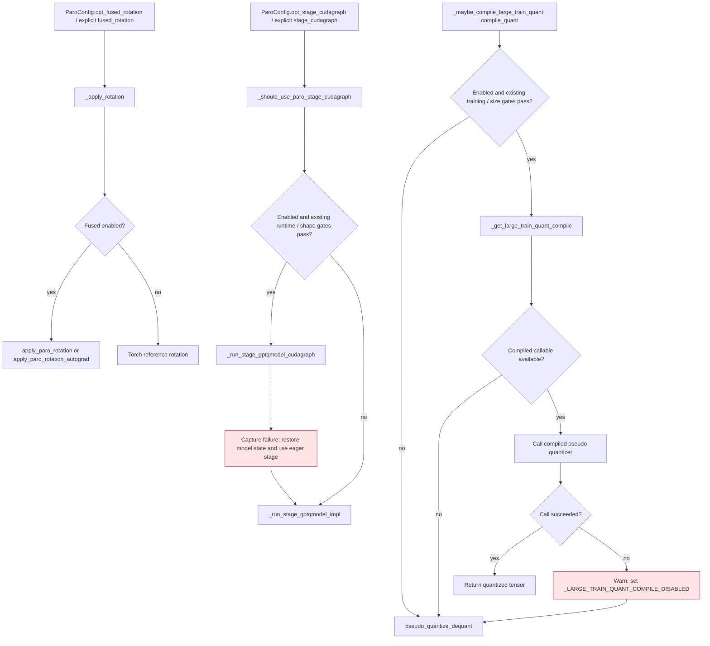

<!-- SPDX-FileCopyrightText: 2026 ModelCloud.ai
SPDX-License-Identifier: Apache-2.0 -->

# Paro affine fitting and optimization controls

GPT-QModel fits the transformed-domain affine grid once for quantizer
initialization and uses the same parameters for pseudo quantization and export.
Including zero prevents constant and one-sided groups from collapsing when the
runtime integer zero point is clamped. Fitting in at least FP32 prevents FP16
range overflow and FP16/BF16 zero-point rounding errors.

Introduced in [#4160](https://github.com/ModelCloud/GPTQModel/pull/4160).

## Affine grid

The grid represents `(code - zero_point) * scale`, with `code` in
`[0, 2**bits - 1]`. Zero points use ties-to-even rounding. Normalizing by the
span before multiplying by `qmax` avoids a rounded intermediate scale moving a
balanced range off its zero-point tie. FP16/BF16 inputs receive FP32 scale and
zero-point parameters; FP32 and FP64 retain their parameter dtype.

The scale refit also changes mixed-sign groups. This is a quantization fit,
not a lossless transform or an unconditional endpoint-containment guarantee.
The existing scale floor and cap remain `1e-5` and `1e5`. When the integer zero
point lands at an extreme, the opposite side has no available codes. Export
clamps learned scales to the same bounds as pseudo quantization, so optimizer
updates outside those bounds cannot change the reconstructed packing grid.

| Before | After | Source evidence |
| --- | --- | --- |
| Fit raw min/max and later clamp an unrepresentable zero point | Include zero before fitting; refit around the integer zero point | Base `ad21f0db:optimization.py:977-982`; `_calc_affine_qparams` |
| Subtract FP16 extrema and divide BF16 values in the model dtype | Promote only reduced extrema to FP32 before arithmetic | Initial PR `801653830:optimization.py:997-1009`; `_calc_affine_qparams` |
| Divide by an already-rounded base scale to select the zero point | Normalize the range first, then multiply by `qmax` | Initial PR `801653830:optimization.py:1003-1004`; `_calc_affine_qparams` |
| Export raw learned scales while pseudo quantization clamps them | Export the same effective bounded scale | Initial PR `801653830:optimization.py:1074`; `GroupLinearQuantizer.pack_params` |

All `optimization.py` references above refer to
`gptqmodel/quantization/paro/optimization.py` at the named commit.

## Explicit optimization controls

Runtime choices come from configuration or an explicit call argument. An
omitted `fused_rotation` or `stage_cudagraph` resolves to `True`. Compilation is
controlled by `_maybe_compile_large_train_quant(..., compile_quant=...)` and
keeps its existing size, training, runtime and failure gates.

| Initial PR mechanism | Replacement | Source at `801653830` |
| --- | --- | --- |
| Environment fallback for fused rotation | `fused_rotation`, supplied by `ParoConfig.opt_fused_rotation` | `optimization.py:883-886` |
| Environment gate for large training quantizer compilation | Explicit `compile_quant` argument on the owning helper | `optimization.py:1185` |
| Environment fallback for graph capture | `stage_cudagraph`, supplied by `ParoConfig.opt_stage_cudagraph` | `optimization.py:1869-1870` |

The ROCm capture exclusion and existing compiled-call fallback are preserved.
Removing environment decisions does not add a kernel or change kernel selection.

## Validation contracts

`tests/test_paro.py` compares independent FP64 scales, integer zero points,
and every quantization code. It covers constant and one-sided groups, mixed
signs, FP16 range overflow, small-magnitude groups at the scale floor, exact rounding ties
and their adjacent representable values. Arithmetic error is checked separately
from parameter-storage and visible-output rounding. The fallback export and
explicit optimization arguments have direct coverage. Export is also checked after
learned scales cross the floor or cap.

`scripts/gil0_api_probe.py --only 'Paro affine fit'` exercises the composed
fit and pseudo quantizer concurrently; its measured result is recorded in
[`pytorch_gil_0_compat.md`](../pytorch_gil_0_compat.md).
