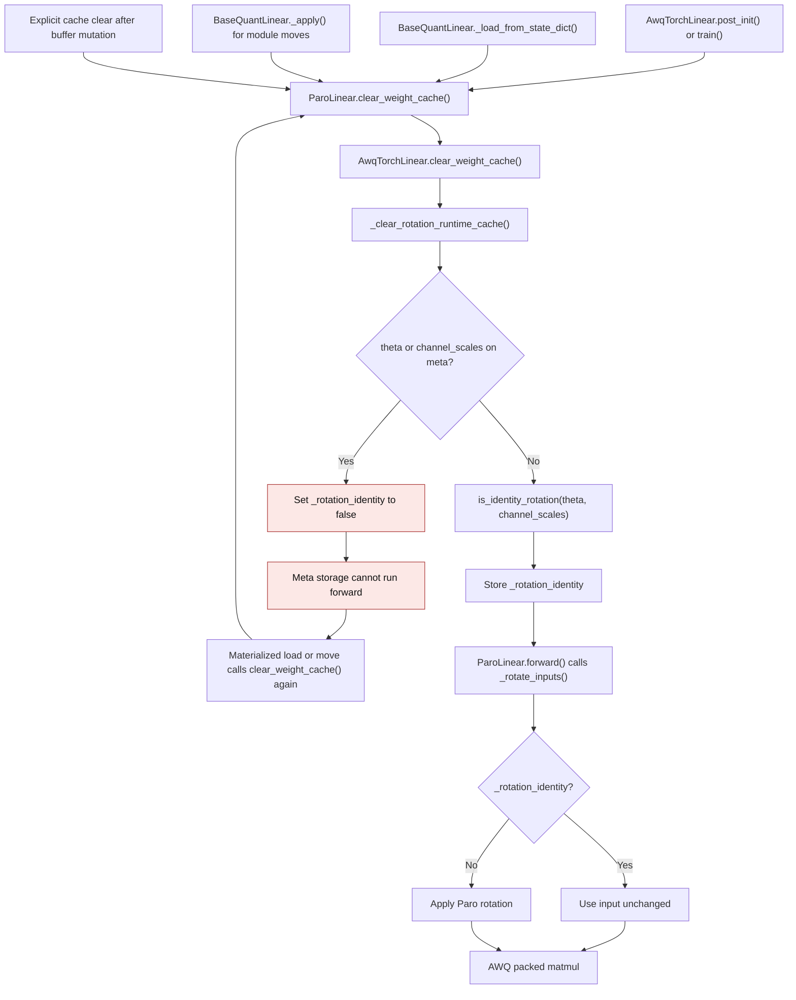
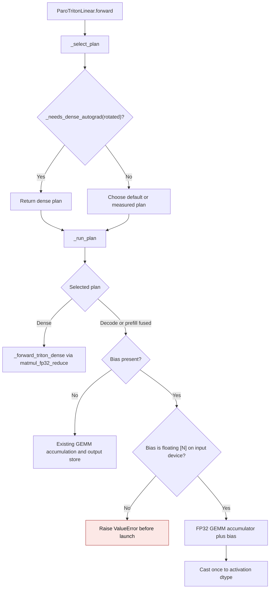
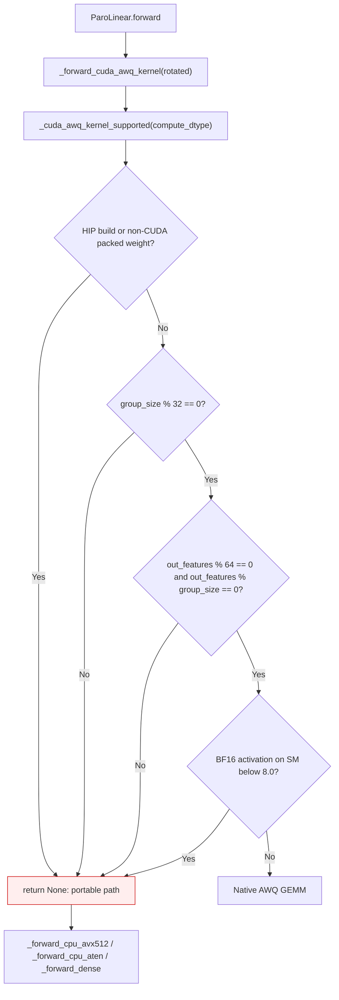
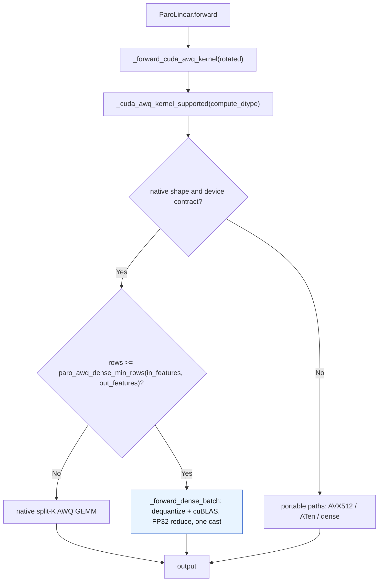
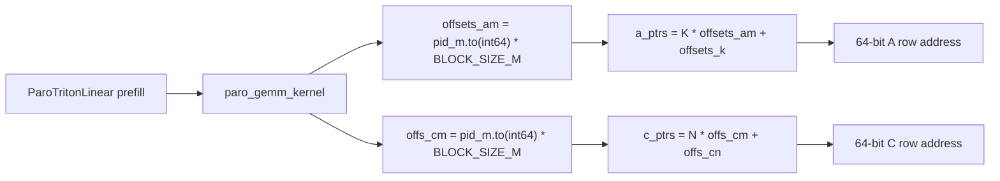
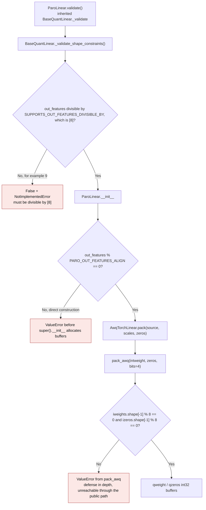
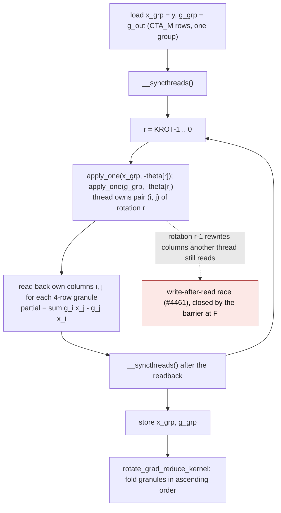

# Paro

## Rotation identity lifecycle

`ParoLinear` can skip activation rotation when both rotation buffers
describe the identity transform. The decision is derived from `theta` and
`channel_scales` when `clear_weight_cache()` invalidates runtime state. The
same method runs after `post_init()`, a state-dict load, and a module move.
Call it after manually changing rotation buffers, including tensors
created under `torch.inference_mode()` whose version cannot be tracked.



| Entry point | Previous mechanism | Current mechanism |
| --- | --- | --- |
| `post_init()` | `paro.py:162-166` recalculated `_rotation_identity` after the AWQ cache clear | Inherited AWQ `post_init()` calls `ParoLinear.clear_weight_cache()`, which recalculates it |
| Explicit cache clear | `paro.py:168-171` dropped runtime tensors but left the old identity decision | `clear_weight_cache()` drops those tensors and recalculates from current rotation buffers |
| State-dict load or module move | `qlinear/__init__.py:319-337` called the same clear hook, so the old decision survived changed buffers | The clear hook refreshes the decision; meta storage conservatively disables the shortcut until materialized |

The decision is a boolean, not a dense weight cache. The packed AWQ weights
remain the only persistent weight representation. The CPU dense fallback still
dequantizes a temporary weight for its current forward.

Introduced in [PR #3744](https://github.com/ModelCloud/GPTQModel/pull/3744).

## Activation Checkpointing

`ParoConfig.opt_gradient_checkpointing` controls activation checkpointing during Paro's train-style optimization stages.

- `opt_scope="layer"` defaults to `opt_gradient_checkpointing=True`
- `opt_scope="module"` defaults to `opt_gradient_checkpointing=False`
- `opt_scope="compute_block"` defaults to `opt_gradient_checkpointing=False`

Current internal benchmarks have only shown a clear resource-usage benefit for `layer` scope. `module` and `compute_block` support the toggle, but they are not enabled by default because we have not yet measured a consistent memory win there.

## ROCm quantization determinism

Paro derives per-module seeds from `opt_seed`, so a fixed seed is expected
to produce the same checkpoint. CUDA runs are bitwise-identical after
[PR #4499](https://github.com/ModelCloud/GPTQModel/pull/4499) made the fused
rotation gradient independent of the launch plan.

ROCm needed a separate fix. Paro accumulates no Hessian, so it used to
keep hipBLASLt, which selects GEMM kernels per process. Two Qwen2.5-0.5B runs
with the same seed and calibration produced PPL `21.26` and `21.44`. The
quantization run plan now treats `ProcessorStep.PARO` like the Hessian builders
in `_needs_deterministic_hessian` (`gptqmodel/models/base.py`), so
`quant_blas_backend(deterministic=True)` pins rocBLAS for the whole run. Two
runs with rocBLAS pinned produced bitwise-identical checkpoints (issue #4460).

The trade-off is accepted: rocBLAS is deterministic but its fp16/bf16 GEMMs are
slower than hipBLASLt (8-14x on gfx1201 for the shapes in
[ROCm default environment](rocm-default-environment.md)). Deterministic
checkpoints are the product contract, so Paro pays that cost. The
documented reproducibility opt-out remains
`KernelConfig(rocm_quant_blas="hipblaslt")`.

The fused-rotation autotune timing knobs are internal C++ constants now; they
are no longer read from `GPTQMODEL_PARO_ROTATE_AUTOTUNE_*` environment
variables. `KernelConfig.paro_rotate_autotune`,
`KernelConfig.paro_rotate_cta_m` and `KernelConfig.paro_rotate_row_pad`
are the only controls.

| Test | Invariant |
| --- | --- |
| `test_paro_selects_the_deterministic_pin_on_mocked_rocm` | A `ProcessorStep.PARO` run plan selects the rocBLAS pin on a mocked ROCm platform |
| `test_paro_has_no_environment_variable_reads` | The Paro extension sources contain no `GPTQMODEL_PARO_*` environment reads |

## Triton bias epilogue

Paro Triton decode and prefill kernels accumulate quantized products in
FP32 when a bias is present, add the bias in that accumulator, and cast once to
the activation dtype. This preserves a finite FP16 result when the unbiased
intermediate exceeds the FP16 range. The dense plan uses
`matmul_fp32_reduce` for the same NVIDIA CUDA contract. A differentiable
rotated input or trainable bias uses the dense plan so autograd can return
its gradient. An unbiased fused call
keeps its existing accumulation setting, while a biased call uses FP32
accumulation even when `KernelConfig(fp32_accum=False)`. On NVIDIA CUDA, the dense plan
keeps the stored bias precision until the FP32 epilogue instead of casting it
to the activation dtype first.



| Path | Previous mechanism | Current mechanism |
| --- | --- | --- |
| Fused decode and prefill | `gemm.py:308` cast the GEMM result to FP16/BF16; `paro_triton.py:143-152` added bias afterward | The Triton kernel adds bias to its FP32 accumulator before its output store |
| Dense fallback | `paro_triton.py:136-138` rounded the matmul before bias and cast the stored bias to the activation dtype | `matmul_fp32_reduce` adds the stored bias in FP32 before NVIDIA CUDA output rounding |
| Differentiable input or bias | Fused output had no input gradient; separate post-kernel addition provided only a bias gradient | `_select_plan` chooses the differentiable dense wide path; `_run_plan` also guards direct calls |

On an NVIDIA GB10 (SM 12.1), a packed all-ones weight with 128 FP16 inputs of
`516` and a bias of `-1024` returned `inf` from both prior fused paths; an
independent FP32 Torch oracle and the corrected paths return `65024`. With
BF16 inputs of 127 ones plus `1.25`, and a bias of `-0.5`, the prior paths
returned `127.5`; the oracle and corrected paths return `128`. Tests cover
both dtypes, decode and prefill, the dense fallback, the unchanged unbiased
call, a noncontiguous bias, exact output against an independent packed-code
Torch oracle, malformed-bias rejection, mixed bias and activation dtypes, and
exact input and bias gradients. The CUDA wide reduction does not change
ROCm dense-path arithmetic; the fused ROCm bias path was not measured here.

For resident FP16 inputs with K=N=1024, five warmups and the median of five
runs of twenty calls with CUDA synchronization gave these per-forward results.
The prior behavior was reproduced by a bias-free kernel call followed by a
separate addition. Peak allocator delta includes the output allocations.

| Rows | Prior post-kernel bias | Fused bias |
| --- | --- | --- |
| 1 | 0.063 ms; 4 KiB peak | 0.055 ms; 2 KiB peak |
| 16 | 0.064 ms; 64 KiB peak | 0.056 ms; 32 KiB peak |

The Triton bias epilogue was introduced by [PR #3657](https://github.com/ModelCloud/GPTQModel/pull/3657).

## Native dispatch gate

`ParoLinear` advertises `group_size=16` because its CPU, ATen and dense paths
support it. The native AWQ CUDA GEMM does not:
`validate_awq_gemm_args` in
`gptqmodel_ext/awq/quantization/gemm_cuda_gen.cu` requires uint4b codes, a group
size divisible by 32, an output width divisible by the 64-column CTA tile, and
an output width divisible by that group size. Dispatch therefore asks the
kernel's own shape contract before calling it, instead of letting the kernel
raise from inside a forward.



The group size is derived from the packed tensors the kernel actually reads
(`in_features // scales.size(0)`), not from the config value: `group_size=-1`
packs one scale row per input channel, which the kernel turns into
`in_features / scaling_factors.size(0)`.

### Previous behavior

| Mechanism | Previous behavior | New behavior |
| --- | --- | --- |
| CUDA dispatch | Called the native GEMM for every CUDA tensor | Gated on the native validator's shape and device contract |
| `group_size=16` (advertised by `SUPPORTS_GROUP_SIZE`) | `RuntimeError: Group size should be a multiple of 32` | Dense fallback |
| Narrow output width, e.g. 8 | `RuntimeError: OC is not multiple of cta_N = 64` | Dense fallback |
| ROCm | `RuntimeError: The native AWQ JIT extension is CUDA-only and cannot be built by hipcc` | Portable path |
| FP16/BF16 activation beside the reconstructed FP32 grid | `RuntimeError: input dtypes must be the same` | Operands promoted to FP32, one cast at the end |

The gate is a capability query, not a configuration switch: there is no
environment override and no new public option.

### Dense fallback dtype contract

`linear_wide_bias` uses `torch.mm(..., out_dtype=torch.float32)` only when both
operands already share a low-precision dtype, which keeps them narrow and the
reduction wide. A mismatched pair (FP16 activation, FP32 reconstructed weight)
is promoted to at least FP32 before the matmul, so the fallback never narrows a
weight or an activation below FP32; the previous `.float()` arithmetic is
preserved bit for bit for same-dtype operands.

### Validation

Measured with torch 2.16.0.dev20261102+cu130 on an RTX 4090 (SM 8.9) and
torch 2.16.0.dev20261025+rocm10.1 on an R9700 (gfx1201). The oracle is the
independent FP32 packed-grid dequantization in
`tests/kernels/test_paro.py::_fp32_awq_oracle`.

| Configuration | Native gate | Result |
| --- | --- | --- |
| `in=16, out=8, group_size=16` | rejected (group size 16) | dense fallback, FP16 `65024` matches the oracle exactly |
| `in=16, out=8, group_size=-1` | rejected (output width 8) | dense fallback |
| `in=128, out=64, group_size=16` | rejected (group size 16) | dense fallback |
| `in=32, out=64, group_size=32` | admitted | native kernel, unchanged |
| `in=128, out=128, group_size=-1` | admitted (derived group size 128) | native kernel, unchanged |
| `in=256, out=128, group_size=128` | admitted | native kernel, unchanged |
| ROCm, `in=32, out=64, group_size=32` | rejected (HIP build) | dense fallback, matches the oracle |

Repeated fallback forwards keep only the packed `int32` buffers; the test
asserts that no `(in_features, out_features)` tensor is retained by the module.

## Native prefill dispatch and wide offsets

Two independent 32-bit assumptions ended an NVIDIA or ROCm prefill once a
single forward produced more than 2^31 output elements (`rows x
out_features`), or the activation itself passed `rows x in_features > 2^31`:

* `ParoLinear` fed the native split-K AWQ GEMM for every row count. The
  underlying store is 64-bit since the AWQ wide-offset fix, but the kernel
  still allocates one FP32 partial slab per split, so a long prefill also paid
  `split_k` x the output in transient memory.
* `paro_gemm_kernel` computed `K * offsets_am` (A rows) and
  `N * offs_cm` (C rows) from int32 vectors, so the same shapes wrapped the
  address and faulted with `cudaErrorIllegalAddress` /
  `hipErrorIllegalAddress`.

#5164 fixed the first by dequantizing and calling cuBLAS above a global
640-row threshold. That threshold was tuned only on Qwen2.5-0.5B shapes
(K/N = 896/4864 and 4864/896). Issue #5210 measured 7-8B projections and
found the native kernel still faster up to roughly 1500-2500 rows, so the
641-2000 row band regressed by 1.1-2.1x per layer. Issue #5260 then found
that the #5210 fit's 2048-row floor regressed the 1024-2047 row band of
small wide projections (896x4864, 2048x8192, 1536x8960), where dequantize +
cuBLAS wins from roughly 800-960 rows on SM 8.9. The dispatch is now
shape-aware and size-aware.





| Mechanism | Previous behavior | Current behavior |
| --- | --- | --- |
| `ParoLinear` CUDA dispatch | Native split-K GEMM for every row count (`paro.py`), one FP32 slab per split, 3.6x the output size transient | Above a shape- and size-aware crossover (768-4096 rows), dequantize the packed grid and call cuBLAS with an FP32 reduction and one output cast |
| `paro_gemm_kernel` A offsets | `K * offsets_am` with an int32 row vector | `offsets_am` is int64, so `rows x in_features > 2^31` no longer wraps |
| `paro_gemm_kernel` C offsets | `N * offs_cm` with an int32 row vector | `offs_cm` is int64, so `rows x out_features > 2^31` no longer wraps |
| Storage | Dequantized weight retained? | The reconstructed weight exists only for the dispatched call; the module keeps the packed INT4 buffers |

### Shape-aware crossover

The dense route pays a dequantize cost proportional to
`in_features * out_features` (the dequantized weight bytes), plus a GEMM
whose per-row cost is lower than the native split-K kernel's. The native
route pays `split_k` FP32 partial slabs. The measured crossover also depends
on the output width: cuBLAS loses tile efficiency on narrow outputs, and the
native kernel's relative advantage changes with the aspect ratio. The fit is
anchored at 1342 rows for 4096x4096:

```
size = in_features * out_features / 4096**2
aspect = in_features / out_features
rows = 1342 * aspect**0.304
            * (size**0.357 if size >= 1 else size**-0.098)
            * max(1, 2048 / out_features)**0.219
       clamped to [768, 4096]
```

The size term is a V-shape in log size. Below the 4096x4096 anchor, small
layers pay a fixed cuBLAS small-M penalty, so the threshold grows as the
layer shrinks; above it, the dequantize work grows with the weight bytes and
the threshold grows with the layer size. The narrow-output term raises the
threshold below 2048 output columns. The 768-row floor keeps #5210's
641-row native choice for every shape, and the 4096-row ceiling keeps
#5096's wide-prefill escape. `paro_awq_dense_min_rows` is a host-side
integer decision, so the same shape always selects the same path.

Measured crossovers on SM 8.9 (RTX 4090, torch 2.15.0+cu132, FP16,
group_size 128, synthetic g128 layers), both routes interleaved in one
process, min of nine to forty-one blocks, and the resulting threshold:

| K/N | Measured crossover (rows) | `paro_awq_dense_min_rows` |
| --- | --- | --- |
| 896/4864 | ~800 | 916 |
| 1536/8960 | ~870 | 800 |
| 2048/8192 | ~960 | 880 |
| 4096/14336 | ~1340 | 1434 |
| 4096/4096 | ~1490 | 1342 |
| 2048/2048 | ~1900 | 1537 |
| 14336/4096 | ~2300 | 3072 |
| 4864/896 | ~2300 | 3070 |
| 8192/2048 | ~2000 | 2045 |
| 8960/1536 | ~3100 | 2491 |

The fit reproduces the wide and square projection crossovers within about
10%. The narrow tall projections (4864/896, 8960/1536, 8192/2048) are noisier
because cuBLAS switches kernels between adjacent row counts; their
thresholds are conservative heuristics. The 896/4864 threshold (916) is
about 115 rows above its measured crossover, so the 641-914 band stays
native; the absolute cost is under 0.03 ms per layer and the 1024-2047 band
that #5260 reported is on the dense route. On SM 8.9 the 7-8B shapes keep
the native kernel at 641 rows and take the dense route at 4096 rows, which
is the #5210 choice. The #5210 SM 12.0 table (~2400 rows for 4096x4096,
~2050 for 4096x14336) is historical: the new fit is tuned on SM 8.9 and has
not been re-measured on SM 12.0.

### Validation

The #5164 table that set the old 640-row threshold, measured with torch
2.15.0+cu132 on an SM 8.9 device and torch 2.16.0.dev20261029+rocm10.1 on
gfx1201, FP16, group_size 128, synthetic g128 layers (K=896/N=4864 and
K=4864/N=896). It does not describe 7-8B projections. Times are medians of
five calls after three warmups with `torch.cuda.synchronize`; peak is the
allocator delta over the call.

| Rows | K/N | Native split-K ms / peak | Dequantize + cuBLAS ms / peak | Relative error |
| --- | --- | --- | --- | --- |
| 512 | 896/4864 | 0.093 / 52 MiB | 0.086 / 37 MiB | 2.7e-5 |
| 1024 | 896/4864 | 0.217 / 104 MiB | 0.120 / 65 MiB | 1.5e-5 |
| 8192 | 896/4864 | 2.342 / 836 MiB | 1.013 / 464 MiB | 2.6e-5 |
| 32000 | 896/4864 | 8.931 / 3266 MiB | 3.794 / 1790 MiB | 2.6e-5 |
| 1024 | 4864/896 | 0.097 / 19 MiB | 0.115 / 22 MiB | 2.4e-5 |
| 4096 | 4864/896 | 0.387 / 77 MiB | 0.260 / 50 MiB | 2.2e-5 |
| 32000 | 4864/896 | 3.458 / 602 MiB | 1.953 / 336 MiB | 2.2e-5 |

The #5210 per-layer table below is the same synthetic-layer harness on SM
12.0 (RTX 5090, torch 2.15.0+cu132). Modes are interleaved round-robin,
min of six blocks of ten calls, one process. `current` is the #5164
`>640` behaviour; `new` is the #5250 fit. Ratios are against
the pre-#5164 always-native route; peak is the allocator delta.

| dtype | K/N | M | native ms | current ms (x) | new ms (x) | native peak / new peak |
| --- | --- | --- | --- | --- | --- | --- |
| FP16 | 4096/4096 | 641 | 0.164 | 0.326 (2.00x) | 0.165 (1.01x) | 50 / 50 MiB |
| FP16 | 4096/4096 | 768 | 0.193 | 0.332 (1.72x) | 0.194 (1.01x) | 60 / 60 MiB |
| FP16 | 4096/4096 | 1024 | 0.260 | 0.393 (1.51x) | 0.261 (1.00x) | 80 / 80 MiB |
| FP16 | 4096/4096 | 2048 | 0.566 | 0.574 (1.01x) | 0.567 (1.00x) | 160 / 160 MiB |
| FP16 | 4096/4096 | 4096 | 1.239 | 0.936 (0.76x) | 0.935 (0.76x) | 320 / 160 MiB |
| FP16 | 4096/14336 | 641 | 0.630 | 1.117 (1.77x) | 0.630 (1.00x) | 175 / 175 MiB |
| FP16 | 4096/14336 | 768 | 0.757 | 1.133 (1.50x) | 0.757 (1.00x) | 210 / 210 MiB |
| FP16 | 4096/14336 | 1024 | 1.047 | 1.303 (1.24x) | 1.048 (1.00x) | 280 / 280 MiB |
| FP16 | 4096/14336 | 2048 | 2.230 | 2.001 (0.90x) | 1.999 (0.90x) | 560 / 336 MiB |
| FP16 | 4096/14336 | 4096 | 4.481 | 3.316 (0.74x) | 3.321 (0.74x) | 1120 / 560 MiB |
| FP16 | 14336/4096 | 641 | 0.521 | 1.101 (2.12x) | 0.522 (1.00x) | 50 / 50 MiB |
| FP16 | 14336/4096 | 768 | 0.633 | 1.120 (1.77x) | 0.634 (1.00x) | 60 / 60 MiB |
| FP16 | 14336/4096 | 1024 | 0.828 | 1.277 (1.54x) | 0.829 (1.00x) | 80 / 80 MiB |
| FP16 | 14336/4096 | 2048 | 1.676 | 1.963 (1.17x) | 1.695 (1.01x) | 160 / 160 MiB |
| FP16 | 14336/4096 | 4096 | 3.380 | 3.242 (0.96x) | 3.019 (0.89x) | 320 / 240 MiB |

BF16 follows FP16 within 2% on every shape and M. The `down_proj` peak
regression from #5164 is gone in the band: 14336/4096 at 641 rows is 50 MiB
on both the old and new dispatch, against 154 MiB for `current`.

Issue #5260 re-measured the per-layer crossover on the same synthetic harness
on an SM 8.9 RTX 4090 (torch 2.15.0+cu132, FP16, group_size 128). The host
was shared with other tenants, so both routes were timed in one process,
interleaved round-robin, and the table reports the minimum over nine to
forty-one blocks. `native` is the split-K GEMM; `dense` is dequantize +
cuBLAS; `chosen` is the route `paro_awq_dense_min_rows` selects. Times are
ms; peak is the allocator delta over the call.

| K/N | M | native ms / peak | dense ms / peak | chosen |
| --- | --- | --- | --- | --- |
| 896/4864 | 641 | 0.102 / 59 MiB | 0.144 / 32 MiB | native |
| 896/4864 | 1024 | 0.205 / 95 MiB | 0.164 / 46 MiB | dense |
| 896/4864 | 1536 | 0.347 / 142 MiB | 0.202 / 65 MiB | dense |
| 896/4864 | 2047 | 0.516 / 190 MiB | 0.274 / 84 MiB | dense |
| 896/4864 | 2048 | 0.579 / 190 MiB | 0.303 / 84 MiB | dense |
| 896/4864 | 3072 | 0.980 / 285 MiB | 0.499 / 122 MiB | dense |
| 896/4864 | 4096 | 1.117 / 380 MiB | 0.560 / 160 MiB | dense |
| 2048/8192 | 641 | 0.364 / 100 MiB | 0.485 / 72 MiB | native |
| 2048/8192 | 1024 | 0.626 / 160 MiB | 0.518 / 96 MiB | dense |
| 2048/8192 | 1536 | 1.058 / 240 MiB | 0.747 / 128 MiB | dense |
| 2048/8192 | 2047 | 1.401 / 320 MiB | 0.946 / 160 MiB | dense |
| 2048/8192 | 2048 | 1.448 / 320 MiB | 0.995 / 160 MiB | dense |
| 2048/8192 | 3072 | 1.829 / 480 MiB | 1.149 / 224 MiB | dense |
| 2048/8192 | 4096 | 2.446 / 640 MiB | 1.448 / 288 MiB | dense |
| 1536/8960 | 641 | 0.310 / 110 MiB | 0.440 / 70 MiB | native |
| 1536/8960 | 1024 | 0.538 / 175 MiB | 0.507 / 96 MiB | dense |
| 1536/8960 | 1536 | 0.874 / 262 MiB | 0.692 / 131 MiB | dense |
| 1536/8960 | 2047 | 1.196 / 350 MiB | 0.875 / 166 MiB | dense |
| 1536/8960 | 2048 | 1.198 / 350 MiB | 0.875 / 166 MiB | dense |
| 1536/8960 | 3072 | 1.835 / 525 MiB | 1.119 / 236 MiB | dense |
| 1536/8960 | 4096 | 2.446 / 700 MiB | 1.396 / 306 MiB | dense |
| 4096/4096 | 641 | 0.212 / 50 MiB | 0.435 / 52 MiB | native |
| 4096/4096 | 1024 | 0.363 / 80 MiB | 0.477 / 64 MiB | native |
| 4096/4096 | 1536 | 0.587 / 120 MiB | 0.559 / 80 MiB | dense |
| 4096/4096 | 2047 | 0.883 / 160 MiB | 0.842 / 96 MiB | dense |
| 4096/4096 | 2048 | 0.804 / 160 MiB | 0.807 / 96 MiB | dense |
| 4096/4096 | 3072 | 1.266 / 240 MiB | 0.898 / 128 MiB | dense |
| 4096/4096 | 4096 | 1.723 / 320 MiB | 1.137 / 160 MiB | dense |
| 4096/14336 | 641 | 0.916 / 175 MiB | 1.484 / 182 MiB | native |
| 4096/14336 | 1024 | 1.504 / 280 MiB | 1.689 / 224 MiB | native |
| 4096/14336 | 1536 | 2.289 / 420 MiB | 2.174 / 280 MiB | dense |
| 4096/14336 | 2047 | 3.114 / 560 MiB | 2.515 / 336 MiB | dense |
| 4096/14336 | 2048 | 3.074 / 560 MiB | 2.493 / 336 MiB | dense |
| 4096/14336 | 3072 | 4.601 / 840 MiB | 3.301 / 448 MiB | dense |
| 4096/14336 | 4096 | 6.115 / 1120 MiB | 4.098 / 560 MiB | dense |
| 14336/4096 | 641 | 0.873 / 50 MiB | 1.952 / 132 MiB | native |
| 14336/4096 | 1024 | 1.233 / 80 MiB | 1.747 / 144 MiB | native |
| 14336/4096 | 1536 | 2.453 / 120 MiB | 2.602 / 160 MiB | native |
| 14336/4096 | 2047 | 2.773 / 160 MiB | 2.839 / 176 MiB | native |
| 14336/4096 | 2048 | 2.575 / 160 MiB | 3.049 / 176 MiB | native |
| 14336/4096 | 3072 | 4.054 / 240 MiB | 3.970 / 208 MiB | dense |
| 14336/4096 | 4096 | 5.734 / 320 MiB | 5.026 / 240 MiB | dense |
| 2048/2048 | 641 | 0.069 / 25 MiB | 0.121 / 21 MiB | native |
| 2048/2048 | 1024 | 0.114 / 40 MiB | 0.125 / 24 MiB | native |
| 2048/2048 | 1536 | 0.156 / 60 MiB | 0.161 / 32 MiB | native |
| 2048/2048 | 2047 | 0.254 / 80 MiB | 0.195 / 40 MiB | dense |
| 2048/2048 | 2048 | 0.249 / 80 MiB | 0.191 / 40 MiB | dense |
| 2048/2048 | 3072 | 0.430 / 120 MiB | 0.245 / 56 MiB | dense |
| 2048/2048 | 4096 | 0.638 / 160 MiB | 0.337 / 72 MiB | dense |

The 1536/8960 row at 1024 is the #5260 regression case: the #5210 fit put
the threshold at 1843, so it chose native and paid 0.538 ms against 0.507 ms.
The new fit chooses dense. The 4096/14336 and 14336/4096 rows keep the
#5210 choice at 641 and 4096 (native at 641, dense at 4096).
The 2048/2048 1536-row entry is a 41-round re-measure: the nine-round sweep
caught a contention burst in the native block (0.242 ms) while the dense
block was clean, so the re-measured native/dense pair is 0.156/0.161 ms.

A 16-layer, hidden-2048, intermediate-8192, GQA 32/8 x 64 stack of real
`ParoLinear` layers (identity rotation, so rotation cost is constant across
modes) gives the equivalent end-to-end check. One prefill through the stack,
FP16, modes interleaved, min of five blocks of five forwards:

| Seq | native ms | current ms (x) | new ms (x) |
| --- | --- | --- | --- |
| 512 | 9.59 | 9.63 (1.00x) | 9.69 (1.01x) |
| 768 | 14.40 | 23.53 (1.63x) | 14.41 (1.00x) |
| 1024 | 19.40 | 25.23 (1.30x) | 19.33 (1.00x) |
| 1536 | 30.41 | 31.70 (1.04x) | 30.26 (1.00x) |
| 2048 | 42.14 | 40.12 (0.95x) | 37.54 (0.89x) |
| 4096 | 95.28 | 73.80 (0.77x) | 73.77 (0.77x) |

Regressions live in `tests/kernels/test_paro.py`: the Triton cases build
`rows x out_features` and `rows x in_features` just above 2^31 with only the
tail rows nonzero, the layer cases assert the dispatched route and oracle
agreement, and the #5210/#5260 cases pin the shape-aware crossover, the 7-8B
choice at 641 and 4096 rows, and the small-wide 1024-2047 band. The
wide-prefill case now uses 4096 rows so it still exercises the dense route
for its 896x4864 layer.

## Output width alignment

An output width is packable only in multiples of eight. `pack_awq` writes eight
INT4 codes per `int32`, and Paro reuses that packed layout for every
inference path (CPU ATen, the dense fallback, the AWQ CUDA GEMM and Triton), so
the alignment belongs to the format rather than to one kernel. Both the
selection-time check and the constructor read the same module constant
`PARO_OUT_FEATURES_ALIGN`:



`SUPPORTS_OUT_FEATURES_DIVISIBLE_BY` and the constructor guard both read the
single module constant `PARO_OUT_FEATURES_ALIGN`, so the declaration the
backend selector consumes, the constructor, and `pack_awq` cannot drift apart.
`ParoMlxQuantLinear` already declared `[8]` for the same layout; this change
makes the CUDA/CPU class agree with it.

### Previous behavior

| Mechanism | Previous behavior | New behavior |
| --- | --- | --- |
| Declaration consumed by selection | `SUPPORTS_OUT_FEATURES_DIVISIBLE_BY = [1]` at `gptqmodel/nn_modules/qlinear/paro.py:104` (pre-fix) | `[PARO_OUT_FEATURES_ALIGN]` = `[8]` at `paro.py:117` |
| Selection-time validation | `BaseQuantLinear._validate_shape_constraints` at `gptqmodel/nn_modules/qlinear/__init__.py:731-733` computed `out_features % 1`, so 9 passed | The same code computes `out_features % 8`, so 9 fails with `NotImplementedError` |
| Direct construction | `ParoLinear.__init__` (`paro.py:115-138` pre-fix) had no width check; 9 failed at `AwqTorchLinear.pack` (`torch_awq.py:141`) | `ParoLinear.__init__` raises `ValueError` at `paro.py:155-161`, before `super().__init__` |
| Auto-padding | `SUPPORTS_AUTO_PADDING = False` at `paro.py:102` (pre-fix), so selection never padded | Unchanged `False` at `paro.py:110`; no unpad exists, so the width is constrained |
| `pack_awq` on an unaligned width | `ValueError: INT4 AWQ packing requires ... divisible by 8` at `packing_utils.py:42-43` | Unchanged; now defense in depth, unreachable through the public path |

This is fail-closed rather than padded: `SUPPORTS_AUTO_PADDING` is `False` and
no unpad step exists in any Paro forward, so padding the output width would
require changing packing and all four inference paths together. Declaring the
real alignment keeps every accepted width round-trippable.

### Validation

| Test | Invariant |
| --- | --- |
| `test_paro_output_width_declaration_matches_the_packer` | Declaration is `[8]`; `validate` rejects 9 and accepts 8, 16, 64 |
| `test_paro_constructor_rejects_an_unpackable_output_width` | Direct construction of width 9 raises before packing; width 8 still constructs |
| `test_paro_pack_and_forward_round_trips_at_the_packer_alignment` | Width 8 packs, forwards, and matches `_fp32_awq_oracle` exactly |

## Transformers loading

Paro checkpoints are loaded with `GPTQModel.load`. They are not supported
by `transformers.AutoModelForCausalLM.from_pretrained`, because Paro has
its own packed layout and kernel (`ParoLinear`), not a GPTQ layout.

Before issue #4074, `gptqmodel/__init__.py` registered the Paro quant method as
an alias for transformers' `GPTQConfig` and `GptqHfQuantizer`. That path
renamed the method to `gptq`, so optimum kernel
selection then rejected the checkpoint with:

```text
ValueError: Unsupported format: `FORMAT.PARO` for quantization method `METHOD.GPTQ`
```

The alias was removed. `transformers` now fails cleanly with
`Unknown quantization type, got paro`, which names the actual problem
instead of a FORMAT/METHOD mismatch, and `GPTQModel.load` continues to load
Paro checkpoints with `ParoLinear`.

## Fused rotation backward

When the rotation angles train, `_ParoRotateTensorFunc.backward` runs
`rotate_pair_grad` (`gptqmodel_ext/paro/rotation.cu`). The op sweeps the
rotations in reverse. It rotates the saved output and the incoming gradient
back by `-theta[r]` in shared memory, and records each rotation's angle
gradient from the swept pair. A second launch, `rotate_grad_reduce_kernel`,
folds the per-row partials.



After the swept step, `x` is the rotation's input and `g = R^T g_out` is the
gradient with respect to that input. For `R = [[c, s], [-s, c]]`,
`dR/dtheta = R J` with `J = [[0, 1], [-1, 0]]`. The angle gradient is
therefore `g_out^T R J x = g^T J x = sum(g_i x_j - g_j x_i)`, with no
sin/cos factor.

| Contract | Before | Now |
| --- | --- | --- |
| Shared-memory ordering | One barrier between `apply_one` and the readback (`rotation.cu:417` at 4bc0413). Nothing ordered the readback of rotation `r` before the `apply_one` writes of rotation `r-1`, so the gradient was sporadically wrong (up to 4.2 on ROCm and 1.7 on CUDA at 2048 features). | The barrier comes after the readback (`rotation.cu:471`). It orders both the write-after-read and the read-after-write between rotations. A thread reads back only columns it wrote itself, so the readback needs no barrier of its own. |
| Launch-plan invariance | One partial per `CTA_M`-row tile (`rotation.cu:436`, `:516`). The autotune picks `CTA_M` by timing, so two cold runs could sum in different orders. Llama-3.2-1B picked 8 vs 16 for its 2048x2048 weight shape, and the checkpoints diverged from layer 0. | One partial per fixed 4-row granule (`kRotatePairGradRowGranule`), folded in ascending order. The result is bit-identical for every `cta_m`/`row_pad`. `cta_m=4` results did not change. |
| Angle gradient | `A cos(theta) - B sin(theta)` on the input-side gradient (`rotation.cu:436`, `paro.py:1143`). This is exact only at `theta == 0`: the error against fp64 autograd was 0.7 / 7.1 / 18.5 for \|theta\| up to 0.05 / 0.25 / 1.0. | `A = sum(g_i x_j - g_j x_i)` in `rotate_pair_grad`, `grad_theta` and the torch fallback. These now match fp64 autograd and the unfused optimizer path. |

The `grad_theta` op is reached only when `rotate_pair_grad` is unavailable.
It still folds its batch chunks with `atomicAdd`, so it is not bitwise
reproducible when the batch has more than 32 rows.

### Validation

| Test | Invariant |
| --- | --- |
| `test_paro_pair_grad_sweep_is_race_free` | 20 launches at 2048 features are bit-identical for every `cta_m`/`row_pad`, and the gradient matches fp64 autograd |
| `test_paro_pair_grad_is_launch_plan_invariant` | x, gradient and angle gradient are bit-identical across all 6 launch plans (1, 1000 and 1001 rows) |
| `test_paro_fused_rotation_theta_grad_matches_autograd` | `rotate_pair_grad`, `grad_theta` and the torch fallback, with and without channel scales, match fp64 autograd for \|theta\| up to 0.8 |
| `test_paro_pair_grad_reduce_folds_tiles_in_ascending_order` | The granule fold equals adding the per-4-row results one at a time |

### Module training path

The backward above is only reachable when the layer calls the autograd
wrapper. `ParoLinear._rotate_inputs` now does so whenever a gradient is
needed (`torch.is_grad_enabled()` and the input, `theta` or `channel_scales`
requires grad), which is the same condition the Paro optimizer already used.
Otherwise it keeps the plain rotation, so inference numerics are unchanged:
the wrapper's forward runs the same fused kernel and returns a bitwise
identical tensor.

The matmul needs the same treatment. The native AWQ GEMM
(`gptqmodel_awq::gemm_forward` and `gemm_forward_fp32_reduce`) and the fused
Triton decode/prefill plans are raw kernel launches with no autograd kernel,
so a gradient taken through them is dropped even when the rotation is
differentiable. `ParoLinear._forward_cuda_awq_kernel` therefore returns
`None` when the rotated operand requires a gradient and lets the dense
reference serve the call, and `ParoTritonLinear` already selects its
differentiable dense plan through `_needs_dense_autograd`.

| Path | Before | Now |
| --- | --- | --- |
| Rotation | `apply_paro_rotation` always, including in train mode | `apply_paro_rotation_autograd` when a gradient is needed; the fused forward stays bitwise identical |
| Native AWQ GEMM | Ran in train mode; `x.grad`, `theta.grad` and `channel_scales.grad` were all `None` on CUDA | Inference keeps the native kernel; a gradient-bearing operand takes the dense reference |
| Upstream parameters | Every parameter before a Paro projection trained on a gradient that missed the projection's residual-stream contribution | The projection contributes its share; a parameter ahead of the layer gets a finite, nonzero gradient |

| Test | Invariant |
| --- | --- |
| `test_paro_linear_cuda_training_gradients_match_reference` | FP16 and BF16 CUDA training gradients for the input, `theta` and `channel_scales` match a dense FP32 reference within the single output rounding |
| `test_paro_triton_linear_cuda_training_gradients_match_reference` | The same contract through `ParoTritonLinear`'s dense plan |
| `test_rotation_dispatch_keeps_the_inference_path` | The autograd wrapper is used only when a gradient is needed; eval and `no_grad` forwards keep the plain and vectorized paths |
| `test_cuda_awq_gemm_is_reserved_for_inference` | The native AWQ GEMM still serves `no_grad` forwards and is skipped only for a gradient-bearing operand |

## Compiled inference and CUDA graphs

`ParoTritonLinear` declares `COMPILE_LEVEL.CUDAGRAPH`: a non-identity layer
traces with `torch.compile(fullgraph=True)`, lowers with Inductor and captures
under `mode="reduce-overhead"`. Two paths used to break that contract (#5225).

- `_resolve_rotation_launch` enters the rotation autotune disk lock and may
  read the launch cache from disk. Dynamo cannot trace a `threading.Lock`
  context manager, so the lock is now checked before it is taken and the
  resolution is trace-safe: while compiling, the process-local launch cache is
  read without a lock, and a cold shape falls back to the native legacy launch
  config instead of touching disk.
- The fused `gptqmodel_paro` rotation ops are CUDA-only. `rotation.cu` now
  registers Meta implementations for `rotate`, `rotate_pair`,
  `rotate_pair_grad` and `grad_theta`, so fake-tensor tracing gets output
  metadata instead of `Operator does not support running with fake tensors`.

A normal eager warmup (or the first eager forward after loading a checkpoint)
loads the JIT extension and resolves the shape into the process-local cache.
If a trace starts cold, the extension is not JIT-built inside the graph and the
reference rotation is used instead, which keeps the trace clean. Measured on
RTX 5090, torch 2.15.0+cu132: a non-identity layer traces to one graph with
zero breaks, and a four-layer model under `optimize(backend="inductor")` goes
from 14 breaks / 4 graphs / 0.47x eager to 0 breaks / 1 graph / 1.34x eager.

| Test | Invariant |
| --- | --- |
| `test_nonidentity_layer_traces_with_zero_graph_breaks` | A non-identity rotation traces with zero breaks and matches eager under `eager`, `aot_eager` and `inductor` |
| `test_nonidentity_layer_reaches_declared_cudagraph_level` | `compile_probe` reaches the declared `CUDAGRAPH` level and captures a CUDA graph |
| `test_fused_rotate_ops_have_fake_tensor_implementations` | `rotate`, `rotate_pair_grad` run under `FakeTensorMode` and report the CUDA metadata |
| `test_optimize_compiles_a_tiny_paro_model_without_breaks` | Model-level `optimize()` installs a forward with zero graph breaks |
