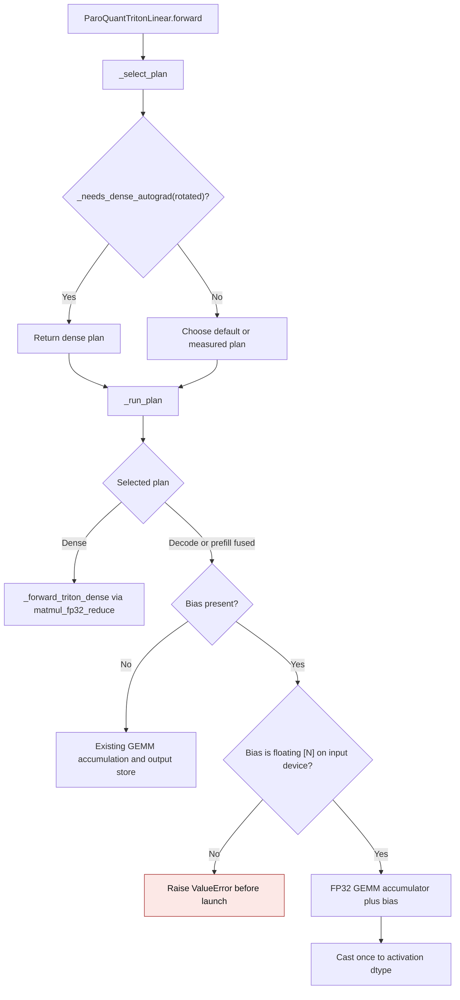

# ParoQuant

## Activation Checkpointing

`ParoConfig.opt_gradient_checkpointing` controls activation checkpointing during ParoQuant's train-style optimization stages.

- `opt_scope="layer"` defaults to `opt_gradient_checkpointing=True`
- `opt_scope="module"` defaults to `opt_gradient_checkpointing=False`
- `opt_scope="compute_block"` defaults to `opt_gradient_checkpointing=False`

Current internal benchmarks have only shown a clear resource-usage benefit for `layer` scope. `module` and `compute_block` support the toggle, but they are not enabled by default because we have not yet measured a consistent memory win there.

## Triton bias epilogue

ParoQuant Triton decode and prefill kernels accumulate quantized products in
FP32 when a bias is present, add the bias in that accumulator, and cast once to
the activation dtype. This preserves a finite FP16 result when the unbiased
intermediate exceeds the FP16 range. The dense plan uses
`matmul_fp32_reduce` for the same NVIDIA CUDA contract. A differentiable
rotated input or trainable bias uses the dense plan so autograd can return
its gradient. An unbiased fused call
keeps its existing accumulation setting, while a biased call uses FP32
accumulation even when `GPTQMODEL_FP32_ACCUM=0`. On NVIDIA CUDA, the dense plan
keeps the stored bias precision until the FP32 epilogue instead of casting it
to the activation dtype first.

| Path | Previous mechanism | Current mechanism |
| --- | --- | --- |
| Fused decode and prefill | `gemm.py:308` cast the GEMM result to FP16/BF16; `paroquant_triton.py:143-152` added bias afterward | The Triton kernel adds bias to its FP32 accumulator before its output store |
| Dense fallback | `paroquant_triton.py:136-138` rounded the matmul before bias and cast the stored bias to the activation dtype | `matmul_fp32_reduce` adds the stored bias in FP32 before NVIDIA CUDA output rounding |
| Differentiable input or bias | Fused output had no input gradient; separate post-kernel addition provided only a bias gradient | `_select_plan` chooses the differentiable dense wide path; `_run_plan` also guards direct calls |

On an NVIDIA GB10 (SM 12.1), a packed all-ones weight with 128 FP16 inputs of
`516` and a bias of `-1024` returned `inf` from both prior fused paths; an
independent FP32 Torch oracle and the corrected paths return `65024`. With
BF16 inputs of 127 ones plus `1.25`, and a bias of `-0.5`, the prior paths
returned `127.5`; the oracle and corrected paths return `128`. Tests cover
both dtypes, decode and prefill, the dense fallback, the unchanged unbiased
call, a noncontiguous bias, exact output against an independent packed-code
Torch oracle, malformed-bias rejection, mixed bias and activation dtypes, and
exact input and bias gradients. The CUDA wide reduction does not change
ROCm dense-path arithmetic; the fused ROCm bias path was not measured here.

For resident FP16 inputs with K=N=1024, five warmups and the median of five
runs of twenty calls with CUDA synchronization gave these per-forward results.
The prior behavior was reproduced by a bias-free kernel call followed by a
separate addition. Peak allocator delta includes the output allocations.

| Rows | Prior post-kernel bias | Fused bias |
| --- | --- | --- |
| 1 | 0.063 ms; 4 KiB peak | 0.055 ms; 2 KiB peak |
| 16 | 0.064 ms; 64 KiB peak | 0.056 ms; 32 KiB peak |

The Triton bias epilogue was introduced by [PR #3657](https://github.com/ModelCloud/GPTQModel/pull/3657).
