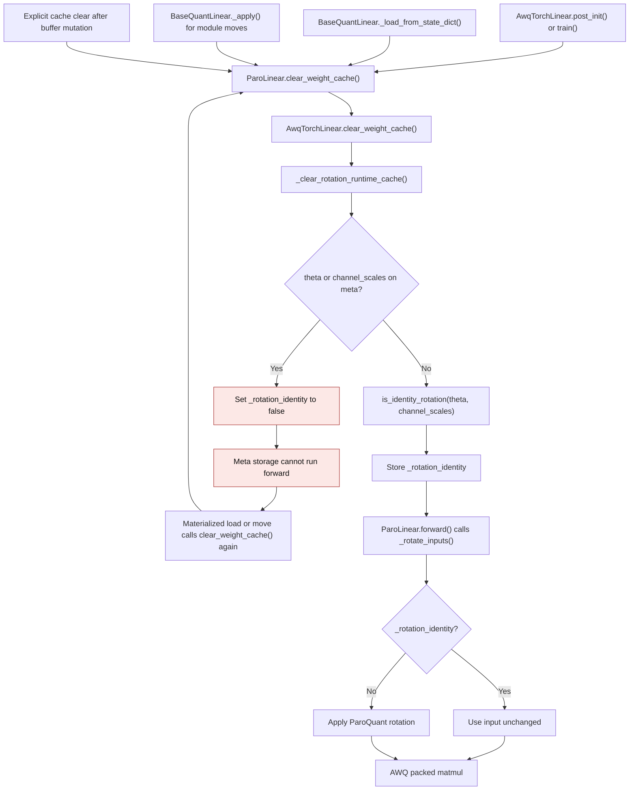
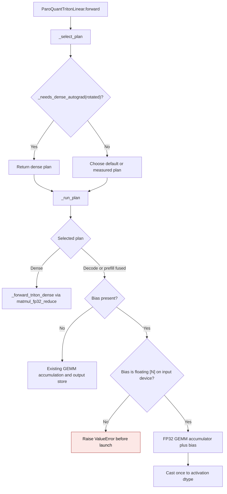
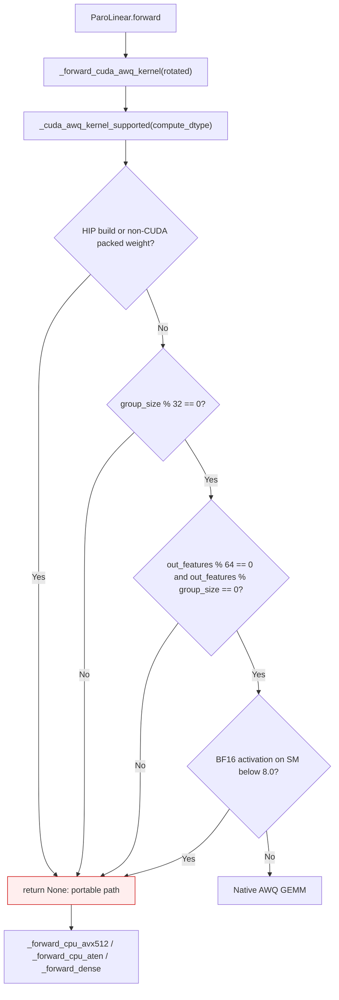
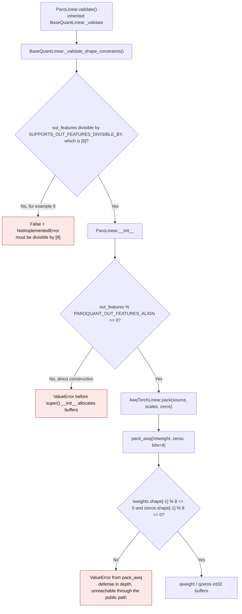

# ParoQuant

## Rotation identity lifecycle

`ParoLinear` can skip activation rotation when both rotation buffers
describe the identity transform. The decision is derived from `theta` and
`channel_scales` when `clear_weight_cache()` invalidates runtime state. The
same method runs after `post_init()`, a state-dict load, and a module move.
Call it after manually changing rotation buffers, including tensors
created under `torch.inference_mode()` whose version cannot be tracked.

| Entry point | Previous mechanism | Current mechanism |
| --- | --- | --- |
| `post_init()` | `paroquant.py:162-166` recalculated `_rotation_identity` after the AWQ cache clear | Inherited AWQ `post_init()` calls `ParoLinear.clear_weight_cache()`, which recalculates it |
| Explicit cache clear | `paroquant.py:168-171` dropped runtime tensors but left the old identity decision | `clear_weight_cache()` drops those tensors and recalculates from current rotation buffers |
| State-dict load or module move | `qlinear/__init__.py:319-337` called the same clear hook, so the old decision survived changed buffers | The clear hook refreshes the decision; meta storage conservatively disables the shortcut until materialized |

The decision is a boolean, not a dense weight cache. The packed AWQ weights
remain the only persistent weight representation. The CPU dense fallback still
dequantizes a temporary weight for its current forward.

Introduced in [PR #3744](https://github.com/ModelCloud/GPTQModel/pull/3744).

## Activation Checkpointing

`ParoConfig.opt_gradient_checkpointing` controls activation checkpointing during ParoQuant's train-style optimization stages.

- `opt_scope="layer"` defaults to `opt_gradient_checkpointing=True`
- `opt_scope="module"` defaults to `opt_gradient_checkpointing=False`
- `opt_scope="compute_block"` defaults to `opt_gradient_checkpointing=False`

Current internal benchmarks have only shown a clear resource-usage benefit for `layer` scope. `module` and `compute_block` support the toggle, but they are not enabled by default because we have not yet measured a consistent memory win there.

## Triton bias epilogue

ParoQuant Triton decode and prefill kernels accumulate quantized products in
FP32 when a bias is present, add the bias in that accumulator, and cast once to
the activation dtype. This preserves a finite FP16 result when the unbiased
intermediate exceeds the FP16 range. The dense plan uses
`matmul_fp32_reduce` for the same NVIDIA CUDA contract. A differentiable
rotated input or trainable bias uses the dense plan so autograd can return
its gradient. An unbiased fused call
keeps its existing accumulation setting, while a biased call uses FP32
accumulation even when `GPTQMODEL_FP32_ACCUM=0`. On NVIDIA CUDA, the dense plan
keeps the stored bias precision until the FP32 epilogue instead of casting it
to the activation dtype first.

| Path | Previous mechanism | Current mechanism |
| --- | --- | --- |
| Fused decode and prefill | `gemm.py:308` cast the GEMM result to FP16/BF16; `paroquant_triton.py:143-152` added bias afterward | The Triton kernel adds bias to its FP32 accumulator before its output store |
| Dense fallback | `paroquant_triton.py:136-138` rounded the matmul before bias and cast the stored bias to the activation dtype | `matmul_fp32_reduce` adds the stored bias in FP32 before NVIDIA CUDA output rounding |
| Differentiable input or bias | Fused output had no input gradient; separate post-kernel addition provided only a bias gradient | `_select_plan` chooses the differentiable dense wide path; `_run_plan` also guards direct calls |

On an NVIDIA GB10 (SM 12.1), a packed all-ones weight with 128 FP16 inputs of
`516` and a bias of `-1024` returned `inf` from both prior fused paths; an
independent FP32 Torch oracle and the corrected paths return `65024`. With
BF16 inputs of 127 ones plus `1.25`, and a bias of `-0.5`, the prior paths
returned `127.5`; the oracle and corrected paths return `128`. Tests cover
both dtypes, decode and prefill, the dense fallback, the unchanged unbiased
call, a noncontiguous bias, exact output against an independent packed-code
Torch oracle, malformed-bias rejection, mixed bias and activation dtypes, and
exact input and bias gradients. The CUDA wide reduction does not change
ROCm dense-path arithmetic; the fused ROCm bias path was not measured here.

For resident FP16 inputs with K=N=1024, five warmups and the median of five
runs of twenty calls with CUDA synchronization gave these per-forward results.
The prior behavior was reproduced by a bias-free kernel call followed by a
separate addition. Peak allocator delta includes the output allocations.

| Rows | Prior post-kernel bias | Fused bias |
| --- | --- | --- |
| 1 | 0.063 ms; 4 KiB peak | 0.055 ms; 2 KiB peak |
| 16 | 0.064 ms; 64 KiB peak | 0.056 ms; 32 KiB peak |

The Triton bias epilogue was introduced by [PR #3657](https://github.com/ModelCloud/GPTQModel/pull/3657).

## Native dispatch gate

`ParoLinear` advertises `group_size=16` because its CPU, ATen and dense paths
support it. The native AWQ CUDA GEMM does not:
`validate_awq_gemm_args` in
`gptqmodel_ext/awq/quantization/gemm_cuda_gen.cu` requires uint4b codes, a group
size divisible by 32, an output width divisible by the 64-column CTA tile, and
an output width divisible by that group size. Dispatch therefore asks the
kernel's own shape contract before calling it, instead of letting the kernel
raise from inside a forward.

The group size is derived from the packed tensors the kernel actually reads
(`in_features // scales.size(0)`), not from the config value: `group_size=-1`
packs one scale row per input channel, which the kernel turns into
`in_features / scaling_factors.size(0)`.

### Previous behavior

| Mechanism | Previous behavior | New behavior |
| --- | --- | --- |
| CUDA dispatch | Called the native GEMM for every CUDA tensor | Gated on the native validator's shape and device contract |
| `group_size=16` (advertised by `SUPPORTS_GROUP_SIZE`) | `RuntimeError: Group size should be a multiple of 32` | Dense fallback |
| Narrow output width, e.g. 8 | `RuntimeError: OC is not multiple of cta_N = 64` | Dense fallback |
| ROCm | `RuntimeError: The native AWQ JIT extension is CUDA-only and cannot be built by hipcc` | Portable path |
| FP16/BF16 activation beside the reconstructed FP32 grid | `RuntimeError: input dtypes must be the same` | Operands promoted to FP32, one cast at the end |

The gate is a capability query, not a configuration switch: there is no
environment override and no new public option.

### Dense fallback dtype contract

`linear_wide_bias` uses `torch.mm(..., out_dtype=torch.float32)` only when both
operands already share a low-precision dtype, which keeps them narrow and the
reduction wide. A mismatched pair (FP16 activation, FP32 reconstructed weight)
is promoted to at least FP32 before the matmul, so the fallback never narrows a
weight or an activation below FP32; the previous `.float()` arithmetic is
preserved bit for bit for same-dtype operands.

### Validation

Measured with torch 2.16.0.dev20261102+cu130 on an RTX 4090 (SM 8.9) and
torch 2.16.0.dev20261025+rocm10.1 on an R9700 (gfx1201). The oracle is the
independent FP32 packed-grid dequantization in
`tests/kernels/test_paroquant.py::_fp32_awq_oracle`.

| Configuration | Native gate | Result |
| --- | --- | --- |
| `in=16, out=8, group_size=16` | rejected (group size 16) | dense fallback, FP16 `65024` matches the oracle exactly |
| `in=16, out=8, group_size=-1` | rejected (output width 8) | dense fallback |
| `in=128, out=64, group_size=16` | rejected (group size 16) | dense fallback |
| `in=32, out=64, group_size=32` | admitted | native kernel, unchanged |
| `in=128, out=128, group_size=-1` | admitted (derived group size 128) | native kernel, unchanged |
| `in=256, out=128, group_size=128` | admitted | native kernel, unchanged |
| ROCm, `in=32, out=64, group_size=32` | rejected (HIP build) | dense fallback, matches the oracle |

Repeated fallback forwards keep only the packed `int32` buffers; the test
asserts that no `(in_features, out_features)` tensor is retained by the module.

## Output width alignment

An output width is packable only in multiples of eight. `pack_awq` writes eight
INT4 codes per `int32`, and ParoQuant reuses that packed layout for every
inference path (CPU ATen, the dense fallback, the AWQ CUDA GEMM and Triton), so
the alignment belongs to the format rather than to one kernel. Both the
selection-time check and the constructor read the same module constant
`PAROQUANT_OUT_FEATURES_ALIGN`:

`SUPPORTS_OUT_FEATURES_DIVISIBLE_BY` and the constructor guard both read the
single module constant `PAROQUANT_OUT_FEATURES_ALIGN`, so the declaration the
backend selector consumes, the constructor, and `pack_awq` cannot drift apart.
`ParoMlxQuantLinear` already declared `[8]` for the same layout; this change
makes the CUDA/CPU class agree with it.

### Previous behavior

| Mechanism | Previous behavior | New behavior |
| --- | --- | --- |
| Declaration consumed by selection | `SUPPORTS_OUT_FEATURES_DIVISIBLE_BY = [1]` at `gptqmodel/nn_modules/qlinear/paroquant.py:104` (pre-fix) | `[PAROQUANT_OUT_FEATURES_ALIGN]` = `[8]` at `paroquant.py:117` |
| Selection-time validation | `BaseQuantLinear._validate_shape_constraints` at `gptqmodel/nn_modules/qlinear/__init__.py:731-733` computed `out_features % 1`, so 9 passed | The same code computes `out_features % 8`, so 9 fails with `NotImplementedError` |
| Direct construction | `ParoLinear.__init__` (`paroquant.py:115-138` pre-fix) had no width check; 9 failed at `AwqTorchLinear.pack` (`torch_awq.py:141`) | `ParoLinear.__init__` raises `ValueError` at `paroquant.py:155-161`, before `super().__init__` |
| Auto-padding | `SUPPORTS_AUTO_PADDING = False` at `paroquant.py:102` (pre-fix), so selection never padded | Unchanged `False` at `paroquant.py:110`; no unpad exists, so the width is constrained |
| `pack_awq` on an unaligned width | `ValueError: INT4 AWQ packing requires ... divisible by 8` at `packing_utils.py:42-43` | Unchanged; now defense in depth, unreachable through the public path |

This is fail-closed rather than padded: `SUPPORTS_AUTO_PADDING` is `False` and
no unpad step exists in any ParoQuant forward, so padding the output width would
require changing packing and all four inference paths together. Declaring the
real alignment keeps every accepted width round-trippable.

### Validation

| Test | Invariant |
| --- | --- |
| `test_paroquant_output_width_declaration_matches_the_packer` | Declaration is `[8]`; `validate` rejects 9 and accepts 8, 16, 64 |
| `test_paroquant_constructor_rejects_an_unpackable_output_width` | Direct construction of width 9 raises before packing; width 8 still constructs |
| `test_paroquant_pack_and_forward_round_trips_at_the_packer_alignment` | Width 8 packs, forwards, and matches `_fp32_awq_oracle` exactly |
