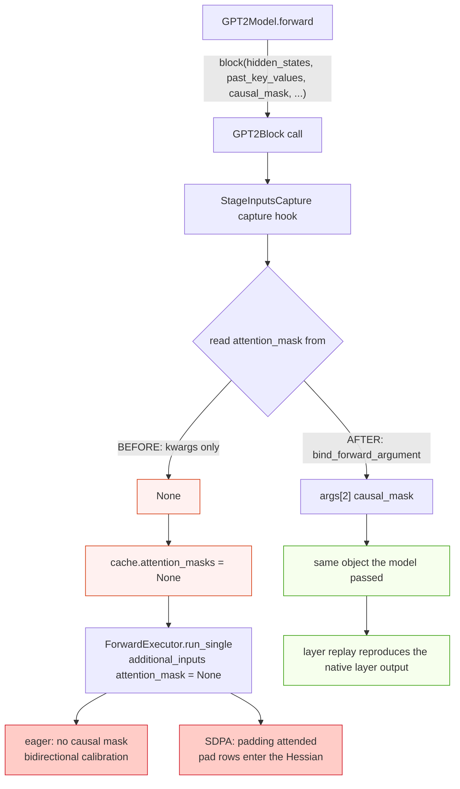

# Positional replay mask capture

`StageInputsCapture` records what the model's own forward handed to the first
decoder block and replays it through every later layer. Some `transformers`
families pass part of that state **positionally**, so a capture hook that reads
`kwargs` alone records `attention_mask=None`. The replay then runs every layer
without a causal restriction under eager attention, and attends to padding under
SDPA. GPT-2 is the family in this report; the capture now binds each block's own
signature instead of assuming a keyword slot.

Introduced by the fix for issue #4660.

## The call that the hook sees

`transformers` 5.22 `GPT2Model.forward` invokes every block as:

```python
hidden_states = block(
    hidden_states,
    past_key_values if not (self.gradient_checkpointing and self.training) else None,
    causal_mask,            # args[2] -> attention_mask
    encoder_hidden_states,  # args[3]
    encoder_attention_mask=encoder_attention_mask,
    use_cache=use_cache,
    position_ids=position_ids,
    **kwargs,
)
```

`GPT2Block.forward` declares `attention_mask` third, so the mask only exists as
`args[2]`. Capturing `kwargs["attention_mask"]` yields `None`, and
`ForwardExecutor.run_single` then forwards `attention_mask=None` to every layer.



## Binding instead of reading kwargs

`gptqmodel/utils/inspect.py` gains two helpers:

| Helper | Contract |
| --- | --- |
| `_get_signature(callable)` | signature of a bound method, cached on `__func__` (never pins the module) and with the leading `self` removed |
| `bind_positional_arguments(callable, args, kwargs)` | `dict` of parameter name to argument, or `None` when the signature cannot be inspected or the call does not bind |
| `bound_forward_argument(module, args, kwargs, name)` | value a block received for `name`, positional or keyword, including a parameter captured through `**kwargs` |

`bound_forward_argument` is called by the shared capture stage
(`gptqmodel/looper/stage_inputs_capture.py`) and by the looped-decoder capture
mixin (`gptqmodel/models/looped_capture.py`), so both paths agree.

## Contracts

| Situation | Behaviour |
| --- | --- |
| block declares `attention_mask` positional-or-keyword (GPT-2) | the positional value is captured |
| block declares `attention_mask` keyword-only (Llama, Qwen, OPT, Bloom) | the keyword value is captured, unchanged |
| block declares `**kwargs` and receives `position_ids` through it | the nested value is read |
| signature cannot be inspected | falls back to `kwargs.get(name)` |
| arguments do not satisfy the signature | falls back to `kwargs.get(name)`, never raises |
| block is called with no positional arguments | binding is skipped; keyword values are used |
| the captured value is not a tensor | the slot stays `None`, exactly as before |

Signatures are cached through the underlying function so a bound decoder block
does not keep its module (and its device tensors) alive, matching
`get_supported_kwargs`.

## Measured effect

GPT-2 (`openai-community/gpt2`), GPTQ 4-bit g128, 128 C4 calibration rows,
wikitext-2 perplexity over 80 x 512-token windows, reloaded with the default
SDPA implementation.

| attention | batch | main PPL delta | fixed PPL delta |
| --- | --- | --- | --- |
| `eager` | 1 | +5.004 | **+3.811** |
| `eager` | 8 (padded) | +4.013 | +4.013 |
| `sdpa` | 8 (padded) | +3.391 | +3.959 |

`eager`/`bs=1` is the case the issue describes: without the mask, layers 1..N
calibrate on bidirectional activations. The `bs=8` PPL rows are within the noise
of this small sample, so the checkpoints carry the evidence: `eager`/`bs=8`
differs from `main` in 96 of 292 tensors, and `eager`/`bs=1` in 94 of 292, while
`sdpa`/`bs=1` is bitwise identical because `create_causal_mask` returns `None`
for an un-padded batch and the capture cannot recover a tensor that does not
exist. Replay parity is exact in every materialized case: after the fix a
replayed GPT-2 block receives `(B, 1, S, S)` and reproduces the native layer
output bit-exactly under both `eager` and `sdpa`; on `main` it receives `None`.

## Tests

`tests/test_positional_mask_capture_4660.py` pins the invariant at the consumer:

| Test | Invariant |
| --- | --- |
| `test_capture_records_positional_mask[eager\|sdpa]` | `cache.attention_masks[0]` equals the mask the model passed to block 0 |
| `test_replayed_layers_reproduce_native_layer_output[eager\|sdpa]` | replaying every layer from the cache reproduces the native layer output exactly |
| `test_keep_mask_excludes_padding_for_a_padded_gpt2_batch` | normalized keep mask drops the pad rows |
| `test_keyword_mask_family_keeps_its_captured_mask` | OPT (keyword mask) is unchanged |

## Not in scope

- Blocks that build their mask inside the block and receive no mask argument.
- Per-layer-type mask rebuilds; those are covered in
  [layer-type replay masks](layer-type-replay-masks.md).
