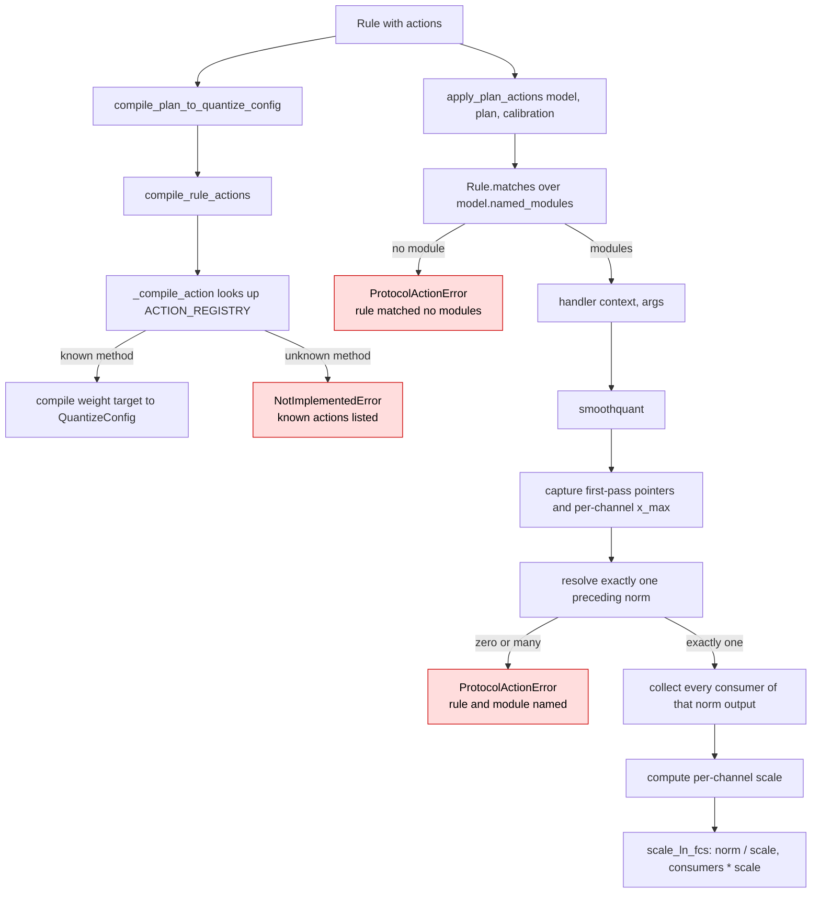
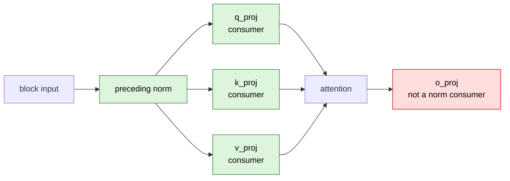

# Protocol actions

The quantization protocol lets a `Rule` carry rule-scoped `actions` such as
`smoothquant(alpha=0.5)`. This page documents the shipped action mechanism: how
an action method is resolved, where it executes relative to config compilation,
and which failure paths are fail-closed.

Introduced by PR #4106 for issue #3781. The user-facing protocol surface is described in
[Quantization protocol](quantization_protocol.md).

## Why actions are a separate stage

`compile_plan_to_quantize_config` turns one rule's `weight` target into a
`QuantizeConfig`. It must not read activations, install hooks, or mutate a model:
the same plan is compiled before a model is loaded and is compiled again when a
checkpoint is inspected.

Rule actions are the opposite kind of work. `smoothquant` needs calibration
activations and the live module tree. The shipped split is therefore:

1. compilation resolves every `OperationSpec.method` against `ACTION_REGISTRY`
   and fails on an unknown method, but never touches a model;
2. `apply_plan_actions` resolves each rule's matches on the live model and runs
   the registered handlers in stage/rule order.

## Shipped surface

| `OperationSpec.method` | Status | Behavior |
| --- | --- | --- |
| `smoothquant` | implemented | Folds the inverse per-channel scale into the preceding norm and scales every consumer of that norm output. |
| `awq_balance` | not implemented | Raises `NotImplementedError` with the known-method list. |
| `calibrate_router` | not implemented | Raises `NotImplementedError` with the known-method list. |
| anything else | rejected | Raises `NotImplementedError` with the known-method list. |

The registry is `ACTION_REGISTRY` (`gptqmodel/quantization/protocol.py:120`) and
`register_action` is the extension point. `smoothquant` is registered at
`gptqmodel/quantization/protocol.py:538`.

## Flow



## How `smoothquant` resolves the fold

The resolution is data-flow based, not name based. During the first calibration
pass, `_capture_smoothquant_statistics`
(`gptqmodel/quantization/protocol.py:356`) records:

- the `data_ptr` of each weighted module's input;
- the `data_ptr` of each gain norm's output;
- a running per-channel `max(abs(x))` for each weighted module.

For every matched module, `_resolve_smoothquant_groups`
(`gptqmodel/quantization/protocol.py:430`) requires its input pointer to match
exactly one norm output pointer. That norm is the fold source. It then collects
every other weighted module whose input pointer matches the same norm output:
those are the sibling consumers that must receive the same scale or the block
output would change.



`q_proj`, `k_proj`, and `v_proj` all read the same norm output, so the fold uses
one scale for the norm output and multiplies all three weights by it. `o_proj`
reads the attention output, so a rule that matches it raises instead of folding
into an unrelated norm.

The per-channel scale is the SmoothQuant form
`max(abs(x)) ** alpha / max(abs(w)) ** (1 - alpha)`
(`_smoothquant_scales`, `gptqmodel/quantization/protocol.py:501`), clamped away
from zero. The fold itself calls the existing
`gptqmodel.quantization.awq.quantize.scale.scale_ln_fcs`, which also handles
offset-gain norms such as Gemma's `1 + weight`.

## Failure contract

| Situation | Result |
| --- | --- |
| Unknown action method at compile time | `NotImplementedError` naming the method and listing `smoothquant`. |
| Unknown action method at execution time | Same error, raised before calibration starts. |
| Rule matches no module | `ProtocolActionError` naming the rule and stage. |
| Matched module has no 2-D weight | `ProtocolActionError` naming the rule and module. |
| Matched module's input is not exactly one norm output | `ProtocolActionError` naming the rule, module, and whether zero or several norms matched. |
| A consumer of the folded norm has no 2-D weight | `ProtocolActionError`; the fold is refused rather than partially applied. |
| A consumer has several distinct inputs in the first pass | `ProtocolActionError`; the fold would not be well-defined. |
| `smoothquant` called without `calibration` | `ProtocolActionError`. |
| `alpha` outside `[0, 1]` or an unknown argument | `ProtocolActionError`. |

Every one of these paths raises. None of them silently skips a matched module.

## Scope and limits

- v1 folds only the canonical norm to linear pair. Residual parents, MoE
  parents, and activation-input projections such as `o_proj` and `down_proj`
  are not folded; a rule that matches them fails closed.
- Every consumer of the folded norm output must be a module with a 2-D weight.
  A functional operation, an intervening copy, or a weightless transform
  between the norm and a consumer makes pointer resolution fail closed.
- `awq_balance` and `calibrate_router` are deliberately out of scope. They keep
  raising `NotImplementedError` with the known-method list.
- `compile_plan_to_quantize_config` still supports exactly one stage and one
  rule, and its weight target still requires a global match. The separate action
  stage supports multi-stage plans; config compilation keeps its existing
  limits.

## Example

```python
from gptqmodel.quantization.protocol import (
    ExecutionPlan,
    OperationSpec,
    Rule,
    Stage,
    apply_plan_actions,
)

plan = ExecutionPlan(
    version=2,
    stages=(
        Stage(
            name="balance",
            rules=(
                Rule(
                    match=r".*\.q_proj$",
                    actions=(OperationSpec(method="smoothquant", args={"alpha": 0.5}),),
                ),
            ),
        ),
    ),
)

apply_plan_actions(model, plan, calibration=lambda: model(input_ids))
```

`calibration` must run one or more forward passes through the model root. It is
called under the hooks that capture the first pass's data flow and the
per-channel activation maxima; no activation tensor is retained afterwards.
