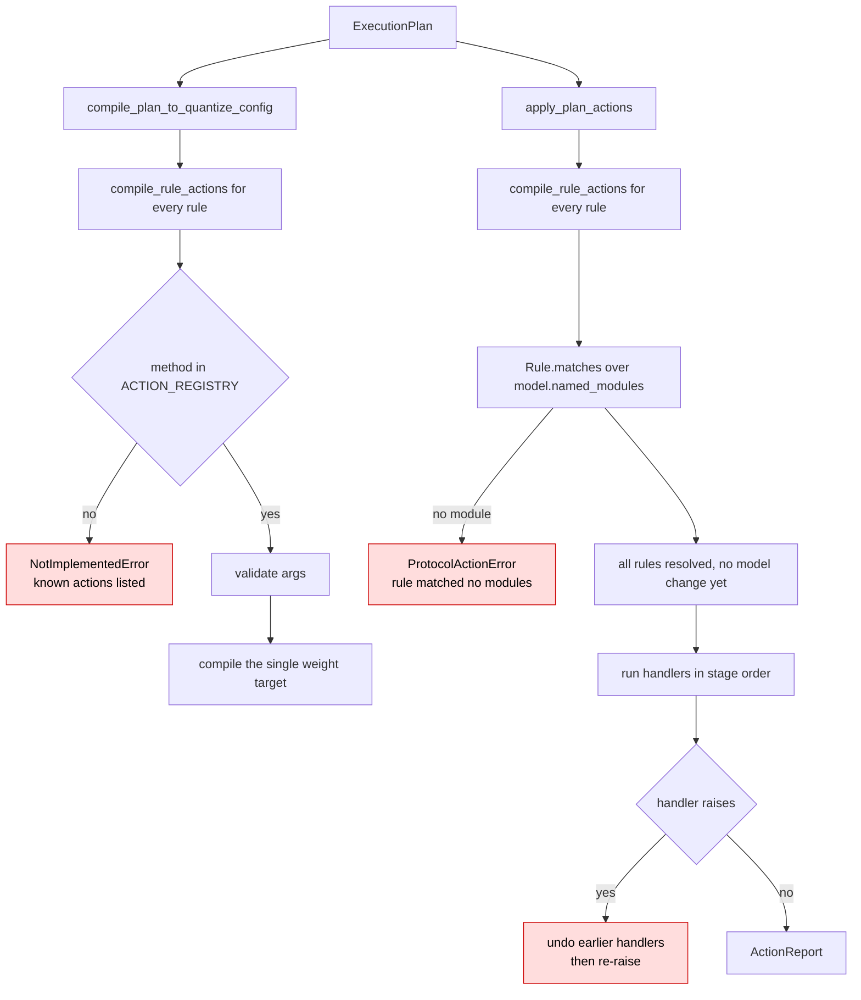
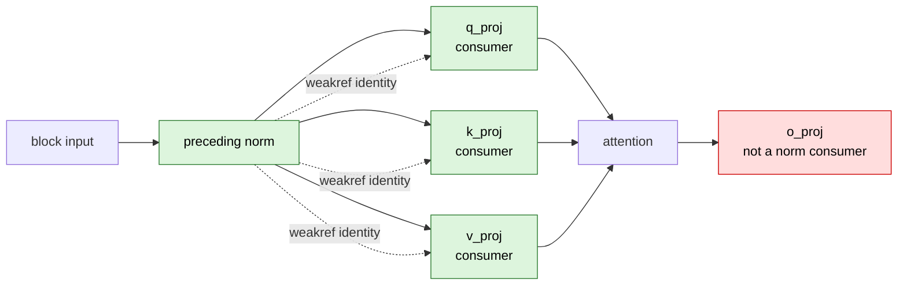

# Protocol actions

The quantization protocol lets a `Rule` carry rule-scoped `actions` such as
`smoothquant(alpha=0.5)`. This page documents the shipped action mechanism: how
an action method is resolved, where it executes relative to config compilation,
how a fold is resolved and verified, and which failure paths are fail-closed.

Introduced by PR #4106 for issue #3781 and hardened by PR #4117. The
user-facing protocol surface is described in
[Quantization protocol](quantization_protocol.md).

## Why actions are a separate stage

`compile_plan_to_quantize_config` turns the plan's `weight` target into a
`QuantizeConfig`. It must not read activations, install hooks, or mutate a model:
the same plan is compiled before a model is loaded and again when a checkpoint is
inspected.

Rule actions are the opposite kind of work. `smoothquant` needs calibration
activations and the live module tree. The shipped split is therefore:

1. compilation resolves every `OperationSpec.method` against `ACTION_REGISTRY`
   and validates its arguments, but never touches a model;
2. `apply_plan_actions` resolves every rule's matches on the live model, then
   runs the registered handlers in stage/rule order.

`compile_and_apply_plan(model, plan, calibration=...)` performs both steps for
one plan and returns `(QuantizeConfig, ActionReport)`.

## Shipped surface

| `OperationSpec.method` | Status | Behavior |
| --- | --- | --- |
| `smoothquant` | implemented | Folds the inverse per-channel scale into the preceding norm and scales every consumer of that norm output. |
| `awq_balance` | not implemented | Raises `NotImplementedError` with the known-method list. |
| `calibrate_router` | not implemented | Raises `NotImplementedError` with the known-method list. |
| anything else | rejected | Raises `NotImplementedError` with the known-method list. |

`smoothquant(alpha=0.5)` is the authoring helper. The registry is
`ACTION_REGISTRY` and `register_action` is the extension point; both live in
`gptqmodel/quantization/protocol.py`.

## Plan flow

Every rule is resolved before any handler runs, and a handler that fails rolls
back every earlier rule.



## `smoothquant` resolution

The fold source is resolved from the first calibration pass. A norm output is
matched to a consumer by **tensor identity** through a `weakref`, never by a raw
`data_ptr()`: the allocator reuses freed addresses, so a pointer recorded for one
layer's norm output also matched inputs in unrelated layers. A weak reference
dereferences to `None` once the tensor is gone, so a recycled address can never
match, and no activation is pinned.



`q_proj`, `k_proj`, and `v_proj` all read the same norm output, so one scale is
used for the norm output and all three weights are multiplied by it. `o_proj`
reads the attention output; a rule that matches it alone resolves nothing and
raises.

The per-channel scale is `max(abs(x)) ** alpha / max(abs(w)) ** (1 - alpha)`,
clamped away from zero. The fold calls the existing
`gptqmodel.quantization.awq.quantize.scale.scale_ln_fcs`, which also handles
offset-gain norms such as Gemma's `1 + weight`.

## Verified-or-rolled-back contract

A resolved fold is not applied blindly. Before mutating, the handler snapshots
every parameter it will touch. It then:

1. **Refuses structurally** when a consumer's weight is shared with a module that
   does not consume the same norm output - a tied `lm_head` / `embed_tokens`.
2. **Refuses structurally** when a module that consumes the norm output has no
   2-D weight - a fused expert block, a router, a norm-to-norm chain.
3. **Verifies numerically** by replaying the captured calibration call and
   comparing the output with the pre-fold output. The bound is
   `1e-3 + 8 * eps(dtype) * max|logits|`.
4. **Rolls back and raises** on any mismatch, naming the rule, the max
   difference, and the argmax agreement.

Step 3 is what catches a consumer no hook can see: a functional residual, a
fused expert parameter, or a tensor that leaves the module graph. Without it the
model silently returns different logits at argmax agreement 0.000.

Measured fold drift, Qwen2.5-0.5B, `q_proj|k_proj|v_proj`, `alpha=0.5`, on the
real checkpoint: fp32 `4.4e-5`, fp16 `8.6e-2`, bf16 `6.9e-1` absolute, which is
`2e-6`, `3.9e-3` and `3.2e-2` of `max|logits|` - all inside `8 * eps`. The
smallest observed corruption (a missed MoE router) is `1.6e-1` of
`max|logits|`, outside it.

## Failure contract

| Situation | Result |
| --- | --- |
| Unknown action method | `NotImplementedError` naming the method and listing `smoothquant`. |
| Invalid or unknown action argument | `ProtocolActionError` at compile time, before any model exists. |
| Rule matches no module | `ProtocolActionError` naming the rule and stage. |
| Rule matches only containers | `ProtocolActionError` naming the first container. |
| Broad rule matches containers and foldable linears | Containers are skipped and recorded in `ActionReport.skipped`. |
| Matched module has no 2-D weight | Skipped when other matches fold; raises when nothing folds. |
| Matched module has no norm predecessor | Skipped when other matches fold; raises when nothing folds. |
| A consumer of the folded norm has no 2-D weight | `ProtocolActionError`; no partial fold. |
| A consumer's weight is shared with a non-consumer | `ProtocolActionError`; no partial fold. |
| Non-finite activation or weight maximum | `ProtocolActionError` before any parameter is divided. |
| Replayed output differs from the pre-fold output | All touched parameters restored, then `ProtocolActionError`. |
| A later rule fails | Every earlier rule's handler is undone, then the error is re-raised. |
| `smoothquant` called without `calibration` | `ProtocolActionError`. |
| `alpha` outside `[0, 1]`, or NaN | `ProtocolActionError`. |

Every one of these paths raises or rolls back. None of them silently skips a
matched module or leaves a partly folded model.

## Scope and limits

- v1 folds only the canonical norm to linear pair. Residual parents, MoE parents,
  and activation-input projections such as `o_proj` and `down_proj` are not
  folded; a rule that resolves only those fails closed.
- Identity resolution requires the consumer to receive the norm output tensor
  itself. A consumer that receives a view of it (for example a sequence slice
  before a tied output head) is not resolved; the rule fails closed.
- Every consumer of the folded norm output must be a module with a 2-D weight.
  A functional consumer is caught by the numeric check, not by resolution, so it
  raises instead of folding.
- The numeric bound scales with the storage dtype. In bf16 the fold itself moves
  the logits by about 3% of their magnitude, so the gate is proportionally wider;
  it is still an order of magnitude below a missed-consumer error.
- `awq_balance` and `calibrate_router` are deliberately out of scope. They keep
  raising `NotImplementedError` with the known-method list.
- Aliases and `stop` remain unsupported by config compilation.

## Example

```python
from gptqmodel.quantization.protocol import (
    ExecutionPlan,
    QuantizeSpec,
    Rule,
    Stage,
    TargetSpec,
    compile_and_apply_plan,
    smoothquant,
)

plan = ExecutionPlan(
    version=2,
    stages=(
        Stage(name="balance", rules=(Rule(match=r".*self_attn\.q_proj$", actions=(smoothquant(0.5),)),)),
        Stage(
            name="ptq",
            rules=(
                Rule(
                    match="*",
                    weight=TargetSpec(quantize=QuantizeSpec(method="gptq", args={"bits": 4})),
                ),
            ),
        ),
    ),
)

config, report = compile_and_apply_plan(model, plan, calibration=lambda: model(input_ids))
```

`calibration` must run one or more forward passes through the model root. It is
called under the hooks that capture the first pass's data flow and the
per-channel activation maxima; no activation tensor is retained afterwards.
