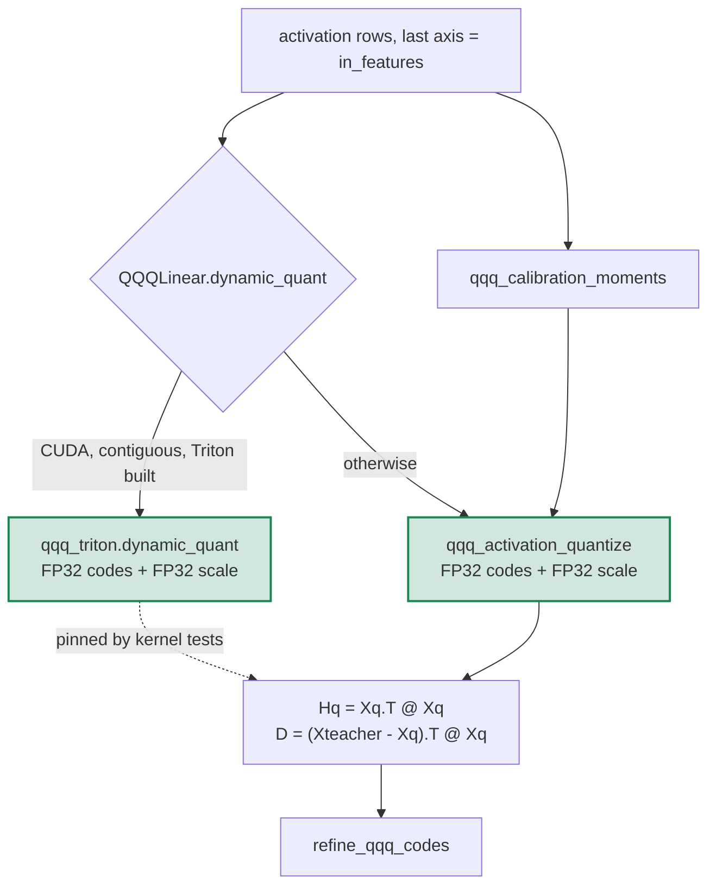

# QQQ activation INT8 grid contract

QQQ is a W4A8 method: packed INT4 weights multiply an INT8 activation and a
per-row FP32 scale. That activation grid is defined once, in
`gptqmodel/quantization/qqq_activation.py::qqq_activation_quantize`, and both
the portable inference kernel and the GSQ calibration statistics call it. This
page records the arithmetic contract, why the calibration used to disagree with
it, and how the two consumers stay pinned together.

## The deployed grid

For one activation row `x` with `a = max_j |x_j|`:

```text
scale = a / 127            (FP32)
code_j = clamp(round(x_j / scale), -128, 127)    (INT8)
dequantized_j = code_j * scale                   (FP32)
```

The maximum and the division happen in FP32, and the scale is FP32.
`127`, not `128`, is the divisor; `-128` is reachable only through rounding.
Two rows do not follow the plain quotient, and the rule that selects between
them is decided from `a`, never from the quotient:

- `a == 0` is the all-zero row: it receives `scale = 1` and decodes to exactly
  zero without dividing by zero.
- `a > 0` but `a / 127` rounds to zero is a scale-representation limit, not an
  all-zero row. The row is still finitely encodable because the scale may be a
  subnormal, so the scale is floored at `2**-149`, the least positive FP32
  subnormal. `a = 7 * 2**-149` therefore keeps codes `[7]` on scale `2**-149`
  and reconstructs its input bit for bit instead of collapsing to `[0]` on the
  unit scale. The floor cannot introduce saturation: it applies only when the
  quotient rounds to zero, which requires `a < 63.5 * 2**-149`, so every code
  on that path is bounded by `63`.

`QQQLinear.dynamic_quant` uses the frozen Torch path when the Triton quantizer is
unavailable, and the Triton (`qqq_triton.py`) and Metal (`mlx_qqq.py`) kernels
evaluate the same expression with FP32 operands. The Torch path is the
reference those kernels are compared against. The Triton kernel mirrors both
the zero-row decision and the floor.

### Not covered: the Metal quantizer

The Metal quantizer (`gptqmodel/nn_modules/qlinear/mlx_qqq.py`) already selects
its unit scale from `maxima[0] == 0.0f` rather than from the quotient, so it
does not turn a positive row into the unit scale. Its remaining behaviour at
that boundary is unverified: whether the backend preserves a subnormal row
maximum through `float(...)` and the threadgroup reduction decides between two
outcomes, and neither was measured here. A flushing backend reaches the
zero-row branch with an already-zero maximum, while a preserving backend
evaluates `maxima[0] / 127.0f` to `0` and would emit a zero scale, which the
failure contract below rejects. The same floor therefore belongs in that kernel
if a Metal device preserves the inputs, together with a device test; until then
the floor is limited to the Torch and Triton paths. Stored FP16 activations
cannot reach this boundary because their smallest subnormal (`2**-24`) widens
to a normal FP32 value.

## Before and after

The GSQ calibration built its own grid instead of reusing the kernel's:

| Step | Before (`gsq_qqq.py:85-95`) | After |
| --- | --- | --- |
| Operand | `inputs.half()` | `inputs.float()` |
| Row maximum | FP16 `amax` | FP32 `amax` |
| Scale | `(maximum / 127).float()` — division in FP16 | `maximum / 127` in FP32 |
| Zero row | `scale > 0` mask, codes forced through a unit divisor | helper's unit scale, codes exactly zero |
| Tiny row | raised `runtime token scale underflows` when FP16 divided to zero | same FP32 scale the kernel deploys |
| Code/scale source | private copy of the kernel's expression | shared helper |

The zero-row decision itself was also wrong for a finite FP32 subnormal row: it
tested the quotient rather than the maximum, so a positive `a` whose `a / 127`
underflowed to zero took the unit scale meant for an all-zero row and its codes
were erased.

| Input (single-element row) | Before (scale / code) | After (scale / code) |
| --- | --- | --- |
| `0` | `1` / `0` | `1` / `0` |
| `7 * 2**-149` | `1` / `0` | `2**-149` / `7` |
| `63 * 2**-149` | `1` / `0` | `2**-149` / `63` |
| `64 * 2**-149` | `2**-149` / `64` | `2**-149` / `64` |
| `127 * 2**-149` | `2**-149` / `127` | `2**-149` / `127` |
| `200 * 2**-149` | `2 * 2**-149` / `100` | `2 * 2**-149` / `100` |

The last three rows already had a nonzero quotient and are the control that
keeps the normal path unchanged.

`[2**-20, 2**-22]` is the sharpest case: the FP16 scale `2**-20 / 127` is a
subnormal that rounds to zero, so the old calibration raised while the deployed
kernel used the representable FP32 scale `7.5092466e-9` and codes `[127, 32]`.
For ordinary rows the FP16 division also rounded the scale away from the FP32
value, so every moment carried a small, silent error:

| Input (FP16) | Old Hessian relative error | Old outcome |
| --- | ---: | --- |
| `[1, 0.25]` | `1.220694e-4` | accepted, silently wrong |
| `[0.001, 0.00025]` | `2.381857e-3` | accepted, silently wrong |
| `[2**-20, 2**-22]` | n/a | raised, though the kernel deploys a finite grid |

Both columns are gone after the change: the same helper produces the codes, the
FP32 scale and the moments, and the FP64 oracle in
`tests/test_gsq_qqq_activation_contract.py` agrees to `1e-6` normalized error.

## Flow



The Triton and Metal kernels are separate implementations of the same grid, so
they are qualified by their own tests rather than by routing through the Torch
helper. `tests/test_gsq_qqq_activation_contract.py::test_triton_quantizer_matches_the_torch_grid`
compares their codes and scales for supported dtypes; `tests/test_nan_activation_quantizers_4220.py`
covers nonfinite rows, where the scale is poisoned instead of folded into a code.

## Failure contract

- A non-floating or empty operand is rejected by the helper.
- A nonfinite activation is rejected by the calibration entry point, not
  silently clamped.
- No activation int8 row may have a nonpositive or nonfinite scale.
- The calibration never substitutes a different grid when the kernel's own
  contract rejects an input; it fails instead of fitting statistics for an
  operand the runtime will not produce.

## Consumers and tests

| Consumer | Location | Guarantee |
| --- | --- | --- |
| Portable kernel | `gptqmodel/nn_modules/qlinear/qqq.py::QQQLinear.dynamic_quant` | uses the shared helper |
| Triton kernel | `gptqmodel/nn_modules/qlinear/qqq_triton.py::dynamic_quant` | matches codes/scale |
| GSQ moments | `gptqmodel/quantization/gsq_qqq.py::qqq_calibration_moments` | uses the shared helper |
| GSQ fitter | `gptqmodel/quantization/gsq_qqq.py::refine_qqq_codes` | consumes the moments unchanged |
