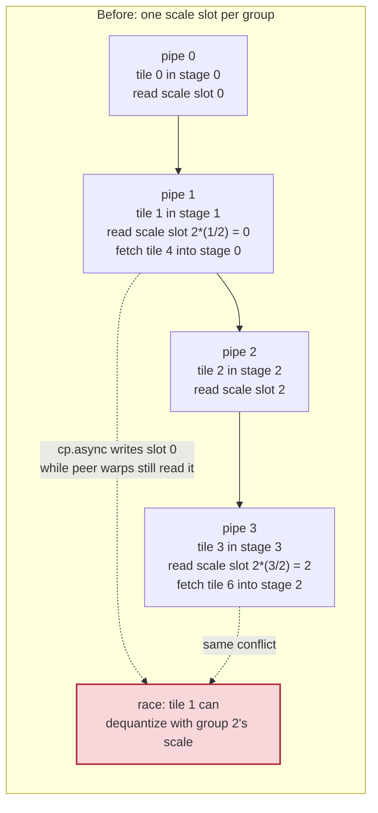
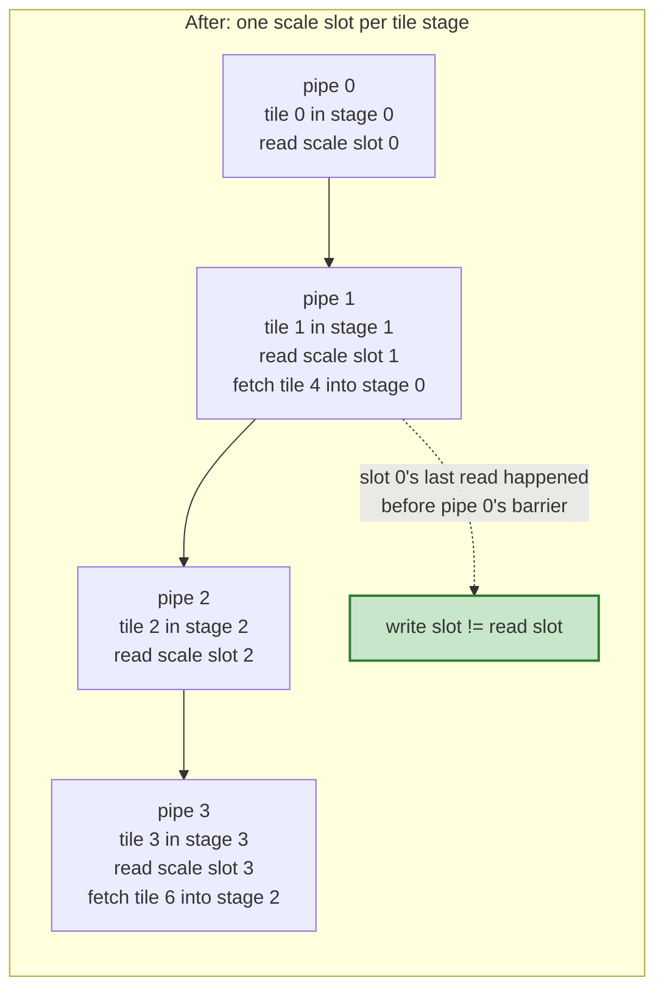

# QQQ per-group scale staging

`gptqmodel_ext/qqq/qqq_gemm.cu` keeps one shared-memory pipeline slot per
k-tile for the activations (`A`), the packed weights (`B`), and the weight
per-group scales (`s3`). A tile is fetched three tiles ahead of its first use,
and `fetch_to_registers()` copies a tile's slot into registers one pipe
iteration before `matmul()` consumes it.

For `group_blocks >= thread_k_blocks` a group can span several k-tiles. With
group size 128 and `thread_k = 64` (the default tile for `prob_m > 16`), two
consecutive tiles share one scale row. The scale slot therefore has to live as
long as the tile it belongs to, exactly like the `A`/`B` slot. The original
code staged the scale only once per group and remapped the read to the group's
first tile stage (`s3_sh_stage * ((group_blocks / thread_k_blocks) *
(pipe / (group_blocks / thread_k_blocks)))`). That makes the second tile read a
slot that the *next* group's fetch overwrites in the same pipe iteration, with
no barrier between the read and the asynchronous copy.

## Stage schedule

With four pipeline stages and two tiles per group, the old mapping put groups
0, 2, 4, ... in scale slot 0 and groups 1, 3, 5, ... in slot 2:

The fix stages the scale in the tile's own slot, so the write and the read use
different stages exactly as `A` and `B` do:

| Mechanism | Before | After |
| --- | --- | --- |
| Scale slot for a tile | group's first tile stage, `s3_sh_stage * ((group_blocks / thread_k_blocks) * (pipe / (group_blocks / thread_k_blocks)))` in `fetch_to_registers` | the tile's own stage, `s3_sh_stage * pipe` |
| When a scale row is copied | once per group, guarded by `pipe % (group_blocks / thread_k_blocks) == 0` | every tile; the row is shared by the group's tiles |
| `s3_gl_rd` advance | after the single per-group copy | after the last tile of the group, `pipe % s3_tiles_per_group == s3_tiles_per_group - 1` |
| Tile 1's scale source | stage 0, rewritten by tile 4's fetch in the same pipe iteration | stage 1, written three tiles earlier and awaited by `wait_for_stage()` |

The row pointer only advances on the last tile of a group, so both tiles copy
the same global row. Because a physical stage is `tile % stages` and `stages`
is a multiple of the tiles-per-group ratio, the parity test on `pipe` is the
group boundary; it is identical to the old write condition.

## Reduction scratch

`thread_block_reduce()` reuses `sh`, which aliases the `A` fetch stages, as its
reduction scratch. The last `ldsm4` of the main loop is not followed by a
barrier, so the scratch write could land while a peer warp was still loading
its last `A` fragment. A `__syncthreads()` at the top of
`thread_block_reduce()` waits for every warp to finish reading the `A` stages.
The reduction values are unchanged; only the ordering is fixed.

## Failure contract

The scale stage is not a heuristic: every tile reads the stage that its own
`A`/`B` tile occupies. If a future change makes the scale read and write the
same stage again, the kernel is not allowed to depend on asynchronous copy
timing; the read must be separated from the write by a pipeline barrier. The
regression tests below compare `QQQLinear` with `QQQTorchLinear` on ten
back-to-back calls for rows 17, 32, 64, and 128 at group size 128 and -1, and
pin the explicit `{64, 256}` thread tile.

## Validation

`tests/test_qqq_jit.py::test_qqq_large_batch_cuda_matches_torch_on_every_repeat`
and `tests/test_qqq_jit.py::test_qqq_gemm_64x256_tile_matches_torch_on_every_repeat`.
The kernel is bit-identical to the pre-fix kernel on hardware where the race
does not fire, and `compute-sanitizer --tool racecheck` reports no shared
memory hazards for the reduction path after the barrier. Introduced in
[#4662](https://github.com/ModelCloud/GPTQModel/issues/4662).
