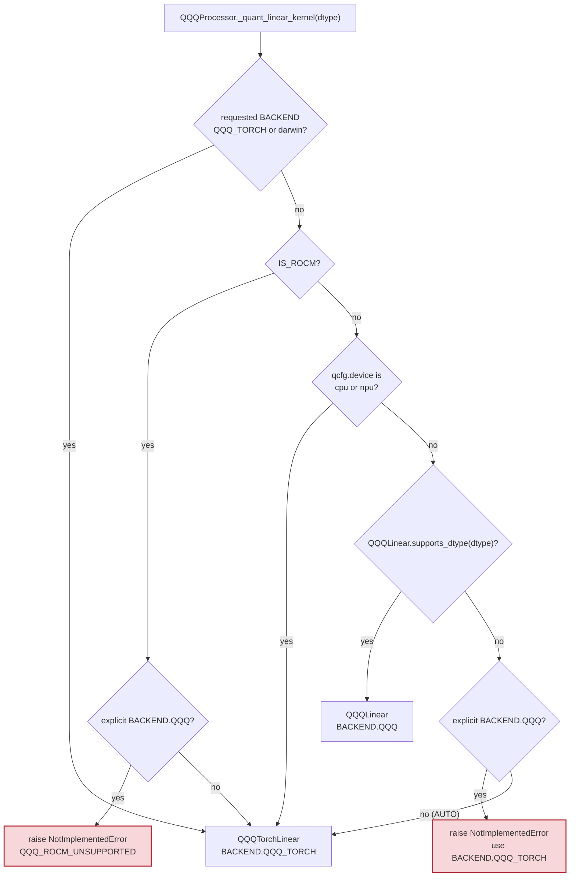

# QQQ in-memory kernel selection

QQQ has two inference kernels:

- `QQQLinear` — the Marlin-derived W4A8 CUDA kernel, declared
  `SUPPORTS_DTYPES = [torch.float16]`.
- `QQQTorchLinear` — the portable Torch kernel, declared
  `SUPPORTS_DTYPES = [torch.float16, torch.bfloat16]` and available on CPU,
  CUDA, ROCm, XPU, NPU and MPS.

The checkpoint reload path already selects a kernel from the model dtype:
`models/base.py` passes `dtype=self.model.dtype` into `select_quant_linear`,
whose `_validate_shared` rejects a kernel whose `SUPPORTS_DTYPES` does not
contain the dtype. The in-memory quantization path did not. On CUDA,
`QQQProcessor._quant_linear_kernel` always returned `QQQLinear`, so
`quantize(..., offload_to_disk=False)` produced a BF16 model whose first
forward raised:

```text
NotImplementedError: QQQLinear is an FP16 kernel; use BACKEND.QQQ_TORCH
for torch.bfloat16 activations.
```

The fix makes both paths read the same `SUPPORTS_DTYPES` declaration through
`BaseQuantLinear.supports_dtype`, and `QQQProcessor.submodule_finalize` passes
the packed module's dtype into the selector. This is issue #4074 item 2.

## Selection flow



`supports_dtype` is the shared declaration check:

```python
@classmethod
def supports_dtype(cls, dtype):
    if dtype is None:
        return True
    supported = cls.SUPPORTS_DTYPES
    return supported is None or dtype in supported
```

## Before and after

| Mechanism | Before | After |
| --- | --- | --- |
| In-memory CUDA kernel | always `QQQLinear`, `gptqmodel/looper/qqq_processor.py:85-108` | dtype-aware via `QQQLinear.supports_dtype`, `gptqmodel/looper/qqq_processor.py:85-124` |
| dtype contract | duplicated literal `[torch.float16]` knowledge | shared `BaseQuantLinear.supports_dtype`, `gptqmodel/nn_modules/qlinear/__init__.py` |
| Explicit `BACKEND.QQQ` + BF16 | built `QQQLinear`, failed in the first forward | `NotImplementedError` naming `BACKEND.QQQ_TORCH` |
| Reload path | `dtype=self.model.dtype` into `select_quant_linear` | unchanged |

## Validation

`tests/test_qqq_bf16_in_memory.py` builds a tiny BF16 Llama, quantizes with
`QQQConfig(offload_to_disk=False)` on CUDA, asserts that no FP16-only
`QQQLinear` exists, runs an in-memory forward, then saves, reloads, and runs
the reloaded forward. `tests/test_qqq_config.py` pins the selector directly for
FP16, BF16 and an explicit `BACKEND.QQQ` request.
