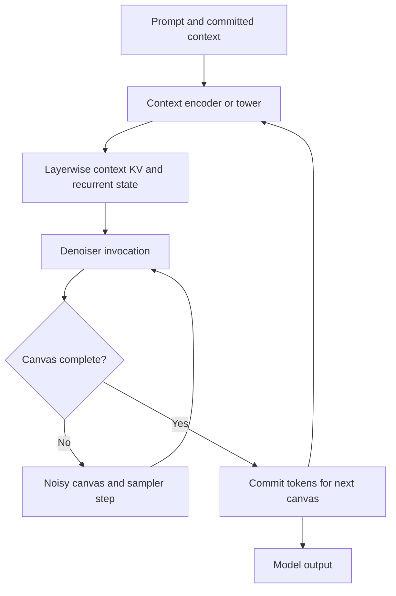

<!-- SPDX-FileCopyrightText: 2026 ModelCloud.ai
SPDX-License-Identifier: Apache-2.0 -->

# 2026 architecture audit for the quantization redesign

**Status:** design evidence introduced in revision 0.3 and retained in revision
0.9, with the broad source survey inspected through 2026-10-27.
See the [main proposal](component-quantization-design.md),
[method inventory](quantization-method-lifecycles.md),
[parallel execution proposal](quantization-parallel-execution.md), and
[public API proposal](quantization-plan-api.md). Dataset modality, route
preparation, streaming, and role binding are specified by the
[data contract](quantization-data-contract.md).
The [DeepSeek V4.1 Flash mock config](quantization-example-deepseek-v4.1-flash.md)
turns one pinned checkpoint into a concrete design target with expected selections
and acceptance cases; it does not establish runtime support.

The survey covers publicly documented 2026 model families and their distinct
execution patterns, including the October releases. It is not an exhaustive
census of every checkpoint, fine-tune, research prototype, or private model.
Release names, publication dates, checkpoint creation dates, and library support
dates are different evidence; a 2026 integration does not prove a 2026 model
release. Older architecture foundations are identified where relevant.

**Compatibility here means the proposed contracts can express a requirement.**
It does not establish a working adapter, supported quantizer/kernel combination,
or acceptable quantization quality. No model was quantized for this audit.
Each deployed checkpoint still needs a pinned configuration/code inventory,
replay equivalence checks, and numerical/task validation.

## 1. Findings and compatibility matrix

The component/state/lifecycle separation survives this survey. The current
proposal incorporates the required contracts for shared multimodal ownership,
invocation identity, depth history, iterative samplers, streaming events, and
physical partitioning. Parallel execution is a core requirement.

The status column assesses the design, not current GPTQModel support:

- **Fits:** existing ownership/state/program concepts express the pattern;
  model-specific adapters and validation are still required.
- **Extend:** this audit identified an extension incorporated into the current
  contract. The label records the design requirement, not an outstanding omission
  or an implemented adapter.
- **Domain:** the lifecycle model can represent it, but a new input/sampler/task
  adapter is needed; do not advertise generic text-calibration support.

The observed-structure column is source-backed. The final column is our design
inference and proposed compatibility condition.

| Family / 2026 evidence | Observed structure | Design status and required condition |
| --- | --- | --- |
| Qwen3.5 / Qwen3.6, February family and subsequent compatible checkpoints | Vision-language backbone with alternating Gated DeltaNet and full attention; dense and MoE variants. [Official implementation docs][qwen35] | **Fits:** preserve recurrent/convolution state, positions, modality masks, and per-layer type. A text-looking decoder is not proof of text-only observations. |
| Qwen3.8-Flash-Next, August report | Hybrid linear/sparse attention, multiple residual branches, and n-gram memory. [Report][qwen38] | **Extend:** residual structure and token-derived memory must be explicit input resources; changing embeddings can invalidate more than the next layer's hidden state. |
| Qwen3.8-Omni, September report | Multiple perceptual encoders and a shared multimodal Thinker. [Report][qwen-omni] | **Extend:** common ownership plus aligned modality/event traces; execution branches are not automatically independently writable. |
| DeepSeek V4.1-Flash, September/October release | Encoder/decoder memory dependencies, reused sparse selections, native low-precision source, and draft-model bindings. [Report][ds41], [release][ds-release] | **Fits:** track nonadjacent state producers and aliases; qualify the actual native source and complete candidate path. Large-model execution also requires partition contracts. |
| Kimi K2.5, 2026 release family | Native vision and sparse MoE language modeling. [Model card][kimi25] | **Fits:** vision-conditioned calibration, routed expert coverage, and complete mixed persistence. Do not infer reverse text-to-vision inference dependencies from joint training. |
| Kimi K3, July release | KDA plus gated MLA, Attention Residuals, latent MoE, vision, and a release with MXFP4 weights/MXFP8 activations. [Pinned card][kimi3], [architecture description][kimi3-blog] | **Extend:** retain depth-history inputs for AttnRes, recurrent state, latent expert boundaries, and native numerical semantics. Do not collapse every block input to one residual tensor or silently assume a dense original. |
| GLM-5.3-Flash, August release | Sparse/linear attention hybrid, multimodality, and manifold-constrained hyper-connections. [Pinned card][glm53] | **Extend:** carry the complete residual-stream structure, indexer control state, and recurrent state. Support for an earlier GLM family does not certify this one. |
| Tencent Hy4-Preview, September implementation record | MLA, sparse attention with selection reuse, gated attention/sinks, and independent hyper-connections. [Implementation docs][hy4] | **Extend:** depth-dependent selection and multiple residual streams need exact producers, shapes, and liveness. Do not treat it as an ordinary list of independent MLA blocks. |
| Nemotron 3 Super / Ultra, March/June reports | Mamba-attention hybrids with LatentMoE and multi-token prediction; native low-precision training/release variants. [Super][nemotron3-super], [Ultra][nemotron3-ultra] | **Fits:** separate recurrent and attention resources, latent expert transformations, and draft objectives. Materialization must scale with total stored parameters, not active parameters alone. |
| Nemotron 3.5 Super / Lightning / Bolt, October releases | Hybrid Mamba-transformer MoE variants; Super adds multimodality, while Bolt includes structured compression and aggressive low-bit representation. [Super/Lightning][nemotron35], [Bolt][bolt] | **Fits:** discover each released topology and representation. A compressed derivative cannot inherit its parent's tensor layout or original-source identity by name. |
| OLMo Hybrid, 2026 release/integration | Full attention interleaved with Gated DeltaNet. [Implementation docs][olmo] | **Fits:** recurrent-state replay, continuation coverage, and method/backend capabilities; local transformer-only reconstruction is insufficient to validate long-sequence behavior. |
| Ling 3.0, July architecture record | A native hybrid-linear design using KDA and sparse expert activation. [Developer documentation][ling] | **Fits:** independent expert work can be distributed after correct routing/capture; state transitions and expert observation counts remain part of the numerical contract. |
| LFM2.5 and LFM3, 2026 family / October LFM3 checkpoint | LFM2.5 builds on the earlier LFM2 hybrid; LFM3-1.7B combines gated short convolutions, sliding-window attention, and global attention. [LFM2.5 card][lfm25], [pinned LFM3 card][lfm3] | **Fits:** convolution history and heterogeneous attention windows are distinct resources. Confirm behavior for the concrete family member instead of extrapolating across all LFM modalities. |
| LFM2.5 Encoders, July release | Bidirectional attention and symmetrically padded, noncausal short convolutions; masked-language pretraining for classification, token-level tasks, and retrieval adaptation. [Developer release][lfm-encoders] | **Extend:** masks, both-sided convolution context, pooling/task heads, and evaluation objectives belong to the concrete route. A causal predecessor does not justify causal replay or one-sided partition halos. |
| Gemma 4 dense/MoE family, 2026 report | Variant-dependent vision/audio encoders, local/global attention, per-layer embeddings, and shared KV. [Report][gemma4], [implementation][gemma4-code] | **Fits:** per-layer auxiliary inputs and shared KV must survive boundary capture. Endpoint quantization invalidates all dependent injections. |
| Gemma 4 12B Unified, 2026 report | Raw image/audio inputs enter the common backbone without separate modality encoders; attention masks depend on token modality. [Report][gemma4], [implementation][gemma-unified] | **Extend:** modality is a route, not necessarily a component owner. A requested `vision.encoder` target can be absent; quantizing shared backbone weights affects multiple routes. |
| MiniMax M3 / M3.1-Flash, June family and October successor | Native image/video input and block-oriented MiniMax Sparse Attention; M3.1 uses sparse attention throughout, quantization-aware training, and an included DSpark draft head. [M3 release][minimax3], [M3.1 card][minimax31] | **Fits:** expose block selection, masks, and gather semantics. Pin each successor's layer types, native numerical representation, and draft dependencies; statistics follow actual candidate sparse selection. |
| MiMo-V2.6, September checkpoints / October report | Multimodal encoders, hybrid sliding-window/global attention, sparse MoE, and a multi-layer speculative decoder. [Pinned card][mimo26], [report][mimo-report] | **Fits:** multiple encoder/decoder lifecycles plus explicit draft/target coupling; runtime partitioning must include their interfaces and all auxiliary payloads. |
| Step-3.7-Flash, 2026 release family | Vision encoder combined with a sparse language backbone. [Official card][step37] | **Fits:** independent ownership and fused multimodal observations; exporting a language quant alone must not silently drop its vision assets. |
| Muse Spark Open, October release | Shared image/video perception encoder, audio encoder, MoE backbone, normalized/gated attention and residual paths; BF16/NVFP4 releases. [Developer card][muse], [implementation docs][muse-code] | **Fits:** preserve operator semantics and shared encoder identity. Plan memory for all expert weights and native source formats, including capture/teacher overhead. |
| Reflection Beam, October release | Gated GQA/sliding-window attention and sparse MoE, with multiple published numerical variants. [Pinned card][beam] | **Fits:** distinguish source numerics, attention types, and independent expert work. A small active-parameter count does not make full-model replication cheap. |
| DeepSeek-OCR 2, January report | A visual encoding pipeline with mixed attention roles and semantic ordering before language interpretation. [Report][ocr2], [implementation][ocr2-code] | **Extend:** multiple vision stages and structured/query-conditioned masks are part of the route; image preprocessing and token ordering are observation identity. |
| HRM-Text, May report/checkpoint | Reuses slow and fast transformer stacks through nested recurrence; PrefixLM attention. [Report][hrm], [developer card][hrm-card] | **Extend:** one parameter owner can have many invocation identities. Aggregate or optimize over the declared invocation distribution; do not fit a different weight for every apparent unrolled layer. |
| DiffusionGemma, 2026 model card | Encoder builds context; a bidirectional decoder repeatedly denoises a canvas; committed canvases return to the encoder. [Google model card][diffusion-gemma] | **Extend:** separate canvas, denoising, and committed-context transitions. Treat the feedback as a bounded sampler trace, not a same-step DAG cycle or ordinary causal decode. |
| Nemotron-TwoTower, June report | A causal context tower supplies layer-aligned KV and Mamba state to a diffusion denoiser. [Report][two-tower] | **Extend:** cross-tower resources exist at many depths; capture committed context and noisy-block state separately. A one-vector encoder/decoder interface loses necessary dependencies. |
| LLaDA2.1, February report | Block diffusion with both mask filling and token editing. [Report][llada21] | **Extend:** sampling steps can revisit previously predicted tokens. Record masks, edit state, noise/sampling policy, and repeated invocations rather than assuming append-only tokens. |
| Voxtral Realtime, February report | Causal audio encoding with explicitly delayed audio/text alignment and delay-conditioned normalization. [Report][voxtral-rt] | **Extend:** calibration and evaluation need stream clocks, offsets, chunk boundaries, and normalization conditioning, not only text token positions. |
| MiniCPM-o 4.5, 2026 release/report | Interconnected modality encoders/decoders and full-duplex input/output streams aligned on a shared timeline. [Developer card][minicpm], [report][minicpm-report] | **Extend:** record input arrival, output state, and stream-event ordering. Splitting arbitrary stream chunks across GPUs without state transfer changes the experiment. |
| Voxtral TTS, March report | Autoregressive semantic generation, repeated acoustic flow-matching, and a learned waveform codec. [Report][voxtral-tts] | **Domain:** represent all three programs, noise/time conditioning, and waveform quality checks. The speech codec's latent quantization is not the same operation as weight compression. |
| GLM-Image, January release | Autoregressive visual-token generation followed by a diffusion decoder with additional text conditioning. [Official implementation docs][glm-image] | **Domain:** the AR module is only one part of the image-generation pipeline. Preserve latent/token interfaces, conditioning assets, sampler steps, and final image evaluation. |
| Helios, March report | Autoregressive video diffusion with historical/noisy context and multiple input routes. [Report][helios] | **Domain:** video/noise/frame traces, generative sampler adapter, and temporal quality evaluation. Text calibration cannot claim support simply because DiT projections are linear. |
| Cosmos 3, 2026 project/report | A unified mixture-of-transformers design combines autoregressive and diffusion behavior across language, image, video, audio, and action routes. [Developer project][cosmos3] | **Domain:** discover shared and specialized owners and each route's actual coupling. Joint multimodal generation needs explicit sampler/state interfaces and task-specific evaluation; do not infer independent modality towers from the API. |
| GR00T N1.7, April release | Vision-language features and robot state condition a flow-matching action head. [Developer announcement][gr00t], [model card][gr00t-card] | **Domain:** action-chunk/embodiment conditioning and iterative generation need dedicated adapters and closed-loop task evaluation. N1.6 is a 2025 predecessor, not counted as a new 2026 architecture. |

The table groups related versions where the observed structural issue is the
same. Uninspected successors do not automatically inherit a compatibility verdict.
Private models with undisclosed weights/execution cannot be certified from
product behavior or model cards alone. Neither those models nor every research
domain is implied to be supported by this plan.

## 2. Required contract changes

### Ownership is independent of modality

Provide separate registries for canonical parameter owners, semantic operators,
and execution routes. A vision route can execute a shared backbone with no
`vision.encoder` owner. Shared multimodal weights cannot be changed exclusively
for one route unless the architecture exposes separate parameters or a separately
authorized structural specialization is introduced.

`inspect()` should expose both `components` and `routes`, including affected
routes for every selected write. Missing selectors fail with available choices.
No dummy encoder is fabricated to make a modality-oriented API look uniform.
The model mapping also declares default quantization groups per scope. An
omitted `target` is `Target.AUTO`; a typed vision operation resolves those mapped
owners without module paths from the caller. Multiple encoders need a declared
default/union or an explicit `DynamicModuleTargeting` query. Labels, input routes,
and a neighboring operation's partial selection cannot silently supply scope.
Defaults, bridge ownership, mapping version, and resolved IDs appear in previews.

Dataset routing should use the same architecture registry. `ImageDataSet` enters
the supported image path without a user-supplied route name; its features remain
inputs to downstream shared owners. For example, DeepSeek-V4.1 inserts projected
visual features into the sequence processed by its language backbone. [Report][ds41]
Automatically excluding image observations from language fitting would therefore
change its calibration distribution. Encoder-free models use their real input
path, and custom schemas resolve through registered contracts. Explicit route
choices are needed only for ambiguity or intentional restrictions. Preparation,
observation consumers, and weight-write scopes remain separately inspectable.

### A trace records invocations, not just layers and token positions

An `InvocationTrace` names the region, parameter revision, episode/sample,
logical step, and relevant axes: sequence position, stream/event time, recurrence
iteration, canvas/chunk, denoising time, and speculative branch. The adapter
declares which axes exist. Multiple visits share parameter ownership but retain
distinct state and observation identities.

Method statistics declare whether repeated visits are pooled, weighted, stratified,
or used in a joint objective. The scheduler cannot silently pool every hook call
or refit the same owner on every visit. Source/reference and candidate traces
must align at the objective's declared comparison points, even when their actual
generated continuations diverge.

### Residual and memory interfaces retain their full structure

Region interfaces support structured tensors, depth-history collections,
per-layer embeddings, latent projections, route metadata, and state handles.
AttnRes history, hyper-connection streams, shared sparse selections, and layerwise
cross-tower state are ordinary explicit dependencies with bounded lifetime.
The fitting boundary may need to include a projection and its surrounding
normalization/gating; the component owner still need not expand to the whole model.

### Sampler and streaming drivers are architecture responsibilities

The execution adapter owns forward/step/reset/commit semantics, including masks,
noise schedule, guidance mode where applicable, codec context, stream clocks,
and generator state. A trace can be replayed for paired measurements or generated
under candidate behavior for task evaluation. Both are useful and answer
different questions. Fixed reference tokens/noise alone do not establish the
quality of a candidate-driven iterative rollout.

Execution and validation are task-specific even within one family. A
bidirectional encoder requires both-sided context and its actual head/pooling
semantics; causal next-token perplexity is not a universal acceptance metric.
Classification, retrieval, perception, and generation routes declare their own
input masks, output interfaces, and evaluation criteria.

This is a logical-time model execution trace. Quantization stages consume its
versioned observations; the drawing is not permission to concurrently mutate
the encoder while its denoiser consumes an old, unlabeled context. Independent
task evaluation uses the same architecture execution contracts after saving,
with the persisted artifact and fresh state; it is not a quantization stage.

### Partitioning is part of execution semantics

The same graph may run through replicas, tensor shards, experts, pipeline stages,
or context partitions. These layouts must preserve canonical owner identity,
complete invocation state, observation counts, and method-specific group geometry.
Parallel placement cannot split a recurrent stream, denoising canvas, collective,
or coupled optimization region merely to fill idle GPUs. Per-operation data must
cover the selected routes: an image-text default cannot satisfy an audio branch,
and independently calibrated encoders still require joint route coverage for the
backbone and, separately after saving, artifact evaluation. Typed recipe extensions
change their declared programs without creating new parameter owners or expanding
write selection. See the
[parallel contract](quantization-parallel-execution.md) for legal decomposition.

## 3. Adapter acceptance cases

These proposed cases turn architecture claims into reviewable requirements.
They complement the method conformance checks and are not results from tests run
for this PR.

| Case | Required demonstration |
| --- | --- |
| Encoder-free multimodality | The adapter reports no nonexistent encoder, exposes image/audio/text routes, and identifies shared weights affected by a backbone operation. |
| Automatic data routing | Typed sources enter the correct input paths without component bindings; shared consumers receive all applicable supplied routes. Missing alignment or unresolved task/route choices fail concretely, and vision changes invalidate candidate-derived image features before downstream fitting. |
| Automatic module targeting | Scoped AUTO and explicit dynamic queries resolve the same canonical owners across path renames and GPU layouts under one mapping version; absent/ambiguous default groups and stale compiled mappings fail without widening writes. |
| AttnRes / multi-stream residuals | Boundary replay preserves complete depth history/streams and invalidates every real consumer when a producer changes. |
| Latent MoE | Shared latent projections, router, experts, and reconstruction scope are explicit; parallel expert work does not duplicate shared ownership. |
| Nested recurrence | Repeated invocations reuse one packed owner; statistics preserve iteration policy and state, including when examples move between workers. |
| Bidirectional encoder/task head | Replay preserves noncausal attention/convolution context, pooling and head behavior; context partitions exchange all required neighbors and validation uses the selected task objective. |
| Shared-memory encoder/decoder | KV/index/Mamba producers and nonadjacent consumers carry revisions; no final candidate replay borrows source-only state. |
| Diffusion canvas | Noisy-step and committed-context states remain distinct; masks, sampled edits, schedule, and commit points survive replay/resume. |
| Full-duplex streaming | Timeline-aligned audio/video/text and output history survive sharding, continuation, and restoration. |
| Native compressed release | Source format and runtime behavior remain explicit; an unavailable dense ancestor is not synthesized or falsely labeled original. |
| Draft model | Independent evaluation after saving measures acceptance/throughput and required hidden-state taps against the persisted main/draft composition. |
| Generative audio/video/action | Appropriate sampler, non-text input preparation, and task evaluator are mandatory before claiming supported quantization. |

Model adapters should publish a capability report for these cases, linked to
checkpoint and implementation revisions. The report should distinguish
discovered structure, executable replay, supported method/layout combinations,
and measured quality. A checked box for the family name alone is insufficient.

## Sources and evidence boundaries

Primary reports, developer model cards, and official implementation documentation
were inspected on 2026-10-27. Pinned cards are snapshots retrieved during the
audit. Other links are moving documents; an implementation phase must pin them
and verify concrete checkpoint details. The reports support structural facts,
not claims that our quantization approach is optimal.

The revision 0.5 consistency review rechecked the Qwen3.8-Next, Qwen3.8-Omni,
and DeepSeek-V4.1 anchor reports on 2026-10-29. It retains the broad survey's
original evidence date; it is not a new census of releases since that audit.

[qwen35]: https://huggingface.co/docs/transformers/v5.15.0/model_doc/qwen3_5
[qwen38]: https://arxiv.org/html/2608.30320v1
[qwen-omni]: https://arxiv.org/html/2609.25611v1
[ds41]: https://arxiv.org/html/2609.19969v1
[ds-release]: https://www.deepseek.com/en/news/deepseek-v4-1-flash/
[kimi25]: https://huggingface.co/moonshotai/Kimi-K2.5
[kimi3]: https://huggingface.co/moonshotai/Kimi-K3/blob/f831ab66814297da540d832a5235f8e904f29d06/README.md
[kimi3-blog]: https://www.kimi.com/en/blog/kimi-k3
[glm53]: https://huggingface.co/zai-org/GLM-5.3-Flash/blob/46a050bec13002ad29ee795c16e61cf4fa3c4a9c/README.md
[hy4]: https://huggingface.co/docs/transformers/v5.19.0/model_doc/hy_v4
[nemotron3-super]: https://research.nvidia.com/labs/nemotron/Nemotron-3-Super/
[nemotron3-ultra]: https://arxiv.org/abs/2606.15007
[nemotron35]: https://research.nvidia.com/labs/nemotron/Nemotron-3.5-Super-and-Lightning/
[bolt]: https://research.nvidia.com/labs/nemotron/Nemotron-3.5-Bolt-24GB/
[olmo]: https://huggingface.co/docs/transformers/v5.10.2/en/model_doc/olmo_hybrid
[ling]: https://developer.ant-ling.com/en/docs/models/ling/
[lfm25]: https://huggingface.co/LiquidAI/LFM2.5-1.2B-Instruct
[lfm-encoders]: https://www.liquid.ai/blog/lfm2-5-encoders
[lfm3]: https://huggingface.co/LiquidAI/LFM3-1.7B/blob/40ebe0aa6662c9d40389c2f5d565b6a2c6aebacd/README.md
[gemma4]: https://arxiv.org/abs/2607.02770
[gemma4-code]: https://huggingface.co/docs/transformers/main/model_doc/gemma4
[gemma-unified]: https://huggingface.co/docs/transformers/model_doc/gemma4_unified
[minimax3]: https://www.minimax.io/blog/minimax-m3
[minimax31]: https://huggingface.co/MiniMaxAI/MiniMax-M3.1-Flash
[mimo26]: https://huggingface.co/XiaomiMiMo/MiMo-V2.6-Pro-MOPD/blob/6a7f202e8dbd0e57b3fe1da03917d08d75abc4b8/README.md
[mimo-report]: https://arxiv.org/abs/2610.11959
[step37]: https://huggingface.co/stepfun-ai/Step-3.7-Flash
[muse]: https://huggingface.co/meta-models/Muse-Spark-Open-816B-A42B-NVFP4/blob/main/README.md
[muse-code]: https://huggingface.co/docs/transformers/v5.20.0/en/model_doc/muse_spark
[beam]: https://huggingface.co/reflection/Beam-1.0-501B-A23B/blob/50a18f8ccf28c75cfdfd9cfe602451c5c81acaef/README.md
[ocr2]: https://arxiv.org/abs/2601.20552
[ocr2-code]: https://huggingface.co/docs/transformers/model_doc/deepseek_ocr2
[hrm]: https://arxiv.org/abs/2605.20613
[hrm-card]: https://huggingface.co/sapientinc/HRM-Text-1B/blob/main/README.md
[diffusion-gemma]: https://ai.google.dev/gemma/docs/diffusiongemma/model_card
[two-tower]: https://arxiv.org/html/2606.26493v1
[llada21]: https://arxiv.org/abs/2602.08676
[voxtral-rt]: https://arxiv.org/abs/2602.11298
[minicpm]: https://huggingface.co/openbmb/MiniCPM-o-4_5/blob/503e754207c94da6bb26850b4469f367c9ea3582/README.md
[minicpm-report]: https://arxiv.org/abs/2604.27393
[voxtral-tts]: https://arxiv.org/html/2603.25551v1
[helios]: https://arxiv.org/abs/2603.04379
[glm-image]: https://huggingface.co/docs/transformers/v5.3.0/en/model_doc/glm_image
[cosmos3]: https://research.nvidia.com/labs/cosmos-lab/cosmos3/
[gr00t]: https://huggingface.co/blog/nvidia/gr00t-n1-7
[gr00t-card]: https://huggingface.co/nvidia/GR00T-N1.7-3B/blob/main/README.md
