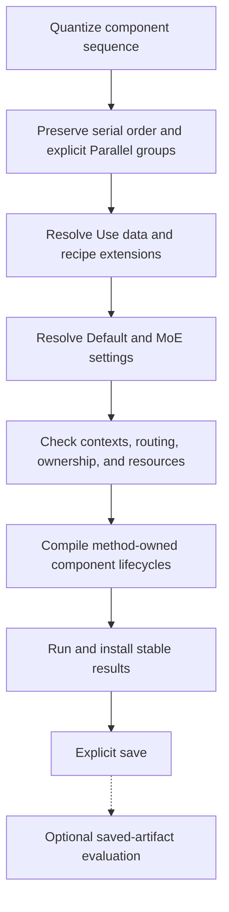

<!-- SPDX-FileCopyrightText: 2026 ModelCloud.ai
SPDX-License-Identifier: Apache-2.0 -->

# Component composer: Quantize, Default, MoE, and Run

**Status:** revision 0.13 design proposal, 2026-10-29. This is the preferred
authoring API, not an implemented interface. The
[API contract](quantization-plan-api.md), [data contract](quantization-data-contract.md),
and [placement contract](quantization-device-placement.md) specify its lowering
and advanced controls. No compatibility with previous draft spellings is required.

## 1. Serial by default, explicit component concurrency

```python
run = (
    Quantize(
        Language(GPTQ()).Use(textData),
        Vision(GPTQ()).Use(visionData),
        model=model,
    )
    .Default(parallel=DataParallel(devices=[0, 1]))
    .MoE(
        routing=MoERouting.bypass,
        parallel=DataParallel(devices=[2, 3]),
    )
    .Run()
)
```

`textData` and `visionData` are caller-supplied `QDataSet` objects, and `model` is
the composition handle. Method defaults such as `GPTQ()` remain method-defined.
The language action completes before vision starts: **argument order is execution
order**. `.Default(...)` and `.MoE(...)` do not make components concurrent.

To explicitly request concurrent component quantization:

```python
job = (
    Quantize(
        Parallel(
            Language(GPTQ()).Use(textData),
            Vision(GPTQ()).Use(visionData),
        ),
        model=model,
    )
    .Default(parallel=DataParallel(devices=[0, 1, 2, 3]))
)
run = job.Run()
```

`Parallel(...)` is a fork/join group, with at least two branches. Each branch
retains its own method program and data/state. A following positional item in
`Quantize(...)` waits for all branches to install stable results and drain pending
work. Nested `Quantize(...)` groups express a serial sequence within a branch.
The compiler records these edges; it never interprets dictionary traversal,
device number, or method type as component order.

`Parallel` requires an admitted concurrent schedule. Missing method/runtime
support, conflicting writes, a required producer dependency between branches, or
resources that only permit wholly serial execution produce a concrete error.
The implementation must not silently reorder, serialize the whole group, change
teacher/context policies, or refit another component to make the request work.
Individual dependent stages and local packing may still serialize within a legal
concurrent schedule. Actual overlap depends on execution timing; a declaration
does not promise that every stage runs simultaneously.

| Expression | Intent |
| --- | --- |
| `Quantize(Language(...), Vision(...))` | Quantize language, then vision. |
| `Quantize(Vision(...), Language(...))` | Quantize vision, then language. |
| `Quantize(Parallel(Language(...), Vision(...)))` | Request concurrent component lifecycles, subject to numerical and resource admission. |
| `DataParallel(devices=[0, 1])` | Two logical replicas distribute samples inside the applicable component/region lifecycle. |
| `TensorParallel(devices=[0, 1])` | Two tensor shards execute one logical computation inside that lifecycle. |

The last two are execution configurations, not component scheduling groups.
`Default(parallel=...)` therefore cannot replace `Parallel(...)`.

### Order and calibration context

Serial order does not imply that every method uses the same observations. Each
component uses its method's admitted source/candidate/teacher policy and records
the exact producer revisions. For a supported local GPTQ text-first experiment,
language can observe the existing vision revision; subsequent vision quantization
invalidates those derived caches and marks language's calibration context changed.
Its historical fit remains valid for its recorded context. The run reports the
change and does not claim language was fitted on the final vision weights.

If a chosen objective explicitly requires the *new* vision revision before fitting
language, the language-first declaration conflicts with that requirement and
fails planning. It is not silently reversed. The same dependency prevents a
`Parallel(Language(...), Vision(...))` group under that policy. An independent
frozen-source experiment must be selected explicitly when the method supports it;
wrapping the branches in `Parallel` cannot select that numerical experiment for
the caller. Upstream-first remains a useful choice, expressed by listing vision
first. Automatic refitting requires a separately declared refinement policy.

## 2. Components, recipes, data, and model binding

`Language`, `Vision`, `Audio`, and registered component declarations establish
scope. Their first argument is a method or composed recipe. `target` defaults to
`Target.AUTO`; a `DynamicModuleTargeting` query can narrow it. Mapping version and
canonical owner IDs are resolved before worker placement, including grouped
expert selection. Scope names do not fabricate independent weights for models
with a shared multimodal backbone.

`Use(*items)` dispatches registered types:

- A `QDataSet` supplies data for the unambiguous method role. `DataBindings`
  names multiple roles when needed; no one dataset silently fills train,
  validation, adapter, and final evaluation roles.
- A recipe extension, such as `EoRA` or `StagedGSQ`, contributes its declared
  method-owned program through the existing typed recipe registry.
- Unknown or ambiguous types fail. Calls are immutable, and chained/variadic
  forms preserve the same declared ordering and compatibility rules.

```python
language = Language(GPTQ(bits=4)).Use(EoRA(rank=32)).Use(
    DataBindings(
        calibration=textData,
        adapter=textData.alias(reason="shared EoRA observation corpus"),
    )
)
```

Datasets attached to components describe input sources, not private modality
pipelines. Compatible calibration routes propagate to their downstream calibration
consumers within the composition: vision's image corpus also supplies the
image-conditioned language observations, alongside `Language.Use(textData)`.
Automatic routing preserves aligned image prompts, source weights, and actual
producer revisions. It does not invent paired image/text records. Explicit
training/validation/selection bindings do not automatically propagate into other
roles; final evaluation data stays outside the composer. Ambiguous method roles
still require explicit `DataBindings`.
Explicit named `DataBindings` replace inference for those roles; propagation
cannot append another source to an intentionally supplied exact role binding.
Positional `Use(QDataSet)` remains the common automatically composed case.

`Quantize(..., model=model)` binds a model without executing. This permits the
terminal `.Run()` spelling. An unbound job may instead use `.Run(model)` or
`.Compile(model)`; a bound job uses `.Compile()` for a metadata-only preview.
There is no process-global current model. Conflicting model bindings in nested
groups fail. `.Run()` returns `QuantizationRun`; repeated runs revalidate the
current composition and cannot silently reuse stale observations or fit sources.

The composer covers both initial fitting and explicit replacement of packed
weights. A packed selection requires an identified `source=` on its component;
omission fails. `source.dequantized()` is the existing bounded, provenance-bearing
descriptor for fitting decoded released values. It never recovers original
precision. Compilation records dense quantization versus requantization for each
owner and rejects mixed/unsupported codecs. The direct `model.requantize(...)`
operation remains available; the composer does not require another wrapper around
every `Language(...)` declaration.

## 3. Defaults and MoE overrides

`Default(...)` defines settings within this `Quantize` action. It is not a global
configuration and cannot affect a sibling action in an outer plan. Components
may supply their own `.Default(...)` and `.MoE(...)` values when necessary.

Field precedence, from lowest to highest, is:

1. Registered method/backend defaults.
2. The enclosing `Quantize.Default(...)` values.
3. The component's `.Default(...)` values.
4. `Quantize.MoE(...)` for matching routed-expert regions only.
5. The component's `.MoE(...)` values for those regions.

Nested composers inherit outer settings before applying their corresponding
local scope. `.MoE(...)` specificity applies after general defaults. Omitted
fields inherit; explicit values replace that field. Repeating a setter at the
same scope returns a new value with the supplied fields updated, without mutating
earlier jobs. A parallel configuration is one atomic field including its device
pool; changing data parallelism to tensor parallelism cannot accidentally retain
the earlier device count or replica groups.

`MoE` resolves architecture roles, not module-name substrings. Its default scope
is selected routed-expert work, not shared experts, dense vision blocks, or
independently owned draft weights. Regions with no matching work retain their
defaults and show the MoE override as inapplicable. An explicit module selector
that matches nothing still fails. MoE settings cannot expand the selected writes.
Coupled transforms/solves, tied owners, and hard module maps always constrain the
result; a default is not permission to split an indivisible method region.

`DataParallel(devices=[...])` accepts a simple list/tuple of local GPU ordinals.
An optional `Local(...)` value in `devices=` carries budgets, custom module maps,
CPU/NUMA policy, and buffers using the existing placement contract. For example:

```python
job = Quantize(Language(GPTQ()).Use(textData), model=model).Default(
    parallel=TensorParallel(devices=Local(gpus=[0, 1, 2, 3], host_memory="256GiB"))
)
```

No worker count, stage ID, or `required` flag is needed. Explicit execution modes
are requirements; methods lower them into complete supported profiles. Lists
normalize to a local device context. `Default(devices=Local(...))` requests
automatic execution with that placement; it replaces the execution field as a
whole. Supplying both `devices=` and `parallel=` to the same setter is ambiguous
and fails. The former `Local(parallel=...)` authoring spelling is superseded;
physical context and the typed execution configuration have distinct roles.
Advanced combined layouts retain explicit replica/shard axes and validated counts.

All scopes share one physical reservation ledger. Reusing GPU 0 in two parallel
branches never doubles its capacity. Defaults and MoE overrides can use different
pools only when the adapter supports the boundary transfers and the method
preserves logical sample/reduction identity. Different replica counts require
declared redistribution, not an assumption that rank numbers still align.

## 4. Routing bypass is an explicit calibration policy

`MoERouting.native` is the default. `MoERouting.bypass` deliberately supplies the
declared calibration stream to selected experts without relying on the router's
normal top-k assignment for coverage. Methods/adapters must support its exact
observation weights, intermediate inputs, and batching. It changes the numerical
experiment; it is not a device-placement optimization or a quantizer shortcut.

Data-parallel bypass partitions samples between replicas and merges each expert's
statistics using its declared reducer. Assigning *different experts* to different
devices is expert/task placement, not data parallelism. Bypass cannot expand a
last-ten-experts write query to the full bank. Shared experts and preserved owners
still follow their declared execution contracts.

Bypass is scoped to admitted quantization capture work. Required normal model
replay, candidate context propagation, and saved inference use the model's actual
routing unless the method explicitly declares another distinct experiment.
Temporary hooks/state must be restored on success, failure, and cancellation.
Bypass provenance belongs in observation/cache identities so its statistics cannot
be reused as native routed statistics. Unsupported bypass fails before mutation.

The focused repository audit at `6d90aa19` already exposes
[`ExpertsRoutingBypass`][routing-config] and a
[forward context][routing-execution] that excludes quantization overrides from
replay. The proposal retains that separation with explicit capabilities instead
of silent disabling when a required hook is unavailable.

## 5. Execution, persistence, and lowering

```python
resolved = job.Compile()
print(resolved.explain())
run = model.run(resolved)
artifact = run.save("quantized-model")
report = artifact.evaluate(suite=held_out_suite, data=held_out_data)
```

Compilation consumes no dataset and runs no numerical work. `.Run()` is the
convenience form that compiles and executes the same bound job. Saving and optional
evaluation remain separate caller actions, with the previous durability,
independent-resource, and failure contracts. There is no composer evaluation
stage or hidden refitting from evaluation scores.



The compiler lowers component declarations to `QuantizeComponent` or
`RequantizeComponent` actions and the existing `Plan` graph. These are advanced
graph descriptors; the old overloaded `Quantize(...)` single-component constructor
is removed, not retained as a compatibility dispatch. An explicit outer
`Plan.serial(...)` or `Plan.parallel(...)` may contain a `Quantize` action. Its
component groups retain their boundaries and final completion barrier.

Authoring serialization stores an ordered component sequence, explicit parallel
groups, `.Use` data/extension descriptors, defaults, MoE overrides, and model
bindings. A compiled plan stores explicit dependency edges, resolved per-owner
settings and their provenance, execution profiles, and routing policy. A round-trip
must preserve serial order, overrides, and exact global selection; flat operation
lists without order edges cannot reconstruct the requested sequence.

The serial example has this authoring form; bindings supply the model and data:

```yaml
schema: gptqmodel.quantize/v1
model: {binding: model}
components:
  - scope: language
    recipe: {method: gptqmodel/gptq@1}
    use: [{dataset: {binding: textData}}]
  - scope: vision
    recipe: {method: gptqmodel/gptq@1}
    use: [{dataset: {binding: visionData}}]
defaults:
  parallel: {type: data, devices: [0, 1]}
moe:
  routing: bypass
  parallel: {type: data, devices: [2, 3]}
```

An explicit concurrent group replaces those two component entries with one entry
containing `parallel: [<language declaration>, <vision declaration>]`. Subsequent
components remain serial after its join. The `parallel` key under an execution
setting carries a typed mode; the group key contains component branches. Schema
validation distinguishes these contexts and rejects a mode used as a branch.

Proposed gates V38-V40, P17-P18, QD19, and DS8 cover this surface. They are future
conformance requirements, not results of executing this draft API.

[routing-config]: https://github.com/ModelCloud/GPTQModel/blob/6d90aa196e7c94c9d62459c60267b346fa1fb613/gptqmodel/quantization/config.py
[routing-execution]: https://github.com/ModelCloud/GPTQModel/blob/6d90aa196e7c94c9d62459c60267b346fa1fb613/gptqmodel/looper/forward_executor.py
