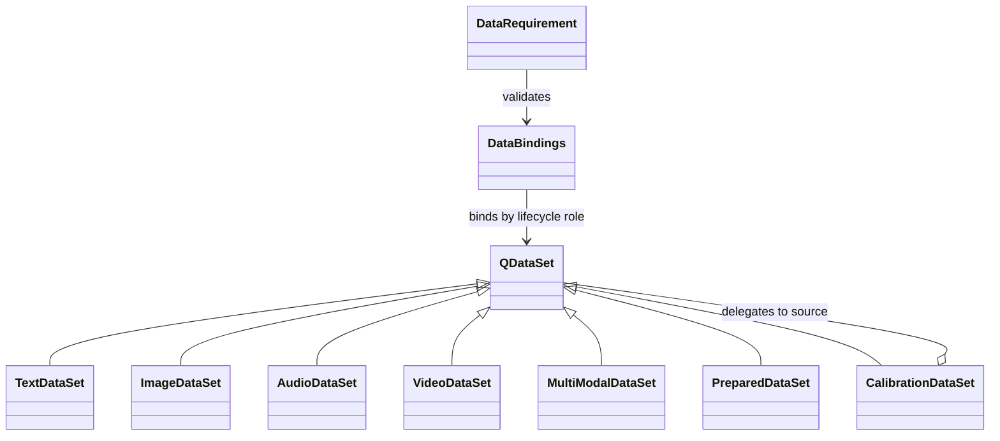
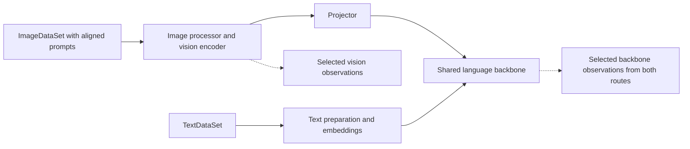

<!-- SPDX-FileCopyrightText: 2026 ModelCloud.ai
SPDX-License-Identifier: Apache-2.0 -->

# Data contract for quantization lifecycles

**Status:** revision 0.10 design proposal, 2026-10-29. No data API is
implemented by this PR. See the
[main design](component-quantization-design.md),
[method audit](quantization-method-lifecycles.md),
[public API proposal](quantization-plan-api.md), and
[parallel execution contract](quantization-parallel-execution.md).

Introduce an inheritable `QDataSet` abstraction, but keep two independent ideas
separate:

1. **Content and modality** describe each sample: text, image, audio, video,
   state/action, a multimodal event stream, or already prepared tensors.
2. **Data role** describes why a processor consumes samples: observation,
   initialization, training, validation, selection, adapter generation,
   profiling, or independent evaluation of a saved artifact.

`CalibrationDataSet` should inherit from `QDataSet`, as proposed, and act as a
role-aware view over any compatible source. It should not become the parent of
`TextDataSet`, `ImageDataSet`, or `AudioDataSet`. Calibration can use all those
modalities, and one text corpus can serve several explicitly declared roles.
Making role and modality two branches of one inheritance tree would require
multiple-inheritance combinations such as `CalibrationImageAudioDataSet`.



## 1. Current source audit

This audit uses GPTQModel commit
[`6d90aa19`](https://github.com/ModelCloud/GPTQModel/tree/6d90aa196e7c94c9d62459c60267b346fa1fb613),
the `main` head inspected on 2026-10-29. The design branch has an older runtime
baseline, so the links in this section are pinned to the newer source rather
than implying those APIs are implemented by this PR.

| Current path | Observed data behavior | Requirement for the redesign |
| --- | --- | --- |
| Public `quantize(calibration=...)` and `CalibrationInputType` | Accept raw strings, token IDs, mappings and optional Hugging Face datasets. The base preparer normalizes, filters, concatenates, sorts, pads, and batches text-like samples. [Public dispatch][base], [base preparation][calibration] | Replace the widening raw union and adjacent tuning flags with one typed dataset source plus a preparation policy. Data-free methods must declare no requirement. |
| Architecture preparation | Current `main` has 32 model-definition overrides of `prepare_dataset()`. They produce model-specific image, video, audio, OCR, multimodal, and text batches. Qwen3-VL deliberately keeps image iterators lazy. [Qwen3-VL][qwen3-vl], [Qwen2-Audio][qwen2-audio], [Qwen Omni][qwen-omni], [OpenVLA][openvla] | Raw sample ownership belongs to `QDataSet`; model/route-specific rendering and tensor preparation belong to a versioned architecture data adapter. Streaming must not be erased by a common eager list conversion. |
| EoRA | Quantization can receive a separate `adapter_calibration_dataset`; post-quantization adapter generation has another calibration-dataset argument. [Base dispatch][base], [EoRA processor][eora] | Expose an `adapter` data role. Reusing observation data is an explicit alias, not an invisible fallback. |
| Staged GSQ | The low-level lifecycle accepts separate training `documents`, GPTQ `initialization_documents`, and held-out `validation_documents`. The public wrapper currently collapses them into one calibration input. [GSQ driver][gsq-model] | Preserve distinct `initialize`, `train`, and `validate` bindings and their disjointness requirements. A convenience API may reuse one source only when the method permits it and the resolved plan reports that choice. |
| ParoQuant | One captured corpus is divided internally into prefix training rows and suffix validation rows; module and grouped scopes use the resulting splits differently. [ParoQuant processor][paro] | Split selection, overlap policy, row/sample units, and seed belong in data provenance. Validation cannot be assumed held out merely because code calls a suffix `validation`. |
| Norm tuning | The argument named `calibration` is sampled repeatedly as optimization data for teacher/student distillation. [Norm tuning][norm] | Bind it as training data for that operation. Its role is not Hessian calibration even when the same raw corpus is reused. |
| Activation calibration | `calibrate_activations(samples)` fits producer scales; `measure_nvfp4_producers(samples)` measures a separate held-out reconstruction set. [Activation calibration][activation] | Represent scale fitting and selection/measurement as distinct role bindings with compatible prepared schemas. |
| RCO and evaluation | RCO consumes objective batches during a precision search, while `utils.data` separately constructs prompt/label evaluation loaders. [RCO][rco], [evaluation data][eval-data] | Search/selection is a method role; final evaluation belongs to an independent saved-artifact consumer. Both use typed datasets, with task labels, metrics, and leakage provenance kept outside calibration metadata. |
| Method-local loading | The AWQ utility can load a named Hugging Face dataset, shuffle it, tokenize it, and form blocks inside the method package. [AWQ data utility][awq-data] | Loading, selection, and block formation must be visible in the resolved data pipeline instead of hidden inside a quantizer. |

The repository therefore has more than a calibration dataset. It has raw data
sources, model-specific preparation, method-specific observations, optimizer
training sets, initializer sets, selection/validation sets, adapter data, and
task evaluation data. Some are currently separate arguments; others are
implicit slices or method-local loaders.

## 2. `QDataSet` contract

`QDataSet[T]` is an immutable description of a sample source and a factory for
per-run cursors. It is not a mutable iterator shared by workers and it does not
own model-specific tokenization or processor calls.

```python
class QDataSet(ABC, Generic[SampleT]):
    @property
    def identity(self) -> DataSetIdentity: ...

    @property
    def schema(self) -> SampleSchema: ...

    @property
    def capabilities(self) -> DataSetCapabilities: ...

    @abstractmethod
    def open(self, request: ReadRequest) -> DataCursor[SampleT]: ...
```

The minimal contract includes:

| Contract | Required meaning |
| --- | --- |
| `DataSetIdentity` | Provider/URI or binding name, immutable revision where available, split, selection/sampling policy, transform graph, and schema version. It excludes credentials. In-memory data receives an explicit run-local binding identity or a materialized artifact identity. |
| `SampleSchema` | Required and optional fields, modalities, dtypes/encodings, alignment units, labels/targets, timestamps or state axes, and semantic version. Arbitrary dictionaries are allowed only behind an adapter that validates a declared schema. |
| `DataSetCapabilities` | Map or streaming access, known/unknown cardinality, replayability, stable sample IDs, random access, resumable cursor, finite/infinite status, and supported partitioning. |
| `ReadRequest` | Resolved selection, deterministic seed, epoch/pass, shard/worker identity, ordering, limits, retry policy, and requested fields. The planner lowers view policies into this request; a source loader does not resolve model routes or teacher policies. |
| `DataCursor` | A private cursor yielding sample envelopes, with checkpoint/close semantics where supported. Opening a second cursor is explicit; a single-pass stream can reject it. |
| `QSample` | Stable sample/event ID, typed payload, optional weight/group/trace metadata, and source offset. Batch position is not sample identity. |

Subclasses may override loading, validation, cursor creation, sharding, and
efficient projection. A subclass cannot conceal a model forward, download a
different revision after compilation, or return a different schema without
changing its identity.

Common immutable operations return another `QDataSet`: `select`, `shuffle`,
`limit`, `map`, `mix`, and `zip_aligned`. `split` returns a `DataSplits` collection
of named `QDataSet` views, such as `splits.train`. Each operation enters identity
and provenance. Registered transforms have names and versions; portable plans
do not serialize arbitrary callables. A streaming shuffle must name its bounded
buffer/reservoir policy; it cannot claim to be a full random permutation. Split
ratios use a declared exact-count or stable-hash policy according to capabilities.

Source identity, view identity, and prepared-input identity are separate. Views
retain parent/sample ancestry for overlap checks. A mutable in-memory binding
must be frozen, verified, or materialized before use; a Python object address
cannot establish immutable contents. Sources without stable IDs require recorded
IDs and offsets in a bounded snapshot to support replay and overlap guarantees.

`len(dataset)` is optional. Requiring it would exclude streaming corpora and live
event traces. A method that needs exact cardinality declares that requirement;
the planner can schedule a bounded snapshot stage or reject an incompatible
source. Compilation only resolves metadata and declared capabilities. It does
not open a stream to discover its size. Content-dependent schema, coverage,
and overlap checks run in explicit validation stages before dependent fitting;
unmet guarantees fail or use a predeclared fallback, never silently pass.

## 3. Modality and structure subclasses

Convenience subclasses validate common raw sample shapes. The schema remains the
source of truth so future modalities do not require coordinator branches.

| Proposed class | Sample contract |
| --- | --- |
| `TextDataSet` | Raw text, messages, token IDs, masks, or labeled prompt/response records. It records which representation is authoritative. |
| `ImageDataSet` | One or more images plus aligned prompts/messages, optional targets, spatial metadata, and decode policy. An image URL and decoded pixels are different source stages. |
| `AudioDataSet` | Audio bytes/path/array plus sample rate, channels, time alignment, prompt/messages, and optional transcript/target. Resampling is a versioned transform. |
| `VideoDataSet` | Video or frame sequence plus timing/FPS policy, frame selection, optional audio, prompt/messages, and targets. Frame sampling is part of identity. |
| `StateActionDataSet` | Environment/robot state, embodiment, action chunks, timing, observation modalities, and optional rewards/targets for action-model workflows. Current OpenVLA calibration uses image/text prompts; this class covers the fuller future contract. |
| `ConversationDataSet` | Ordered typed messages and content parts. Useful when the conversation is the authoritative raw representation. |
| `MultiModalDataSet` | Aligned content/events from two or more modalities, including full-duplex or streaming timelines. Use composition rather than multiple inheritance from every modality class. |
| `CompositeDataSet` | A weighted mixture, concatenation, aligned zip, or stratified view over child datasets, preserving every child identity and sampling policy. |
| `PreparedDataSet` | Model-ready batches supplied by an expert caller or preparation cache. It is pinned to an architecture adapter, processor/tokenizer revision, route, numerical profile, and prepared schema; it is never assumed portable to another model. |

A dataset can declare several modalities without using one of these conveniences.
For example, `ImageDataSet` may carry caption text, while a synchronized audio,
video, and text timeline is more naturally a `MultiModalDataSet`.

### Automatic routing is the default

Supplying an `ImageDataSet` should be enough to enter the model's image input
path. Users should not have to repeat `route="image_text"` or bind the same source
to each component along that path. The architecture adapter resolves the route
from the source schema, task/scenario requirements, and its registered input
contracts. Resolution uses schema metadata, not hardcoded dataset class names,
so custom subclasses participate without planner changes.

Input routing and parameter selection remain distinct. In a vision-language
model, images enter the vision processor/encoder, and their features can flow
through a projector into the language backbone. That backbone therefore needs
observations from the image route as well as any supplied text-only route. Raw
images are not sent to a text-only tokenizer, but the image corpus is not excluded
from downstream backbone calibration. Executing a component for observations
does not authorize changing its weights.
Likewise, `Target.AUTO` resolves the operation's declared scope from the model
mapping; it does not derive a weight-write scope from the dataset class. When a
language operation is selected too, it still receives the required image-derived
observations. `DynamicModuleTargeting` narrows module writes independently of
these automatically resolved input paths.



This illustrates an encoder/projector architecture, not a universal topology.
Encoder-free models route images into their actual shared input path. Audio,
video, and future modalities follow their adapter's contracts in the same way.
The resolver applies these rules before device placement:

1. Apply any explicit route restriction, then match the declared schema and
   requested task/scenarios to supported input contracts. Select the unique
   match, or the adapter's versioned default for that task/schema. If distinct
   choices remain, report them and request only the missing route choice.
   A union schema compiles a route dispatch for each declared record variant;
   runtime schema validation checks those variants without guessing new routes.
2. Resolve each consuming stage's required portion of that execution path.
   Pruning downstream execution is legal only when the adapter and method
   declare that the observations need no downstream context or objective.
   Full-context and end-to-end methods retain the complete required path.
3. Keep every applicable supplied route for a shared consumer. Selection of
   language weights cannot silently discard image/audio observations because
   their input entered another component. Missing required modality coverage
   remains a reported error or pending content check.
4. Preserve alignment. Separate image and text sources do not imply paired
   captions, and separate audio/video sources do not imply synchronized events.
   Use aligned records or `zip_aligned` when a route requires that relationship.
   Missing prompts/fields require data or an adapter-declared default recorded
   in preparation identity; the planner does not fabricate them.

An optional `QDataSet.for_route("route_id")` returns an immutable restricted
view for ambiguous or deliberately narrowed workflows. `CalibrationDataSet`'s
optional `route=` is equivalent. Neither spelling binds raw samples directly
to a module or bypasses preparation. Prepared inputs retain their already-pinned
route and producer lineage. `explain()` records inferred and explicit choices,
the executed path, the observation consumers, and selected writes separately.

## 4. `CalibrationDataSet` and lifecycle roles

`CalibrationDataSet` is a delegating, inheritable `QDataSet` view:

```python
class CalibrationDataSet(QDataSet[SampleT]):
    source: QDataSet[SampleT]
    profile: CalibrationProfile

    def open(self, request: ReadRequest) -> DataCursor[SampleT]:
        # Selection and weighting have already been lowered by the planner.
        return self.source.open(request)
```

`CalibrationProfile` declares optional route/scenario restrictions, coverage
strata, weighting, length/chunk policy, and trace axes. Omitted routes are inferred
by the architecture adapter. The view identity includes the source view
and profile; schema and cursor capabilities delegate to the source subject to
the view's declared constraints. The sketch omits those property implementations.
Changing a route or weighting policy changes the view identity even if the raw
samples stay the same. Teacher/candidate source choice belongs to the recipe's
observation requirements, not the raw dataset loader.

The profile does not perform tensor preparation. A project can subclass
`CalibrationDataSet` to add domain validation while retaining the same cursor
and identity rules.
The friendly constructor accepts `scenarios=` and related keyword arguments to
build the immutable profile. `route=` is an optional override, not boilerplate
required by the dataset's modality.

Roles are typed bindings, not a closed subclass list:

| Built-in role | Typical current consumer |
| --- | --- |
| `calibration` | GPTQ/QQQ/VPTQ Hessians, AWQ features, GPTAQ/FOEM/native observations, activation-scale fitting. Method requirements can distinguish native and candidate observation streams within this role. |
| `initialize` | Method-required initializer observations, such as separate GPTQ/RTN/AWQ inputs for staged GSQ. A resolved data-free initializer declares no dataset requirement. |
| `train` | GSQ reconstruction, ParoQuant optimization, norm tuning, or another intrinsic optimizer. |
| `validate` | Held-out epoch/checkpoint selection and stopping decisions inside an optimizer. |
| `select` | Precision search, bounded refinement choice, activation-scale recipe selection, or best-candidate choice. |
| `adapter` | EoRA or another adapter-generation operation. |
| `evaluate` | Independent task evaluation of a committed artifact after saving. This role belongs to the artifact evaluator and is rejected in quantization plans. |
| `profile` | Bounded cost/memory profiling used by physical planning. Timing an optimizer/solve uses disposable candidate state, declared fitting roles, and no retained numerical result. |

Method plugins can add namespaced roles, for example
`vendor/method:contrastive_negatives`, together with a `DataRequirement`.
Coordinator code does not add a new keyword or enum branch for each future role.
The built-in `evaluate` role is reserved for the separate evaluator. It cannot
be supplied through `Plan.data(...)`, a quantization operation, or a serialized
quantization plan. Method validation, stopping, and selection keep their own
roles; final evaluation data is neither loaded nor required while quantizing.

`DataRequirement` declares accepted schemas/modalities, whether raw or prepared
data is accepted, minimum coverage, access pattern, replay/pass count, ordering,
full-context needs, split/disjointness rules, batching, and legal distributed
partitioning. Compilation matches requirements to `DataBindings` using source
descriptors and model handles, without requiring full weight/data materialization.
It reports missing/incompatible declarations and distinguishes pending runtime
checks from proven guarantees. Composed recipes declare their effective roles;
they do not automatically inherit every role of each standalone extension.

Aliases permit intentional reuse of raw samples, not implicit reuse of fitted
statistics or captured activations. GPTAQ/native and candidate streams must align
sample IDs, positions, masks, and augmentation draws while retaining distinct
producer revisions. RNG keys include sample/trace identity and pass; worker ID
alone cannot determine augmentation or noise in a topology-independent replay.

## 5. Friendly API

The common one-role case accepts a `QDataSet` directly. A plain dataset binds to
the operation's only unambiguous required role, and its route is inferred. Neither
a `CalibrationDataSet` wrapper nor a route string is required for ordinary GPTQ:

```python
images = ImageDataSet.from_hf(
    "org/image-text-calibration",
    revision="7d2c...",
    split="train",
)
run = model.quantize(
    target="language",
    recipe=GPTQ(bits=4, group_size=128),
    data=images,
    devices=Local(gpus="all"),
)
```

For multiple inputs, `.data(*datasets)` registers sources once for the plan.
Chaining `.data(images).data(texts)` is equivalent to `.data(images, texts)`:

```python
images = ImageDataSet(image_text_samples)
texts = TextDataSet(text_samples)

plan = (
    Plan()
    .devices(Local(gpus=[0, 1, 2, 3]))
    .data(images, texts)
    .serial(Quantize.vision(recipe=GPTQ(bits=8), name="vision"))
    .serial(Quantize.language(recipe=GPTQ(bits=4), name="language"))
)

# Optional coverage controls; the image route is still inferred.
calibration = CalibrationDataSet(images, scenarios=("prefill", "decode"))
```

The vision operation consumes the image source. The language operation consumes
both the image-conditioned and text-only paths. It observes the installed vision
revision under the progressive policy; automatic data routing does not change
teacher/candidate selection or allow stale image features to cross that boundary.

Role resolution is independent of route resolution. Explicit operation bindings
take precedence; positional `CalibrationDataSet` views supply the `calibration`
role. A plain positional source can fill remaining compatible requirements only
when their role is unambiguous, including the same role across multiple operations.
Multiple unresolved roles require named bindings; modality never implies whether
samples are for training, validation, or evaluation. An explicitly named binding
can use any compatible `QDataSet` view regardless of its positional role default.
Data-free programs acquire no consumers.

A named role accepts one source or an ordered source group, for example
`.data(calibration=(images, texts))`. Each source resolves its own route;
this does not pair their records. With several sources for one consumer, the
default is deterministic concatenation in registration order over finite or
explicitly bounded views. Sample weights and the method's valid-observation
normalization are preserved; there is no implicit equal weighting of corpora
or oversampling of rare modalities. `.mix(...)` supplies an explicit alternative
sampling/weighting policy. An unbounded first source cannot silently starve a
later source. Resolved ordering, limits, and weights enter the plan identity.
Stage-wide sample caps must retain required route coverage or fail before fitting;
they cannot silently exhaust the budget on the first source. Repeated source
registrations are diagnosed; intentional extra weighting belongs in an explicit
mixture policy rather than duplicated bindings.

Named roles remain compact and chainable:

```python
splits = TextDataSet.from_hf(
    "org/quant-corpus", revision="91af..."
).split(
    train=0.8, validation=0.1, evaluation=0.1,
    by="sample_id", seed=17,
)

gsq_data = DataBindings(
    initialize=splits.train.limit(512).alias(reason="initialize on training subset"),
    train=splits.train,
    validate=splits.validation,
)

plan = (
    Plan()
    .devices(Local(gpus=[0, 1, 2, 3]))
    .add(Quantize(
        "language", Recipe(GPTQ(bits=4)).use(StagedGSQ()),
        data=gsq_data, name="language",
    ))
)
run = model.run(plan.compile(model))
artifact = run.save("language-quantized")
report = artifact.evaluate(suite=language_quality, data=splits.evaluation)
```

Plan-level bindings are defaults. Operation-level bindings override by exact
role and appear in `explain()`. Unknown roles and unused operation-specific
bindings are errors; the report identifies consumers of plan defaults.
Namespaced roles can be passed as a mapping, for example
`DataBindings({"vendor/method:contrastive_negatives": negatives})`.
Reusing the same view for multiple roles is
written explicitly:

```python
shared = DataBindings(
    calibration=calibration,
    adapter=calibration.alias(reason="shared EoRA observation corpus"),
)
```

Aliases preserve one dataset identity while recording the distinct consumers.
Roles that require disjoint data reject an alias. A method may publish a default
deterministic split policy, but the compiled plan shows the resulting views and
overlap guarantees.

`Plan.calibrate(dataset)` can remain ergonomic sugar for
`Plan.data(calibration=dataset)`. The canonical serialized form records role
bindings and source groups. Resolved plans additionally freeze adapter/route
choices, so inferred defaults remain reviewable and cannot change during resume.

## 6. Preparation belongs to the architecture route

The architecture adapter compiles a `DataPipeline` from raw schema to the exact
prepared inputs required by a route and lifecycle stage:


Each step is versioned and declares required fields, effects, resources, and
whether it is deterministic. Processor outputs can include arbitrary validated
fields such as `pixel_values`, video grids, audio features, feature masks,
position IDs, robot state, or sampler state. The coordinator carries the typed
mapping; it does not hardcode a text-only allowlist.

Preparation identity includes architecture/route adapter version, tokenizer and
processor revisions, chat template, modality decode/resample/frame policy,
truncation/concatenation, padding/collation, batch policy, and applicable random
state. Changing any numerical input transform invalidates prepared caches and
derived observations.

Raw datasets, prepared batches, invocation captures, and method statistics are
different artifacts. A method that can consume prepared batches does not gain
permission to reinterpret raw samples. A `PreparedDataSet` bypasses only the
declared preparation steps and must satisfy the final prepared schema exactly.

Learned features or teacher targets require the producing model revision and
invocation lineage as well. Supplying them through `PreparedDataSet` cannot hide
a model forward or make the cache independent of changed producer weights; the
corresponding producer dependencies remain in the lifecycle graph.

## 7. Streaming, parallelism, and continuation

Data placement is compiled with the [parallel execution contract](quantization-parallel-execution.md):

- Map-style sources can use deterministic index partitions. Streaming sources
  need provider-supported shards or durable cursor/range assignments.
- Global sample/event IDs, weights, valid counts, and duplicate policy survive
  sharding, retries, sampler padding, and gathering.
- A recurrent sequence, video clip, duplex stream, denoising trace, or robot
  episode stays intact unless the adapter declares exact state handoff and
  boundary overlap.
- Expensive image/audio/video decode can run near the consumer and use a bounded
  content-addressed asset cache. Cache locality cannot change sample selection.
- Unknown cardinality is legal for streaming capture with a bounded stop policy;
  exact-epoch training can require a materialized finite snapshot.
- Resume stores dataset identity, role view, cursor/shard progress, epoch/order,
  and preparation identity. A changed remote `latest` revision cannot resume an
  old run as if it were identical.
- Reopening a source for several method passes is a declared requirement. A
  non-replayable source must be spooled within budget or rejected before the
  first destructive model stage.

Checkpoints record committed consumption, not the furthest prefetched offset.
Cursor progress, shuffle/RNG state, and the corresponding statistic or optimizer
update must describe one consistent boundary. Retries can reread input, but cannot
double-count committed samples or skip prefetched samples whose update was lost.

Data memory estimates include decoded modality assets, processor outputs,
prefetch queues, pinned buffers, prepared batches, and captured observations.
The scheduler bounds them independently from weight, Hessian, and optimizer
budgets.

## 8. Splits, leakage, and provenance

Splits operate on stable sample, conversation, document, episode, or group IDs,
not post-padding rows. The split unit is schema metadata. Group-aware splitting
keeps related frames, turns, augmentations, or embodiments together where the
task requires it.

The quantization compiler computes overlap among fitting/selection inputs when
recorded ancestry permits it and otherwise reports the guarantee as unknown.
Different dataset names or hashes alone do not prove that content is disjoint.
Requirements can demand validation of sample or
group ancestry before fitting. After saving, the separate evaluator compares its
data against the artifact's recorded fitting/selection provenance. It defaults
to disjointness from calibration, initialization, training, adapter generation,
optimizer validation, and refinement selection. An explicit reuse policy can
permit overlap, but the result cannot be labeled held out. Missing provenance
reports unknown overlap; this affects the evaluation claim, not the completed save.

Final evaluation is optional work on a saved artifact. Its metrics cannot trigger
the completed run's refinement, change its status, or select a different winner.
If a later experiment uses that feedback, record the earlier evaluation as
selection evidence and obtain fresh independent data for a held-out claim.

The quantization manifest records its fitting/selection data:

- Dataset identities, revisions, splits, selectors, limits, seeds, and transforms.
- Role bindings and explicit aliases.
- Inferred/explicit route decisions, adapter defaults, and observation consumers.
- Schema/modalities, preparation pipeline, route/scenarios, and weighting.
- Cardinality/counts actually consumed, skipped/invalid samples, and coverage.
- Distributed partitions, duplicates/retries, cursor checkpoints, and ordering.
- Proven or unknown overlap among fitting, selection, and validation inputs.

The separate evaluation report records artifact identity, suite/runtime, its own
dataset provenance and consumed coverage, and overlap against the saved fitting
provenance. It does not add data requirements to quantization or rewrite the
committed model manifest.

Raw private samples need not be embedded in the model artifact. The manifest can
retain identities and aggregate coverage while data artifacts follow their own
retention policy. Portable replay requires resolvable immutable sources or
explicitly materialized artifacts.

## 9. Acceptance criteria

| ID | Proposed check |
| --- | --- |
| QD1 | `TextDataSet`, `ImageDataSet`, `AudioDataSet`, `VideoDataSet`, `MultiModalDataSet`, and a custom subclass preserve stable IDs/schema through selection, batching, preparation, and persistence. |
| QD2 | `CalibrationDataSet` wraps any compatible modality dataset and can be subclassed without coordinator changes. Incompatible route/schema bindings fail during compilation. |
| QD3 | GPTQ/RTN require exactly their declared roles: GPTQ resolves calibration-role observation data while data-free RTN performs no data loading or tokenizer/processor initialization. |
| QD4 | Staged GSQ receives distinct initialize/train/validate views; explicit reuse is reported, and a disjoint-validation requirement rejects overlap. |
| QD5 | EoRA can use a separate adapter dataset or an explicit alias of calibration data, with identical behavior after save/resume. |
| QD6 | ParoQuant's train/validation split is represented as dataset views with stable row/sample units and no accidental overlap when disjointness is requested. |
| QD7 | Text, image+text, audio+text, image/video, OCR, and prepared-tensor routes reproduce the architecture adapter's declared inputs without dropping auxiliary fields. |
| QD8 | Map and streaming sources support their declared 1/2/4/8-worker partition/resume semantics without duplicate weighting or broken sequence/event boundaries. |
| QD9 | Preparation-cache keys change for tokenizer/processor/template/decode/frame/resample/concat/collation changes and remain reusable across physical layouts when numerical inputs are identical. |
| QD10 | Fitting/selection overlap appears in the plan/manifest; the separate evaluator records final-data overlap against saved provenance in its own report. Missing provenance cannot establish a held-out claim or invalidate the completed save. |
| QD11 | A synthetic future method registers a namespaced data role and custom sample schema without changing planner dispatch or the `QDataSet` base. |
| QD12 | Dataset and prepared-batch memory, prefetch, decode, and materialization limits participate in scheduling and fail preflight when no legal bounded plan exists. |
| QD13 | View/profile changes invalidate the appropriate prepared caches while retaining sample ancestry; explicit aliases do not merge incompatible teacher/candidate observations or method statistics. |
| QD14 | Compilation consumes no cursor; runtime content checks gate fitting, and cursor/statistic checkpoints recover correctly with prefetched input and retried shards. |
| QD15 | Evaluation data is bound only after a successful save and is rejected in quantization plans. The independent evaluator checks disjointness from recorded fitting/selection inputs; unknown overlap cannot pass a strict held-out requirement. Its report/failure/retry cannot alter the artifact or quantization status. |
| QD16 | `.data(images, texts)` resolves image and text input paths without manual route/component bindings; shared-backbone observations include both paths and an encoder-only observation stops early only under an admitted replay contract. |
| QD17 | Custom modality schemas and encoder-free adapters resolve through registered input contracts; ambiguous routes, missing aligned fields, and explicit incompatible route restrictions fail with concrete choices. |
| QD18 | Source groups preserve declared limits, ordering, weights, and actual coverage across GPU layouts; no implicit pairing, equal-corpus weighting, duplicated contributions, or reuse across distinct lifecycle roles occurs. Resolved routes and producer revisions survive save/resume. |

## 10. Proposed decisions

1. Adopt `QDataSet` as the extensible source/cursor contract.
2. Make `CalibrationDataSet(QDataSet)` a role-aware delegating view.
3. Keep modality/structure subclasses orthogonal to lifecycle roles.
4. Let methods declare versioned, extensible `DataRequirement` roles and let
   plans provide `DataBindings`.
5. Move raw-to-prepared conversion into architecture route adapters; methods
   consume prepared schemas or derived observations.
6. Preserve streaming and map-style sources instead of eagerly converting every
   iterable to a list.
7. Make split/alias/disjointness, preparation identity, sharding, resume, and
   actual consumed coverage part of provenance.
8. Keep the common API small: `data=dataset` and `.data(*datasets)` infer routes
   and unambiguous roles; multi-role methods use named bindings.
9. Route by schema and architecture contracts, including downstream shared
   consumers; explicit route restrictions are reserved for overrides/ambiguity.
10. Reuse `QDataSet` in the independent saved-artifact evaluator, with a separate
    role scope, data binding, cursor lifetime, and provenance report.

The proposal uses the requested `QDataSet` / `DataSet` spelling and
`calibration` as the canonical public role name. Method-specific observation
streams remain typed requirements beneath that role rather than changing its
public meaning.

[base]: https://github.com/ModelCloud/GPTQModel/blob/6d90aa196e7c94c9d62459c60267b346fa1fb613/gptqmodel/models/base.py
[calibration]: https://github.com/ModelCloud/GPTQModel/blob/6d90aa196e7c94c9d62459c60267b346fa1fb613/gptqmodel/utils/calibration.py
[qwen3-vl]: https://github.com/ModelCloud/GPTQModel/blob/6d90aa196e7c94c9d62459c60267b346fa1fb613/gptqmodel/models/definitions/base_qwen3_vl.py
[qwen2-audio]: https://github.com/ModelCloud/GPTQModel/blob/6d90aa196e7c94c9d62459c60267b346fa1fb613/gptqmodel/models/definitions/qwen2_audio.py
[qwen-omni]: https://github.com/ModelCloud/GPTQModel/blob/6d90aa196e7c94c9d62459c60267b346fa1fb613/gptqmodel/models/definitions/base_qwen2_5_omni.py
[openvla]: https://github.com/ModelCloud/GPTQModel/blob/6d90aa196e7c94c9d62459c60267b346fa1fb613/gptqmodel/models/definitions/openvla.py
[eora]: https://github.com/ModelCloud/GPTQModel/blob/6d90aa196e7c94c9d62459c60267b346fa1fb613/gptqmodel/looper/eora_processor.py
[gsq-model]: https://github.com/ModelCloud/GPTQModel/blob/6d90aa196e7c94c9d62459c60267b346fa1fb613/gptqmodel/looper/gsq_training_model.py
[paro]: https://github.com/ModelCloud/GPTQModel/blob/6d90aa196e7c94c9d62459c60267b346fa1fb613/gptqmodel/looper/paroquant_processor.py
[norm]: https://github.com/ModelCloud/GPTQModel/blob/6d90aa196e7c94c9d62459c60267b346fa1fb613/gptqmodel/quantization/norm_tuning.py
[activation]: https://github.com/ModelCloud/GPTQModel/blob/6d90aa196e7c94c9d62459c60267b346fa1fb613/gptqmodel/quantization/activation_calibration.py
[rco]: https://github.com/ModelCloud/GPTQModel/blob/6d90aa196e7c94c9d62459c60267b346fa1fb613/gptqmodel/quantization/rco.py
[eval-data]: https://github.com/ModelCloud/GPTQModel/blob/6d90aa196e7c94c9d62459c60267b346fa1fb613/gptqmodel/utils/data.py
[awq-data]: https://github.com/ModelCloud/GPTQModel/blob/6d90aa196e7c94c9d62459c60267b346fa1fb613/gptqmodel/quantization/awq/utils/calib_data.py
