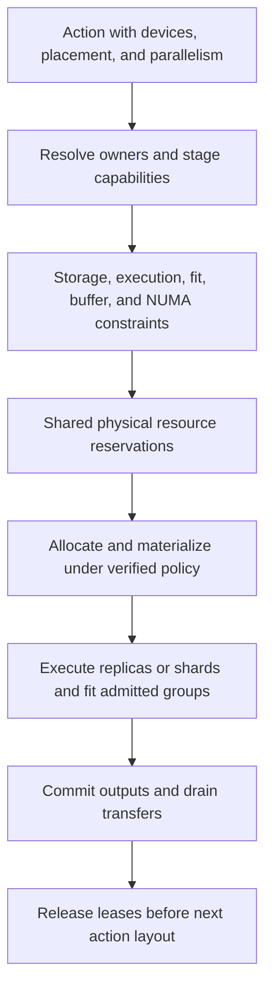

<!-- SPDX-FileCopyrightText: 2026 ModelCloud.ai
SPDX-License-Identifier: Apache-2.0 -->

# Device placement inside lifecycle actions

**Status:** revision 0.11 design proposal, 2026-10-29. These APIs and execution
guarantees are proposed, not implemented. See the [public API](quantization-plan-api.md),
[parallel contract](quantization-parallel-execution.md), and
[DeepSeek example](quantization-example-deepseek-v4.1-flash.md).

## 1. Actions own their resources and execution policies

Configure devices and mappings on the action supplied to `serial` or `parallel`:

```python
vision = (
    Quantize.vision(recipe=GPTQ(bits=8), name="vision")
    .devices(Local(gpus=[0, 1]))
    .parallelism(Parallelism.auto().for_stage(
        "observe", DataParallel(workers=2), required=True,
    ))
)
language = (
    Quantize.language(recipe=GPTQ(bits=4), name="language")
    .devices(Local(gpus=[0, 1, 2, 3]))
    .parallelism(Parallelism.auto().for_stage(
        "observe", TensorParallel(shards=4), required=True,
    ))
)
plan = Plan().data(multimodal_calibration).serial(vision).serial(language)
```

Constructor arguments `devices=` and `parallelism=` are equivalent to these
immutable action builders. Direct calls accept the same arguments. There is no
`Plan.devices` or `Plan.parallelism`: including a fragment cannot replace its
actions' device assignments. Reuse immutable `Local` descriptions explicitly
when actions should share a configuration. Omitted action policies resolve to
recorded automatic defaults; they do not inherit another action's assignments.
An independent evaluator owns its own device configuration after saving.

`observe` above is an illustrative action-local stage ID, not a mandatory stage
in every method. The compiled ID gains the action namespace. Unknown stages or
unsupported required layouts fail. Data parallelism for observations and data
parallelism for optimization have different reducer requirements. Applying data
parallelism to an arbitrary solve is not implied by a capture policy.

| Control | Meaning |
| --- | --- |
| `Plan.serial(a, b)` / `Plan.parallel(a, b)` | Completion order or legal overlap between lifecycle actions. |
| `action.devices(Local(...))` | This action's permitted hardware, budgets, tensor placement, and stage resource constraints. |
| `action.parallelism(...)` | How admitted stages use that hardware: replicas, tensor partitions, or another declared layout. |
| `DataParallel(workers=2)` | Two complete logical replicas process different data partitions, with the declared statistic/gradient reduction. A logical replica can itself be sharded. |
| `TensorParallel(shards=4)` | Four workers execute one logical computation over partitioned tensors, with adapter-declared axes and collectives. |

Running two lifecycle actions concurrently is neither data parallelism nor tensor
parallelism. Both execution modes can occur inside a single serial action, and
both can coexist in one stage when supported:

```python
hybrid = HybridParallel(
    mesh=DeviceMesh(devices=[[0, 1], [2, 3]], axes=("data", "tensor")),
    data_axis="data",
    tensor_axis="tensor",
)
language = language.parallelism(
    Parallelism.auto().for_stage("observe", hybrid, required=True)
)
```

This requests two data replicas, each tensor-sharded across two GPUs. Tensor
groups are `[0, 1]` and `[2, 3]`; corresponding data-reduction groups are `[0, 2]`
and `[1, 3]`. Replicas consume different samples while the tensor ranks of a
replica cooperate on the same logical batch. The reducer must not count one
sample once per tensor rank. Shared memory, optimizer state, RNG, and collectives
retain explicit replica/shard identities. This is a capability request, not a
claim that any current method/backend implements it. Expert or pipeline layouts
remain separate supported partition types.

## 2. Placement separates storage, execution, and fitting

A single model `device_map` cannot specify where host-backed tensors live, where
their forward operators run, and where a quantizer fits them. Add chainable
`Local.place(target, storage=..., execute=..., fit=..., priority=0)` rules.
Optional `stage=` and `view=` restrict a rule to a registered action-local stage
and source/reference/candidate view; omission covers all applicable views/stages:

| Field | Contract |
| --- | --- |
| `storage` | Backing placement for the selected model tensors and representation metadata between uses. Source and candidate identities remain distinct even when both use the same node. It does not move optimizer state or observation buffers implicitly. |
| `execute` | Placement of the selected operators during this action's source/reference/candidate execution. An explicit view/stage override may narrow it. Transfers from backing storage are declared and bounded. |
| `fit` | Placement of admitted fitting work for selected write owners. It neither selects additional weights nor relocates the entire model forward. Coupled method groups must satisfy their combined constraints. |

Unspecified fields remain automatic and are shown in the resolved layout.
Explicit placements are requirements. The planner cannot silently move a pinned
task to another GPU, spill a hard GPU storage assignment to CPU, or manufacture
tensor parallelism to fit it. Every explicit GPU must belong to the action's
allowed pool. Portable strings such as `cuda:0` refer to that process's visible
ordinal; resolution also records stable physical identity and launcher mapping.

Placement queries use `DynamicModuleTargeting` and adapter metadata. Without an
explicit component they inherit the action scope. An explicit component may
address any owner in the action's executed dependency closure, including
preserved vision weights needed by a language action. This is a physical mapping,
not permission to expand that action's weight writes. Nonexecuted/nonfitted
matches are reported as inactive; nonexistent or ambiguous owners fail.

The following is a generic 40-layer, 384-expert mapping example. The exact model
must expose these groups and admit these layouts:

```python
language_devices = (
    Local(gpus=[0, 1, 2, 3], numa_nodes=[0, 1])
    .place(
        DynamicModuleTargeting(component="language").dense(),
        execute=ByLayer({range(0, 20): "cuda:0", range(20, 40): "cuda:1"}),
        fit=ByLayer({range(0, 20): "cuda:0", range(20, 40): "cuda:1"}),
    )
    .place(
        DynamicModuleTargeting(component="language").experts(type="routed"),
        execute=ByExpert(
            {range(0, 192): "cuda:2", range(192, 384): "cuda:3"},
            per="moe_layer",
        ),
        fit=RoundRobin(devices=["cuda:2", "cuda:3"], unit="expert", per="moe_layer"),
    )
    .place(
        DynamicModuleTargeting(component="language", role="conditional_memory_table"),
        storage=CPU(numa=0, memory_policy="bind"),
        execute=CPU(numa=0, cores=list(range(0, 8))),
    )
)
mapped_language = Quantize.language(recipe=GPTQ(bits=4), name="language").devices(language_devices)
```

`dense()` selects the adapter's dense per-layer execution groups: ordinary attention/MLP,
norms, routers, and shared experts, where present. It excludes routed expert
banks and conditional-memory tables, and does not imply a dense stored dtype.
Tables' GPU projection/gating operators can still belong to dense groups. Unknown
groups fail; there is no substring-based classification. Per-layer queries exclude
model-level endpoints without a layer ID; those need a separate rule or retain
automatic placement. `layers([ids...])` restricts a query to global logical layers.

`ByLayer` uses canonical layer IDs, and `ByExpert` uses canonical global expert IDs
within each specified MoE layer. Python ranges are half-open. Maps must cover all
active matched units; a partial map requires an explicit `default=Auto()`.
Missing IDs and overlapping disagreeing ranges fail. Nested maps allow different
distributions in different layers. Assignment is resolved before rank sharding.
`RoundRobin` deterministically distributes the selected fitting units in logical
ID order, restarting per declared group. It never changes which experts receive
data or adds writes to unselected experts.

An expert unit keeps its gate/up/down projections together. A dense calculation
group respects the adapter/method's co-location requirements. These distributions
assign whole units; splitting one tensor requires an admitted `PartitionSpec`
and tensor-parallel capability. Mapping all experts to GPUs does not require all
layers to remain resident: `storage` and the materialization schedule determine
residency. Executing an expert-sharded forward and independently fitting captured
experts are distinct capabilities; one cannot stand in for the other.

### Custom mappings per layer and per module

```python
language_devices = (
    language_devices
    .place(
        DynamicModuleTargeting(component="language").layers([0, 1]).experts(type="routed"),
        execute=ByLayer({
            0: ByExpert({range(0, 192): "cuda:2", range(192, 384): "cuda:3"}, per="moe_layer"),
            1: ByExpert({range(0, 192): "cuda:3", range(192, 384): "cuda:2"}, per="moe_layer"),
        }),
        priority=10,
    )
    .place(
        DynamicModuleTargeting(component="language", role="attention_projection").layers([14]),
        execute=ModuleMap({
            "language.layers.14.attention.qkv": "cuda:0",
            "language.layers.14.attention.output": "cuda:1",
        }),
        priority=10,
    )
)
mapped_language = mapped_language.devices(language_devices)
```

The `ModuleMap` keys illustrate exact canonical owner IDs returned by `inspect()`
for a hypothetical two-projection attention mapping; they are not DeepSeek paths
or globs. Actual inventory IDs must be used. Fused owners, tied storage, and
coupled transforms cannot be split by writing different aliases into a map.

Rules resolve per field and owner: explicit rules override automatic defaults;
higher numeric `priority` overrides a lower one only for matching fields. Equal
priority conflicting assignments fail. Chaining order is not precedence.
Identical rules can coalesce. Resolving a GPU fit override must not erase an
unrelated CPU storage requirement. Architecture, method, hard memory, and alias
constraints always apply. Conflicts explain the relevant owners and rules.

### Stage buffers and worker affinity

```python
language_devices = language_devices.for_stage(
    "observe",
    devices=[0, 1, 2, 3],
    cpu=CPU(numa=0, cores=list(range(0, 8))),
    buffers={
        "observations": CPU(numa=0, memory_policy="bind"),
        "transfer": CPU(numa=0, memory_policy="bind", pinned=True),
    },
)
mapped_language = mapped_language.devices(language_devices)
```

Stage/buffer IDs are plugin-declared; this example requests an observation stage
with host-spooled observations and transfer buffers. Unsupported placements fail,
including methods requiring GPU-resident statistics. Similar registered buffer
roles cover statistics, fitting masters, optimizer state, packing, and dataset
decode/prefetch. Worker pools, buffer rules, owner mappings, and `Parallelism`
constraints must agree; stage pools narrow permitted resources rather than silently
overriding explicit owner locations. Optional stage/view qualifiers on `place`
can express different reference/candidate execution without changing provenance.
They participate in the same field/priority rules.

## 3. NUMA is a memory and execution contract

The [Engram research implementation][engram] describes deterministic lookup and
host-memory tables. The pinned DeepSeek checkpoint declares Engram at layers
1 and 14. [Configuration][ds-config] Treat these tables as persistent model
owners, with separate lookup and projection operators, not as disposable KV or
calibration buffers. CPU lookup requires an admitted CPU kernel; GPU lookup from
host storage requires a supported bounded transfer/gather path. A placement flag
alone implements neither. Preserve hash/history, modality masks, and row identity.

Linux distinguishes CPU scheduling affinity from memory policy. Changing policy
does not automatically relocate already allocated pages; file-backed mappings
also differ from anonymous allocations. Cpuset restrictions take priority over
memory policy. [Linux NUMA documentation][numa] Therefore the proposed contract
requires the following independently:

- `CPU(numa=0, memory_policy="bind")` restricts backing allocation to node 0;
  `preferred` permits reported fallback, while `interleave` distributes pages
  across an explicit node list. Interleaving pages is not logical table sharding.
- `cores=` binds workers; it does not establish table placement. Validate CPU/node
  availability, allowed cpusets, allocator capability, thread budgets, and GPU
  connectivity. Reserve actual cores, not an assumed socket-to-GPU numbering rule.
- Apply allocation policy before loading/first touch in a supported allocator.
  The proposed `load()` creates a source-backed composition handle; bulk residency
  belongs to action materialization. For existing eager tensors, verify placement
  or schedule a budgeted copy/migration before use. Changing metadata alone fails.
- File-backed/shared mappings, page migration, and pinned allocations need explicit
  backend capabilities. If hard binding cannot be enforced and verified, fail;
  do not label best-effort page locality as guaranteed NUMA placement.
- Bound per-node host bytes, pinned staging, table replicas/shards, outstanding
  lookup batches, and transfer events. `Local(host_memory={0: ..., 1: ...},
  pinned_memory={0: ..., 1: ...})` supplies per-node byte budgets; aggregate budgets
  remain available. Pinned bytes count against host totals as well.
- Isolate incompatible affinity/allocator policies in suitable workers. Do not
  change global process policy while another action allocates. Immutable packed
  table replicas may be shared under explicit read leases; candidate updates need
  versioned ownership and invalidation of row buffers before later consumption.

Fetched rows are bounded operation inputs and are released after their consumers;
they are not a persistent expanded-weight cache. Preserve the table's actual
native representation and decoding semantics. Quantizing a table itself requires
a method/codec supporting lookup semantics, rather than assuming GPTQ linear
fitting applies because the table is a two-dimensional tensor.

## 4. One scheduler reconciles action-local requests

Two `Local(gpus=[0])` instances refer to the same physical GPU. They do not create
two memory budgets. The coordinator resolves physical devices/NUMA nodes once
and maintains shared reservations across all actions, processes, and collective
groups. Per-action budgets are ceilings, not additional hardware capacity.
Concurrent requests must also fit host, pinned-memory, core, and bandwidth limits.
Inconsistent descriptions of the same topology fail; external usage is rechecked
at runtime. `.parallel` allows resource serialization when overlap cannot fit.

For `serial(vision, language)`, install vision's stable result, drain outstanding
transfers/readers, release its leases, and materialize the language action's
requested layout. The latter can place preserved vision differently while retaining
its installed revision. An action's configuration never relocates another active
action's tensors implicitly. Conflicting shared storage needs serialization,
explicit immutable replication, or rejection. Coupled writes remain atomic.
Release worker/temporary leases at completion, but keep live backing tensors and
retained artifacts charged to storage leases until transferred or evicted. An
action finishing cannot make its still-resident outputs disappear from memory
accounting. Transfer destinations are reserved before releasing source storage.



`explain()` must show each action's requested and resolved maps, backing bytes,
transient bytes, CPU cores and NUMA policies, transfer boundaries, replica/shard
groups, inactive rules, and actual limiting capability. Runtime records measured
locality/usage separately from compile-time estimates. Moving a stage preserves
logical sample selection, source revisions, and supported numerical guarantees.
Changing kernels/reduction order can change the numerical execution profile;
placement is not a bitwise-equivalence promise.

Portable files store device policies **inside each operation**. They serialize
typed selectors, half-open ranges, priorities, mappings, and registered layout
descriptors, never Python callbacks. The compiled layout records concrete owners,
physical topology, and policy/allocator versions. Resuming under a changed layout
requires the method's continuation capability and revalidation of NUMA placement.
Saving records execution provenance but does not require the evaluator or another
machine to reproduce these hardware assignments; they supply a fresh layout.

For example, this is the `devices` field inside a serialized action; the remaining
action fields, such as recipe, source, and weight target, are omitted here:

```yaml
devices:
  kind: local
  gpus: [0, 1, 2, 3]
  numa_nodes: [0, 1]
  placement:
    - target: {component: language, group: dense}
      execute:
        type: by_layer
        ranges:
          - {start: 0, stop: 20, device: "cuda:0"}
          - {start: 20, stop: 40, device: "cuda:1"}
      priority: 0
    - target: {component: language, role: conditional_memory_table}
      storage: {type: cpu, numa: 0, memory_policy: bind}
      execute: {type: cpu, numa: 0, cores: [0, 1, 2, 3, 4, 5, 6, 7]}
      priority: 0
```

## 5. Evidence and proposed gates

The repository audit at [6d90aa19][repo] found separate
`dense_vram_strategy_devices` and `moe_vram_strategy_devices`, group-aware dense
placement, and whole gate/up/down expert placement. `Threadx` already binds worker
CPU cores. These are useful existing controls; the inspected code did not expose
an Engram/NUMA memory allocation contract. See the pinned [configuration][repo-config],
[subset placement][repo-subset], and [worker affinity][repo-threadx].

The redesign retains those distinctions without inheriting their old API or silent
fallbacks. Future conformance gates P10-P15 in the
[parallel contract](quantization-parallel-execution.md) cover action-local ownership,
dense/expert maps, data/tensor combinations, NUMA allocation, buffer lifetimes,
and portable layout/resume behavior. No CPU/GPU runtime test or performance claim
is made by these documents.

[engram]: https://github.com/deepseek-ai/Engram
[ds-config]: https://huggingface.co/deepseek-ai/DeepSeek-V4.1-Flash-1017/blob/1bae0e1088993b9b82de08f59de5be5a34e42170/config.json
[numa]: https://docs.kernel.org/7.0/admin-guide/mm/numa_memory_policy.html
[repo]: https://github.com/ModelCloud/GPTQModel/tree/6d90aa196e7c94c9d62459c60267b346fa1fb613
[repo-config]: https://github.com/ModelCloud/GPTQModel/blob/6d90aa196e7c94c9d62459c60267b346fa1fb613/gptqmodel/quantization/config.py
[repo-subset]: https://github.com/ModelCloud/GPTQModel/blob/6d90aa196e7c94c9d62459c60267b346fa1fb613/gptqmodel/looper/stage_subset.py
[repo-threadx]: https://github.com/ModelCloud/GPTQModel/blob/6d90aa196e7c94c9d62459c60267b346fa1fb613/gptqmodel/utils/threadx.py
