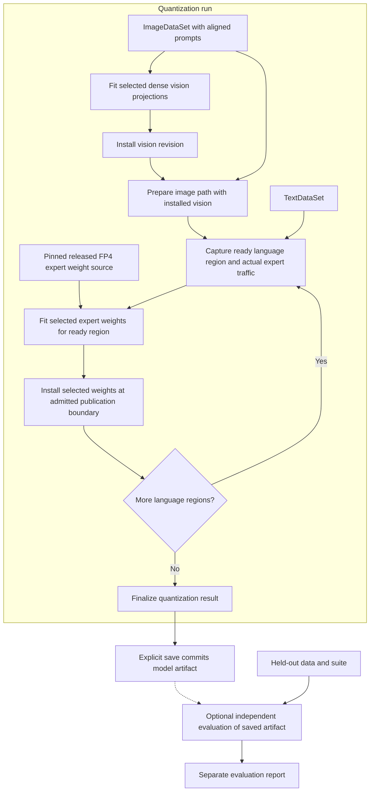

<!-- SPDX-FileCopyrightText: 2026 ModelCloud.ai
SPDX-License-Identifier: Apache-2.0 -->

# DeepSeek V4.1 Flash: mock config and design target

**Status:** revision 0.13 design example, 2026-10-29. This is a proposed API and
an acceptance target for the redesign, not an executable current-package example
or a validated quantization recipe. No model loading or quantization was performed.
See the [main design](component-quantization-design.md),
[API contract](quantization-plan-api.md),
[data contract](quantization-data-contract.md),
[parallel contract](quantization-parallel-execution.md) and
[device placement contract](quantization-device-placement.md).

The requested workload changes both vision and language. Interpret "last ten MoE
modules per layer" as the last ten **routed experts in every main-backbone MoE
layer**, selected by global expert ID. The visual encoder is dense and has no MoE
expert collection, so the example gives it a separate quantization operation.
If the write scope must contain only MoE weights, omit the vision operation;
image preparation and vision execution are still needed for multimodal language
calibration. [Vision implementation][vision]

## Pinned architecture and write scope

Checkpoint: `deepseek-ai/DeepSeek-V4.1-Flash-1017` at
`1bae0e1088993b9b82de08f59de5be5a34e42170`.

| Part | Pinned structure | Intended change |
| --- | --- | --- |
| Vision encoder | 32 dense ViT blocks. | Fit its admitted dense linear projections with illustrative 8-bit GPTQ. |
| Main language backbone | 40 layers, 384 routed experts per layer, top-6 routing. | Refit expert IDs **374–383 in each layer**, including gate/up/down projections, with illustrative 4-bit GPTQ. |
| Shared experts | One per main MoE layer. | Preserve. |
| DSpark draft | Three prediction layers, 128 routed experts per layer. | Preserve; outside the main `language` owner. |
| Engram tables | Declared at main layers 1 and 14. | Preserve; explicitly request CPU backing and lookup with separate NUMA policies. This needs an admitted lookup/transfer backend. |
| Other owners | Projector, language attention, routers, norms, embeddings/head, Engram projections, and other weights outside the selected vision projections and experts. | Preserve their payloads while executing the required forward paths. |

Counts and released FP8/FP4 configuration come from the
[pinned configuration][config]. The reference implementation distinguishes main
and draft MoE configurations and assigns global expert IDs before rank ownership.
Its expert `w1`, `w3`, and `w2` map to gate, up, and down respectively.
[Backbone implementation][backbone]

## Mock config

`image_text_samples`, `text_samples`, `held_out_data`, and `held_out_suite` are
caller-provided bindings. The first two are finite or explicitly bounded source
views with stable identities. Image records include their aligned prompts; the
separate text corpus is not implicitly paired with those images. The optional
suite/data are used only after saving, to evaluate text and image-conditioned
behavior independently of quantization.

```python
checkpoint = "deepseek-ai/DeepSeek-V4.1-Flash-1017"
revision = "1bae0e1088993b9b82de08f59de5be5a34e42170"

model = GPTQModel.load(checkpoint, revision=revision)
source = SourceSnapshot(checkpoint, revision=revision)

last_10_experts = (
    DynamicModuleTargeting()
    .experts(type="routed")
    .last(10, per="moe_layer", order_by="expert_id")
)

vision_devices = (
    Local(gpus=[0])
    .place(
        DynamicModuleTargeting(component="vision"),
        execute="cuda:0", fit="cuda:0",
    )
)
language_devices = (
    Local(gpus=[0, 1, 2, 3], numa_nodes=[0, 1])
    .place(
        DynamicModuleTargeting(component="vision"),
        execute="cuda:0",  # Execute the installed vision revision for images.
    )
    .place(
        DynamicModuleTargeting(component="language").dense(),
        execute=ByLayer({range(0, 20): "cuda:0", range(20, 40): "cuda:1"}),
    )
    .place(
        DynamicModuleTargeting(component="language").experts(type="routed"),
        execute=ByExpert(
            {range(0, 192): "cuda:2", range(192, 384): "cuda:3"},
            per="moe_layer",
        ),
        fit=RoundRobin(devices=["cuda:2", "cuda:3"], unit="expert", per="moe_layer"),
    )
    .place(
        DynamicModuleTargeting(component="language", role="conditional_memory_table"),
        storage=ByLayer({
            1: CPU(numa=0, memory_policy="bind"),
            14: CPU(numa=1, memory_policy="bind"),
        }),
        execute=ByLayer({
            1: CPU(numa=0, cores=list(range(0, 8))),
            14: CPU(numa=1, cores=list(range(32, 40))),
        }),
    )
)

job = Quantize(
    Vision(GPTQ(bits=8, group_size=128))
        .Use(ImageDataSet(image_text_samples))
        .Default(devices=vision_devices),
    Language(
        GPTQ(bits=4, group_size=128),
        target=last_10_experts,
        source=source.dequantized(),
    )
        .Use(TextDataSet(text_samples))
        .Default(devices=language_devices),
    model=model,
)

resolved = job.Compile()
print(resolved.explain())
run = model.run(resolved)
artifact = run.save("deepseek-v4.1-flash-mixed")

# Optional evaluation of the saved artifact; outside the quantization plan.
report = artifact.evaluate(suite=held_out_suite, data=held_out_data)
```

The bits and group sizes are mock design choices, not measured recommendations.
Device/NUMA IDs are illustrative physical requests and require matching local
hardware. Component `.Default(devices=...)` values configure this action;
`Quantize(Vision(...), Language(...))` runs them serially in that exact order.
There is no global device setting on an outer plan. `load()` is a source-backed handle,
with bulk tensor allocation deferred until each action's materialization policy
is established. Existing eagerly allocated models need verified placement or an
explicitly budgeted migration; CPU affinity alone cannot relocate their tables.
`Vision` supplies vision scope; its omitted `target` is `Target.AUTO`.
The proposed checkpoint mapping resolves that default to the vision encoder's
quantizable projections and keeps the projector in its separate bridge group.
`Language` supplies main-backbone scope, narrowed by the
`DynamicModuleTargeting` query. Neither operation needs a module path string.
The names are labels; changing them cannot change scope or select additional
weights. AUTO does not consume language weights left outside the expert query.

The mapping's semantic owners and default groups are proposed adapter contracts.
The adapter must verify selected tensor representations:
`QuantizeComponent` requires dense stored vision weights and rejects a packed input.
A dense ViT topology alone does not prove that its checkpoint weights are dense.

The language declaration supplies an explicit source because the released routed
experts are already FP4; compilation records a `RequantizeComponent` operation.
`source.dequantized()` explicitly fits decoded values from that pinned
release; it does not recover original BF16 weights or request a dense full-model
teacher. It is a lazy weight-source descriptor with bounded decoding inside the
consuming fitting stage. It neither changes the source snapshot nor retains an
expanded inference-weight cache. The source codec, scales, decoded numerical
profile, and new output representation must appear in provenance.

The selector is grouped **before GPU sharding**. It resolves to 400 logical
expert groups and 1,200 logical gate/up/down projection weights. Fused or sharded
storage must map those logical weights to their actual owners; partial writes
require an admitted representation, never changes to neighboring experts.
It does not mean the last ten layers, the most active ten experts, or ten experts
per GPU. Shared experts and draft experts are excluded by ownership and expert type.

## Data flow and quantization order

No `route=` or per-component data binding is needed. The adapter derives the image
and text paths, including downstream consumers. Image-derived embeddings enter
the language backbone, so its selected experts receive observations from both
supplied paths. [Multimodal architecture][report]



Serial constructor order makes the installed vision result precede
candidate-conditioned language capture. The pinned source supplies the expert
weights being refitted; it does not force language observations to use the old
vision outputs. After
each admitted language publication boundary, subsequent observations respect
the current candidate and the method's within-layer dependencies. This remains
progressive fitting, not simultaneous joint optimization.
Each lifecycle action can still use admitted multi-GPU execution internally;
the positional sequence controls completion order between vision and language.

The quantization plan ends at its method/integrity checks. `save()` commits the
complete mixed artifact before optional `artifact.evaluate(...)` starts. The
evaluator loads the persisted representations with fresh inference state and
writes a separate report. Missing evaluation data or a later evaluation failure
cannot block quantization/saving, mutate the artifact, or restart fitting.

Only selected owners are written, but the model still executes its required
attention, memory, projector, router, and expert paths. Routing considers the
complete expert bank; selecting ten experts for writes cannot force tokens into
those experts. Low traffic must trigger the method's declared coverage failure
or an explicitly different fallback plan, rather than count as a successful fit.

The four listed GPUs describe the requested pool, not a claim that this model
fits on four unspecified devices. The planner must account for the entire
executed model, native mixed-format kernels, capture/fit buffers, and host/scratch
budgets. It may chunk independent expert fits or use admitted distributed capture
and model partitions. Unsupported layouts or insufficient resources fail with a
concrete explanation; the plan cannot silently substitute a different algorithm.

## Placement is independent of write selection and action order

The vision action uses GPU 0. The language action requests dense execution groups
on GPU 0 for layers 0-19 and GPU 1 for layers 20-39. Within every main MoE layer,
the full routed expert bank executes with IDs 0-191 on GPU 2 and 192-383 on GPU 3.
That expert-parallel forward requires an admitted adapter/communication path;
independent fitting workers alone do not provide it. Only selected experts
374-383 are fitted, distributed five apiece across GPUs 2 and 3 by global ID.
Their gate/up/down matrices remain grouped, and installed payloads return to
the correct owners independent of the fitting worker.

Engram table backing is bound by layer to NUMA nodes 0 and 1; lookup workers use
the separately requested CPU cores. The adapter must validate these core/node
relationships and support the CPU lookup plus bounded transfer to GPU fusion
operators. The [pinned config][config] identifies Engram layers; it does not prove
this placement/backend combination exists in GPTQModel. Hash/history state and
image-token masks must follow the native semantics. Table quantization is outside
this example's write scope. Untargeted placements, including bridge/endpoints and
non-table storage/buffers, remain automatic but must appear in the preview.

These are hard execution maps, not promises that every layer stays resident.
Unspecified backing storage can use admitted bounded materialization within the
resolved host/GPU budgets. `ByExpert` assigns whole experts, not tensor shards.
The action may set `.Default(parallel=DataParallel(...))` or the tensor counterpart,
with an applicable `.MoE(...)` override; the method resolves its stages. Replication or tensor
splitting cannot silently override these single-device owner assignments. A new
compatible mapping/mesh and capability check are required for such a variant.
`Parallel(...)` explicitly requests lifecycle overlap and must be admitted for
these objectives and resources. This example keeps native expert routing.
`job.MoE(routing=MoERouting.bypass)` would request a different calibration experiment
for the selected routed experts; it cannot reuse native statistics or widen the
last-ten query. See the [composer contract](quantization-composer-api.md).

## Expected preview and acceptance target

The following is an expected resolution summary, **not captured runtime output**:

```text
vision
  target: AUTO in vision scope -> mapped vision encoder projections
  data: image source through inferred image path

language
  waits for: installed vision revision
  target: DynamicModuleTargeting in language scope
  writes: main layers 0..39, routed expert IDs 374..383, gate/up/down
  count: 400 expert groups; 1,200 logical projection weights
  weights: bounded decoding of pinned released FP4 values
  observations: candidate image path + text-only path

vision devices: GPU 0
language devices: GPUs 0,1,2,3; NUMA nodes 0,1
  dense execution: layers 0..19 -> GPU 0; 20..39 -> GPU 1
  routed execution: each layer IDs 0..191 -> GPU 2; 192..383 -> GPU 3
  selected expert fits: five per GPU 2/3 in each layer
  Engram storage: layer 1 -> NUMA 0; layer 14 -> NUMA 1
  Engram lookup: CPU cores 0..7 / 32..39, subject to topology/backend validation
  backing, buffers, transfers, kernels, and total memory: feasibility pending
```

The preview contains no evaluation stage. After the run, the caller saves the
assembled result; optional evaluation then reads that committed artifact,
including preserved owners, and records text/image metrics separately.

These are future conformance requirements, not tests passed by this PR:

| ID | Required demonstration |
| --- | --- |
| DS1 | Omitted target equals explicit `Target.AUTO` in vision scope and resolves only mapped encoder projections. The language `DynamicModuleTargeting` query resolves the expected main-layer expert IDs before sharding. Renaming jobs cannot change selection; reject missing/ambiguous defaults, insufficient expert counts, and ambiguous ordering. |
| DS2 | Preserve all unselected packed/dense payloads and aliases, including the projector, shared experts, and draft owners; require a valid partial-write codec for fused expert storage. |
| DS3 | Infer image/text routes without manual bindings; collect language observations from both, and invalidate image features when their vision producer changes. |
| DS4 | Decode only the declared low-bit weight source during fitting, preserve native source identity, and distinguish the new representation from the native FP4 baseline. |
| DS5 | Preserve global expert selection, sample weights, method dependencies, and producer revisions across admitted serial and multi-GPU layouts; handle low expert coverage explicitly. |
| DS6 | Reject incompatible kernels/layouts or infeasible memory before dependent writes. Quantization requires no evaluation suite/data; after successful save, an independent evaluator reads the committed artifact. Its failure/retry cannot alter saved weights or quantization success. |
| DS7 | Preserve action-local placements: dense layer groups, full routed forward bank, five selected expert fits per GPU 2/3 per layer, and table-specific CPU/NUMA allocation. Verify native lookup/mask behavior and bounded transfers; unsupported CPU lookup, topology, or conflicting data/tensor layouts fail without moving other active actions' owners. |
| DS8 | Composer lowering retains vision-first serial order, per-component settings, image-derived language observations, explicit packed-weight source, and exact last-ten selection. Parallel and bypass variants require separate admission/provenance; neither silently changes order, routing, or selected writes. |

[config]: https://huggingface.co/deepseek-ai/DeepSeek-V4.1-Flash-1017/blob/1bae0e1088993b9b82de08f59de5be5a34e42170/config.json
[vision]: https://huggingface.co/deepseek-ai/DeepSeek-V4.1-Flash-1017/blob/1bae0e1088993b9b82de08f59de5be5a34e42170/inference/vision.py
[backbone]: https://huggingface.co/deepseek-ai/DeepSeek-V4.1-Flash-1017/blob/1bae0e1088993b9b82de08f59de5be5a34e42170/inference/model.py
[report]: https://arxiv.org/html/2609.19969v1#S2.SS1.SSS1
