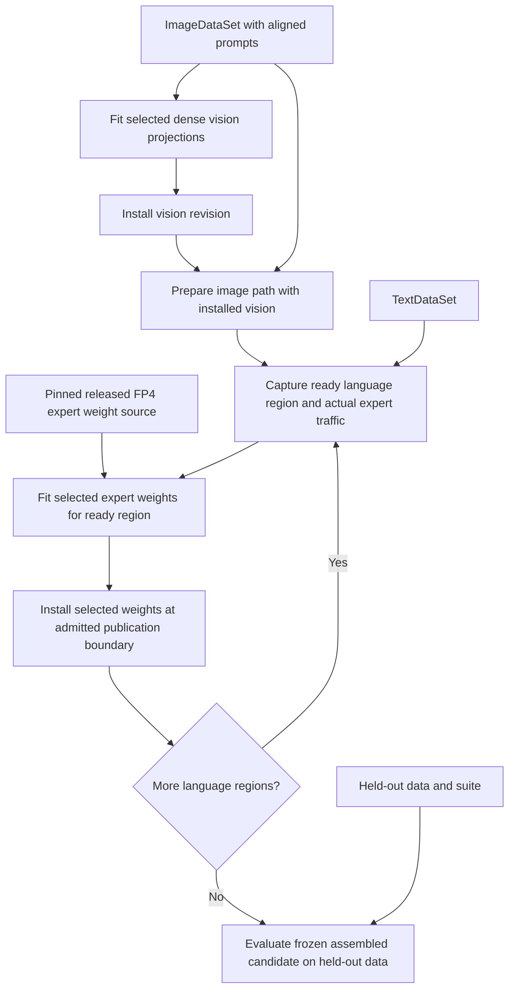

<!-- SPDX-FileCopyrightText: 2026 ModelCloud.ai
SPDX-License-Identifier: Apache-2.0 -->

# DeepSeek V4.1 Flash: mock config and design target

**Status:** revision 0.7 design example, 2026-10-29. This is a proposed API and
an acceptance target for the redesign, not an executable current-package example
or a validated quantization recipe. No model loading or quantization was performed.
See the [main design](component-quantization-design.md),
[API contract](quantization-plan-api.md),
[data contract](quantization-data-contract.md), and
[parallel contract](quantization-parallel-execution.md).

The requested workload changes both vision and language. Interpret "last ten MoE
modules per layer" as the last ten **routed experts in every main-backbone MoE
layer**, selected by global expert ID. The visual encoder is dense and has no MoE
expert collection, so the example gives it a separate quantization operation.
If the write scope must contain only MoE weights, omit the vision operation;
image preparation and vision execution are still needed for multimodal language
calibration. [Vision implementation][vision]

## Pinned architecture and write scope

Checkpoint: `deepseek-ai/DeepSeek-V4.1-Flash-1017` at
`1bae0e1088993b9b82de08f59de5be5a34e42170`.

| Part | Pinned structure | Intended change |
| --- | --- | --- |
| Vision encoder | 32 dense ViT blocks. | Fit its admitted dense linear projections with illustrative 8-bit GPTQ. |
| Main language backbone | 40 layers, 384 routed experts per layer, top-6 routing. | Refit expert IDs **374–383 in each layer**, including gate/up/down projections, with illustrative 4-bit GPTQ. |
| Shared experts | One per main MoE layer. | Preserve. |
| DSpark draft | Three prediction layers, 128 routed experts per layer. | Preserve; outside the main `language` owner. |
| Other owners | Projector, language attention, routers, norms, embeddings/head, Engram, and other weights outside the selected vision projections and experts. | Preserve their payloads while executing the required forward paths. |

Counts and released FP8/FP4 configuration come from the
[pinned configuration][config]. The reference implementation distinguishes main
and draft MoE configurations and assigns global expert IDs before rank ownership.
Its expert `w1`, `w3`, and `w2` map to gate, up, and down respectively.
[Backbone implementation][backbone]

## Mock config

`image_text_samples`, `text_samples`, `held_out_data`, and `held_out_suite` are
caller-provided bindings. The first two are finite or explicitly bounded source
views with stable identities. Image records include their aligned prompts; the
separate text corpus is not implicitly paired with those images. The final suite
checks both text and image-conditioned behavior on disjoint data.

```python
checkpoint = "deepseek-ai/DeepSeek-V4.1-Flash-1017"
revision = "1bae0e1088993b9b82de08f59de5be5a34e42170"

model = GPTQModel.load(checkpoint, revision=revision)
source = SourceSnapshot(checkpoint, revision=revision)

last_10_experts = (
    Select.component("language")
    .experts(kind="routed")
    .last(10, per="moe_layer", order_by="expert_id")
)

plan = (
    Plan()
    .devices(Local(gpus=[0, 1, 2, 3]))
    .data(
        ImageDataSet(image_text_samples),
        TextDataSet(text_samples),
    )
    .add(Quantize(
        target="vision.encoder",
        recipe=Recipe(GPTQ(bits=8, group_size=128)),
        name="vision",
    ))
    .then(Requantize(
        target=last_10_experts,
        recipe=Recipe(GPTQ(bits=4, group_size=128)),
        source=source.dequantized(),
        name="language",
    ))
    .evaluate(suite=held_out_suite, data=held_out_data)
)

resolved = plan.compile(model)
print(resolved.explain())
```

The bits and group sizes are mock design choices, not measured recommendations.
`vision.encoder` and `language` are proposed semantic adapter owners, not assumed
module attribute paths. The adapter must verify selected tensor representations:
`Quantize` requires dense stored vision weights and rejects a packed input.
A dense ViT topology alone does not prove that its checkpoint weights are dense.

The language operation is `Requantize` because the released routed experts are
already FP4. `source.dequantized()` explicitly fits decoded values from that pinned
release; it does not recover original BF16 weights or request a dense full-model
teacher. It is a lazy weight-source descriptor with bounded decoding inside the
consuming fitting stage. It neither changes the source snapshot nor retains an
expanded inference-weight cache. The source codec, scales, decoded numerical
profile, and new output representation must appear in provenance.

The selector is grouped **before GPU sharding**. It resolves to 400 logical
expert groups and 1,200 logical gate/up/down projection weights. Fused or sharded
storage must map those logical weights to their actual owners; partial writes
require an admitted representation, never changes to neighboring experts.
It does not mean the last ten layers, the most active ten experts, or ten experts
per GPU. Shared experts and draft experts are excluded by ownership and kind.

## Data flow and quantization order

No `route=` or per-component data binding is needed. The adapter derives the image
and text paths, including downstream consumers. Image-derived embeddings enter
the language backbone, so its selected experts receive observations from both
supplied paths. [Multimodal architecture][report]



`.then(...)` makes the installed vision result precede candidate-conditioned
language capture. The pinned source supplies the expert weights being refitted;
it does not force language observations to use the old vision outputs. After
each admitted language publication boundary, subsequent observations respect
the current candidate and the method's within-layer dependencies. This remains
progressive fitting, not simultaneous joint optimization.

Only selected owners are written, but the model still executes its required
attention, memory, projector, router, and expert paths. Routing considers the
complete expert bank; selecting ten experts for writes cannot force tokens into
those experts. Low traffic must trigger the method's declared coverage failure
or an explicitly different fallback plan, rather than count as a successful fit.

The four listed GPUs describe the requested pool, not a claim that this model
fits on four unspecified devices. The planner must account for the entire
executed model, native mixed-format kernels, capture/fit buffers, and host/scratch
budgets. It may chunk independent expert fits or use admitted distributed capture
and model partitions. Unsupported layouts or insufficient resources fail with a
concrete explanation; the plan cannot silently substitute a different algorithm.

## Expected preview and acceptance target

The following is an expected resolution summary, **not captured runtime output**:

```text
vision
  writes: admitted dense vision projections
  data: image source through inferred image path

language
  waits for: installed vision revision
  writes: main layers 0..39, routed expert IDs 374..383, gate/up/down
  count: 400 expert groups; 1,200 logical projection weights
  weights: bounded decoding of pinned released FP4 values
  observations: candidate image path + text-only path

evaluation
  reads: frozen final composition, including preserved owners
  data: disjoint held-out text and image tasks

devices: local GPUs 0,1,2,3; layout and memory feasibility must be resolved
```

These are future conformance requirements, not tests passed by this PR:

| ID | Required demonstration |
| --- | --- |
| DS1 | Resolve the pinned semantic owners and grouped selector to the expected main-layer expert IDs; reject missing owners, fewer than ten experts in a selected group, and ambiguous ordering. |
| DS2 | Preserve all unselected packed/dense payloads and aliases, including the projector, shared experts, and draft owners; require a valid partial-write codec for fused expert storage. |
| DS3 | Infer image/text routes without manual bindings; collect language observations from both, and invalidate image features when their vision producer changes. |
| DS4 | Decode only the declared low-bit weight source during fitting, preserve native source identity, and distinguish the new representation from the native FP4 baseline. |
| DS5 | Preserve global expert selection, sample weights, method dependencies, and producer revisions across admitted serial and multi-GPU layouts; handle low expert coverage explicitly. |
| DS6 | Reject incompatible kernels/layouts or an infeasible memory plan before dependent writes; successful final evaluation uses the assembled candidate and cannot feed refitting. |

[config]: https://huggingface.co/deepseek-ai/DeepSeek-V4.1-Flash-1017/blob/1bae0e1088993b9b82de08f59de5be5a34e42170/config.json
[vision]: https://huggingface.co/deepseek-ai/DeepSeek-V4.1-Flash-1017/blob/1bae0e1088993b9b82de08f59de5be5a34e42170/inference/vision.py
[backbone]: https://huggingface.co/deepseek-ai/DeepSeek-V4.1-Flash-1017/blob/1bae0e1088993b9b82de08f59de5be5a34e42170/inference/model.py
[report]: https://arxiv.org/html/2609.19969v1#S2.SS1.SSS1
