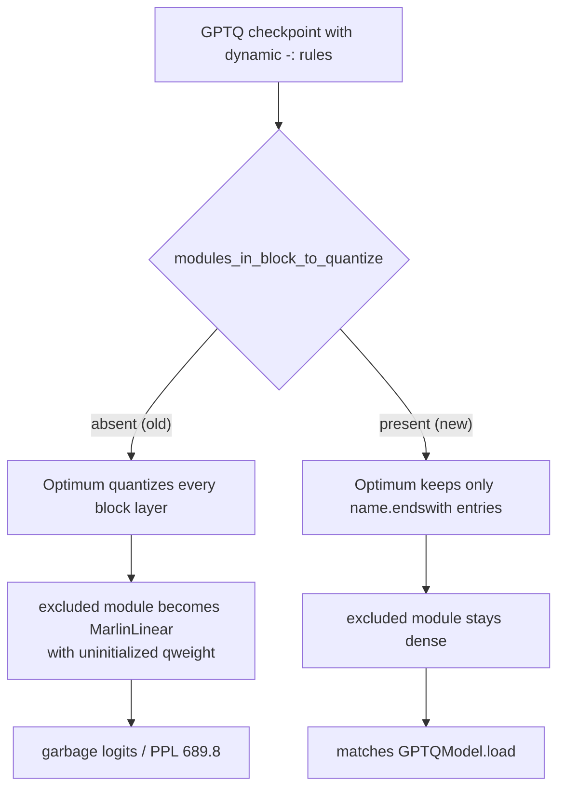
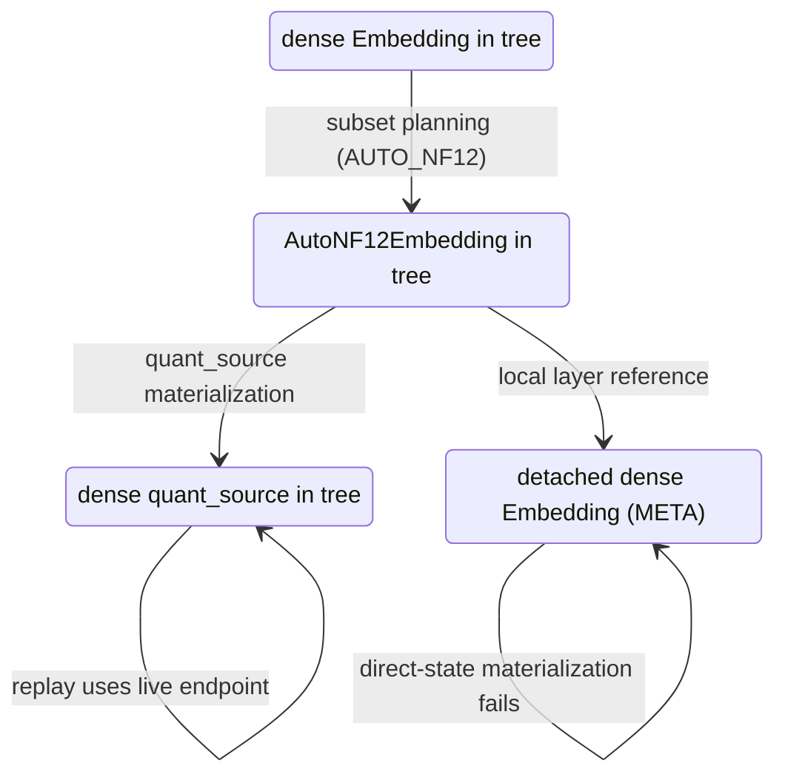
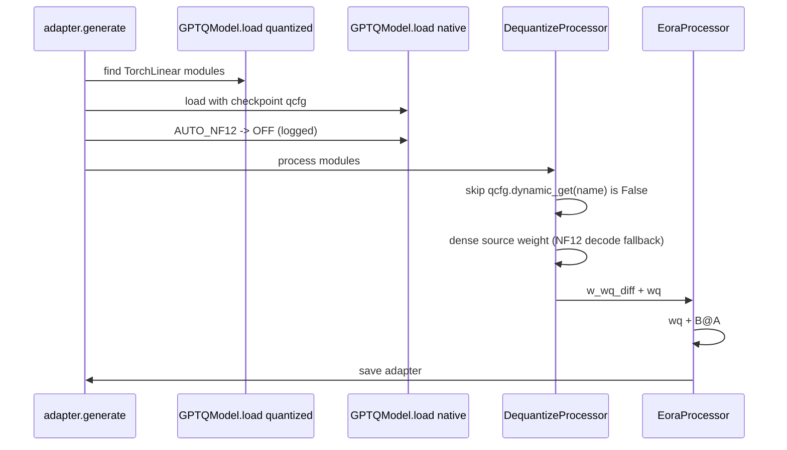
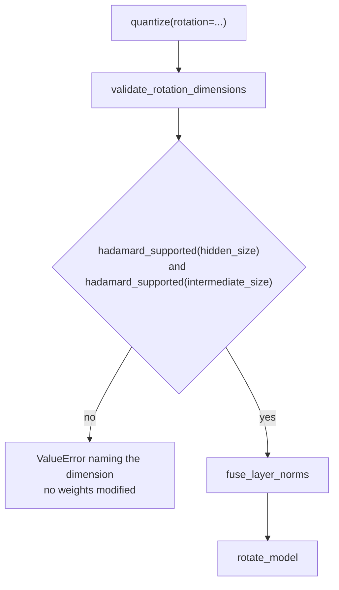
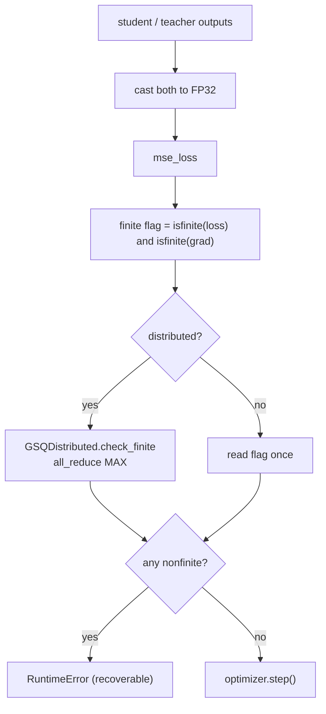

# Quantization features: dynamic exclusions, endpoint requantize, post-quant EoRA, rotation, and GSQ

This page describes the feature-level contracts fixed for issue #4077. Every
flow below is fail-closed: a checkpoint, model shape, or training step that
cannot be handled exactly raises before it can leave a partially converted
model behind.

| Feature | Entry point | Contract |
| --- | --- | --- |
| GPTQ `dynamic` `-:` exclusions | `save_quantized` / `GPTQModel.load` | The saved checkpoint declares the exact quantized module set so Optimum does not build uninitialized layers for excluded modules. |
| Endpoint requantize | `GPTQModel.requantize(embed_quant_mode=...)` | The endpoint module is re-resolved from the model tree before its forward and before replay; no detached META source is materialized. |
| Post-quant EoRA | `GPTQModel.adapter.generate` | The generator runs on dense native weights; checkpoint `-:` rules are honored by the dequantize stage. |
| Rotation | `GPTQModel.quantize(rotation=...)` | Unsupported widths fail with a `ValueError` before any weight is rotated. |
| Staged GSQ | `train_stage_update` | Losses reduce in FP32 and a nonfinite step raises a Python error instead of a device-side assert. |

## 1. GPTQ `dynamic` `-:` exclusions and plain HF loading

Optimum decides which modules to quantize from
`quantization_config.modules_in_block_to_quantize` and matches each entry with
`name.endswith`. A GPTQ checkpoint produced with `dynamic={"-:...": {}}` used
to carry only the exclusion regex, so Optimum quantized every block layer and
built a `MarlinLinear` with an uninitialized `qweight` for each excluded dense
module.



The save path computes the set from the live model
(`find_modules(model, layers=[BaseQuantLinear])`) and writes it as one group:

```json
"modules_in_block_to_quantize": [["model.layers.0.self_attn.q_proj", "..."]]
```

One group is required because Optimum flattens the field with
`sum(..., [])`; a flat list of strings raises `TypeError`. Full names are
suffix-matched by Optimum, and `GPTQModel.load` accepts either a block-relative
name or a full name (`relative.endswith(entry) or name.endswith(entry)`).

## 2. Endpoint requantize under AUTO_NF12

The input-embedding pseudo-layer *is* the projection. AUTO_NF12 replaces
`NamedModule.module` with an `AutoNF12Embedding`, and deferred dense-source
materialization later replaces it again with a dense `nn.Embedding`. The layer
reference captured before those swaps points at a detached module, so
direct-state materialization chased META tensors that were no longer in the
model tree.



`_resolve_live_endpoint_module` re-reads `get_input_embeddings`,
`get_output_embeddings`, or the `lm_head` after planning and again after the
subset passes. The second read is what keeps the replay from forwarding the
released AUTO_NF12 wrapper, whose packed buffers are empty by then.

## 3. Post-quant EoRA

The EoRA generator needs dense native weights twice: to build `w - wq` and to
install `wq + BA` back into the module. AUTO_NF12's
`AutoNF12HookedLinear` has no `weight` attribute, so `adapter.generate` now
disables AUTO_NF12 for that pass and logs why. The saved adapter dtype and the
quantized checkpoint are unchanged.



`DequantizeProcessor` now receives the checkpoint's `qcfg`. A module that the
checkpoint's `-:` rules left dense is skipped instead of popping a missing
entry from the quantized-weight map. If a packed module is still supplied
directly, `_dense_source_weight` decodes it through `dequantize_weight`; NF12
stores BF16 bit patterns exactly.

## 4. Rotation validation

`rotate_model` rotates embeddings, the head, norms, and attention in place
before it reaches the MLP output. `get_hadK` then rejected a width such as
Qwen2.5's `intermediate_size=4864` with a bare `AssertionError`, leaving a
half-rotated model.



`hadamard_supported` asks the same `get_hadK` contract used by the transform,
so the predicate cannot drift from the code it guards. A supported width is a
power of two, or a power-of-two multiple of one of 172, 156, 140, 108, 60, 52,
36, 28, 40, 20, or 12.

## 5. Staged GSQ precision and failure mode

A staged loss used `F.mse_loss` in the model dtype. An FP16 residual of 300
squares to `inf`, and `torch._assert_async` then fired a device-side assert
that poisons the CUDA context for the rest of the process.



The forward stays in the model dtype; the reduction is widened to FP32. Two
other half-precision overflows in the same path are also avoided: the relaxed
assignment exponent (`logits * multiplier`, with a multiplier in the hundreds)
is evaluated in FP32, and the trainable logits themselves are stored in FP32.
Without the last two, a real FP16 Llama run reaches NaN logits before the loss
can be reduced. The finiteness check is read once per stage update, so the cost
is one synchronization rather than one per loss and trainable tensor.

## Related pages

- [Checkpoint interop](checkpoint-interop.md) for the producer-side module
  filter grammar.
- [Quantization memory and tensor lifetimes](quantization-memory.md) for the
  replay and cache ownership rules.
- [AWQ dynamic group size](awq-dynamic-group-size.md) for `dynamic` resolution
  outside GPTQ.
