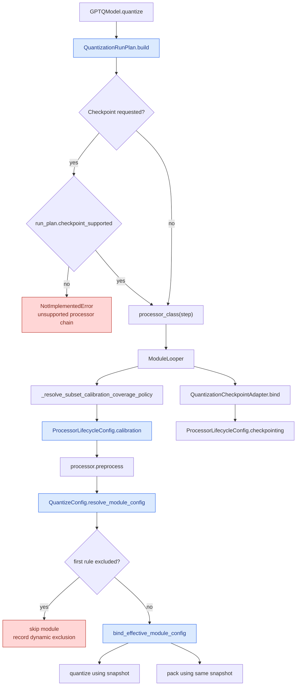

# Quantization lifecycle contracts

A quantization run now uses three explicit contracts:

1. `QuantizationRunPlan` records the method, format, backends, batch size, and ordered processor chain.
2. `ProcessorLifecycleConfig` declares replay behavior, calibration policies, and checkpoint support on each processor.
3. `EffectiveModuleConfig` freezes the first matching `dynamic` rule and its values for one module.

The flow keeps quantization math and packing on the same resolved values while making unsupported processor chains fail before tensor work begins.

## Abstraction boundary

The redesign follows two rules:

- A shared lifecycle property is declared only when multiple processors or lifecycle stages consume the same decision.
- Method math, kernel selection, capture storage, and method-specific failure rules stay inside the processor that owns them.

| Shared contract | Consumers | Why it is shared |
| --- | --- | --- |
| `QuantizationRunPlan.processors` | `BaseQModel`, `ModuleLooper`, checkpoint preflight | GPTQ, QQQ, AWQ, ParoQuant, EXL3, weight-only, native, and EoRA runs need one ordered chain. |
| `ProcessorLifecycleConfig.execution` | subset planning, layer replay, capture hooks | Multiple calibrated methods use the same replay decisions. |
| `ProcessorLifecycleConfig.calibration` | GPTQ, QQQ, AWQ, ParoQuant, VPTQ, subset planning | Those methods require calibration traffic before quantizing a module. |
| `ProcessorLifecycleConfig.checkpointing` | checkpoint adapter and checkpoint preflight | Primary and EoRA adapter processors compose in the same continuation chain. |
| `EffectiveModuleConfig` | quantization and packing | Multiple methods consume the same first-match dynamic rule, and both stages must see one snapshot. |

The three contracts do not introduce a generic quantization algorithm, a processor registry for every method, or a shared math interface. Those details remain local because they change for reasons unrelated to the common lifecycle.

## New flow



The run plan is immutable after preflight. `BaseQModel.quantization_run_plan` exposes it for diagnostics:

```python
from gptqmodel.models import ProcessorStep, QuantizationRunPlan

model.quantize(calibration, backend=BACKEND.AUTO)
print(model.quantization_run_plan.describe())

assert ProcessorStep.GPTQ in model.quantization_run_plan.processors
```

Example result for GPTQ with EoRA:

```json
{
  "method": "gptq",
  "export_method": "gptq",
  "format": "gptq",
  "pack_backend": "gptq_torch",
  "loop_backend": "auto",
  "batch_size": 1,
  "weight_only": false,
  "processors": ["gptq", "eora"],
  "checkpoint_supported": true
}
```

Exact backend values depend on the method and device. The plan reports the values selected by preflight.

## Processor lifecycle API

Processors declare lifecycle behavior instead of being recognized through class lists:

```python
from gptqmodel.looper.loop_processor import (
    CalibrationTypes,
    CheckpointSupport,
    ExecutionConfig,
    LoopProcessor,
    ProcessorLifecycleConfig,
)

class ExampleProcessor(LoopProcessor):
    lifecycle_spec = ProcessorLifecycleConfig(
        calibration=CalibrationTypes.EACH_MODULE_NEEDS_INPUT,
        checkpointing=CheckpointSupport.PRIMARY,
    )

    def __init__(self, require_fwd=True, **kwargs):
        super().__init__(
            **kwargs,
            lifecycle_spec=self.lifecycle_spec.with_execution(ExecutionConfig(
                require_fwd=require_fwd,
                fwd_replay_after_process=True,
                subset_forward_early_stop=True,
            )),
        )
```

`ExecutionConfig` controls forward replay and activation capture. `CalibrationTypes.EACH_MODULE_NEEDS_INPUT` makes uncovered modules fail or be pruned according to the existing fallback policy. `CheckpointSupport.PRIMARY` permits the processor as the first checkpoint owner; `CheckpointSupport.SECONDARY` permits an EoRA-style second processor.

The checkpoint adapter accepts `(PRIMARY,)` and `(PRIMARY, SECONDARY)`. Other chains raise `NotImplementedError` before the quantization loop starts.

## Per-module settings API

Resolve a module once when inspecting or integrating a processor:

```python
from gptqmodel.quantization.config import QuantizeConfig

config = QuantizeConfig(
    bits=4,
    group_size=128,
    dynamic={
        r"-:^model\.layers\.0\.mlp\.down_proj$": {},
        r"+:^model\.layers\.0\.": {"bits": 3, "group_size": 64},
    },
)

snapshot = config.resolve_module_config("model.layers.0.self_attn.q_proj")
assert snapshot.source_pattern == r"+:^model\.layers\.0\."
assert snapshot.get("bits") == 3

excluded = config.resolve_module_config("model.layers.0.mlp.down_proj")
assert excluded.excluded
```

The snapshot is immutable and retains the ordered winning rule. Later edits to `config.dynamic` affect new resolutions; they do not change an existing snapshot. Processors bind the snapshot to `NamedModule.state["effective_module_config"]`, and `create_quant_module` consumes it during packing. This prevents quantization and packing from resolving different values after a concurrent or late dynamic edit.

## Before and after

| Decision | Before | After |
| --- | --- | --- |
| Processor selection | `_quantize_with_calibration` branched over methods and imported processors inline (`base.py:2161-2260` in the parent revision). | `QuantizationRunPlan.build` returns an ordered `ProcessorStep` tuple; `processor_class` loads only the selected processor. |
| Calibration input requirement | `stage_subset.py:233-235` matched a hard-coded processor class tuple. | `stage_subset.py:222` reads `ProcessorLifecycleConfig.calibration`. |
| Checkpoint admission | `gptq_checkpoint.py:249-265` matched a hard-coded processor-type set. | `gptq_checkpoint.py:244` validates declared `checkpointing` values. |
| Per-module settings | GPTQ repeated `dynamic_get` for each field (`gptq_processor.py:129-164` in the parent revision). | `resolve_module_config` caches the first ordered match and returns one immutable snapshot (`config.py:3238`). |
| Pack settings | Packing called `create_quant_module` with the base dynamic mapping and re-resolved rules. | `create_quant_module(..., effective_module_config=snapshot)` uses the quantization snapshot (`utils/model.py:609`). |

## Failure and ambiguity contract

| Situation | Result |
| --- | --- |
| Calibrated method has no processor mapping | `QuantizationRunPlan.build` raises `ValueError` before the looper starts. |
| Weight-only config requests EoRA or native capture | `QuantizationRunPlan.build` raises `NotImplementedError`. |
| Checkpoint processor chain is unsupported | `quantize()` raises `NotImplementedError` before processor construction. |
| `lifecycle_spec.execution` and `execution_config` disagree | `LoopProcessor.__init__` raises `ValueError`. |
| Negative dynamic rule wins | The module is skipped and the exclusion is recorded by the existing calibration policy. |
| Snapshot name differs from the packed module name | `create_quant_module` raises `ValueError`; a snapshot cannot leak across modules. |

The new types live in `gptqmodel/looper/loop_processor.py`, `gptqmodel/models/quantization_run_plan.py`, and `gptqmodel/quantization/config.py`.
