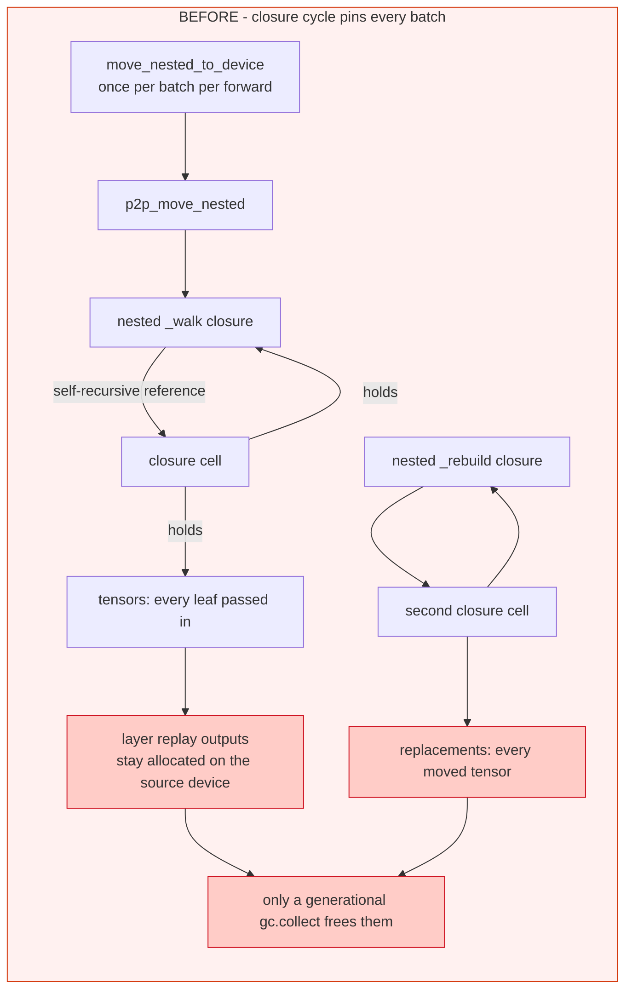
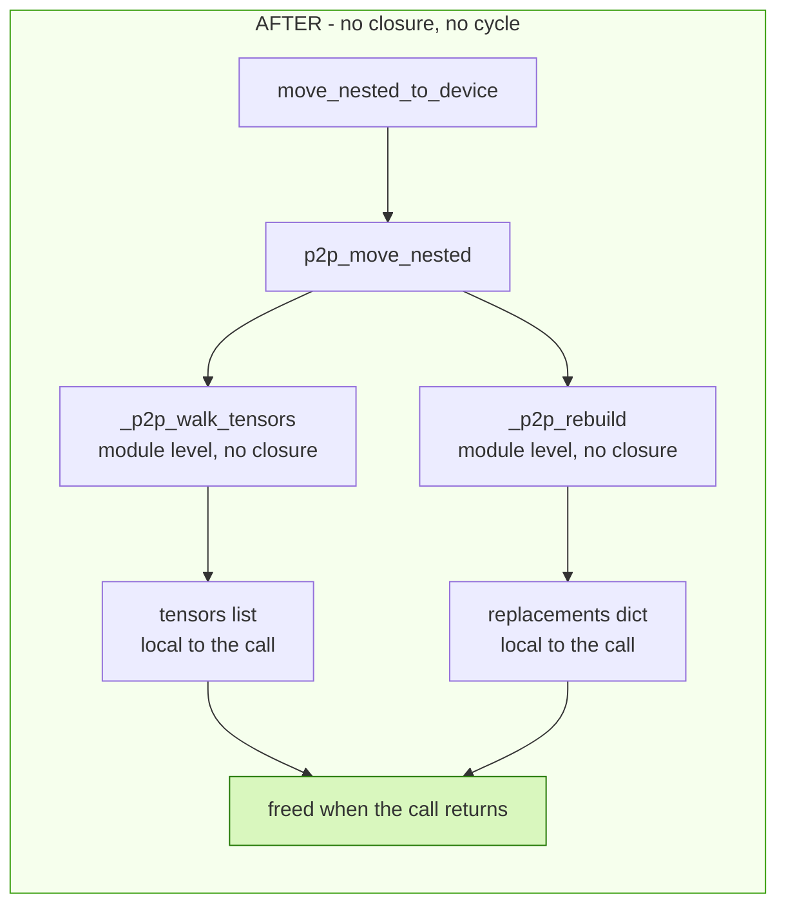
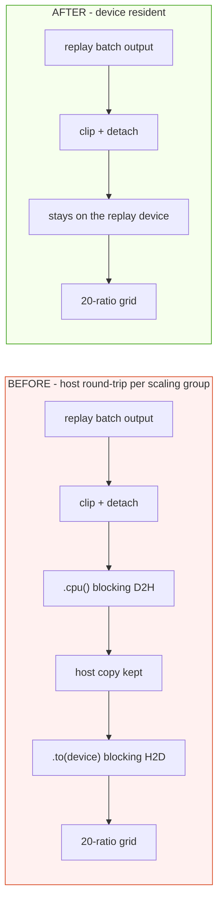
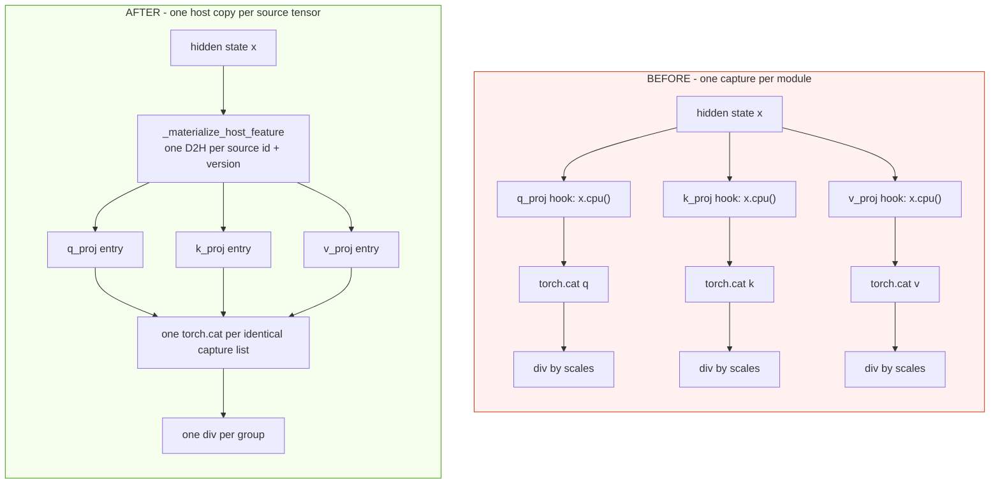
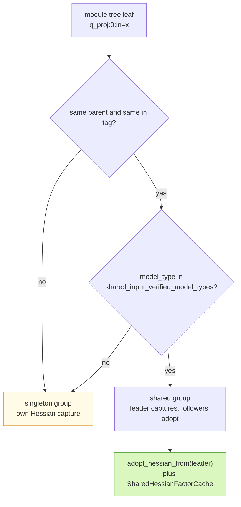

# Quantization memory and tensor lifetimes

Quantization is the most memory-hungry thing GPT-QModel does. A calibration
forward captures one decoder layer's input, the looper replays that input through
each layer in isolation to accumulate its Hessian, and AWQ additionally captures
every projection's input activation to search per-channel scales. Both paths
move nested batches between devices and keep host copies of activations, so the
memory contract is narrow but strict:

* a replayed batch's activations are released as soon as the batch that consumed
  them finishes, without waiting for Python's cyclic garbage collector;
* duplicate work on one activation object is paid once, not once per projection;
* the FP reference used by the scale grid is materialized once, on the device
  that consumes it.

Introduced by the fix for issue #4020. Every change here keeps the packed
`qweight`/`scales`/`qzeros`/`g_idx` tensors bitwise identical.

## 1. Nested activation moves must not form reference cycles

`move_nested_to_device` (`gptqmodel/utils/looper_helpers.py:172`) calls
`p2p_move_nested` for every batch of every forward pass. The traversal and the
rebuild were nested, self-recursive closures:

A function that refers to itself is reachable only through its own closure cell,
so the cell, the function and everything else in that closure (`tensors`) form an
uncollectable-until-cyclic-GC island. CPython's generational collector runs on
allocation counts, not on the quantization loop's progress, so in practice the
island survived the whole run. The audit in #4020 measured an 8-layer run ending
with 1792 MB still live (896 tensors, 7 layers x 128 batches) whose referrer
chain ended in a `p2p_move_nested.<locals>._walk` closure cell.

| Mechanism | Before | After |
| --- | --- | --- |
| Traversal | nested `_walk` closing over `tensors` (`gptqmodel/utils/p2p.py:2033-2043`) | module-level `_p2p_walk_tensors(item, out)` (`gptqmodel/utils/p2p.py:2009`), iterative |
| Rebuild | nested `_rebuild` closing over `replacements` (`gptqmodel/utils/p2p.py:2088-2097`) | module-level `_p2p_rebuild(item, replacements)` (`gptqmodel/utils/p2p.py:2031`) |
| Traversal order | depth-first, declaration order | unchanged (explicit stack, children pushed reversed) |
| Tensor lifetime | until a cyclic GC pass | reference-counted, released with the caller's result |

The traversal stays depth-first in declaration order, so `pending` and `staged`
keep their pairing and the copy enqueue order is unchanged.

## 2. The AWQ FP reference stays on the replay device

`_search_best_scale` builds the FP reference output one replay batch at a time
and used to move every chunk to host "so scale search does not keep the full
activation tensor resident on GPU". `_compute_best_scale` then moved every chunk
straight back to the module device and kept it there for the whole 20-ratio grid,
so the stated goal was never achieved: each scaling group paid a blocking D2H,
a blocking H2D and an extra host copy of the full activation.

`_build_chunked_reference_outputs` (`gptqmodel/looper/awq_processor.py:3834`)
still streams the replay batch by batch, so the reference is materialized once
rather than once per grid step. Peak device memory is unchanged, because the full
reference is resident during the grid either way.

## 3. Sibling projections share one capture

`q_proj`/`k_proj`/`v_proj` and `gate_proj`/`up_proj` are hooked separately but
read the *same* activation object. Before this change each module paid its own
D2H transfer, its own host allocation, its own `torch.cat` and its own in-place
scale division: 7 captures per layer where only 4 are unique.

Three invariants keep this bitwise identical:

1. **One host copy per unique source tensor.** `_materialize_host_feature`
   (`gptqmodel/looper/awq_processor.py:663`) keys the cache on
   `(batch_index, id(source), source._version)` and revalidates the entry with a
   `weakref`, so a recycled id can never hand a sibling the wrong activations.
   The cache is dropped when the calibration batch changes and when the layer
   finalizes. Masked captures (`_masked_hook_wrapper` builds a fresh masked tensor
   per sibling) and inference tensors (no version counter) are never shared.
2. **One `torch.cat` per identical capture list.** `_layer_input_features`
   (`gptqmodel/looper/awq_processor.py:1227`) caches the concatenation by the
   tuple of input tensor ids.
3. **One scale division per tensor per group.** `apply_scale`
   (`gptqmodel/quantization/awq/quantize/scale.py:139`) tracks which group already
   divided each object. A tensor reached by a *different* group is restored from a
   pristine clone taken before the first division, so the second group still sees
   the captured value.

`_scale_feature_by_module` keeps the first module name for a shared tensor, so the
telemetry column stays deterministic instead of depending on dict order.

## 4. Hessian input dedup needs `:in=` tags and a verified forward

`HessianInputDedup` only groups modules that declare the same `:in=<tag>` on
their module-tree leaves, and only for `model_type`s listed in
`shared_input_verified_model_types`. Untagged trees capture one Hessian per
projection even though q/k/v (or gate/up) see identical inputs.

The verification gate is deliberate: a wrong tag silently reuses another module's
Hessian, so a tag only activates after
`tests/module_tree/test_shared_input_cpu_forward.py` observes the real forward and
confirms both siblings received the same tensor. This change adds tags to the
trees the issue listed and adds real-forward cases for the dense architectures it
could build on CPU:

| Definition | Tagged trees | Verified model type |
| --- | --- | --- |
| `definitions/glm.py` | attention, mlp | `glm` |
| `definitions/exaone4.py` | attention, mlp (both trees) | `exaone4` |
| `definitions/hunyuan_v1_dense.py` | attention, mlp | `hunyuan_v1_dense` |
| `definitions/apertus.py` | attention (both trees) | `apertus` |
| `definitions/gemma4.py` | attention, mlp (text and composite trees) | `gemma4_text` |
| `definitions/gemma3.py` | VL tree attention, mlp | inert until `gemma3` is verified |
| `definitions/mistral3.py` | attention, mlp | inert until `mistral3` is verified |

Apertus' MLP has no gate projection, so only its attention triple is tagged. GLM
ships a fused `gate_up_proj` in the source model; the converted tree splits it into
`gate_proj`/`up_proj`, and the real-forward probe confirmed both read the same
input, which is why the MLP is tagged.

The vision-language wrappers (`mistral3`, `gemma3` VL, `gemma4` composite) keep
their tags but stay inert: their model types cannot be built by
`AutoModelForCausalLM.from_config`, so no tiny real forward exists to verify them.
Dedup remains off for them, which is the fail-safe default.

## 5. Measured

RTX 4090 (48 GiB), CUDA 13.0 / torch 2.16, transformers 5.22.2. Calibration is
128 x 512 tokens, GPTQ and AWQ are 4-bit gs128, `offload_to_disk` default.
"Before" is `origin/main`; "after" is this change. The host was shared with other
workers, and the same configuration varied by 30-50% in wall time between runs,
so device memory and packed hashes are the reported metrics and no wall-time
claim is made.

| Run | Peak device alloc | Live at end of run | Allocator retries | Packed SHA-256 |
| --- | --- | --- | --- | --- |
| 8-layer GPTQ, before | 2397.5 MB | 1803.6 MB | 0 | `157265fa...` |
| 8-layer GPTQ, after | **952.8 MB** (-60.3%) | **267.6 MB** | 0 | `157265fa...` (identical) |
| 8-layer AWQ, before | 5389.2 MB | 1892.1 MB | 8 | `b709e98b...` |
| 8-layer AWQ, after | **3853.2 MB** (-28.5%) | **356.1 MB** | 7 | `b709e98b...` (identical) |
| 5-layer 70B-dim GPTQ, before | 19221.0 MB | 4148.3 MB | 4 | `d7246844...` |
| 5-layer 70B-dim GPTQ, after | **16149.0 MB** (-16.0%) | **1076.3 MB** | 4 | `d7246844...` (identical) |

The deterministic per-layer regression is a weakref liveness check on the real
`p2p_move_nested`: with cyclic GC disabled, a dropped batch's tensors are still
alive 8/8 times before the fix (32 MiB still allocated on the source device) and
0/8 after, with no `gc.collect()`.

Host RSS did not move reproducibly: one 8-layer AWQ pair measured 9152 -> 8436 MB
and another 8675 -> 8756 MB. The capture sharing removes duplicate host copies,
but peak RSS is dominated by allocator retention, so it is not reported as a win.

### Hessian dedup

The dedup win is structural and measurable as a count, not as a wall time on this
host. On a 2-layer EXAONE 4 decoder at 70B dimensions (h8192/i28672, 64 heads,
8 KV heads), 128 x 512 calibration tokens:

| Setting | Adopted followers | Leader groups | Packed SHA-256 |
| --- | --- | --- | --- |
| `dedup_shared_inputs=True` | 6/6 | 4 | `3803fa7b...` |
| `dedup_shared_inputs=False` | 0 | 0 | `3803fa7b...` (identical) |

Five captures per layer (q/k/v plus gate/up) collapse to two. The wall time of
that comparison moved in both directions across repeated runs (25.9/34.5 s vs
32.1/38.1 s in one pair, 45.2 s vs 36.6 s in another), so it is not evidence.

## Related reading

* [Calibration layer replay](calibration-replay.md) - the replay contract the
  moved batches belong to.
* [Hessian accumulation flow](gptq-hessian-accumulation.md) - what the dedup
  shares.
* [Multi-GPU quantization](multi_gpu_quantization.md) - the peer-copy mover that
  `p2p_move_nested` feeds.
