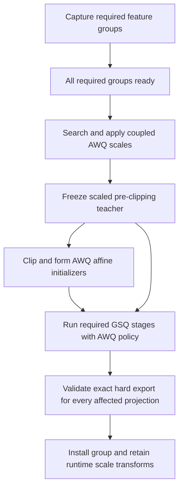
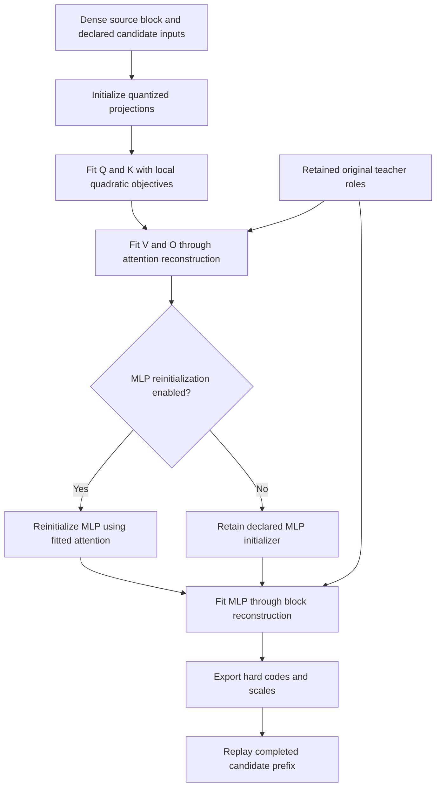
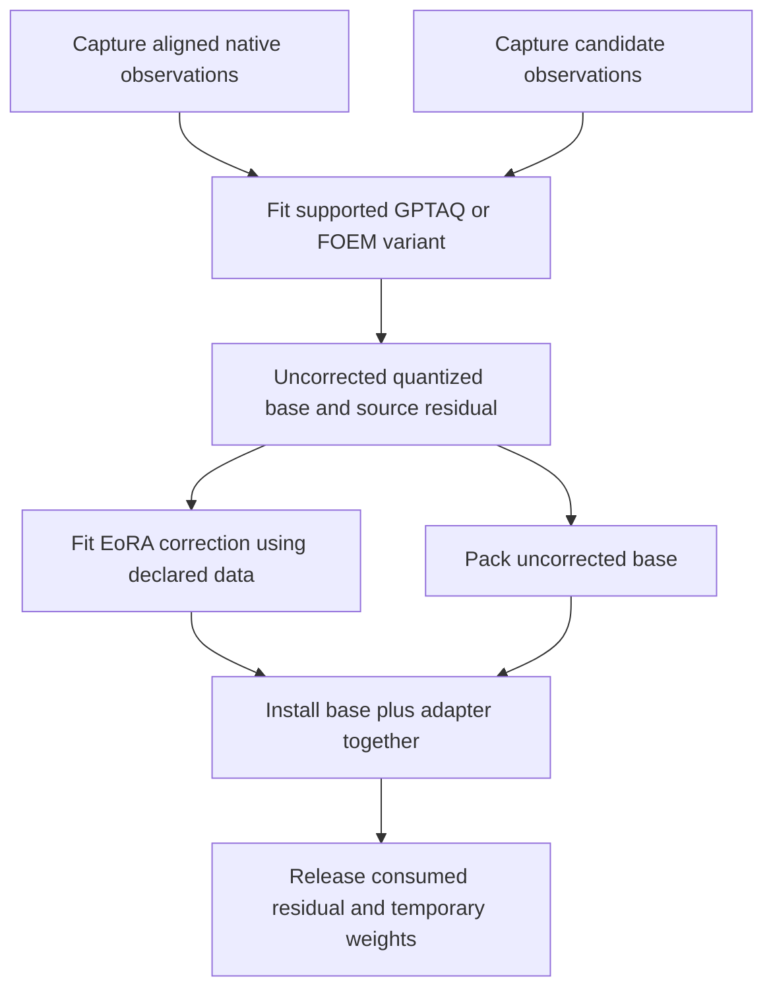

<!-- SPDX-FileCopyrightText: 2026 ModelCloud.ai
SPDX-License-Identifier: Apache-2.0 -->

# Quantization lifecycle inventory and design constraints

**Status:** evidence for revision 0.2 of the
[component quantization proposal](component-quantization-design.md), 2026-10-27.
This is a source audit and design input, not an implementation or a claim that
every combination below is supported today.

The audit baseline is GPTQModel
[`536b7f9b`](https://github.com/ModelCloud/GPTQModel/tree/536b7f9b6af3c1e39f1e7a1b2e58a50d8793af4e).
Repository links below identify the inspected files; observations refer to that
revision even if those files change later.

## 1. Coverage and classification

The inventory covers all nine entries in `METHOD` and all ten concrete method
configuration classes in [config.py](../gptqmodel/quantization/config.py):
`GPTQConfig`, `AWQConfig`, `ParoConfig`, `QQQConfig`, `VPTQConfig`, `FP8Config`,
`BitsAndBytesConfig`, `EXL3Config`, `RTNConfig`, and `GGUFConfig`. It also covers
modifiers, staged training, activation calibration, norm tuning, adapters,
endpoint quantization, and the separate native MLX entrypoint.

`METHOD` alone is not a lifecycle discriminator. RTN has its own configuration
and execution path while using GPTQ/AWQ serialization identities. FP8 has both
weight-only and activation-calibrated paths. GSQ can be a per-weight refinement
or an architecture-specific staged optimizer. An output format does not tell
the planner which algorithm ran, what data it required, or which artifacts it
must preserve.

The proposed registry therefore identifies a **method, variant, modifiers,
architecture contract, execution backend, and output representation** separately.
It validates their combination. Format variants such as GGUF quant types and
AWQ layouts need codec/numerical capabilities, but do not automatically introduce
a new orchestration lifecycle.

## 2. Method inventory

The lifecycle column describes the current source, not a mandatory new common
sequence. Capture, fitting, reconstruction, packing, and installation can be
separate stages, fused stages, repeated stages, or absent.

| Route | Observed lifecycle and data needs | Constraint on the redesign |
| --- | --- | --- |
| GPTQ | Capture module inputs/Hessian statistics, solve with method-specific damping/order/group policies, expose reconstructed weights for sequential replay, and pack scalar parameters later. | Subset ordering and shared-input capture matter. Statistics reuse requires identical observation semantics. A universal end-to-end loss must not be imposed on local GPTQ. |
| RTN | `RTNConfig` uses the weight-only looper. Round source weights, retain scalar quantization parameters, then export through supported GPTQ/AWQ layouts. Optional GSQ has its own requirements. | No activation dataset, tokenizer, teacher forward, or Hessian is inherently required. Algorithm identity must survive use of another method's file layout. |
| GGUF | Weight-only path delegates quantization/encoding to `pack_original` for the selected GGUF quant type. | Encoding can perform the actual numerical fit. The executor cannot require that every packer receive a precomputed scalar result. |
| FP8, ordinary | Weight-only direct packing with configured scale granularity; optional weight-based GSQ refinement. | Data-free scale/code optimization remains data-free. Scales and format metadata are part of the numerical result. |
| FP8, calibrated GSQ | `FP8GSQProcessor` collects inputs and validity masks, fits with activation-aware objectives and optional sequence weighting, retains fitted FP8 bytes/scales, and provides decoded weights for replay. | Export must install the exact fitted payload, not quantize the decoded replay weight again. This route has different requirements from ordinary FP8 and supports a restricted scale-method/configuration set. |
| bitsandbytes | `BitsAndBytesConfig` uses direct weight-only packing for supported INT8/4-bit representations. | Backend-specific payloads and metadata are valid outputs without a Hessian or common scalar tuple. |
| AWQ | Capture input features across subsets, wait until the layer's required groups are ready, search/apply coupled scales and clipping, install pseudo-quantized weights, and pack later. Optional GSQ can run after initialization. | A module callback is not necessarily a completed fit. Scale transformations can write neighboring projections/norms; capture barriers and write closure must be explicit. |
| ParoQuant (`paroquant`) | Capture, optimize, export, then pack. Optimization scope can be module, compute block, or layer. Grouped scopes can retain a pristine teacher; optional noisy-input training maintains separate clean and candidate streams. | Optimization is intrinsic to the method. It needs autograd, optimizer/RNG state, scope-specific teachers, and rotation/channel-scale artifacts. It cannot be reduced to one Hessian solve or deferred entirely to optional global refinement. |
| QQQ | Hessian-based fitting with QQQ-specific scales including `q_scales_extra`, reconstructed weights, and specialized W4A8 packing/runtime handling. Optional GSQ has a QQQ adapter. | Preserve the extra scales and the method/runtime relationship. GPTQ-shaped parameters alone do not describe the result. |
| VPTQ | Online Hessian capture, optional permutation/normalization, weighted codebook fitting and sequential compensation, optional residual codebooks, then vector-quantized installation. | Codebooks, indices, permutations, and normalization are first-class outputs. Low/no-coverage fallbacks are VPTQ policies, not an automatic RTN fallback. |
| EXL3 | Hessian capture, EXL3 transforms/regularization and LDLQ/trellis quantization, reconstructed replay weights, and installation of the already-produced trellis payload. | Installation is not another scalar quantizer/packer. Retain transform and trellis metadata and stochastic state. Validate actual public-path device and modifier restrictions. |

Primary implementation evidence:

- [GPTQ processor](../gptqmodel/looper/gptq_processor.py) and
  [GPTQ task](../gptqmodel/quantization/gptq.py).
- [Weight-only processor](../gptqmodel/looper/weight_only_processor.py),
  [weight-only looper](../gptqmodel/looper/weight_only_looper.py), and
  [RTN task](../gptqmodel/quantization/rtn.py) for RTN, GGUF, FP8, and bitsandbytes.
- [Calibrated FP8 processor](../gptqmodel/looper/fp8_gsq_processor.py) and
  [FP8 GSQ task](../gptqmodel/quantization/gsq_fp8_task.py).
- [AWQ processor](../gptqmodel/looper/awq_processor.py), especially deferred
  `_AWQLayerState` completion and `_quantize_layer`.
- [ParoQuant processor](../gptqmodel/looper/paroquant_processor.py).
- [QQQ processor](../gptqmodel/looper/qqq_processor.py).
- [VPTQ processor](../gptqmodel/looper/vptq_processor.py),
  [VPTQ task](../gptqmodel/quantization/vptq.py), and [VPTQ notes](vptq.md).
- [EXL3 processor](../gptqmodel/looper/exllamav3_processor.py) and
  [EXL3 quantizer](../gptqmodel/exllamav3/modules/quant/exl3_lib/quantize.py).

VPTQ illustrates why fallback is part of a method's contract: absent traffic can
preserve the dense representation, while configured low-coverage handling can
use Hessian-free vector quantization. Unusable statistics have another declared
fallback. The result and report must identify the branch actually used.

## 3. Modifiers and additional operations

These are not all interchangeable decorators. Some change observations, some
introduce whole optimization programs, and some operate on an already quantized
model. Their compatibility must be declared per combination.

| Operation or modifier | Current behavior | Required lifecycle information |
| --- | --- | --- |
| GPTAQ | A `NativeProcessor` captures native inputs before candidate processing; the GPTQ processor selects the GPTAQ task. | Distinct aligned native/candidate observations and their producer revisions. Native capture has a different replay policy from the candidate processor. |
| FOEM | Uses its own GPTQ-derived task; positive `alpha` adds native capture, while the zero case does not require that extra processor. | Requirements depend on resolved configuration. Do not reuse plain GPTQ Hessians or observations solely because module names match. |
| Per-linear GSQ | Method adapters refine supported GPTQ/RTN/AWQ/ParoQuant/QQQ/FP8 results under their respective constraints. | Initializer, objective, candidate representation, scale rules, data requirements, stopping budget, and hard export must remain method-specific. |
| Staged GSQ with GPTQ/RTN initialization | A separate dense-Llama orchestration performs Q/K fitting, V/O attention reconstruction, optional MLP reinitialization after attention, and MLP/block reconstruction. | Required ordered training stages, original teacher roles, candidate initializers, capture/validation sets, exact hard export, and prefix-dependent continuation. |
| Staged AWQ GSQ | Captures a scaled teacher before clipping/quantization, initializes from AWQ affine payloads, and runs staged fitting with MLP reinitialization disabled. | Teacher creation is a named stage between transformations. Replacing this teacher with the raw source changes the method. Validate the whole export group before replacing AWQ metadata. |
| RCO bit allocation utility | Budget-constrained optimization of per-layer precision choices with a coupled model objective and discrete assignment; this is not a separate `METHOD` export route. | A global planning/search operation can emit a resolved precision allocation. Candidate materialization and observations belong to bounded search stages; install only a capability-checked resolved plan. |
| EoRA during quantization | Consumes activation statistics and the source-to-quantized residual, optionally using a separate calibration dataset, to produce LoRA correction. | Retain the uncorrected quantized base and residual until the adapter consumes them. Base packing and adapter publication must not count the correction twice. |
| Post-quantization EoRA | `_eora_generate` uses a dequantization processor plus EoRA on an existing quantized model with source data/weights. | A distinct operation accepting packed base artifacts; it must not force base-weight requantization. |
| Preprocessors | Ordered plans for `AutoModuleDecoderConfig`, `TensorParallelPadderConfig`, and `SmootherConfig`; source decoding/materialization can be deferred until quantization handoff. | Stage-specific source roles, shape/alias updates, numerical transforms, runtime/persistence effects, and write closure. Planning alone need not run a forward. |
| Rotation and norm fusion | Pre-quantization reparameterization can fuse norms, untie embeddings, rotate coupled weights, and require online Hadamard execution. | Structural writes and runtime transforms must be declared; a local target cannot silently authorize a model-wide rewrite. |
| Activation quantization/calibration | W4AFP8/W4A_NVFP4 paths install specialized calibration and inference replay; activation-scale probing/freezing can precede Hessian collection. A separate activation-only calibration path operates on existing INT4 Llama weights. | Weights, activation scales, replay mode, and cache format are separate resources. An operation may change activation metadata without changing packed weights. Current architecture restrictions remain capabilities. |
| Norm tuning | Teacher-based distillation updates selected RMSNorm/LayerNorm parameters on an otherwise quantized model. | A gradient-enabled operation with its own objective, teacher, steps, and allowed writes; packed base tensors remain unchanged. |
| Embedding/output-head targeting | Input, output, or both endpoints can be selected; special save/replacement paths preserve untouched shards. | Endpoint ownership, tied identity, method-dependent data needs, and complete mixed-artifact persistence. Endpoints are not assumed to be decoder-loop members. |
| Architecture preparation/finalization | Model-specific capture hooks prepare off-loop modules and restore runtime state; finalization can restore cross-branch module/parameter aliases after offload and quantization. | Architecture-owned stages declare setup, restoration, alias effects, and complete-composition installation conditions. Per-layer completion alone does not imply the assembled model is ready. |

Evidence:
[native capture](../gptqmodel/looper/native_processor.py),
[GPTAQ](../gptqmodel/quantization/gptaq.py),
[FOEM](../gptqmodel/quantization/foem.py),
[scalar GSQ](../gptqmodel/quantization/gsq_scalar.py),
[ParoQuant GSQ](../gptqmodel/quantization/gsq_paro.py),
[QQQ GSQ](../gptqmodel/quantization/gsq_qqq.py),
[FP8 GSQ](../gptqmodel/quantization/gsq_fp8.py),
[staged GSQ model driver](../gptqmodel/looper/gsq_training_model.py),
[staged GSQ capture](../gptqmodel/looper/gsq_training_capture.py),
[staged GSQ training](../gptqmodel/quantization/gsq_training.py),
[staged AWQ](../gptqmodel/looper/gsq_training_awq.py),
[RCO](../gptqmodel/quantization/rco.py),
[EoRA](../gptqmodel/looper/eora_processor.py),
[dequantization handoff](../gptqmodel/looper/dequantize_processor.py),
[preprocessors](../gptqmodel/looper/module_preprocessor.py),
[activation calibration](../gptqmodel/quantization/activation_calibration.py),
[norm tuning](../gptqmodel/quantization/norm_tuning.py), and
[public dispatch/rotation/endpoint operations](../gptqmodel/models/base.py).
[DiffusionGemma's capture and finalization hooks](../gptqmodel/models/definitions/diffusion_gemma.py)
provide a concrete cross-branch alias example.

GAR/group-order choices, damping, smoothing fallbacks, and quantizer-internal
search options also belong in the method's numerical signature and observation
compatibility checks. They need not become independent top-level lifecycle
families unless they introduce new orchestration requirements.

## 4. Four traces the design must represent

These simplified traces omit resource placement and diagnostics. They illustrate
why a fixed `capture -> fit -> replay -> pack` interface loses information.

### Data-free conversion and payload installation

There is no obligatory model forward or dataset. RTN may split quantization and
encoding; GGUF/direct pack may fuse them. Calibrated FP8 instead supplies an
already-fitted packed payload to installation. Neither case justifies silently
running another quantizer at the finalization boundary.

### AWQ with staged GSQ

An immutable raw source is still recorded. The method's teacher is a distinct,
derived immutable artifact. Teacher identity includes the applied scale
transforms and the stage at which it was frozen.

### Staged GSQ with GPTQ/RTN initialization

This is already a multi-phase algorithm inside one selected model region. Its
stages are not equivalent to optionally refining an otherwise completed GPTQ
run. Training and validation batches, masks, target caches, optimizer state,
random streams, and fitted-prefix lineage are part of the program.

### Native observations, GPTAQ/FOEM, and EoRA

This trace is conditional on the resolved combination being supported. Finalizer
ordering is a producer/consumer dependency. A generic processor list reversal is
not a sufficient extension contract, though today's reversal preserves important
handoffs. Tests already protect specialized uncorrected-weight handoffs for
QQQ/ParoQuant in
[test_specialized_eora_lifecycle.py](../tests/test_specialized_eora_lifecycle.py).

## 5. Framework, execution, and continuation constraints

The present [ExecutionConfig](../gptqmodel/looper/loop_processor.py) already
distinguishes forward requirements, post-processing replay, one-pass capture,
early stopping, activation capture, and full layer-forward context. These are
useful evidence that a common processor signature does not mean a common
sequence. [Layer finalization](../gptqmodel/looper/stage_layer.py) also reverses
processor finalization and manages asynchronous work whose lifetime must end
before an attempt is released.

The redesign should preserve those semantics through declared stage/artifact
dependencies, not copy the old processor protocol as its universal interface.
An all-modules native capture, an AWQ group barrier, and a no-forward conversion
must be distinguishable before execution.

Native MLX is another lifecycle boundary:
[GPTQModel.quantize_mlx](../gptqmodel/models/auto.py) and
[mlx_native.py](../gptqmodel/quantization/mlx_native.py) provide an MLX-LM
load/quantize/save path for GPTQ/AWQ. It does not require a Torch model with
Torch forward hooks. Native GPTQ capture/installation and delegated MLX-LM AWQ
must be represented by their own execution capabilities. Per-method Metal/MLX
helpers elsewhere in the tree do not establish public-path parity for every
architecture, modifier, or checkpoint option. The same caution applies to
EXL3's internal backend helpers versus the public dispatch restrictions.

Staged GSQ can shard documents and synchronize training across ranks. A serial
outer scheduler therefore means one ready lifecycle operation at a time; it does
not require that the operation itself use only one device or process. Resources,
collectives, primary-rank work, failure propagation, and completion barriers
must be visible to the executor. See
[GSQ distributed support](../gptqmodel/quantization/gsq_distributed.py).

Current resumability is narrower than method availability.
[Checkpoint registration](../gptqmodel/looper/gptq_checkpoint.py) has explicit
processor combinations for GPTQ, AWQ, weight-only, QQQ, ParoQuant, and EXL3, with
selected EoRA combinations and architecture/configuration restrictions. It does
not register every processor: VPTQ and calibrated `FP8GSQProcessor` cannot be
assumed to support that generic checkpoint route. GPTAQ/FOEM, rotation, dynamic
overrides, and endpoint selections also encounter restrictions there. Staged
GSQ has a separate completed-block/prefix continuation path.

The proposed capability is therefore `resume at these declared boundaries for
this resolved combination`, not `every method can serialize every live task`.
If an optimizer cannot checkpoint mid-stage, report restart-from-stage behavior
or reject a requested finer resume guarantee before mutation. Quiesce asynchronous
packers, offload workers, device work, and distributed ranks at a durable barrier.

The existing [protocol schema/compiler](../gptqmodel/quantization/protocol.py)
already separates preparation, quantization, export, stages, and weight/input/
output/KV targets. Its compiler currently lowers a restricted **single stage,
single rule, weight-target specification** for selected methods; schema
fields do not establish implemented general multi-stage or activation/KV
execution. A weight target can still require activation calibration. These
concepts are useful inputs to the clean-sheet design, without
requiring compatibility with that compiler.

## 6. Consequences for admission of existing and future methods

The main proposal defines a `LifecycleProgram` contract. This audit supplies its
minimum acceptance cases:

1. Admit data-free conversion with no dataset or teacher execution.
2. Admit methods requiring one or several aligned observation streams and
   method-specific statistics; refuse invalid deduplication.
3. Express deferred capture groups and coupled transformations before mutation.
4. Freeze derived teachers at named stages, retaining immutable source lineage.
5. Run intrinsic optimization with bounded loops and backend/autograd resources.
6. Preserve scalar, vector, trellis, already-packed, adapter, activation-scale,
   norm, and structural artifacts without a forced scalar intermediate.
7. Compose modifiers only through compatible typed artifacts and declared scope.
8. Express model-wide searches and precision allocation without treating every
   local quantizer as a global optimizer.
9. Install exact fitted results, maintain packed inference storage, and release
   transient masters only after their final declared consumers.
10. Report supported resume/cancel/fallback boundaries per resolved combination.
11. Execute framework-native paths without a universal Torch hook or global
    inference-mode wrapper.
12. Add a future method with new stage names, bounded control flow, objectives,
    and artifact schemas without a new method-name branch in the coordinator.

Conformance must enumerate configuration **routes and combinations**, not just
the enum. A future method still needs a plugin, codec/runtime support, and
validation for its requirements. The contract is extensible; it does not promise
that an unknown future algorithm works without implementation. If a new method
requires a capability the contracts cannot express, revise the versioned
contracts explicitly rather than hiding effects inside an opaque callback.
