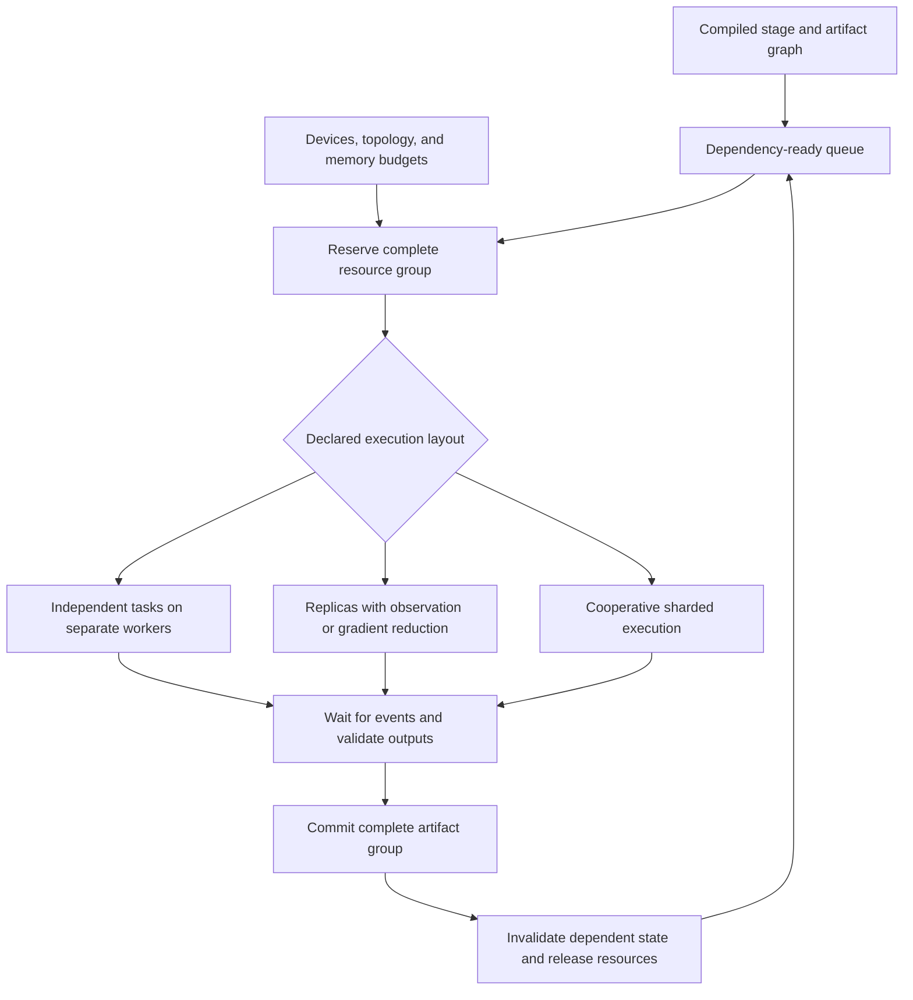

<!-- SPDX-FileCopyrightText: 2026 ModelCloud.ai
SPDX-License-Identifier: Apache-2.0 -->

# Parallel execution contract for quantization lifecycles

**Status:** revision 0.5 design proposal, 2026-10-29. No executor implementation
or performance measurements accompany this document.
See the [main design](component-quantization-design.md),
[method audit](quantization-method-lifecycles.md),
[architecture audit](quantization-architecture-2026.md), and
[API examples](quantization-plan-api.md). The
[data contract](quantization-data-contract.md) defines dataset cursors, shards,
streaming, splits, preparation identity, and consumed-sample provenance.

Multi-GPU quantization is a first-class requirement. A serial executor is useful
as a reference/debug profile; it is not the capability ceiling of the first
usable design. The planner must express both simultaneous independent jobs and
cooperative execution of one stage across devices. Every method need not support
every layout, but supported layouts and restrictions must be visible before a
long job starts.

## 1. Existing behavior to preserve or deliberately replace

At GPTQModel commit
[`536b7f9b`](https://github.com/ModelCloud/GPTQModel/tree/536b7f9b6af3c1e39f1e7a1b2e58a50d8793af4e),
parallel work is already broader than a serial layer traversal suggests:

| Existing mechanism | Source evidence | Design consequence |
| --- | --- | --- |
| Replicated calibration forwards | [forward_executor.py](../gptqmodel/looper/forward_executor.py) distributes batches across device replicas and restores result ordering. | Capture parallelism is distinct from fitting parallelism; sample/invocation identity must survive fan-out and gathering. |
| Device-local Hessian accumulation | [gptq.py](../gptqmodel/quantization/gptq.py) retains per-device partials and merges them at the fitting boundary. | Statistics need declared merge semantics, counts, readiness events, numerical profile, and target ownership. |
| Independent module/expert work | [module_looper.py](../gptqmodel/looper/module_looper.py) and [stage_subset.py](../gptqmodel/looper/stage_subset.py) assign device pools, form MoE chunks, and submit quantization work. | A ready region can contain independent jobs even when the layer order remains sequential. Memory and coverage policies govern concurrency. |
| Asynchronous finalization/offload | [stage_layer.py](../gptqmodel/looper/stage_layer.py) and [threadx.py](../gptqmodel/utils/threadx.py) manage device-scoped tasks and draining. | CPU packing, transfers, disk writes, and GPU work need bounded overlap and explicit completion; a callback returning is not a durable commit. |
| Distributed GSQ optimization | [gsq_distributed.py](../gptqmodel/quantization/gsq_distributed.py) and [gsq_training_model.py](../gptqmodel/looper/gsq_training_model.py) shard documents, synchronize state, reduce weighted updates, and coordinate primary-rank work. | A single lifecycle stage can own a collective group and multiple ranks. Global sample weighting and stage barriers are numerical semantics. |
| Method-specific limitations | `_restrict_quant_devices_for_method` currently restricts ParoQuant's quantization pool to one device; other paths have distinct restrictions. | Do not infer parallel support from GPU availability. Replace hidden branches with combination-specific capabilities, preserving explicit limitations until validated. |

These mechanisms do not establish generic tensor/expert/context parallel support
for every current method. The new contract must state what is implemented and
what is required but unavailable. Backend-specific fast paths, free-threaded
Python behavior, and method reentrancy are separate capabilities.

## 2. Different kinds of parallelism

| Kind | Unit of work | Correctness boundary |
| --- | --- | --- |
| Independent task parallelism | Separate branches, experts/modules with independent fitting objectives, independent candidate trials. | Disjoint writes, compatible versioned reads, isolated mutable state, and no unfulfilled artifact dependency. Shared AWQ transforms or grouped ParoQuant objectives can remove independence. |
| Data-parallel capture | Independent documents/episodes or declared trace partitions, using identical frozen producer revisions. | Method-specific observation/statistic merging. Whole recurrent streams stay together unless the adapter supports exact prefix/state handoff. |
| Data-parallel optimization | Replicated candidate parameters trained on disjoint observations. | Synchronize initialization, updates, weighting, optimizer-step boundaries, hard selection, and stopping decisions. Parallel copies trained independently are separate candidates, not one distributed optimizer. |
| Model parallel execution | Tensor, pipeline, expert, or supported context partitions for source/reference/candidate forwards. | Architecture/runtime declares the exact partitioned execution; weights, state, routing, and collectives retain global identities. A replica is not a shard. |
| Partitioned quantizer solve | Algorithm-approved row/group/expert partitions within a fitting task, or a distributed coupled solve. | Method declares mathematical separability and group boundaries. Input-column splitting can lose cross-column Hessian/coupling terms; it is not generic independent quantization. |
| Pipeline and I/O overlap | Materialization, capture, solve, packing, validation, and offload where dependencies allow. | Buffers remain live until events/consumers finish; bounded queues prevent activations, Hessians, or pending packed outputs from exhausting memory. |

Choosing a list of GPUs does not choose any of these semantics. For example,
capturing a batch on four replicas and fitting on one GPU is a different layout
from one tensor-sharded forward or a four-rank optimizer. The preview must show
that distinction.

MoE parallelism also has two meanings: executing a routed model with experts
sharded across devices, and distributing already-captured independent expert
fitting tasks. The latter does not by itself implement the former. Statistics
must follow actual routing, or an explicitly selected alternative coverage policy.

## 3. Logical plan and physical execution layout

Keep source/teacher/objective dependencies independent of placement. Compile the
logical plan into an `ExecutionLayout` using the supplied resource pool and
method/architecture capabilities. Record both identities. Relocating a task
cannot silently change its source policy, observation set, quantization grouping,
or objective.

The numerical plan fixes global sample selection, logical batch/optimizer-step
boundaries, weighting, and RNG policy. A layout may change supported microbatch
execution or worker assignment while preserving those semantics within its
declared equivalence guarantee. If world size changes batch packing, padding,
normalization, random draws, or update count in a way the method cannot preserve,
it changes the numerical plan and must be recompiled explicitly. Cache keys
include the resulting preparation and reduction identity.

| Contract | Required fields/behavior |
| --- | --- |
| Device context (`Local` or a supplied distributed context) | Visible devices/nodes, memory budgets, host/pinned-memory/disk budgets, interconnect/topology information when available, and allowed offload. Bound through `devices(...)` on a plan or `devices=` on a direct operation. No assumption that all visible GPUs form one fast collective domain. |
| `ParallelContract` | Legal task splits, replica/shard semantics, minimum/maximum workers, process/thread reentrancy, framework/backend restrictions, deterministic profile, and unsupported combinations. |
| `PartitionSpec` | Global tensor/owner identity, shard axes/ranges, replication groups, expert ownership, quantizer group alignment, and reconstruction/resharding rules. |
| `ObservationReducer` | Statistic schema, raw sufficient-statistic or other merge representation, counts/weights/masks, reduction precision/order, duplicate policy, and finalization point. `Not mergeable` is valid. |
| `CollectiveContract` | Participating group, ordered operations/epochs, collective inputs/outputs, synchronization points, failure propagation, and group ownership/lifetime. |
| `ExecutionLayout` | Stage-to-worker placement, declared mesh/group assignments, memory reservations, transfers, versioned boundary artifacts, and feasible concurrency. |
| `ContinuationContract` | Which distributed state is durable, rank/shard mapping, RNG/optimizer state where supported, restart boundaries, and whether a topology change can resume or requires restart/repartition. |

A method can request a replicated observation pass followed by a single-device
solve, independent solves followed by a grouped install, or a cooperative
multi-GPU optimizer. A model that cannot fit on one device can require sharded
execution rather than optional replication. If no supported plan meets that
requirement, compilation reports the blocking stage and required capability.

An algorithm-approved output-row split may share input statistics across workers.
A format's group size, codebook scope, AWQ scaling group, rotation, or joint loss
can constrain that split. A blanket `split(weight, n_gpus)` adapter is rejected.
Block-diagonal statistics or other approximations require a distinct, explicit
numerical recipe and validation; they cannot be a scheduler memory fallback.

## 4. Scheduling and resource ownership

The ready queue contains lifecycle stages with satisfiable dependencies. A stage
becomes runnable only when its exact input artifacts are available and its whole
resource request can be reserved. Independent work may overlap, but it cannot
read a producer halfway through a coupled update.

Resource reservation includes candidate/source weights, teacher/master copies,
activations, Hessians, optimizer state, collective workspaces, packing buffers,
dataset decode/preparation and prefetch queues, and transfers. Parameter bytes
alone are not a useful peak-memory estimate.
Replicating a large layer can increase memory beyond the savings from sharding
its data. Do not schedule every expert at once merely because GPU workers exist.

Use atomic group reservation: a collective job must not hold some devices while
waiting indefinitely for others held by a job that depends on it. Serialize
incompatible collective sequences on shared groups. Collectives participate in
the task dependency graph; they are not hidden calls that another worker may
never reach. Framework process isolation is required where hooks, global buffers,
environment settings, or runtimes are not reentrant.

The scheduler can prioritize a critical producer, reuse existing captures, batch
small independent solves, and overlap CPU/IO work. Those are performance policies
within a fixed numerical plan. A serial causal layer dependency remains serial
where needed, even while its observations and independent subproblems run in
parallel.

For example, a legal multimodal schedule may quantize vision and audio on separate
device groups, join at installed encoder revisions, then use all devices for a
distributed language stage. Within that stage, required Q/K -> V/O -> MLP training
order remains intact. This is concurrency around dependencies, not round-robin
updates of unrelated layer indices.

## 5. Distributed observations and state

Every observation carries its global sample/episode and invocation identity,
producer revision, valid mask, routing membership, and weight. The input manifest
defines partitioning and duplicates. A retry or distributed sampler padding must
not count a sample twice unless that weighting is part of the method.

`QDataSet` opens a private cursor for each resolved role/shard. Map-style index
partitions, provider-backed streaming shards, and materialized snapshots are
different capabilities. Unknown cardinality is legal only with a bounded stop
policy; repeated optimizer epochs require a replayable cursor or an explicitly
budgeted spool. Cursor/shard progress is part of continuation state.

Global selection/splitting precedes worker assignment. Stateful batches and
augmentations retain stable sample/trace/pass identities across workers. A
prefetched cursor may run ahead of the consumer, so a durable boundary couples
committed offsets and sampler/RNG state with the completed statistics or optimizer
update. Retry deduplication uses committed contribution identities; rereading an
input does not authorize counting it twice or skipping a lost update.

Reducers merge the method's declared sufficient statistics and normalization
metadata. Averaging per-rank averages is generally wrong when valid token counts
or expert traffic differ. Reconstruction gradients and losses likewise need the
objective's declared element/sample weighting. The contract must cover ranks
with no traffic for an expert while preserving participation in required
collectives; absence is not evidence of successful calibration.

Statistics may be shared only when source/teacher revisions, observation streams,
masks, preprocessing, algorithm signature, and grouping match. A global reducer
must not merge native and candidate captures or unrelated denoising/recurrence
steps simply because tensor shapes agree.

Sequence/context parallelism requires an adapter-specific state and communication
contract. Arbitrary token shards are not independent sequences. Preserve causal
prefixes or bidirectional context as appropriate, recurrent state, convolution
overlap on all required sides, temporal alignment, and attention collectives.
A group of clean-context shards cannot stand in for a complete noisy canvas
during diffusion reconstruction.

Rank-local runtime state is private. Immutable source tensors can be shared only
through supported read-only mechanisms; mutable candidate/session caches cannot
alias across workers. Device-ready events and ownership remain valid through
asynchronous transfers and buffer reuse.

## 6. Failure, checkpointing, and publication

Use private per-attempt outputs and stable stage/shard IDs. A distributed stage
has one collective success/failure outcome. On failure, stop further dependent
work, abort or drain the affected group according to backend capability, and
retain the last complete durable boundary. Timeouts and worker loss require an
explicit group-abort path; cooperative error gathering alone cannot handle a
rank that has disappeared.

Only a complete expected shard set with matching source, partition schema, and
stage revision can become an installed result. One coordinator commits the
manifest after validation; workers do not race to update the same model files.
Installation is idempotent by artifact identity even when computation is retried.
An atomic AWQ group cannot become half-visible after one rank succeeds.

Publication checks expected owner revisions and declared live-candidate reads.
The coordinator merges disjoint results into one assembled revision rather than
replacing it with a worker's older whole-model manifest. A failed version check
requires recomputation or a declared revalidation policy; it cannot silently
accept stale candidate-conditioned statistics.

Checkpoint state may include observation partitions, complete statistics,
optimizer/master state, collective epoch, candidate prefix, and random streams,
but only where the method supports that boundary. No rank-local snapshot is
advertised as a resumable distributed checkpoint before required participants
and asynchronous work have quiesced.

Changed world size/device layout is a separate capability. Resume can permit
explicit resharding from a topology-independent durable artifact, require the
original layout, or restart the stage. It must not silently reinterpret old
rank-local statistics or optimizer state. Source and numerical lineage remain
stable even when a supported physical layout changes.

Bitwise reproducibility, numerical equivalence within tolerance, and comparable
task quality are different guarantees. Fixed seeds alone do not make reductions
or heterogeneous kernels bitwise identical. Record layout, reduction order/profile,
backend versions, and RNG policy; compare against the declared guarantee.

## 7. Cost visibility and performance gates

`compile().explain()` reports estimated peak memory by resource class, feasible
concurrency, replicated versus sharded state, major transfers, serial bottlenecks,
and unsupported requested layouts. Estimates include confidence/unknown fields.
A calibrated cost profile may improve them; the planner must not invent a wall
time or promise linear speedup from GPU count.

An optional bounded profiling operation measures representative stages and
records model/data/runtime identity. Compilation only schedules it. A profile
that times a solve or optimizer uses disposable state and declares the fitting
data roles it consumes; those results never become an installed quantization or
an untracked teacher. It can recommend a placement revision within
the same numerical recipe. Falling back to a slower but legal layout is explicit
in the resolved plan. A strict requested capability fails preflight instead of
quietly using one GPU for a job expected to need many.

Proposed acceptance gates:

| ID | Check |
| --- | --- |
| P1 | Single-device and multi-device observation paths match the declared statistic semantics with unequal lengths, masks, uneven expert traffic, and an empty local shard. |
| P2 | Independent task concurrency preserves source revisions, aliases, coupled write groups, and ordered output identity. |
| P3 | Distributed optimization preserves initialization, weighted updates, required stage order, hard export, and consistent stop/selection decisions. |
| P4 | Supported tensor/expert/other partitions round-trip global parameter identities and quantization groups without omitted/duplicate shards. Illegal partitions fail planning. |
| P5 | Memory-pressure scheduling accounts for live teachers, statistics, optimizer and transfer buffers; bounded overlap does not corrupt data or introduce a hidden numerical approximation. |
| P6 | Failure/cancellation tests cover rank loss, collective mismatch, worker exceptions, partial offload, and publication, with no partial installed result. |
| P7 | Resume validates topology and numerical identity; supported repartitioning is tested independently from exact-layout resume. |
| P8 | Comparable 1/2/4/8-device runs, where supported, report elapsed time, GPU-hours, peak device/host memory, transfer volume, utilization, and final quality at the same numerical settings. |
| P9 | Supported layout changes preserve global sample selection, logical batches/steps, and declared RNG semantics. Prefetch/retry failure injection recovers committed cursor and update state together without lost or duplicated contributions. |

The first usable executor milestone must demonstrate independent task work,
multi-device capture/statistic merging, and a cooperative optimizer path using
existing supported methods, with their explicit restrictions. At least one
model larger than a single device must have a demonstrated bounded materialization
or supported sharded-execution path. Full coverage of every parallel mode can be
staged, but a serial-only prototype cannot close the parallel design gate.

These are proposed gates, not measurements or an implementation schedule.
