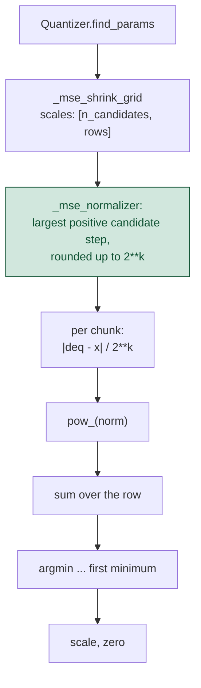
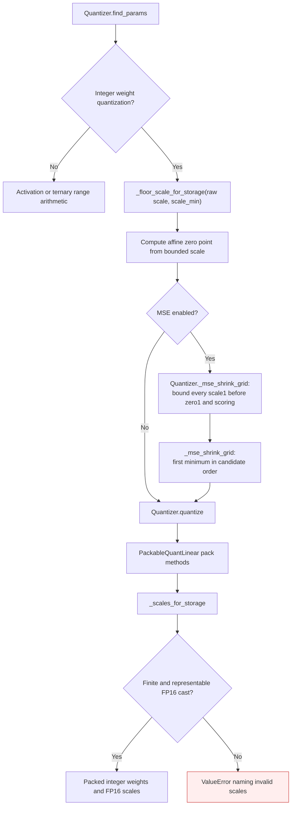
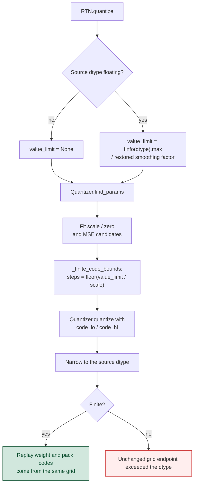
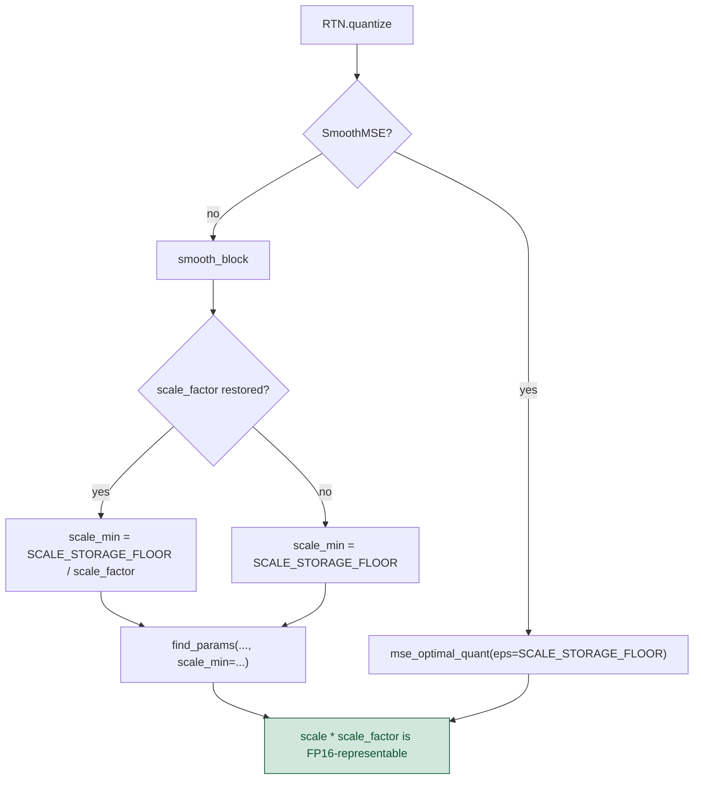
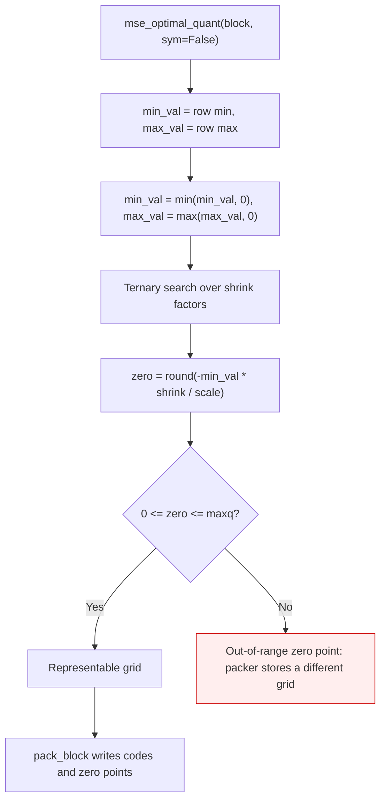
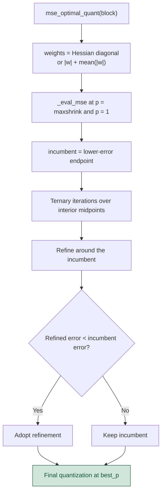
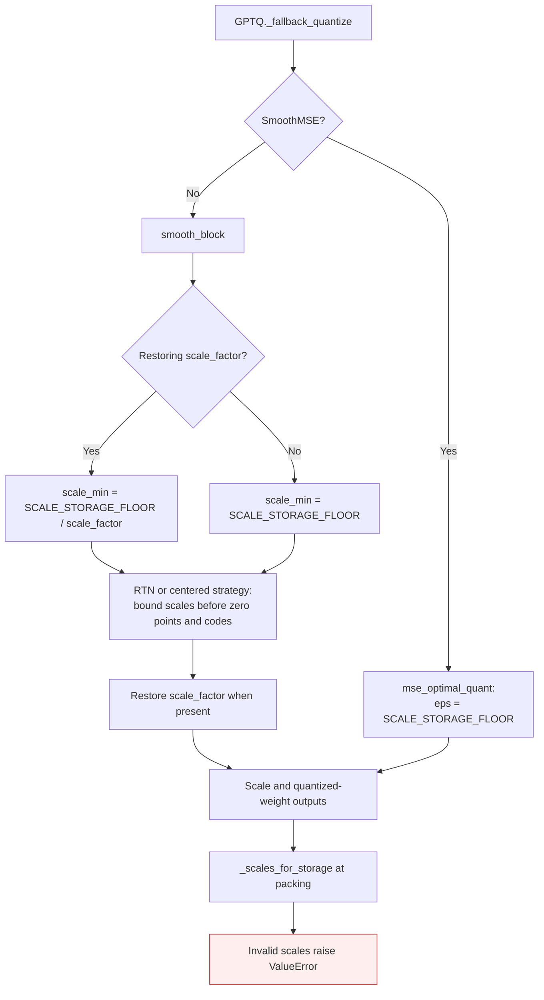

<!-- SPDX-FileCopyrightText: 2026 ModelCloud.ai -->
<!-- SPDX-License-Identifier: Apache-2.0 -->

# GPT-QModel quantization scale storage

GPTQ group scales are packed as FP16. Near-dead weight groups need a scale of
at least `2**-24`, the smallest positive FP16 subnormal, before integer codes
and affine zero points are computed. Applying the bound only to the selected
scale would change the reconstruction after quantization. MSE searches must
score bounded candidates too, including candidates that cross the bound while
shrinking an otherwise representable initial range.

`Quantizer.find_params(..., weight=True)` applies this bound to initial ranges
and MSE candidates. Activation ranges and ternary endpoints retain their own
semantics. An exactly zero range uses the existing sentinel range; a nonzero
range whose division underflows to zero instead receives the storage bound.

## MSE objective normalization

The shrink grid minimizes `sum_j |deq_j - x_j| ** norm` per row, with `norm`
set by `MSEConfig.norm` (the default `2.4`, historically `2`). Raising a small
residual to a high `norm` underflows: in FP32 the largest residual that still
survives `norm = 16` is about `1e-45 ** (1 / 16) ~ 1.6e-3` of the row's step.
Every candidate then scores exactly `0`, and the first-minimum rule keeps the
unshrunk incumbent. The selected scale therefore depends on the row's absolute
magnitude rather than on the shape of its error distribution, and a uniformly
rescaled row can select a different candidate.

`_mse_normalizer` divides every candidate's residuals by one per-row power of
two before the power:



The normalizer is one positive constant per row for all candidates, so
`(r / 2**k) ** norm = r ** norm / 2 ** (k * norm)` is strictly increasing in
`r`: the same candidate wins and the first-minimum tie break is unchanged. A
power of two makes the division exact, so an already-zero error stays zero and
equal candidates stay equal. Because the reference is the row's largest
candidate step, the normalized residual stays within `maxq` code steps and the
power cannot overflow where the unnormalized score did not; a candidate that
still overflows to `+inf` is simply never selected, which is the existing
strict-`<`/NaN behavior.

| Mechanism | Previous behavior | New behavior |
| --- | --- | --- |
| Residual before the power | Raw absolute residual | Absolute residual divided by `2**k`, one `k` per row |
| `norm = 16`, `x` scaled by `1e-3` | Every objective underflows to `0`; candidate `0` wins | Objectives stay finite; candidate `6` wins, matching an FP64 oracle |
| Zero-error candidate | Exactly `0` | Exactly `0` (the division is exact) |
| Equal candidates | First minimum wins | First minimum wins |
| Candidate chunking | Same winner at every budget | Same winner at every budget |

`tests/test_find_params_mse_grid.py` pins this with an independently written
FP64 reconstruction and score over the same representable FP32 candidate
parameters, at `norm = 2.4` and `norm = 16`, across input multipliers
`1`, `1e-3`, `2**-10` and `2**10`, with both a single-candidate and a
full-grid chunk budget, plus explicit zero-error and tie-order controls.

Scope: one constant per row removes the magnitude dependence and matches the
FP64 oracle through `norm = 32`. It is not equivalent to a log-domain scorer
for arbitrary exponents. Beyond about `norm = 40`, terms of a row whose
normalized residual is below `1` still underflow individually once raised to
that power, so a candidate can tie at `0` again. A fully exponent-independent
score needs `log2`/`logsumexp` evaluation, which rounds the default `norm =
2.4` selection differently and is a separate change. Selections for `norm`
`2.0`, `2.4` and `8.0` are bit-identical to the previous code across `bits`
`2`, `3`, `4`, `8` and both symmetric and asymmetric grids; only `norm = 16`
changes, and only for the small-magnitude rows this section describes.



Fallback strategies obey the same storage contract. `SmoothMSE` passes the
storage bound as `eps` to both candidate scoring and final reconstruction in
`mse_optimal_quant`. `SmoothRowCol` temporarily normalizes rows or columns;
its scale bound is divided by the restoring factor in the normalized domain.
Thus multiplying by that factor after code selection preserves a packable
scale in the original weight domain. `Quantizer.find_params` accepts this
per-row bound through `scale_min` for RTN, including RTN's optional MSE search.

## Finite reconstruction range

A packable scale is not the only constraint on the selected code. A symmetric
grid stores `zero = 2 ** (bits - 1)` and `scale = 2 * amax / (2**bits - 1)`,
so the group's negative endpoint rounds to code `-2 ** (bits - 1)` and
reconstructs `2**bits * amax / (2**bits - 1)`, which is strictly larger than
`amax`. Weight-only RTN quantizes an FP32 copy and then narrows the
reconstruction back to the source weight dtype for replay. At
`amax = 61440` the INT4 negative endpoint reconstructs `-65536`; narrowing
that to FP16 stores `-inf` in the replay weight even though every source
parameter was finite, and the non-finite value then feeds the next layer's
calibration capture.

The grid and its ties-to-even rounding are correct. What is missing is a
bound on which codes the grid may select: the reconstruction for a chosen
code has to stay inside the finite range of the dtype it is narrowed to.
`Quantizer.find_params(..., value_limit=...)` therefore derives an inclusive
code range from the fitted `scale`/`zero`:

```
steps = floor(value_limit / scale)      # one step down if the product rounds up
lo    = clamp(zero - steps, 0, maxq)
hi    = clamp(zero + steps, 0, maxq)
```

`value_limit` is the source dtype's `finfo(dtype).max`, divided by any
smoothing factor that is restored after quantization, and it is aligned with
the fitted lane axis (trailing for a `[rows]` grid and the MSE candidate axis,
leading for the `[rows, candidates, 1]` shrink workspace). The MSE shrink grid
and the SmoothMSE ternary search score each candidate with its own bounded
code range, so the winner is the grid that will actually be packed rather than
an endpoint that overflows on the way out. `None` keeps the grid's natural
`[0, maxq]` (or `[-maxq, maxq]` for a signed grid) and leaves every existing
caller bitwise unchanged.

The narrowed tensor is never clamped after the cast, and the live module keeps
its own dtype; only the selected codes move, so the replay weight and the
codes the packers recover from it agree.



| Mechanism | Previous behavior | New behavior |
| --- | --- | --- |
| INT4 symmetric, `amax = 61440`, FP16 | Negative endpoint code `0`, replay `-inf` | Code `1`, replay `-57344` |
| INT4 symmetric, `amax = 61408`, FP16 | Code `0`, replay `-65504` | Unchanged |
| Ordinary weight ranges | Natural `[0, maxq]` codes | Unchanged (bounds resolve to the natural range) |
| Scale / zero point | Fitted range | Unchanged |
| Packing source | Recovered from the replay weight | Same codes, same recovery |

`RTN.quantize` follows the same contract as `GPTQ._fallback_quantize`: its
`SmoothMSE` branch passes `eps=SCALE_STORAGE_FLOOR`, and its `SmoothRowCol`
branch passes `scale_min = SCALE_STORAGE_FLOOR / scale_factor` to
`Quantizer.find_params`. The previous RTN path used the `1e-8` default, which
underflows to zero when the restored scale is stored as FP16.



## Asymmetric SmoothMSE zero points

An affine code range only represents zero points in `[0, maxq]`. The MSE search
therefore fits a range that contains zero; otherwise the derived zero point is
outside the code range for any group whose values do not cross zero.



Including zero keeps `-min_val / (max_val - min_val)` inside `[0, 1]`, so
`zero` is always representable for any shrink factor and every group keeps full
coverage. The pre-pack dequantization and the packed grid then agree.

| Mechanism | Previous behavior | New behavior |
| --- | --- | --- |
| Asymmetric range fit | Raw row minimum and maximum | Range expanded to include zero |
| Zero point for a positive-only group | Negative (for example `-5`) | `0` |
| Zero point for a negative-only group | Above `maxq` (for example `20`) | `maxq` |
| Packed weights vs the scored grid | Shifted by more than one step (about 1.57 for a `[0.5, 2.0]` group) | Agree within checkpoint scale rounding |

The symmetric branch is unchanged: its zero point is the fixed midpoint
`(maxq + 1) / 2`.

## SmoothMSE endpoint candidates

`mse_optimal_quant` searches the shrink factor `p` but must treat the unshrunk
range (`p = 1`) as a candidate, not as an unchecked initialization. The ternary
probes are computed from interior thirds of `[maxshrink, 1]`, so none of them
equals `1`; a search seeded with `p = 1` and `best_err = inf` let the first
interior probe replace the incumbent before `p = 1` was ever scored. The
refinement then only searched near that probe.

The endpoint scores and the final reconstruction are float32 while the tensor
is stored at checkpoint precision, so a float64 oracle can still report a
relative difference around `1e-5`. That is scoring rounding, not a worse
selection: the incumbent is the same expression the search scores.

### Importance-weighted objective

Scoring `p = 1` exposed a second problem: the uniform mean squared weight
error is the wrong objective for a trained transformer. Clipping a row's
largest weight is nearly free under that mean — one element's error buys a
smaller step for the other 127 elements — but those large weights dominate the
row's dot product, so the layer output error rises while the weight MSE falls.
#5221 therefore made SmoothMSE worse end-to-end (Qwen2.5-0.5B-Instruct 4-bit
symmetric PPL 25.363 before it, 26.188 after it) even though it made the
weight-MSE contract exact.

The search now minimizes an importance-weighted error:

| Consumer | Weight for each squared error | Source |
| --- | --- | --- |
| GPTQ / QQQ fallback | `H[j, j]` | Captured Hessian diagonal: exact input-channel activation energy for the diagonal approximation of the layer output error |
| Calibration-free RTN | `abs(w[i, j]) + mean_j(abs(w[i, :]))` | Weight magnitude: a large weight dominates its row's dot product, so its relative error is more visible at the layer output |

Both weightings are per-row normalized before the reduction. The unshrunk
`p = 1` grid is still scored with the same weights and remains the incumbent,
so a clipped grid is accepted only when it lowers the *weighted* error. The
uniform weight MSE is no longer the contract: it can rise slightly while the
weighted output error falls.



| Mechanism | Previous behavior | New behavior |
| --- | --- | --- |
| Objective | Uniform mean squared weight error | Per-row importance-weighted error (Hessian diagonal or weight magnitude) |
| `p = 1` scoring | Never evaluated; `best_err` started at `inf` | Scored together with `p = maxshrink` before the search |
| First interior probe | Always replaced the unscored incumbent | Only replaces an endpoint with a strictly lower measured error |
| Refinement | Argmin over the refinement set only | Compared with the incumbent error |
| Result vs the unshrunk grid | Could be worse (for example a constant row returned `0.9979189634` instead of the exact grid) | Rejected when its weighted error is not lower than the `p = 1` score |

`tests/test_smooth_mse_endpoint_baseline.py` pins this with an independent
float64 endpoint oracle for normal, negative-constant, all-zero and mixed-sign
rows, in symmetric and asymmetric modes, through the direct search and the
`rtn.py`, `gptq.py` and `qqq.py` fallback consumers.
`tests/test_smooth_mse_saliency_criterion.py` pins the weighting itself: a
heavy-tail row that the uniform mean clips must stay on the unshrunk grid, the
Gaussian control must still clip, and the GPTQ fallback must protect the
channel marked by the Hessian diagonal.



| Mechanism at the original #3820 head (`032c5665f`) | Corrected behavior |
| --- | --- |
| `quantization/quantizer.py:367` enters MSE search after bounding only the initial scale; `:426` builds raw candidates | Each candidate is bounded before computing its zero point and objective. |
| `quantization/gptq.py:1466` calls `mse_optimal_quant` with its smaller default `eps` | Candidate and final scales use the FP16 storage bound. |
| `quantization/gptq.py:1537` restores smoothing factors after independently bounding normalized scales | The normalized-domain bound accounts for the factor that will be restored. |
| `quantization/quantizer.py:30` bounds only strictly positive scales | Arithmetic underflow to zero is bounded too; negative and nonfinite inputs remain visible to validation. |

Paths above are relative to `gptqmodel/`. The packing guard continues to reject
invalid externally supplied scales; flooring does not hide overflow or NaNs.

`tests/test_quant_scale_overflow.py` checks FP16, BF16 and FP32 weight inputs,
INT2/INT4/INT8 codes, symmetric/asymmetric zero points, MSE on/off, exact
half-steps and their input-dtype neighbors, arithmetic underflow, unchanged
activation scaling, and complete packed words against independent FP64/Torch
and Python-integer oracles. `tests/test_find_params_mse_grid.py` compares
candidate selection with a separate sequential oracle, including ranges that
cross the storage bound. `tests/test_fallback.py` checks all five fallback
strategies with no smoothing, MSE, row normalization and column normalization.
`scripts/gil0_api_probe.py --only 'GPTQ weight scale floor'` exercises the bound
and MSE selection concurrently with explicit worker device selection.

Introduced while reviewing [#3820](https://github.com/ModelCloud/GPTQModel/pull/3820).

Validation on 2026-11-13 checked `(32, 128)` weight matrices against FP64
reconstructions and Python-integer packed-word writers. On both CUDA and ROCm,
all 228 boundary/fallback cases matched exactly: zero packed-code mismatches,
zero adjudicated tie mismatches, and zero maximum absolute/relative drift in
scales, zero points and reconstructed weights. The separate MSE-grid suite
also checks `(96, 512)` weights against a sequential Torch oracle with exact
selected scales/zero points. These are quantizer and packing measurements;
they do not measure inference kernel arithmetic or performance.
