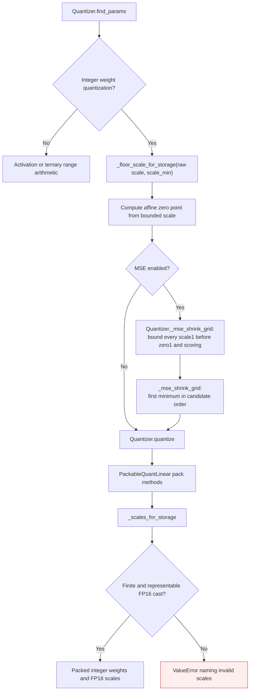
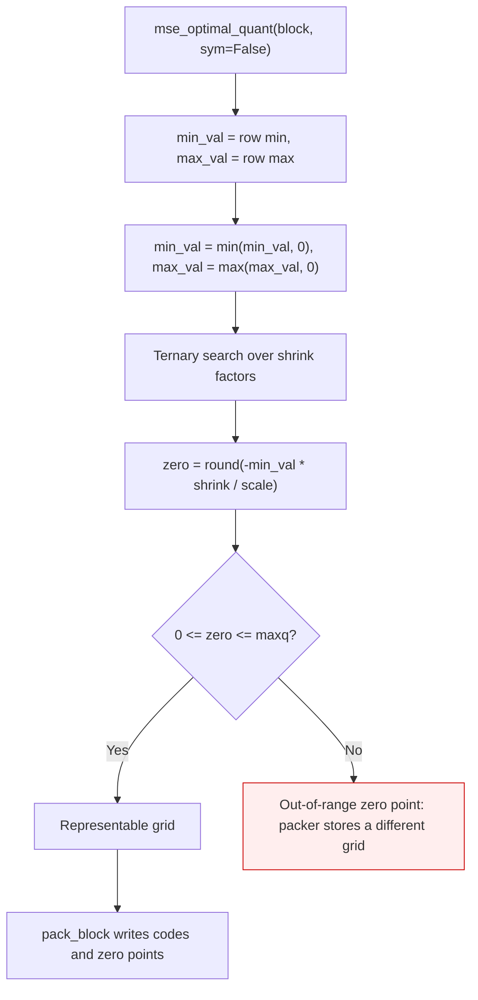
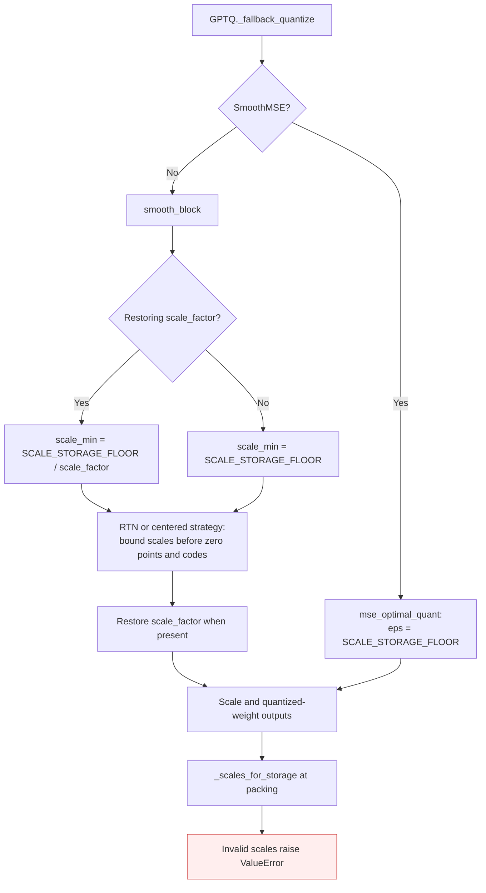

<!-- SPDX-FileCopyrightText: 2026 ModelCloud.ai -->
<!-- SPDX-License-Identifier: Apache-2.0 -->

# GPT-QModel quantization scale storage

GPTQ group scales are packed as FP16. Near-dead weight groups need a scale of
at least `2**-24`, the smallest positive FP16 subnormal, before integer codes
and affine zero points are computed. Applying the bound only to the selected
scale would change the reconstruction after quantization. MSE searches must
score bounded candidates too, including candidates that cross the bound while
shrinking an otherwise representable initial range.

`Quantizer.find_params(..., weight=True)` applies this bound to initial ranges
and MSE candidates. Activation ranges and ternary endpoints retain their own
semantics. An exactly zero range uses the existing sentinel range; a nonzero
range whose division underflows to zero instead receives the storage bound.

Fallback strategies obey the same storage contract. `SmoothMSE` passes the
storage bound as `eps` to both candidate scoring and final reconstruction in
`mse_optimal_quant`. `SmoothRowCol` temporarily normalizes rows or columns;
its scale bound is divided by the restoring factor in the normalized domain.
Thus multiplying by that factor after code selection preserves a packable
scale in the original weight domain. `Quantizer.find_params` accepts this
per-row bound through `scale_min` for RTN, including RTN's optional MSE search.

## Asymmetric SmoothMSE zero points

An affine code range only represents zero points in `[0, maxq]`. The MSE search
therefore fits a range that contains zero; otherwise the derived zero point is
outside the code range for any group whose values do not cross zero.

Including zero keeps `-min_val / (max_val - min_val)` inside `[0, 1]`, so
`zero` is always representable for any shrink factor and every group keeps full
coverage. The pre-pack dequantization and the packed grid then agree.

| Mechanism | Previous behavior | New behavior |
| --- | --- | --- |
| Asymmetric range fit | Raw row minimum and maximum | Range expanded to include zero |
| Zero point for a positive-only group | Negative (for example `-5`) | `0` |
| Zero point for a negative-only group | Above `maxq` (for example `20`) | `maxq` |
| Packed weights vs the scored grid | Shifted by more than one step (about 1.57 for a `[0.5, 2.0]` group) | Agree within checkpoint scale rounding |

The symmetric branch is unchanged: its zero point is the fixed midpoint
`(maxq + 1) / 2`.

| Mechanism at the original #3820 head (`032c5665f`) | Corrected behavior |
| --- | --- |
| `quantization/quantizer.py:367` enters MSE search after bounding only the initial scale; `:426` builds raw candidates | Each candidate is bounded before computing its zero point and objective. |
| `quantization/gptq.py:1466` calls `mse_optimal_quant` with its smaller default `eps` | Candidate and final scales use the FP16 storage bound. |
| `quantization/gptq.py:1537` restores smoothing factors after independently bounding normalized scales | The normalized-domain bound accounts for the factor that will be restored. |
| `quantization/quantizer.py:30` bounds only strictly positive scales | Arithmetic underflow to zero is bounded too; negative and nonfinite inputs remain visible to validation. |

Paths above are relative to `gptqmodel/`. The packing guard continues to reject
invalid externally supplied scales; flooring does not hide overflow or NaNs.

`tests/test_quant_scale_overflow.py` checks FP16, BF16 and FP32 weight inputs,
INT2/INT4/INT8 codes, symmetric/asymmetric zero points, MSE on/off, exact
half-steps and their input-dtype neighbors, arithmetic underflow, unchanged
activation scaling, and complete packed words against independent FP64/Torch
and Python-integer oracles. `tests/test_find_params_mse_grid.py` compares
candidate selection with a separate sequential oracle, including ranges that
cross the storage bound. `tests/test_fallback.py` checks all five fallback
strategies with no smoothing, MSE, row normalization and column normalization.
`scripts/gil0_api_probe.py --only 'GPTQ weight scale floor'` exercises the bound
and MSE selection concurrently with explicit worker device selection.

Introduced while reviewing [#3820](https://github.com/ModelCloud/GPTQModel/pull/3820).

Validation on 2026-11-13 checked `(32, 128)` weight matrices against FP64
reconstructions and Python-integer packed-word writers. On both CUDA and ROCm,
all 228 boundary/fallback cases matched exactly: zero packed-code mismatches,
zero adjudicated tie mismatches, and zero maximum absolute/relative drift in
scales, zero points and reconstructed weights. The separate MSE-grid suite
also checks `(96, 512)` weights against a sequential Torch oracle with exact
selected scales/zero points. These are quantizer and packing measurements;
they do not measure inference kernel arithmetic or performance.
