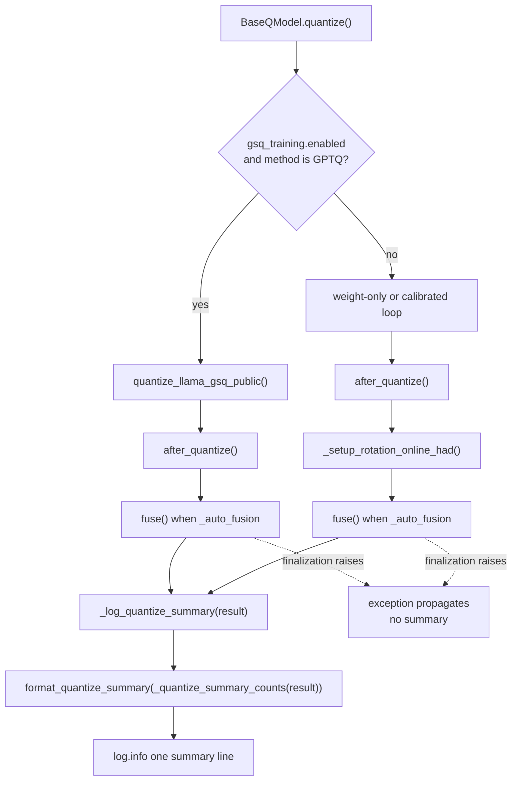
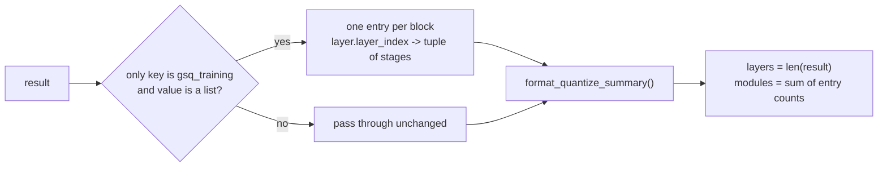

# Quantization run summary

Every completed `BaseQModel.quantize()` run ends with exactly one log line:

```
Quantize summary: 32 layer(s), 224 module(s), 12m05s, peak VRAM 9.00 GiB
```

The line exists so a user can paste one sentence into a report instead of
reconstructing what a long run produced. That only works if the line describes a
*finished* run: it is emitted after finalization, on every supported completion
path, and it is not emitted when finalization fails. The counts also have to
mean the same thing for every result shape.

## Completion paths

`quantize()` has two completion paths: the staged-GSQ dispatch
(`quantize_llama_gsq_public`, GPTQ only) and the ordinary weight-only or
calibrated loop. Both end in `_log_quantize_summary()`, which formats
`_quantize_summary_counts(result)` with the elapsed time measured from the start
of `quantize()` — so finalization is inside the reported duration.



The failure edge is deliberate: a run whose rotation setup or fusion raises must
not leave a success line behind. Nothing catches the exception, so the caller
sees the failure and the summary stays absent.

## Counting contract

The ordinary loop returns a mapping of layer name to its quantized module
entries, which `format_quantize_summary()` counts directly. The staged-GSQ
helper returns `{'gsq_training': [block, ...]}`: a list with one record per
decoder layer, where `record['stages']` holds that layer's projections.
`_quantize_summary_counts()` maps each block to its own layer entry
(`layer.<layer_index>` -> the `stages` keys), so a staged run reports its real
layer count instead of "1 layer".



## Before and after

| Concern | Before | After |
| --- | --- | --- |
| Staged-GSQ completion | returned before the summary (`gptqmodel/models/base.py:1669-1672` at `94f9630`), so the line never appeared | summary logged after `fuse()` (`gptqmodel/models/base.py:1794-1802`) |
| Ordinary completion | summary logged before rotation setup and fusion (`gptqmodel/models/base.py:1973-1979`, `:1981`, `:1990`) | summary logged after both (`gptqmodel/models/base.py:2103-2119`) |
| Failing finalization | success line already emitted, elapsed excluded finalization | exception, no summary line |
| Staged-GSQ counts | would count the single top-level key (`gptqmodel/utils/logger.py:253-255`) | `_quantize_summary_counts()` maps blocks to layers (`gptqmodel/models/base.py:236-259`) |

## Contract

- `quantize()` emits at most one summary per call, and only after its
  finalization steps return normally.
- The reported duration includes `after_quantize()`, rotation setup, and
  `fuse()`.
- Layer and module counts follow the result shape: ordinary results count
  mapping entries, staged-GSQ results count one layer per block and one module
  per projection stage.
- Unknown result shapes pass through to the generic formatter unchanged.

Introduced by PR #3932 for issue #3932.
