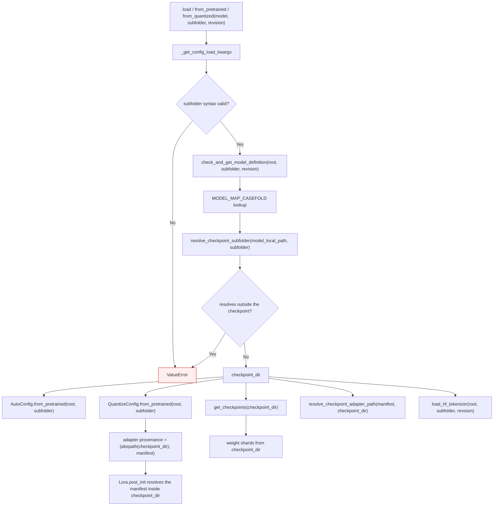
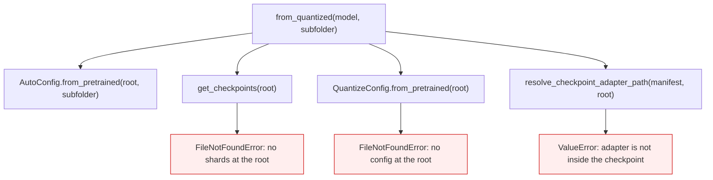

<!-- SPDX-FileCopyrightText: 2026 ModelCloud.ai -->
<!-- SPDX-License-Identifier: Apache-2.0 -->

# Quantized checkpoint subfolder resolution

A Hub repository or a local directory can keep the quantized checkpoint in a
subdirectory. `from_quantized(..., subfolder="nested")` therefore has to read
the architecture config, the quantize config, the tokenizer, the weight shards,
and any relative adapter manifest from that one directory. Reading some of them
from the repository root mixes two checkpoints: the loader can pair a config
from `nested/` with weights that happen to sit at the root, or fail outright
when the root holds nothing.

The same selection has to reach *model-type detection*, which runs before the
loader. Detection reads a config only to choose a model definition, so it is
easy to forward the subfolder to the loader and forget it there — and then a
valid nested checkpoint fails with `Unrecognized model in <root>` before any
loader code runs.

## New flow

`resolve_checkpoint_subfolder` (`gptqmodel/utils/hf.py`) only narrows the base
path. It rejects absolute paths, Windows drive letters, backslashes, and `.`/`..`
segments instead of normalizing them away, and it rejects a symlinked subfolder
that resolves outside the checkpoint. `""`, `None`, and `"."` keep the previous
root behavior, so callers that never pass a subfolder are unaffected.

The same helper is used by `get_checkpoints` (`gptqmodel/utils/model.py`): a
downloaded snapshot is a local directory, so the Hub branch that forwards
`subfolder` to `cached_file` is never reached for it. Without the join, a nested
checkpoint was searched at the repository root.

`normalize_checkpoint_subfolder` performs the same syntax checks and returns the
canonical relative spelling (or `""` for the root). `get_config_selection_kwargs`
runs it, so the public entry points reject an escaping subfolder before any
filesystem or Hub read — including the model-type detection read.

`_get_config_load_kwargs` (`gptqmodel/models/auto.py`) and
`_get_tokenizer_load_kwargs` (`gptqmodel/models/loader.py`) both forward the
selection options — `subfolder`, `revision`, `cache_dir`, `local_files_only`,
`use_auth_token`, `force_download`, `resume_download`, `proxies`,
`_commit_hash` — and only when the caller supplied them, so an unset option
keeps the `AutoConfig`/tokenizer default.

## Previous flow

| Mechanism (at the pre-change head) | Previous behavior | New behavior |
| --- | --- | --- |
| `models/loader.py:1756` pops `subfolder` and forwards it only through `cached_file_kwargs` to `AutoConfig` | Architecture config honored the subfolder; every other artifact used the root | One `checkpoint_dir` is resolved and reused |
| `utils/model.py:1714` local branch of `get_checkpoints` | Searched `model_id_or_path` directly; `subfolder` was ignored | Joins the validated subfolder before searching |
| `quantization/config.py:4753` `QuantizeConfig.from_pretrained` | Popped only `format`; joined `QUANT_CONFIG_FILENAME_COMPAT` under `save_dir` (`:4759`) | Honors `subfolder` and records the resolved directory as the adapter provenance |
| `models/loader.py:1828` adapter manifest resolution | Used `model_local_path`, so a manifest under `nested/` was rejected as outside the checkpoint | Uses `checkpoint_dir` |
| `quantization/config.py:4776` adapter provenance | `(abspath(save_dir), manifest)` | `(abspath(checkpoint_dir), manifest)` |
| `models/auto.py:607` `_get_config_load_kwargs` | Returned only the GGUF selector, so `{"subfolder": "nested"}` produced `{}` and detection read the root config | Forwards the validated config-selection options |
| `models/loader.py:1075` `_get_tokenizer_load_kwargs` | Returned only the GGUF selector | Forwards the validated config-selection options |
| `models/loader.py:1899` tokenizer load in `from_quantized` | Received only `hf_gguf_load_kwargs`, so a nested checkpoint used the root tokenizer | Receives the resolved subfolder/revision selection |

## Failure and ambiguity contract

| Situation | Result |
| --- | --- |
| `subfolder=""`, `None`, or `"."` | Repository root, exactly as before |
| `subfolder="nested"` with the checkpoint under `nested/` | Every artifact resolves under `nested/` |
| `subfolder="../outside"`, `/abs`, `C:\repo`, or `a\b` | `ValueError` naming `subfolder` |
| Symlinked `nested` that resolves outside the checkpoint | `ValueError` naming the checkpoint boundary |
| Subfolder exists but holds no quantize config | `FileNotFoundError` from the config read (unchanged error class) |
| Hub repository id with `subfolder` | `cached_file` receives `subfolder`, unchanged |
| `subfolder` on `load` / `from_pretrained` / `from_quantized` | Validated and forwarded to model-type detection, the loader, and the tokenizer |
| `revision` with a nested checkpoint | Detection, weights, and tokenizer all target that revision |

Tokenizer construction still belongs to Tokenicer (`load_hf_tokenizer` delegates
to `Tokenicer.load`), but the loader now passes the subfolder and revision
through. Tokenicer forwards unknown keyword arguments to Transformers, so no
Tokenicer change is required.

## Validation

| Command | Result |
| --- | --- |
| `pytest tests/test_checkpoint_subfolder_resolution.py -q` | 18 passed |
| same file with the dispatch/tokenizer changes reverted | 5 failed, 13 passed |
| `pytest tests/test_checkpoint_subfolder_resolution.py tests/test_local_model_paths.py tests/test_adapter_remote_security.py -q` | 98 passed |
| issue repro `QuantizeConfig.from_pretrained(root, subfolder="nested")` | returned `bits=4`; `FileNotFoundError` before the fix |
| issue repro `GPTQModel.from_quantized(root, subfolder="nested")` | got past model-type detection; `Unrecognized model in <root>` before the fix |

The loader-level test (`test_loader_resolves_adapter_manifest_under_subfolder`)
drives `from_quantized` far enough to reach the manifest resolver and asserts it
receives `nested/`; it fails when the loader passes the repository root again.
