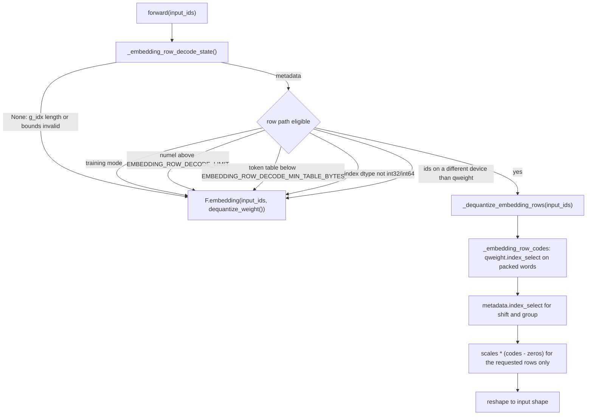

<!-- SPDX-FileCopyrightText: 2026 ModelCloud.ai -->
<!-- SPDX-License-Identifier: Apache-2.0 -->

# Quantized embedding row decode

`TorchQuantEmbeddings` serves a quantized token embedding table. Only the
packed `qweight`/`qzeros`/`scales`/`g_idx` checkpoint tensors persist; the
activation-dtype table is never a runtime weight cache.

## The decision

The module has two decode paths. Whole-table decode unpacks every vocabulary
row and then gathers the tokens, so it writes an `vocab x hidden` dense table
per forward. Row decode reads only the packed words that back the requested
tokens and writes only those rows.

`_embedding_row_decode_state()` builds, once per packed-tensor version, three
indexing tensors — the packed word row per token, the intra-word shift, and the
group per token — plus the decoded zero-point table. They are metadata, not
weights: a `vocab`-length `int32` vector per index, and the small
`groups x hidden` zero-point table that whole-table decode also decodes. Cache
keys come from `tensor_cache_key` on `qweight`/`qzeros`/`g_idx`, so a replaced
or mutated checkpoint rebuilds them; `clear_weight_cache()`, `_apply()`
(device/dtype moves), and state-dict loads also drop them.

Supported packed layouts:

| Format | Bits | Row decode |
| --- | --- | --- |
| `gptq_v2` / `gptq` (continuous) | 2, 4, 8 | One `int32` word per token per output column; field selected by shift |
| `gptq_v2` / `gptq` (continuous) | 3 | Three words per 32 tokens in the 10-1-10-1-10 layout; straddling codes combine two words |
| `gptq_p` (split-plane) | 2–8 | `planar_decode_rows` reads one word per plane for the requested rows only |

## Why the gate has two thresholds

Both thresholds are measured; neither is a heuristic estimate.

**Table size.** A small table is cheaper to decode whole because the row path
pays a fixed gather cost regardless of how many rows it returns. FP16
single-token decode, independent NVIDIA and AMD ROCm hosts:

| Dense table | Whole-table decode | Row decode | Winner |
| --- | --- | --- | --- |
| 32 MiB | 27.5 us | 68.5 us | whole table (2.5x) |
| 64 MiB | 89.3 us | 70.4 us | row decode (1.3x) |
| 128 MiB | 187 us | 69 us | row decode (2.7x) |
| 256 MiB | 372 us | 84 us | row decode (4.4x) |
| 512 MiB | 739 us | 75 us | row decode (9.8x) |
| 1940 MiB (248320 x 4096) | 2791 us | 80 us | row decode (35x) |

`EMBEDDING_ROW_DECODE_MIN_TABLE_BYTES` is therefore 64 MiB
(`in_features * out_features * scales.element_size()`); below it the module
keeps whole-table decode, which is never slower there.

**Token count.** Each extra token adds gather and scratch traffic proportional
to its rows, while whole-table decode is constant. The crossover sits near 1K
tokens for realistic vocabularies:

| Tokens | Row decode | Whole-table decode |
| --- | --- | --- |
| 1 | 72 us | 1495 us |
| 64 | 73 us | 1490 us |
| 1024 | 83 us | 1615 us |
| 1025 | 1514 us | 1510 us |

Row decode and whole-table decode are exactly equal numerically: both apply
`scales[g_idx] * (codes - zeros[g_idx])` with the same `int16` codes, zero
points, and scale dtype, so the comparison tolerance is zero.

## Failure and ambiguity contract

| Situation | Before | After |
| --- | --- | --- |
| `g_idx` length != `in_features` (multi-shard layout) | whole-table decode worked | `_embedding_row_decode_state()` returns `None`; whole-table decode |
| `g_idx` entry outside `[-num_groups, num_groups)` | `validate_g_idx_bounds` raises at `post_init` | same; row decode also declines rather than reading out of bounds |
| Negative `g_idx` | normalized inside dequant | normalized when metadata is built (same `+ num_groups` rule) |
| Token id outside `[0, in_features)` | `F.embedding` raises `IndexError` on CPU | `qweight.index_select` raises `IndexError` on CPU for the same inputs |
| Empty `input_ids` | `F.embedding` returned an empty tensor | explicit empty result with `scales.dtype` and shape `(*ids.shape, out_features)` |
| `training=True` | whole-table decode | unchanged (row decode is inference-only) |
| Unpacked vocabulary not divisible by the packing width | tail rows dropped by `_dequantize_from_codes` | same; row decode only reads valid rows, since the tail is zero-filled in the packed words |

## Storage contract

Row decode retains only indexing metadata. It never writes an unpacked weight
tensor, so `qweight` stays in its packed 2/3/4/5/6/7/8-bit representation
across forwards, and no dense table is cached between calls. The decoded
zero-point table and the three index vectors are metadata that AGENTS.md
explicitly permits.

`tests/test_quantized_embeddings.py` pins this: it counts `dequantize_weight`
calls (zero for the row path), checks `qweight` identity and storage size after
repeated forwards, and confirms a `qweight.zero_()` mutation changes the output.

## Validation

- `tests/test_quantized_embeddings.py` — exact equality against
  `F.embedding(ids, dequantize_weight())` for every supported bits/format pair in
  FP16 and BF16, boundary/repeated/shuffled ids, at and above the token limit,
  packed-storage retention, and mutation invalidation.
- `tests/test_planar_bits_567.py` — `planar_decode_rows` equals
  `planar_unpack_rows(...).index_select(0, rows)` for all rows, shuffled and
  repeated subsets, and an empty selection.
- Measured on 22 bits/format/dtype combinations on an AMD ROCm host: every
  combination exact, 35x faster single-token at 151936 x 3584 in FP16
  (64.7 us vs 2260.7 us), 11.8x at 1024 tokens (194 us vs 2295 us).
- `scripts/gil0_api_probe.py --only "Tensor.index_select row gather"` PASSes
  with `PYTHON_GIL=0` (8 threads x 4 iterations) across three separate
  processes; `pytorch_gil_0_compat.md` records the result.

Introduced in PR #3797.
