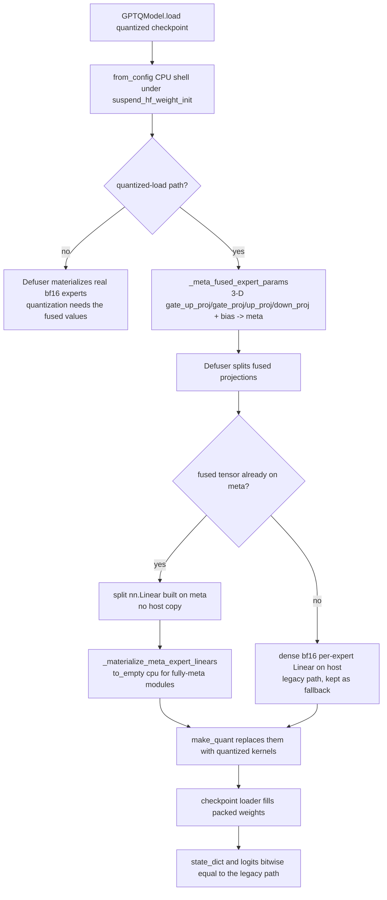
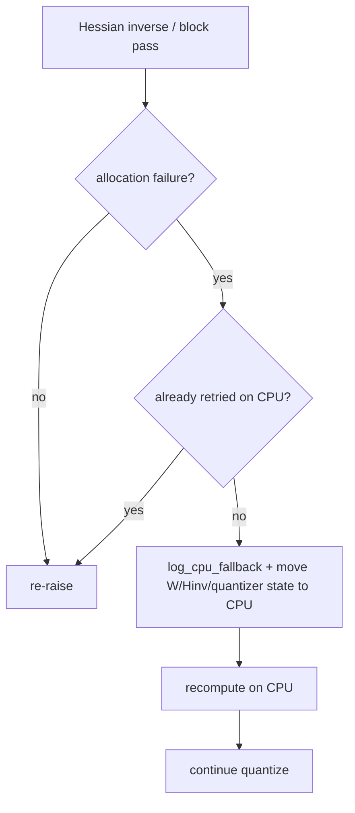

<!-- SPDX-FileCopyrightText: 2026 ModelCloud.ai -->
<!-- SPDX-License-Identifier: Apache-2.0 -->

# Quantized MoE reload: the meta fused-expert shell

Some MoE checkpoints store each expert group as one fused 3-D projection
(`gate_up_proj`, `gate_proj`, `up_proj`, `down_proj`). `Defuser` splits those
tensors into per-expert `nn.Linear` modules. On the **quantized** load path the
split linears are replaced by quantized kernels and filled straight from the
checkpoint, so materializing dense bf16 copies first only inflates host memory:
an OLMoE-1B-7B 4-bit checkpoint (3.66 GiB) peaked at 12.17 GiB `RssAnon`.

GPT-QModel parks the fused projections on `meta` before `Defuser` runs, so the
split linears are created on `meta` too, then allocates their uninitialized
storage with `to_empty` and lets the loader fill the packed weights.

## Lifecycle

Failure and ambiguity paths are deliberately narrow:

- `_meta_fused_expert_params` only matches the four projection names above.
  Differently named fused experts (for example DBRX `mlp.w1/v1/w2`) keep the
  legacy host materialization; this is a missed optimization, not a regression.
- `_materialize_meta_expert_linears` only calls `to_empty` on modules whose
  tensors are **all** on `meta`. A partially-meta module is left alone, so the
  real CPU weights built by `from_config` are never discarded.
- The `to_empty` allocation reserves virtual storage without touching pages, so
  host RSS stays flat; a host with overcommit disabled can still fail here.

## OOM fallback contract

The same change completes the "finish on the host instead of aborting"
contract for the Hessian inverse and the post-inverse block pass:

`_is_memory_allocation_failure` is shared by GPTQ, QQQ and the EXL3 `block_ldl`
solver so CUDA, HIP, and solver-handle allocation errors all take the CPU
retry. A retry resets the partially-appended scale/zero entries and the block
index before re-running, which keeps the packed output bitwise equal to an
unconstrained CPU run.

## Evidence

| Path | Before | After |
|---|---|---|
| OLMoE-1B-7B 4-bit reload, peak `RssAnon` | 12.17 GiB (issue measurement) | ~4.2 GiB (synthetic shell: 8.83 -> 7.75 GiB) |
| Tiny real OLMoE reload, peak `RssAnon` | 1138.1 MiB | 1083.1 MiB |
| QQQ inverse under a 1.3 GiB cap | aborts | finishes on CPU, packed output bitwise equal |
| GPTQ block pass under a 1.15 GiB cap | aborts after the inverse fallback | finishes on CPU, `Q` bitwise equal |

Tests: `tests/test_moe_reload_meta_4400.py`,
`tests/test_moe_reload_meta_e2e_4400.py`,
`tests/test_qqq_exl3_oom_fallback_4400.py`,
`tests/test_gptq_post_inverse_fallback_4400.py`.
