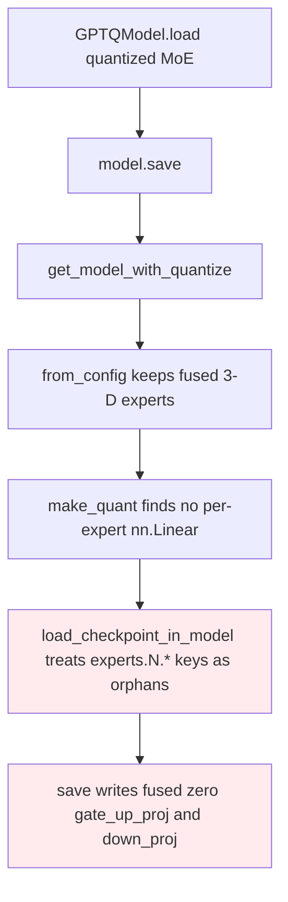
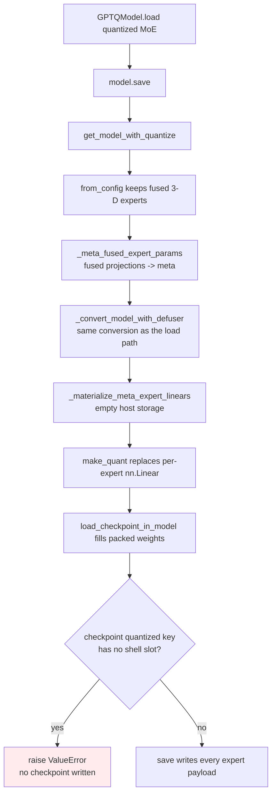

<!-- SPDX-FileCopyrightText: 2026 ModelCloud.ai -->
<!-- SPDX-License-Identifier: Apache-2.0 -->

# Re-saving a loaded quantized MoE: defuse the export shell

Re-saving a loaded quantized checkpoint rebuilds the model from `config.json`
instead of copying the source tensors. For a fused-expert MoE (OLMoE, PhiMoE,
and every other `Defuser` registry model), Transformers 5 builds the experts as
one 3-D `gate_up_proj` / `down_proj` parameter, while the checkpoint stores one
quantized tensor set per expert. The export shell must be defused before
`make_quant` runs, exactly like the quantized-load path.

Introduced for #4589 (regression from #4495).

## The old flow

#4495 made the checkpoint restore loop walk the model's own buffers so a
removed non-quantized buffer such as `rotary_emb.inv_freq` no longer crashed
`save()`. For a fused-expert MoE the same tolerance turned the previous
`AttributeError` into silent data loss: every per-expert quantized tensor was
skipped and the fused zero placeholder was serialized.

## The new flow

The defuse sequence is the one already used by the quantized-load path
(`gptqmodel/models/loader.py`): park the fused tensors on `meta` so Defuser does
not copy them to the host, split them into per-expert linears, then give those
shells empty host storage. `make_quant` replaces them with the quantized
kernels, and the checkpoint loader fills the packed bytes.

## Fail-closed contract

After the shell is loaded, every checkpoint tensor whose leaf name is a
quantization payload (`qweight`, `qzeros`, `scales`, `g_idx`, and the other
names in `_QUANTIZED_TENSOR_SUFFIXES`) must resolve to a module in the shell.
A missing slot raises instead of writing a checkpoint that dropped it.

| Situation | Before #4589 | After |
| --- | --- | --- |
| Fused-expert MoE re-save, shell defused | not defused | defused; all experts preserved |
| Per-expert quantized key with no shell slot | silently dropped | `ValueError`, no checkpoint written |
| Non-quantized orphan buffer (`rotary_emb.inv_freq`) | skipped (#4452) | still skipped |
| Dense quantized checkpoint | unchanged | unchanged |
| EXL3 re-save | passthrough plan | unchanged (does not use this shell) |

The guard is deliberately limited to quantization payload names. Dense
checkpoints legitimately omit tied weights and legacy non-persistent buffers,
so a general "every checkpoint key must exist" rule would reject valid saves.

## Related pages

- [`quantized-moe-reload-meta-shell.md`](quantized-moe-reload-meta-shell.md) —
  the load-side meta shell that this re-save path mirrors.
- [`checkpoint-and-runtime-contracts.md`](checkpoint-and-runtime-contracts.md) —
  buffer dtype restoration for quantized modules.
