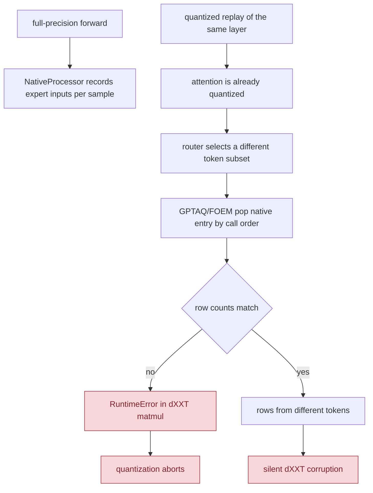
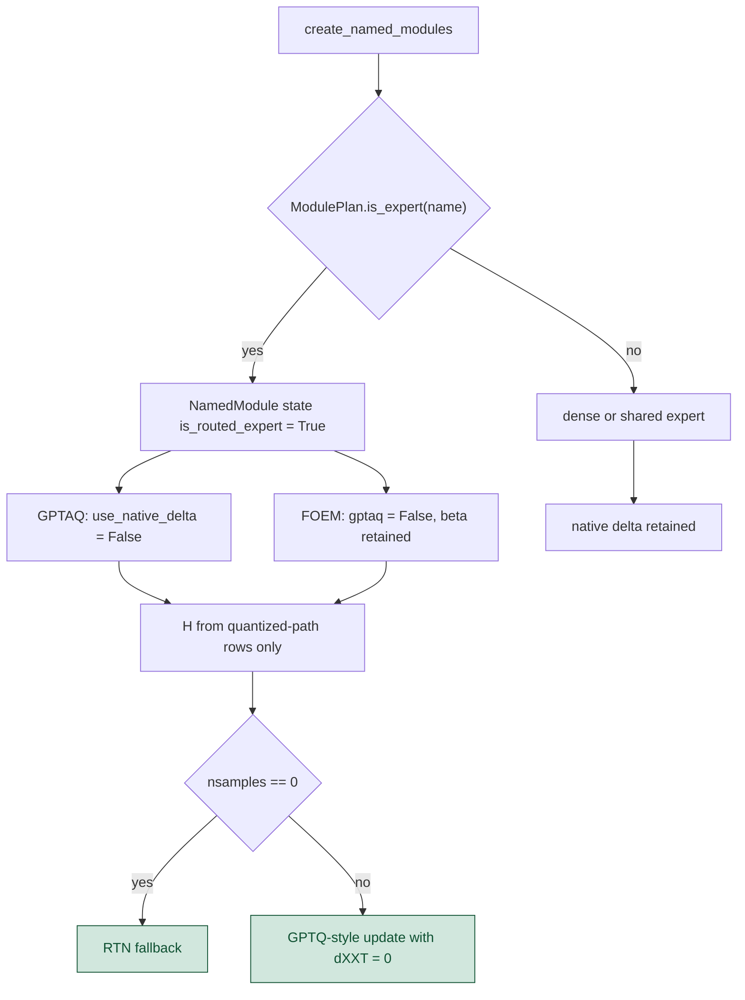
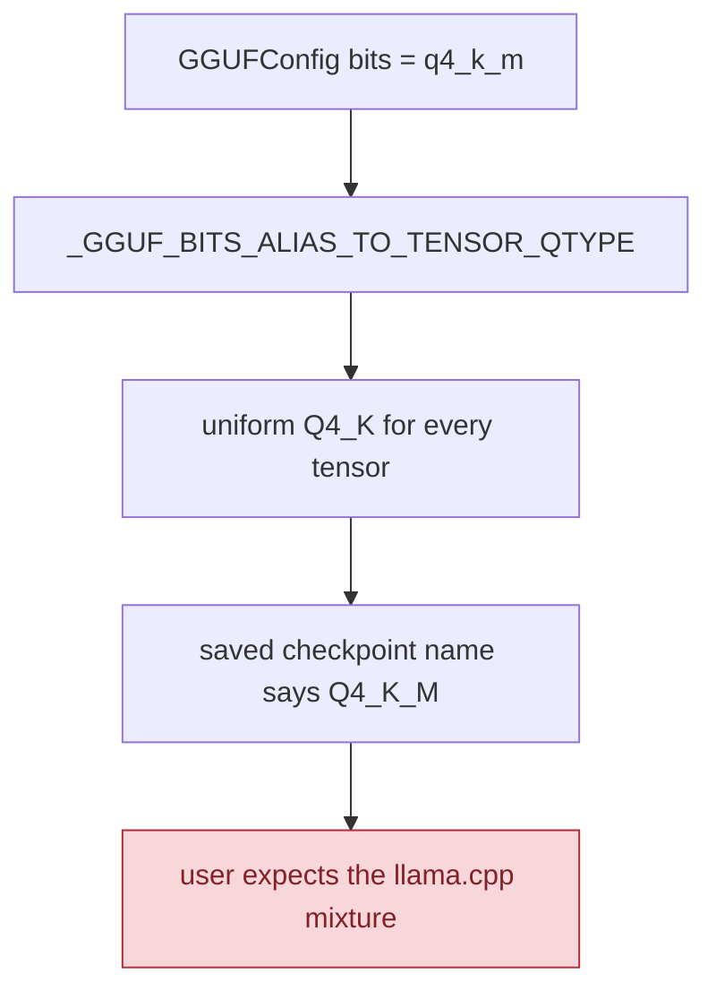
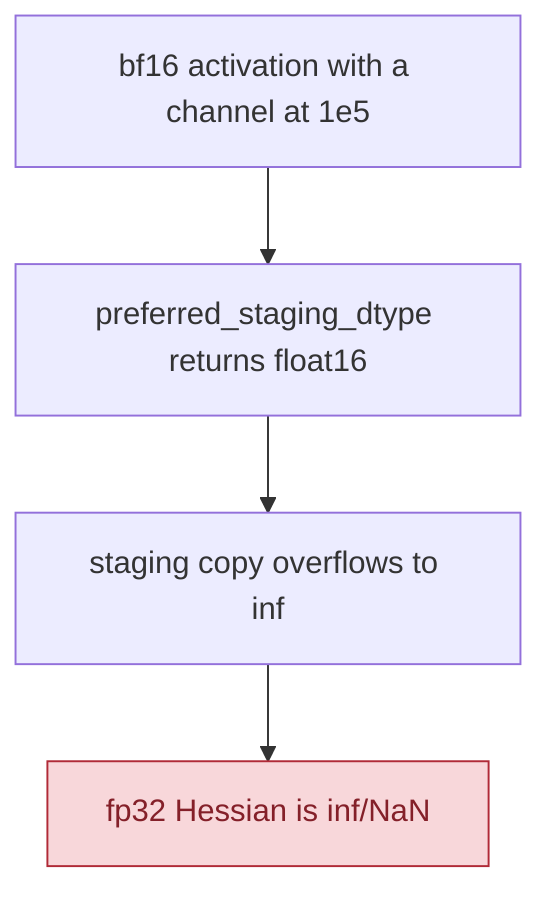
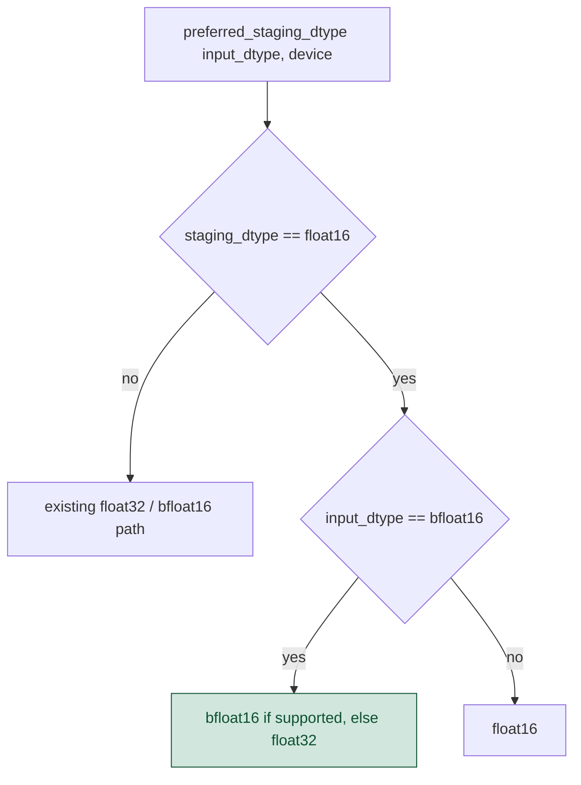
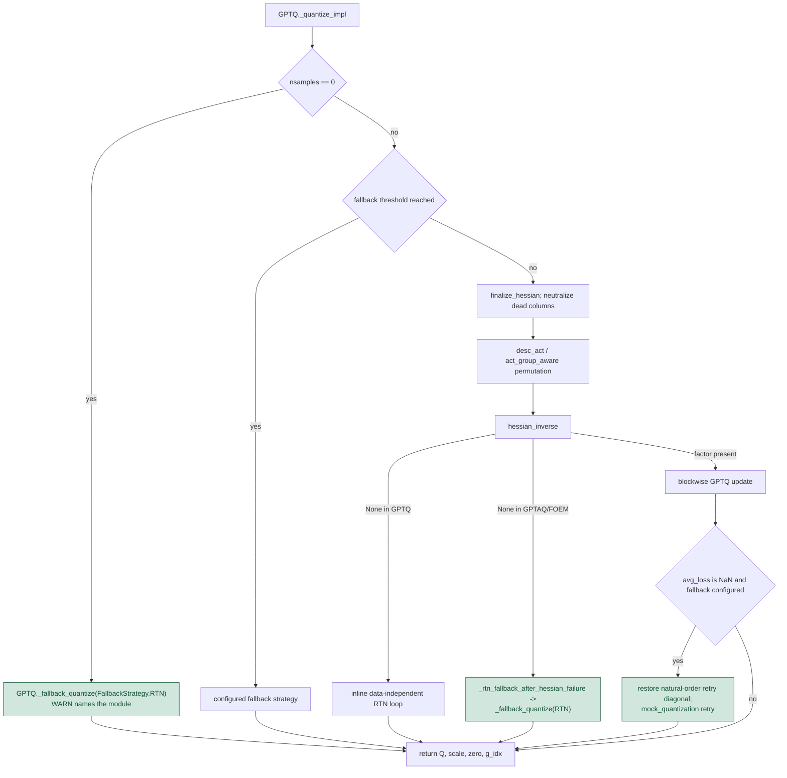
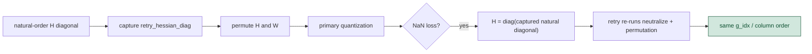
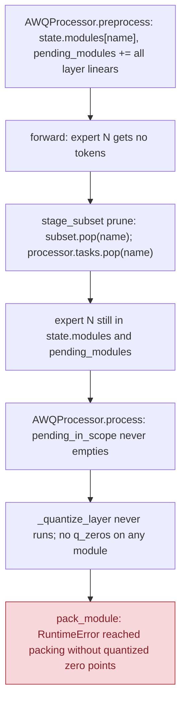
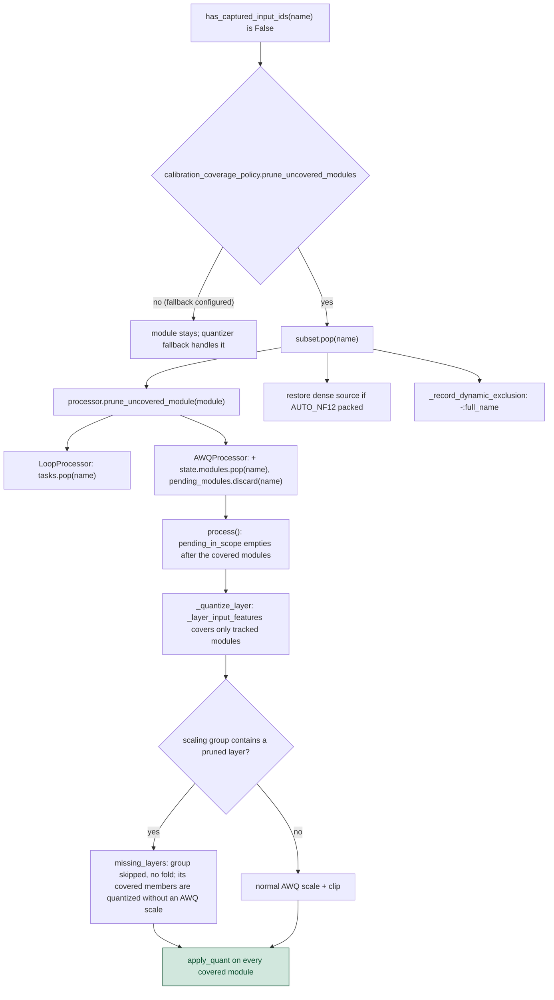

# Quantizer calibration flows: MoE native inputs, GGUF quality aliases, Hessian staging

This page describes three calibration decisions that share one rule: a tensor
must only be combined with data that describes the same tokens, and a name must
not promise a layout the packer does not write.

Introduced by PR for issue #4067.

## 1. GPTAQ/FOEM routed-expert inputs

`NativeProcessor` records every module input during one full-precision forward.
`GPTAQ` and `FOEM` (alpha > 0) later compare those native inputs with the inputs
seen during the quantized replay to build `dXXT = (X_native - X_quant)^T X_quant`.
For dense modules the two passes call the module with the same rows, so pairing
the recorded entries by call order is valid.

For routed experts it is not. Attention in the same layer is already quantized
when the experts replay, so the router sends a different token subset to each
expert. The old code popped one native entry per expert call:

An expert that receives no routed rows has `H = None`. `GPTAQ.quantize` and
`FOEM.quantize` then dereferenced `self.H.device` and never reached GPTQ's
data-independent fallback.

The fix marks routed experts from the model's `ModulePlan` in
`ModuleLooper.create_named_modules` (`plan.is_expert(name)`). `GPTAQ` and `FOEM`
read that mark and disable the native delta for routed experts: `dXXT = 0`, so
GPTAQ runs the plain GPTQ update and FOEM keeps its beta term. Shared experts
and dense projections still use the native delta because they receive the same
rows in both passes. A zero-sample module now takes the configured fallback
strategy (RTN by default) in both quantizers. `GPTAQ` and `FOEM` also apply the
same `desc_act` / `act_group_aware` permutation as GPTQ and truncate
`_tp_pad_cols` before reshaping to the module weight. `FOEM.process_batch`
counts calibration tokens (`inp.shape[1]`) instead of forward sequences, so its
`nsamples` and loss denominator match GPTQ and GPTAQ.

| Situation | Before | After |
| --- | --- | --- |
| Routed expert, row counts differ | `RuntimeError` in `gptaq.py` / `foem.py` | `dXXT = 0`; plain GPTQ update |
| Routed expert, row counts happen to match | silent `dXXT` corruption | `dXXT = 0`; no native pairing |
| Routed expert, zero calibration rows | `AttributeError` on `self.H.device` | RTN fallback |
| `act_group_aware=True` | Ignored; saved meta claimed `True` | Same GAR permutation as GPTQ |
| Tensor-parallel padding | Reshape failed on padded columns | Padded columns truncated before reshape |
| `FOEM.nsamples` | Forward sequences | Calibration tokens |
| Dense projection | native delta | unchanged |
| Shared expert | native delta | unchanged |

The alpha correction is intentionally unavailable for routed experts until the
native rows can be gathered with the quantized-path routing. That follow-up is
not implemented here; routed experts are quantized as plain GPTQ (GPTAQ) or
FOEM without the alpha term.

### Hessian and loss normalization (GPTAQ vs FOEM)

The two quantizers keep different Hessian denominators, and the difference is
intentional:

| Quantizer | `H` denominator | `nsamples` | Reported `avg_loss` denominator |
| --- | --- | --- | --- |
| GPTAQ (`gptaq.py` `process_batch`) | calibration requests (`inp.shape[0]`, one per sample) | tokens | tokens, via `_token_normalized_avg_loss` |
| FOEM (`foem.py` `process_batch`) | calibration tokens (`inp.shape[1]`) | tokens | tokens |
| GPTQ (`gptq.py` `add_batch` + reduction) | calibration tokens (`2 / total_samples`) | tokens | tokens |

GPTAQ keeps its upstream per-request Hessian normalization and converts only
the reported loss to a token mean. FOEM normalizes the Hessian itself by token
count so that `FOEM(alpha=0, beta=0)` matches GPTQ: `H` and `avg_loss` agree to
float32 accumulation (measured relative error 9.6e-8 and 5.5e-7), `nsamples`
is identical, and the quantized weights are bit-identical. Token
normalization also makes FOEM's Hessian independent of how the calibration rows
are grouped into forward batches; a request denominator would scale with the
number of sequences instead.

`H`'s absolute scale does not change the quantized output. For GPTQ and every
FOEM `alpha`/`beta` combination, multiplying `H` and `dXXT` by a constant
produced bit-identical `Q` (measured on CPU: 0 of 2048 dequantized values
changed for a 3x scale), because `hessian_inverse` returns the Cholesky factor
of the damped inverse and the damping is relative to the diagonal mean. The
scale is observable only in `H` itself and in the reported loss, so tests that
assert `H` must encode the per-quantizer denominator above
(`tests/test_gptaq_foem_batch.py::test_hessian_normalisation_matches_documented_contract`
and `test_foem_token_normalisation_matches_gptq_hessian_and_loss`).

## 2. GGUF `q*_k_s` / `q*_k_m` / `q*_k_l` quality aliases

llama.cpp's `_s`/`_m`/`_l` suffixes select a per-tensor mixture, for example
Q6_K for `attn_v` and `ffn_down` in the `use_more_bits` layers. GPT-QModel
stores every tensor with the base K type (`Q4_K` for `q4_k_*`, and so on), so
the alias name overstated the checkpoint quality.

The fix keeps the uniform storage (the mixture is not implemented) but emits a
loud warning from `GGUFConfig.__post_init__` and from dynamic per-layer
overrides. The bpw table now reports `q5_k_s` as 5.5 bpw, matching the uniform
Q5_K blocks that are actually written.

| Alias | Stored type | Reported bpw |
| --- | --- | --- |
| `q4_k_s`, `q4_k_m` | `Q4_K` | 4.5 |
| `q5_k_s`, `q5_k_m` | `Q5_K` | 5.5 |
| `q3_k_s`, `q3_k_m`, `q3_k_l` | `Q3_K` | 3.4375 |

## 3. Hessian staging dtype range

`HessianConfig.staging_dtype` may request float16. `preferred_staging_dtype`
returned float16 for bfloat16 inputs, so an activation outside float16's range
became `inf` before the fp32 matmul, and the Hessian became `inf`/`NaN`.

The staging dtype is now never narrower in range than the input: a bf16 input
with `staging_dtype=float16` stages as bf16 (or fp32 when the device has no
bf16 matmul). An fp16 input may still stage as fp16.

Measured on CPU with a bf16 input whose channel 3 is scaled by `1e5` and
`chunk_size=64`: the old float16 staging produced a non-finite Hessian; the
fixed path matches the float64 oracle within `1e-6` normalized error.

## 4. Hessian-failure and zero-sample fallback chain

GPTQ's low-sample RTN fallback is now the single data-independent fallback for
GPTAQ and FOEM. The zero-sample decision is made in `GPTQ._quantize_impl`
before any Hessian work; GPTAQ and FOEM additionally call the shared helper
after `hessian_inverse` when the inverse is missing.

`GPTAQ.quantize` and `FOEM.quantize` call the same
`GPTQ._rtn_fallback_after_hessian_failure` helper at
`gptqmodel/quantization/gptaq.py:270` and `gptqmodel/quantization/foem.py:331`.
They no longer dereference `Hinv` when it is `None`.

The NaN retry captures `self.H.diagonal()` before the activation-order
permutation (`gptqmodel/quantization/gptq.py:2311`). The retry clones `W` in
natural column order, so restoring that natural-order diagonal makes the retry
recompute the same `desc_act` / `act_group_aware` permutation as the primary
path. Capturing after the permutation made `argsort` the identity and dropped
act-order from `g_idx`.

| Situation | Before | After |
| --- | --- | --- |
| `hessian_inverse` returns `(None, 1.0)` | `gptaq.py:226` / `foem.py:271` dereferenced `None` and aborted the run | GPTAQ/FOEM call `GPTQ._rtn_fallback_after_hessian_failure`, which delegates to `_fallback_quantize(RTN)`; GPTQ keeps its inline no-Hessian loop |
| `nsamples == 0`, fallback disabled | zero Hessian made every column dead; `_neutralize_dead_columns` zeroed all weights and `avg_loss` was `999999999` | zero-sample guard forces RTN and logs a WARN naming the module |
| NaN-loss retry with `desc_act` | retry diagonal captured after permutation; `g_idx` not act-ordered | retry diagonal captured before permutation; same `g_idx` as the primary path |
| `act_group_aware=True` on GPTAQ/FOEM | ignored; checkpoint meta still said `True` | applied with the same GAR permutation as GPTQ |
| Tensor-parallel padding on GPTAQ/FOEM | reshape failed on padded columns | padding truncated before reshape and metadata export |

The regression coverage is
`tests/test_hessian_fallback_contracts.py`; every case fails on the parent
commit and passes after this change.

## 5. Uncovered-module prune with `fallback=None`

With `fallback=None`, a module that never received calibration input (usually
an MoE expert no token was routed to) is pruned instead of quantized: the
subset executor (`stage_subset.py:1445-1476`) removes it from the subset,
restores its dense source (#4349) and records `-:<full_name>` in
`qcfg.dynamic`. Every per-module record the processor created in `preprocess`
must leave with it. The executor used to pop only `processor.tasks[name]`
(`stage_subset.py:1450` on the parent commit), which is all GPTQ tracks. AWQ
also registers each module in `_AWQLayerState.modules` and `pending_modules`
(`awq_processor.py:4329` and `:4339` on the parent commit) and quantizes the
layer only when nothing in scope is pending, so one uncovered expert blocked
the whole layer (#4456):

The executor now hands the pruned module to the processor through
`LoopProcessor.prune_uncovered_module(module)` (`loop_processor.py:1329`,
called at `stage_subset.py:1451`). The base implementation pops
`tasks[name]`; `AWQProcessor.prune_uncovered_module` (`awq_processor.py:4896`)
also removes the module from its layer's `modules` and `pending_modules`.

A pruned module never enters a fold, so its dense weight is bit-identical to the
source. The shared gate/up group of a layer's routed experts (prev_op
`post_attention_layernorm`, `module2inspect=mlp`) contains every expert, so one
pruned expert removes the AWQ scale search for all routed gate/up projections
of that layer; they are still clip-searched and quantized. This matches the
configured-fallback path, where `_should_fallback_group` sends the same group to
plain quantization when any member is starved. Per-expert `down_proj` groups of
covered experts keep their scales.

| Situation | Before | After |
| --- | --- | --- |
| AWQ, `fallback=None`, uncovered expert | every module of the layer reached `pack_module` without `q_zeros`; quantize aborted | uncovered expert dense and in `dynamic`; the rest of the layer quantized |
| GPTQ, `fallback=None`, uncovered expert | dense + `dynamic` (#4349) | unchanged (same `tasks` pop, now through `prune_uncovered_module`) |
| Uncovered expert weight | n/a (crash) | bit-identical to the source checkpoint |

Measured on Qwen3-30B-A3B truncated to one decoder layer, AWQ 4-bit `g128`,
`fallback=None`, 4 C4 rows × 8 tokens, `batch_size=4`,
`CalibrationConfig(min_length=1)`, RTX 5090: 41 of 128 experts received no
tokens. Before: `RuntimeError: AWQProcessor: module model.layers.0.self_attn.q_proj
reached packing without quantized zero points`. After: 265 quantized modules,
123 dense expert projections, all 123 bit-identical to the source and exactly
the 123 `-:` entries in `dynamic`; the checkpoint saves, reloads and produces
finite logits. Coverage: `tests/test_awq_moe_prune_uncovered_4456.py`.
