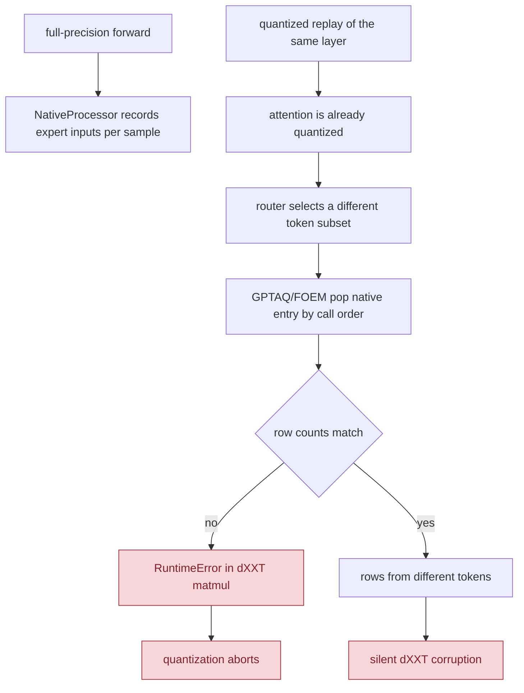
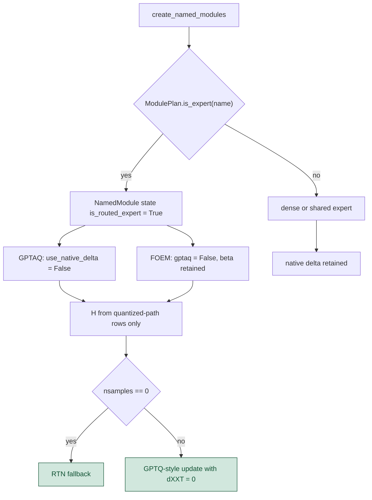
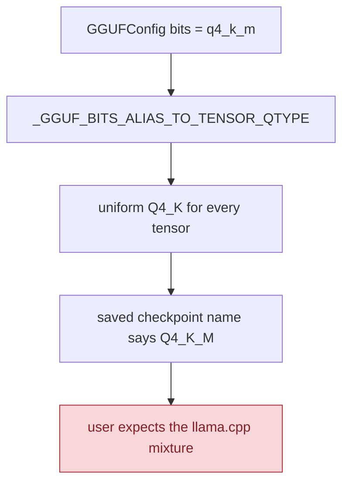
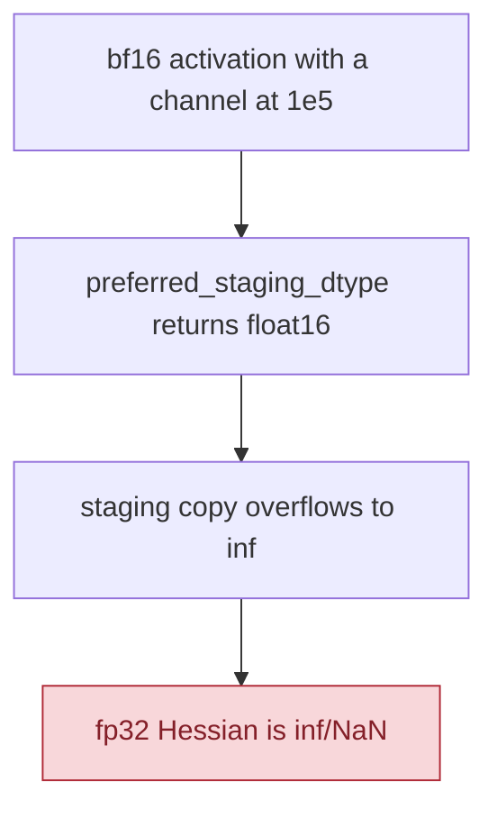
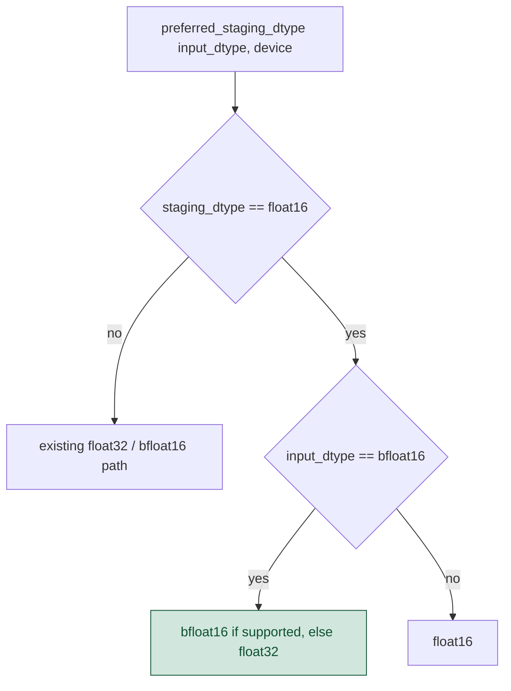

# Quantizer calibration flows: MoE native inputs, GGUF quality aliases, Hessian staging

This page describes three calibration decisions that share one rule: a tensor
must only be combined with data that describes the same tokens, and a name must
not promise a layout the packer does not write.

Introduced by PR for issue #4067.

## 1. GPTAQ/FOEM routed-expert inputs

`NativeProcessor` records every module input during one full-precision forward.
`GPTAQ` and `FOEM` (alpha > 0) later compare those native inputs with the inputs
seen during the quantized replay to build `dXXT = (X_native - X_quant)^T X_quant`.
For dense modules the two passes call the module with the same rows, so pairing
the recorded entries by call order is valid.

For routed experts it is not. Attention in the same layer is already quantized
when the experts replay, so the router sends a different token subset to each
expert. The old code popped one native entry per expert call:

An expert that receives no routed rows has `H = None`. `GPTAQ.quantize` and
`FOEM.quantize` then dereferenced `self.H.device` and never reached GPTQ's
data-independent fallback.

The fix marks routed experts from the model's `ModulePlan` in
`ModuleLooper.create_named_modules` (`plan.is_expert(name)`). `GPTAQ` and `FOEM`
read that mark and disable the native delta for routed experts: `dXXT = 0`, so
GPTAQ runs the plain GPTQ update and FOEM keeps its beta term. Shared experts
and dense projections still use the native delta because they receive the same
rows in both passes. A zero-sample module now takes the configured fallback
strategy (RTN by default) in both quantizers.

| Situation | Before | After |
| --- | --- | --- |
| Routed expert, row counts differ | `RuntimeError` in `gptaq.py` / `foem.py` | `dXXT = 0`; plain GPTQ update |
| Routed expert, row counts happen to match | silent `dXXT` corruption | `dXXT = 0`; no native pairing |
| Routed expert, zero calibration rows | `AttributeError` on `self.H.device` | RTN fallback |
| Dense projection | native delta | unchanged |
| Shared expert | native delta | unchanged |

The alpha correction is intentionally unavailable for routed experts until the
native rows can be gathered with the quantized-path routing. That follow-up is
not implemented here; routed experts are quantized as plain GPTQ (GPTAQ) or
FOEM without the alpha term.

## 2. GGUF `q*_k_s` / `q*_k_m` / `q*_k_l` quality aliases

llama.cpp's `_s`/`_m`/`_l` suffixes select a per-tensor mixture, for example
Q6_K for `attn_v` and `ffn_down` in the `use_more_bits` layers. GPT-QModel
stores every tensor with the base K type (`Q4_K` for `q4_k_*`, and so on), so
the alias name overstated the checkpoint quality.

The fix keeps the uniform storage (the mixture is not implemented) but emits a
loud warning from `GGUFConfig.__post_init__` and from dynamic per-layer
overrides. The bpw table now reports `q5_k_s` as 5.5 bpw, matching the uniform
Q5_K blocks that are actually written.

| Alias | Stored type | Reported bpw |
| --- | --- | --- |
| `q4_k_s`, `q4_k_m` | `Q4_K` | 4.5 |
| `q5_k_s`, `q5_k_m` | `Q5_K` | 5.5 |
| `q3_k_s`, `q3_k_m`, `q3_k_l` | `Q3_K` | 3.4375 |

## 3. Hessian staging dtype range

`HessianConfig.staging_dtype` may request float16. `preferred_staging_dtype`
returned float16 for bfloat16 inputs, so an activation outside float16's range
became `inf` before the fp32 matmul, and the Hessian became `inf`/`NaN`.

The staging dtype is now never narrower in range than the input: a bf16 input
with `staging_dtype=float16` stages as bf16 (or fp32 when the device has no
bf16 matmul). An fp16 input may still stage as fp16.

Measured on CPU with a bf16 input whose channel 3 is scaled by `1e5` and
`chunk_size=64`: the old float16 staging produced a non-finite Hessian; the
fixed path matches the float64 oracle within `1e-6` normalized error.
