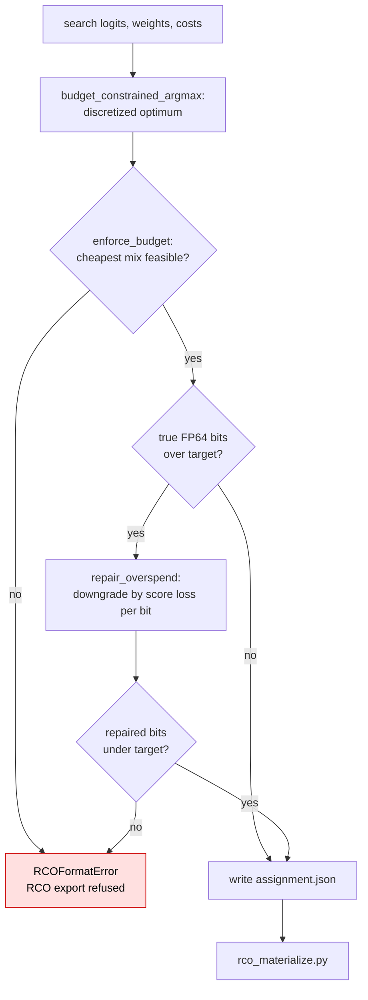

<!-- SPDX-FileCopyrightText: 2026 ModelCloud.ai
SPDX-License-Identifier: Apache-2.0 -->

# RCO discrete budget export

The RCO allocator minimizes the model loss under a bits-per-parameter budget.
The search is continuous and exact, but the exported artifact is a discrete
width per group, so the export tail owns the exact-budget postcondition.

## Two budgets

`budget_constrained_argmax` solves exactly

```
maximize  sum_i s_i,option
subject to  sum_i round(w_i / sum(w) * c_i,option * resolution) <= round(target * resolution)
```

That constraint is a per-group rounded cost grid, not the true budget
`sum_i w_i * c_i,option / sum_i w_i <= target`. Both divisions round
independently, so the discrete optimum can spend slightly more than the target
whenever many groups share one target. Rounding is not a bug in the DP: the
knapsack only promises the discretized budget, and it may also underspend the
true one because discrete feasibility is an inequality.

The exported `assignment.json` used to record that discretized optimum
unchanged, so the published plan could exceed its declared budget:

| Groups | W4 groups chosen | Maximum feasible W4 groups | Exported bits | Rounded spend / cap |
| --- | --- | --- | --- | --- |
| 64 | 15 | 16 | 2.46875 | 1249 / 1250 |
| 448 | 177 | 112 | 2.7902 | 1250 / 1250 |
| 800 | 450 | 200 | 3.125 | 1250 / 1250 |

Equal-parameter groups, W2/W4 options, uniform `[0, 1]` logits, target 2.5 and
resolution 500 produce those rows. Scaling every weight leaves them unchanged.

## Export flow



Before this change the same tail ran `achieved_bits` and wrote the JSON with no
check:


`enforce_budget` is the single postcondition shared by the consumer path
(`allocate`) and the CLIs. It repairs an overspend by dropping the option with
the smallest score loss per bit saved, reuses the recorded search logits as the
score oracle, and refuses a target below the cheapest feasible mix. Repair only
downgrades options, so it can reduce the objective's value but never publishes
an infeasible plan. The DP resolution is not raised to paper over the gap: a
finer grid shrinks the rounding error without removing it.

## Consumers

- `gptqmodel.quantization.rco_formats.allocate` validates and repairs its plan
  and revalidates every `RCOPlan.from_dict` read.
- `scripts/gsq_paper/rco_allocate.py` reports `budget_repair_applied` and fails
  instead of writing an overspent export.

`rco_allocate.py` caches the search in `probs.pt`, but it has no re-decode flag
today. Any future entry point that re-decodes cached logits must call
`decode_assignment` rather than `budget_constrained_argmax` directly, so the
postcondition cannot be bypassed.
