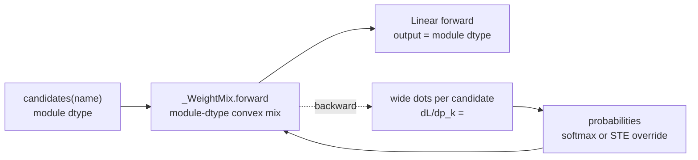
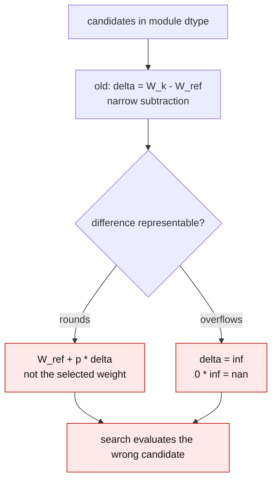

# RCO weight-interpolation precision

RCO searches a per-projection bit width with the model's own loss, so every
candidate width is materialized once and the live projection weight becomes a
differentiable mix of those candidates. This page documents the arithmetic
contract of that mix, its gradient, and the failure it replaced.

## Contract

`InterpolatedLlamaLayers.candidates(name)` in
`gptqmodel/quantization/rco.py` stores the exact candidate tensors in the
module's weight dtype. The parametrization `_WeightInterpolation` evaluates

```
W = (1 - sum_{k != ref} p_k) * W_ref + sum_{k != ref} p_k * W_k
```

through `_WeightMix`, a `torch.autograd.Function` that:

- multiplies the stored candidates directly, so no `W_k - W_ref` difference is
  ever formed and a one-hot `p` reproduces the chosen candidate exactly;
- weights the reference candidate by the probability complement, which keeps
  the mix a convex combination for the soft probabilities too;
- stays in the module's weight dtype, so the forward output is the dtype the
  [forward dtype contract](../../contracts/kernel/forward-dtype.md) requires
  and the projection needs no weight-sized wide scratch;
- recomputes the gradient from the exact candidates in a wide accumulator
  (FP32, FP64 for FP64 weights), one candidate at a time, so no wide copy of a
  candidate or of the activation gradient outlives its use.



## What the delta form broke

Earlier releases stored `delta_k = W_k - W_ref` in the module dtype and built
`W_ref + sum p_k * delta_k`. That is algebraically identical but not
numerically:

| dtype / candidates | stored delta | one-hot output for `W_k` | output for `W_ref` |
| --- | ---: | ---: | ---: |
| BF16 / `[1, 1000]` | -1000 | **0** (expected 1) | 1000 |
| FP16 / `[1, 1000]` (control) | -999 | 1 | 1000 |
| FP16 / `[-60000, 60000]` | -Inf | **-Inf** (expected -60000) | **NaN** (expected 60000) |

Two distinct defects feed that table:

1. **Delta rounding.** A narrow subtraction rounds `W_k - W_ref` to the model
   dtype, so `W_ref + delta_k` no longer equals `W_k`. A hard one-hot
   assignment then evaluates a weight that is not the candidate the search
   selected, breaking the invariant that the search objective is measured on
   the assignment it will keep.
2. **Out-of-range deltas.** Two finite candidates can differ by more than the
   dtype range. The difference becomes `inf`, and `0 * inf` is `NaN`, so even
   the reference selection is corrupted.



## Which calls reach it

Only the search forward is affected: `projected_gumbel_search` passes a hard
one-hot (or the straight-through `onehot - soft.detach() + soft`) assignment to
`set_probs`, and every interpolated projection reads it. The straight-through
form is exact because the soft term cancels, leaving the one-hot value. Both
the Torch `InterpolatedLlamaLayers` and the MLX
`MLXInterpolatedLlamaLayers` implement the convex form with module-dtype
products, so a hard selection is exact on either backend.

Live module dtypes never change during the search: `_WeightInterpolation._apply`
transports the owner-held candidates and the cleanup reference when the model
moves device or dtype, and `cleanup()` removes the parametrizations and copies
the reference back.

## Verification

`tests/test_rco.py` covers one-hot reproduction across FP32/BF16/FP16 and plain
versus straight-through assignment, an FP64 soft-gradient oracle, grouped
decisions with cleanup, and a device move. `tests/test_rco_mlx.py` compares the
MLX mix against the Torch mix on the same candidates and repeats the hard
one-hot check for the MLX layer.

Measured on four 4096x4096 BF16 projections with three candidates, comparing
the reference `W_ref + sum p_k * delta_k` path with this one:

| Metric | Before | After |
| --- | ---: | ---: |
| Resident interpolation state (MiB) | 384.0 | 0.0 |
| Forward peak above weights (MiB) | 96.0 | 40.6 |
| Latency, 1 token (ms) | 2.075 | 1.344 |
| Latency, 8 tokens (ms) | 2.132 | 1.302 |
| Latency, 32 tokens (ms) | 2.195 | 1.127 |
