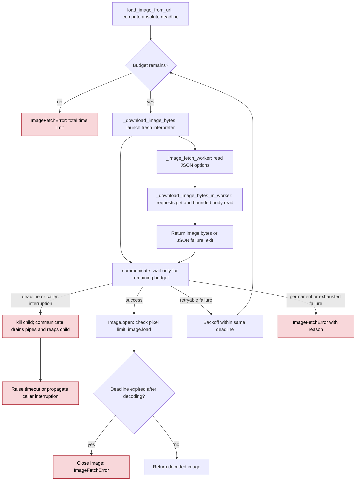

<!-- SPDX-FileCopyrightText: 2026 ModelCloud.ai -->
<!-- SPDX-License-Identifier: Apache-2.0 -->

# Remote image fetch bounds

`gptqmodel.utils.image.load_image_from_url` is the network entry point for
multimodal calibration. `fetch_image`, `InternS1QModel`, and `Ovis2_5QModel`
use it. Each network attempt runs in a fresh Python subprocess so the caller
can terminate a request even before `requests` exposes a response socket.
The caller kills and reaps an unfinished child before returning an error.
This closes the header-reader resource leak reported in #3854, following the
caller-deadline fix in #3848.

One absolute `total_timeout` budget covers worker startup, DNS, connection/TLS
setup, headers, redirects, body transfer, retries and backoff. Image decoding
stays in the caller: the budget is checked before and after decoding, but a
running Pillow decoder is not forcibly interrupted. Process teardown adds a
small scheduling/reaping interval after the network deadline.

## Before and after

References in the before column are to `gptqmodel/utils/image.py` at
`d831ba08b8b64c362f990d38fa7d6e779e417f10`.

| Concern | Before | Current behavior |
| --- | --- | --- |
| Request/header phase | `_get_response`, lines 160–213: a daemon thread returns control at the deadline but cannot cancel `requests.get` during headers | One owned subprocess includes the entire request; timeout kills and reaps it |
| Cancellation race | Lines 185–208: cancellation and response publication can race; no response exists during headers | No response object crosses the process boundary; child exit releases network resources |
| Body stream | Lines 284–293: a separate watchdog searches private response socket attributes | The same subprocess deadline covers body reads without private socket access |
| Error/retry state | Request exceptions handled in the calling process | Worker serializes only reason and retryability as JSON; caller keeps the retry policy |
| Decoding | Deadline checked around Pillow calls | Same caller-side checks and pixel cap; no interruptible-decoder claim |

## Failure and lifecycle contract

- Network deadlines never retry. Per-read stalls and permanent request errors
  also stop immediately; transient HTTP/transport failures may retry within
  the shared budget.
- Successful responses, failures, timeouts and caller interruptions all reap
  their child and close the IPC pipes. Process exit closes sockets even if
  DNS, TLS or header parsing never returned a `requests.Response`.
- A child handles one attempt and retains no connection pool for the next.
  Startup costs apply to each attempt and count against `total_timeout`.
- The child executes this installed Python file with `runpy.run_path`; it
  imports requests and Pillow, not the GPT-QModel model registry. User-site
  and `PYTHONPATH` dependency discovery are preserved without placing the
  utility directory (which contains `inspect.py`) on the import path. The
  worker does not reuse the model interpreter or initialize accelerator state.
- URL and options travel on stdin, not the command line. Image bytes and JSON
  errors travel on stdout; no pickle or checkpoint files are involved.
- The existing byte limit is enforced while streaming and the pixel limit
  before allocating the decoded image. Proxy and certificate configuration
  used by requests still applies inside the child.
- Failure to start the interpreter, or an unexpected worker exit, is a
  terminal diagnostic error. There is no uncancellable thread fallback.

## Regression coverage

`tests/test_image_fetch.py` checks real localhost requests for normal responses,
retries, byte/pixel bounds, invalid data, slow headers, redirect chains and slow
bodies. `test_header_deadlines_release_workers_and_sockets` repeats three
requests to a peer that never completes its headers. It verifies the peer
observes disconnect, no abandoned fetch thread remains, and every child and
pipe has been reaped/closed before the next request. The same test fails on
`d831ba08` because the socket remains open.

`test_fetch_worker_is_reaped_on_caller_interrupt` interrupts a live header read
and verifies socket and child cleanup. Decode tests cover deadline checks after
Pillow returns, not preemption of a running decoder.
