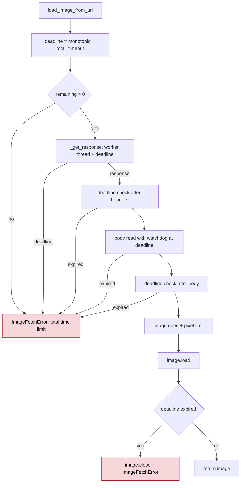

<!-- SPDX-FileCopyrightText: 2026 ModelCloud.ai -->
<!-- SPDX-License-Identifier: Apache-2.0 -->

# Remote image fetch bounds

`gptqmodel.utils.image.load_image_from_url` is the only network path used by
multimodal calibration: `fetch_image` dispatches `http://`/`https://` inputs to
it, and `InternS1QModel` / `Ovis2_5QModel` call it directly. Its
`total_timeout` is an absolute wall-clock budget for one `load_image_from_url`
call, covering every retry attempt, the request/redirect/header phase, the body
stream, and image decoding. The deadline contract was introduced in #3483.

## New flow

## Before / after

| Concern | Before | After |
| --- | --- | --- |
| Request/header phase | `requests.get(...)` ran before any watchdog (`gptqmodel/utils/image.py:157` on pre-fix `main`) | `_get_response` runs the blocking call on a daemon thread and stops waiting at the absolute deadline |
| Redirect chains | Followed inside `requests` with per-read timeouts only | The same absolute deadline bounds the whole chain |
| Per-read timeout | Passed through unchanged | `_clamp_timeout` caps connect/read at the remaining budget |
| Body stream | Watchdog created after headers with a fresh budget (`gptqmodel/utils/image.py:189-193`) | Watchdog is scheduled from the shared deadline |
| Decode | Returned without rechecking the budget (`gptqmodel/utils/image.py:326`) | Checked after the body and after `image.load()` |

## Failure contract

| Situation | Result |
| --- | --- |
| Budget expires during connect, headers, or redirects | `ImageFetchError` with `total time limit`; not retried |
| Budget expires during body streaming | socket aborted by the watchdog; `ImageFetchError`; not retried |
| Budget expires after the body or during decoding | `ImageFetchError`; image closed |
| Server returns a full response inside the budget | decoded `PIL.Image` returned |
| Retryable HTTP/transport failure before the deadline | retried with exponential backoff, bounded by the same deadline |

The helper thread is a daemon. When the caller gives up it is cancelled: if the
response has already arrived it is closed immediately; a request still blocked
inside `requests` is released as soon as the server completes or closes the
connection.

## Tests

`tests/test_image_fetch.py` pins the contract:

| Test | Invariant |
| --- | --- |
| `test_slow_headers_are_bounded_by_total_timeout` | delayed headers cannot exceed the budget |
| `test_redirect_chain_is_bounded_by_total_timeout` | individually fast redirects share one deadline |
| `test_header_drip_is_bounded_by_total_timeout` | trickled headers cannot reset the budget |
| `test_decode_time_is_bounded_by_total_timeout` | decoding is inside the budget |
| `test_slow_drip_body_is_bounded_by_total_timeout` | body streaming is inside the budget |
