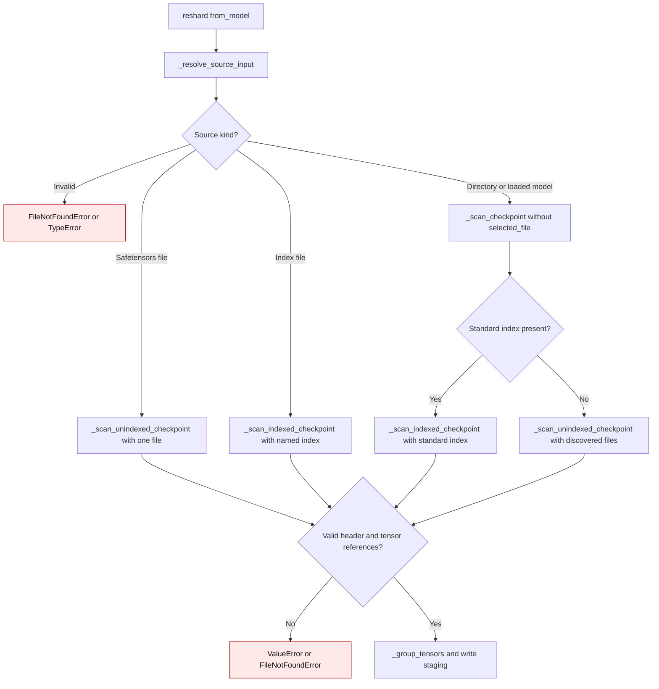

# Reshard source selection

`reshard(from_model, ...)` accepts a checkpoint directory, a specific
`.safetensors` file, a `.safetensors.index.json` file, or a loaded GPTQModel
whose `model_local_path` is a directory. A file path selects that file or index;
a directory retains the standard index-first discovery behavior. Auxiliary
config and tokenizer files still come from the selected source's directory.

Previously, `_resolve_source_dir` discarded an explicit filename at
`gptqmodel/reshard.py:279-285`, and `_scan_checkpoint` then preferred a
standard index or discovered every safetensors file in that directory at
`gptqmodel/reshard.py:436-443`. The current `_resolve_source_input` keeps the
selected path at `gptqmodel/reshard.py:279-293`; `_scan_checkpoint` uses it at
`gptqmodel/reshard.py:439-456`, called from `gptqmodel/reshard.py:785-790`.

| `from_model` | Previous selection | Current selection |
| --- | --- | --- |
| Directory | Standard index if present, otherwise all discovered safetensors files | Same |
| Specific `.safetensors` file | Standard index or all files in its directory | Only that file |
| Specific `.safetensors.index.json` file | Standard index or all files in its directory | Only shards named in that index |

An explicitly selected index must pass the same shard and tensor-name checks
as a standard index. If it is invalid, resharding fails before publishing the
destination.
See [PR #3589](https://github.com/ModelCloud/GPTQModel/pull/3589) for the
reproducer and rationale.
