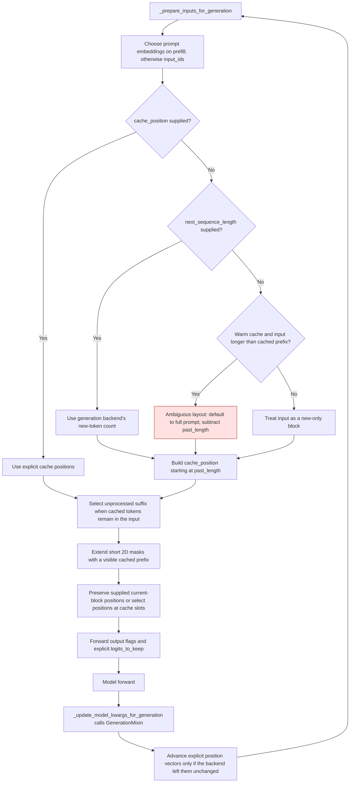

# Ricursive generation, attention, and training contracts

Ripple's native model and GPT-QModel's compatibility hooks must agree on which
inputs are new, which cache slots are visible, and which outputs the caller
requested. The hooks recognize native contract version `2026-11-09`; older
`2026-11-05` checkpoints still receive the generation and masking fixes.

The initial warm-cache fix was introduced in
[GPT-QModel #3703](https://github.com/ModelCloud/GPTQModel/pull/3703). The complete
modeling fixes and regression suite are in
[GPT-QModel #3709](https://github.com/ModelCloud/GPTQModel/pull/3709) and
[Ripple HF #11](https://huggingface.co/ricursiveAI/Ripple-65B-Preview/discussions/11).
**All unit tests live in GPT-QModel.** The test file previously added to HF #11
has been removed; the HF PR contains only the native modeling implementation.

## Generation flow



Without explicit `cache_position` or the generation backend's length hint, a
warm-cache input longer than the cached prefix defaults to a full prompt. A
longer new-only block must supply `cache_position`. A capacity-sized mask cannot
resolve that ambiguity, even when its final slot is visible.

```python
past_length = past_key_values.get_seq_length()
cache_position = torch.arange(
    past_length, past_length + new_input_ids.shape[1], device=new_input_ids.device
)
outputs = model.generate(
    new_input_ids,
    past_key_values=past_key_values,
    attention_mask=full_attention_mask,
    cache_position=cache_position,
    max_new_tokens=16,
)
```

Generation maintains explicit cache positions on Transformers 5 without
advancing them twice on Transformers 4. Continuation buffers can omit the cached
prefix, so input slicing uses the unprocessed suffix instead of applying an
absolute cache index to a shorter buffer. Embeddings-only prefill takes its
length from the embeddings, and later decode steps switch to token IDs.

A short 2D mask assumes its omitted prefix was visible. Callers with padding in
the cached prefix must provide the full mask to retain that information. Caller
4D masks retain their boolean visibility or additive bias; local attention also
applies its sliding window.

## Model and compatibility lifecycle


The GPT-QModel GQA fast path remains local to GPT-QModel. Normal GQA inference
keeps KV heads grouped. Requested attention weights need an explicit query-head
axis, but the SDPA output remains unchanged, avoiding BF16 rounding drift when
turning diagnostics on.

For older forwards, `_patch_logits_to_keep` registers a projection hook on the
actual instance for the duration of the call and removes it in `finally`. It
works for subsequent model instances and replacement heads. Labeled calls keep
all positions until FP32 loss is computed; dict and tuple outputs are both
trimmed afterward. Current native forwards need no logits wrapper. These changes
do not introduce persistent expanded or dequantized weight storage.

## Before and after

Native references below are `modeling_ricursive.py` at `f8fb7f5`;
compatibility references are `gptqmodel/utils/ricursive_patch.py` at `4e174cb53`.

| Previous behavior and source | Current behavior |
| --- | --- |
| Native line 865: only explicit `position_ids` advanced on Transformers 5. | Explicit cache positions advance too, with backend identity checks preventing double advancement. |
| Native line 935: absolute cache indices index a continuation buffer. | Select the unprocessed suffix in full-prompt and new-only layouts. |
| Native line 925: an empty `input_ids` tensor determines embeddings-prefill length. | Embeddings determine prefill length and inputs. |
| Native line 962: generation output flags are dropped. | Forward caller options, excluding training labels. |
| Native line 422: attention weights are always `None`. | Return requested weights while retaining the SDPA output. |
| Native line 958: cache positions index a short mask out of bounds. | Normalize the implicitly visible prefix before deriving positions. |
| Native line 703: 4D masks are expanded like 2D masks. | Preserve supplied 4D masks. |
| Native line 541: checkpointing is advertised but no decoder recomputation is implemented. | Checkpoint decoder calls and preserve value-residual gradients. |
| Native line 841: cross-entropy reduces in activation dtype. | Reduce loss in FP32. |
| Native line 595: every cache layer grows without a sliding limit. | Build a cache from the layer configuration on supported Transformers versions. |
| Native line 330: full static capacity is expanded before trimming. | Trim unwritten cache slots before head expansion. |
| Compatibility line 790: a class flag skips head setup on later instances. | Each call installs and removes its own instance hook. |
| Compatibility line 818: only dictionary logits are trimmed. | Preserve the requested shape for tuple outputs too. |

## Tests and reproduction

| GPT-QModel file | Coverage |
| --- | --- |
| `tests/test_ricursive_native_generation.py` | The 48 native tests moved from HF #11: padded masks, cache lengths, explicit positions, continuation blocks, and left-padded generation. |
| `tests/test_ricursive_support.py` | Existing compatibility, module-plan, quantize/save/reload, and generation integration tests. |
| `tests/test_ricursive_modeling_contracts.py` | All 13 review findings, checkpoint recomputation/gradient parity, compatibility generation, head replacement, and exception cleanup. |
| `tests/test_ricursive_modeling_numerics.py` | Independent FP32 model oracle, head-width variants, window eviction, block decoding, MLP chunking, static/dynamic caches, greedy/beam generation, and chunked prefill. |
| `tests/test_ricursive_modeling_precision.py` | CPU and active CUDA/ROCm runtime checks in FP32, FP16, and BF16, including the 80-query/8-KV head layout. |
| `tests/ricursive_test_utils.py` | Isolated tiny-model fixtures and standalone compatibility-module loading for Transformers 4.57. |

All tests run without the 65B weights. `GPTQMODEL_RIPPLE_REF` selects a local
checkout containing the two native Python files. The standalone modeling suites
can also download only the pinned code files defined in `ricursive_test_utils`.

```bash
GPTQMODEL_RIPPLE_REF=/path/to/ripple/source OMP_NUM_THREADS=1 python -m pytest -q -o log_cli=false \
  tests/test_ricursive_support.py \
  tests/test_ricursive_native_generation.py \
  tests/test_ricursive_modeling_contracts.py \
  tests/test_ricursive_modeling_numerics.py \
  tests/test_ricursive_modeling_precision.py
```

For Transformers 4.57, omit `test_ricursive_support.py`: that older integration
suite imports GPT-QModel's complete registry, which requires Transformers 5 for
other model architectures. All standalone modeling suites, including the
compatibility shim tests, run on both versions.

## Measured validation

On PyTorch 2.15.0 with an NVIDIA RTX 4090:

- Transformers 5.22.1: **313 passed** across all five test files above.
- Transformers 4.57.6: **230 passed** across the four standalone modeling suites.
- Precision coverage includes FP32, FP16, and BF16 on CPU and the CUDA runtime.
- Both reentrant and non-reentrant checkpointing match ordinary backward gradients,
  with value residuals enabled and disabled.
- Tests use tiny deterministic models. The full 65B checkpoint, distributed
  execution, and an AMD ROCm device were not exercised in this validation.

The code-only fixture is pinned to native commit
`948fa2689b50ce2f713f573682632fe0fad0118d` from HF #11.
