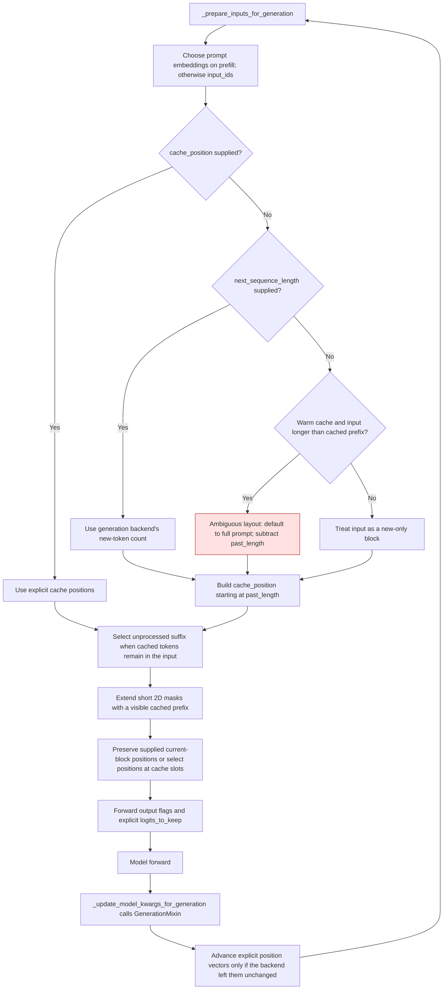
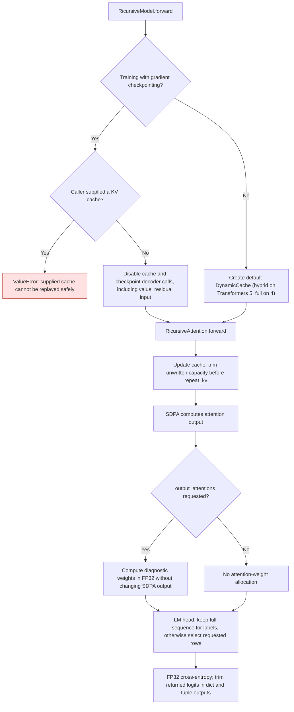
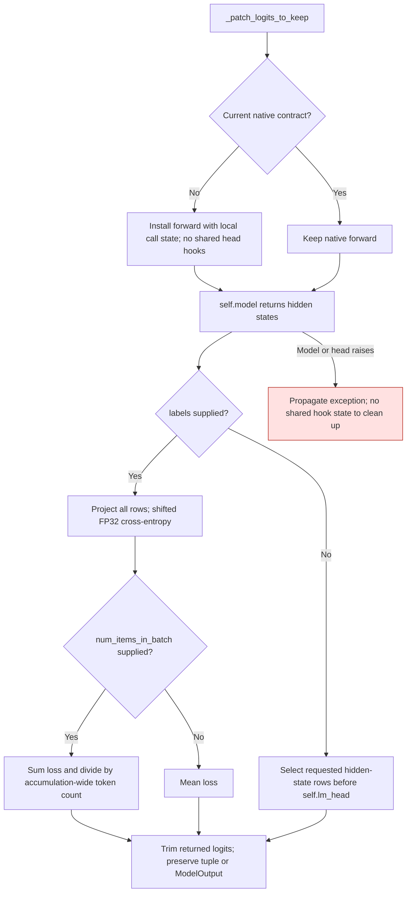

# Ricursive generation, attention, and training contracts

Ripple's native model and GPT-QModel's compatibility hooks must agree on which
inputs are new, which cache slots are visible, and which outputs the caller
requested. The compatibility layer recognizes native contract version `2026-11-09.1`; older
`2026-11-05` checkpoints still receive the generation and masking fixes.

The initial warm-cache fix was introduced in
[GPT-QModel #3703](https://github.com/ModelCloud/GPTQModel/pull/3703). The complete
modeling fixes and regression suite are in
[GPT-QModel #3709](https://github.com/ModelCloud/GPTQModel/pull/3709) and
[Ripple HF #11](https://huggingface.co/ricursiveAI/Ripple-65B-Preview/discussions/11).
**All unit tests live in GPT-QModel.** The test file previously added to HF #11
has been removed; the HF PR contains only the native modeling implementation.

## Generation flow



Without explicit `cache_position` or the generation backend's length hint, a
warm-cache input longer than the cached prefix defaults to a full prompt. A
longer new-only block must supply `cache_position`. A capacity-sized mask cannot
resolve that ambiguity, even when its final slot is visible.

```python
past_length = past_key_values.get_seq_length()
cache_position = torch.arange(
    past_length, past_length + new_input_ids.shape[1], device=new_input_ids.device
)
outputs = model.generate(
    new_input_ids,
    past_key_values=past_key_values,
    attention_mask=full_attention_mask,
    cache_position=cache_position,
    max_new_tokens=16,
)
```

Generation maintains explicit cache positions on Transformers 5 without
advancing them twice on Transformers 4. Continuation buffers can omit the cached
prefix, so input slicing uses the unprocessed suffix instead of applying an
absolute cache index to a shorter buffer. Embeddings-only prefill takes its
length from the embeddings, and later decode steps switch to token IDs.

The default cache is version-aware. Transformers 5 builds the configured hybrid
cache, so sliding layers keep only their window. Transformers 4 keeps a plain
full-attention `DynamicCache`: its configured `DynamicSlidingWindowLayer` cannot
be cropped after passing the window, which breaks assisted decoding and any
cache rollback.

A short 2D mask assumes its omitted prefix was visible. Callers with padding in
the cached prefix must provide the full mask to retain that information. Caller
4D masks retain their boolean visibility or additive bias; local attention also
applies its sliding window.

## Model and compatibility lifecycle



The GPT-QModel GQA fast path remains local to GPT-QModel. Normal GQA inference
keeps KV heads grouped. Requested attention weights need an explicit query-head
axis, but the SDPA output remains unchanged, avoiding BF16 rounding drift when
turning diagnostics on.

For older forwards, `_patch_logits_to_keep` installs a class forward that calls
`self.model` and slices hidden-state rows using local call variables. It never
installs LM-head hooks. Concurrent calls, including full-logit and labeled calls,
therefore cannot inherit another request's row selection. Replacement heads and
subsequent model instances use the same contract. Labeled calls project every
position, compute FP32 loss, then trim returned logits. Current native forwards
need no replacement. No persistent expanded or dequantized weights are introduced.



Tensor-parallel attention derives head counts from local projection widths and
KV grouping from the resulting tensors. The same code handles an unsharded
model. Sliding layers intersect caller masks with the window using boolean AND
or additive `-inf`, so an empty visibility row stays empty. The tied-weight map
identifies `lm_head.weight` as sharing `model.embed_tokens.weight`; Transformers
5 consumes the map and Transformers 4 consumes its keys.

## Before and after

Native references below are `modeling_ricursive.py` at `f8fb7f5`;
compatibility references are `gptqmodel/utils/ricursive_patch.py` at `4e174cb53`.

| Previous behavior and source | Current behavior |
| --- | --- |
| Native line 865: only explicit `position_ids` advanced on Transformers 5. | Explicit cache positions advance too, with backend identity checks preventing double advancement. |
| Native line 935: absolute cache indices index a continuation buffer. | Select the unprocessed suffix in full-prompt and new-only layouts. |
| Native line 925: an empty `input_ids` tensor determines embeddings-prefill length. | Embeddings determine prefill length and inputs. |
| Native line 962: generation output flags are dropped. | Forward caller options, excluding training labels. |
| Native line 422: attention weights are always `None`. | Return requested weights while retaining the SDPA output. |
| Native line 958: cache positions index a short mask out of bounds. | Normalize the implicitly visible prefix before deriving positions. |
| Native line 703: 4D masks are expanded like 2D masks. | Preserve supplied 4D masks. |
| Native line 541: checkpointing is advertised but no decoder recomputation is implemented. | Checkpoint decoder calls and preserve value-residual gradients. |
| Native line 841: cross-entropy reduces in activation dtype. | Reduce loss in FP32. |
| Native line 595: every cache layer grows without a sliding limit. | Build a hybrid cache from the layer configuration on Transformers 5; keep a crop-compatible full cache on Transformers 4. |
| Native line 330: full static capacity is expanded before trimming. | Trim unwritten cache slots before head expansion. |
| Compatibility line 790: a class flag skips head setup on later instances. | Local forward state slices the current instance's head input without hooks. |
| Compatibility line 818: only dictionary logits are trimmed. | Preserve the requested shape for tuple outputs too. |


The subsequent clean review fixes and their 38 new regression cases are in
[GPT-QModel #3710](https://github.com/ModelCloud/GPTQModel/pull/3710).
That review compared native `948fa2689` and compatibility
`1efaf4a298` and added these regressions:

| Previous behavior and source | Current behavior |
| --- | --- |
| Native `modeling_ricursive.py:895` and compatibility `ricursive_patch.py:894`: always reduce mean loss. | Honor `num_items_in_batch` using summed loss divided by the shared token count. |
| Native `modeling_ricursive.py:299` and compatibility `ricursive_patch.py:690`: reshape using global head counts after TP sharding. | Infer local heads and grouping from projection tensors. |
| Native `modeling_ricursive.py:269`: replace existing `-inf` exclusions with finite minima. | Preserve exclusions with `-inf`, including completely blocked query rows. |
| Compatibility `ricursive_patch.py:883`: register request-specific hooks on a shared head. | Replace the forward once and keep all request-specific slicing state local. |
| Native `modeling_ricursive.py:811`: list-valued tied metadata crashes on Transformers 5. | Target-to-source mapping supports tying, resizing, and save/load on both versions. |

## Tests and reproduction

| GPT-QModel file | Coverage |
| --- | --- |
| `tests/test_ricursive_native_generation.py` | The 48 native tests moved from HF #11: padded masks, cache lengths, explicit positions, continuation blocks, and left-padded generation. |
| `tests/test_ricursive_support.py` | Existing compatibility, module-plan, quantize/save/reload, and generation integration tests. |
| `tests/test_ricursive_modeling_contracts.py` | All 13 review findings, checkpoint recomputation/gradient parity, compatibility generation, head replacement, and exception cleanup. |
| `tests/test_ricursive_modeling_numerics.py` | Independent FP32 model oracle, head-width variants, window eviction, block decoding, MLP chunking, static/dynamic caches, greedy/beam generation, and chunked prefill. |
| `tests/test_ricursive_modeling_precision.py` | CPU and active CUDA/ROCm runtime checks in FP32, FP16, and BF16, including the 80-query/8-KV head layout. |
| `tests/test_ricursive_review_regressions.py` | 38 cases: all five clean-review defects, actual historical source, real Trainer updates, concurrent labeled/full/sliced requests, tied resize/save/load, and real two-rank TP. |
| `tests/ricursive_tp_worker.py`, `tests/ricursive_tp_oracle.py` | Distributed loader, dynamic/static cache and generation checks, independent partition-aware arithmetic, and separately measured fused-backend rounding. |
| `tests/ricursive_test_utils.py` | Isolated tiny-model fixtures and standalone compatibility-module loading for Transformers 4.57. |

All tests run without the 65B weights. `GPTQMODEL_RIPPLE_REF` selects a local
checkout containing the two native Python files. The standalone modeling suites
can also download only the pinned code files defined in `ricursive_test_utils`.

```bash
GPTQMODEL_RIPPLE_REF=/path/to/ripple/source OMP_NUM_THREADS=1 python -m pytest -q -o log_cli=false \
  tests/test_ricursive_support.py \
  tests/test_ricursive_native_generation.py \
  tests/test_ricursive_modeling_contracts.py \
  tests/test_ricursive_modeling_numerics.py \
  tests/test_ricursive_modeling_precision.py \
  tests/test_ricursive_review_regressions.py
```

For Transformers 4.57, omit `test_ricursive_support.py`: that older integration
suite imports GPT-QModel's complete registry, which requires Transformers 5 for
other model architectures. All standalone modeling suites, including the
compatibility shim tests, run on both versions.

## Measured validation

PyTorch 2.15.0, CPU, and two NVIDIA RTX 4090 devices:

- Transformers 5.22.1: **351 passed** across the six test files above
  (313 existing cases plus 38 new cases).
- Transformers 4.57.6: **265 passed, 3 skipped** across the five standalone
  suites. The three CPU TP cases are skipped because that version's loader
  selects CUDA on a CUDA-enabled Torch build even when given a CPU mesh.
  All nine GPU TP cases pass. The isolated Trainer environment uses datasets 3.6.0.
- Real Trainer SGD updates agree across batch/accumulation layouts on both
  versions, including actual historical source with the compatibility patch.
- Tensor-parallel configurations use two ranks, hidden width 32, 8 query heads,
  2 KV heads, head dimension 8, two decoder layers, and a four-token window.
  Tests cover FP32, FP16, and BF16, prefill, chunked cached decoding, and greedy
  generation. Token comparisons are exact.
- The independent dense TP oracle explicitly rounds each shard's GEMM result
  before summation. With math SDPA to isolate that arithmetic, the largest FP32
  logit error is `2.28e-7`; FP16 and BF16 oracle error is zero for these fixtures.
- Default fused-backend projection errors against that oracle peak at
  `1.23e-4` for BF16 (`7.63e-6` for FP16), below `atol=rtol=2e-3`.
  Whole-model BF16 logits differ from the unsharded fused baseline by up to
  `0.00341796875`; this is reported separately from arithmetic error because
  shard reduction and fused SDPA rounding accumulate through PeriNorm blocks.
  No widened floating tolerance is used, and generated tokens match exactly.
- Existing single-device checks cover CPU/GPU FP32, FP16, BF16, and both
  checkpointing modes with value residuals enabled and disabled.
- No persistent dense/expanded weight cache or dequantization scratch is added.
  The change retains only normal checkpoint weights, existing KV-cache state,
  and call-local activations.
- Tiny deterministic models were used. Full 65B quantized accuracy, distributed
  training, and AMD ROCm hardware were not exercised.

The code-only fixture is pinned to native commit
`2f007aabfcedd0f8763d86d08f9aa0afbc344cea` from HF #11, which keeps the
Transformers 4 default cache crop-compatible. The rollback regression is in
[GPT-QModel #3752](https://github.com/ModelCloud/GPTQModel/pull/3752).
Historical compatibility coverage also loads
`da94cc013a8fda04a502f0a185083c7099ea06c1` directly.
