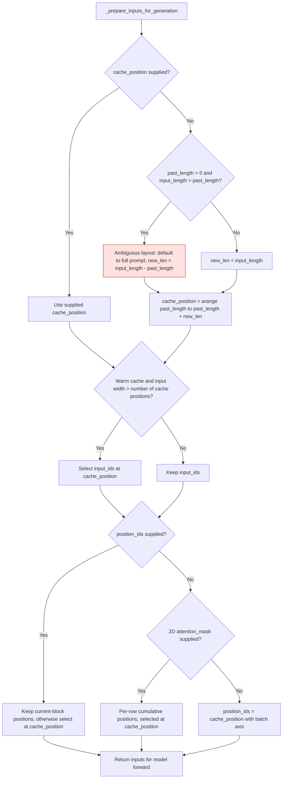

# Ricursive cached generation

GPT-QModel's `_prepare_inputs_for_generation` compatibility hook prepares
Ripple inputs for a warm cache. It uses explicit `cache_position` when supplied;
otherwise, inputs longer than the cached prefix are full prompts and inputs no
longer than that prefix are new-only blocks. Attention masks may span allocated
cache capacity, so neither their width nor their final bit identifies the input
layout.

Introduced in [GPT-QModel #3703](https://github.com/ModelCloud/GPTQModel/pull/3703).



The ambiguity path defaults to a full prompt; it does not reject the call. To
submit a new-only block longer than the cached prefix, supply explicit positions:

```python
past_length = past_key_values.get_seq_length()
cache_position = torch.arange(
    past_length, past_length + new_input_ids.shape[1], device=new_input_ids.device
)
inputs = model.prepare_inputs_for_generation(
    new_input_ids,
    past_key_values=past_key_values,
    attention_mask=attention_mask,
    cache_position=cache_position,
    use_cache=True,
)
```

The 2D attention mask covers the cached and current token slots and may include
unused capacity afterward. Cumulative positions retain per-row left-padding
offsets; selecting at `cache_position` avoids using that unused tail. Explicit
`position_ids` may already cover only the current block, or cover the full prompt
or capacity.

## Replaced decisions

Line references below refer to base commit `275901aa5` in
`gptqmodel/utils/ricursive_patch.py`.

| Before | After |
| --- | --- |
| Lines 188–203: matching mask width plus a visible final bit identifies a long new-only block. | Mask contents do not determine layout. Long new-only blocks use explicit `cache_position`. |
| Lines 227–230: take the final mask-derived positions. | Select the positions at the actual cache indices. |
| Lines 223–226: slice caller positions whenever input tokens were sliced. | Preserve already selected current-block positions; select full-width positions by cache index. |

With four cached tokens, a six-token full prompt, and an all-visible mask of
width ten, the cache must end at six tokens. With ten cached tokens, two new
tokens, and a sixteen-slot padded mask, unpadded-row positions must be `[10, 11]`.
These cases were reported in
[Ripple PR #11](https://huggingface.co/ricursiveAI/Ripple-65B-Preview/discussions/11).

## Regression coverage

`tests/test_ricursive_support.py` binds the compatibility hook directly to a tiny
Ripple model, including when upstream declares native support. The tests compare
cached logits against a full uncached forward and assert input tokens, cache
lengths, cache positions, and per-row positions. They cover dynamic/static caches,
left padding, full prompts, short/equal-length new blocks, explicit long new
blocks, padded prefill, caller positions, and greedy batched generation.

Validation with PyTorch 2.15.0 and Transformers 5.22.1: the two reported cases
failed in all eight cache/padding combinations before the fix; the complete
Ripple suite passed all 83 tests afterward.

Run without downloading checkpoint weights:

```bash
GPTQMODEL_RIPPLE_REF=/path/to/ripple/source python -m pytest -q -o log_cli=false tests/test_ricursive_support.py
```

Models declaring native Transformers compatibility retain their own generation
hook. The matching native fix is maintained in Ripple PR #11.
