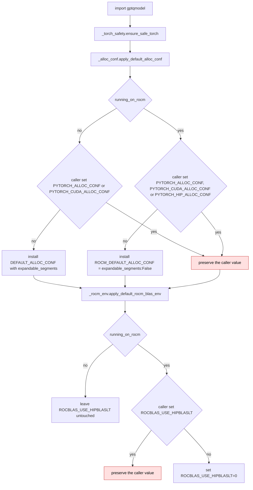
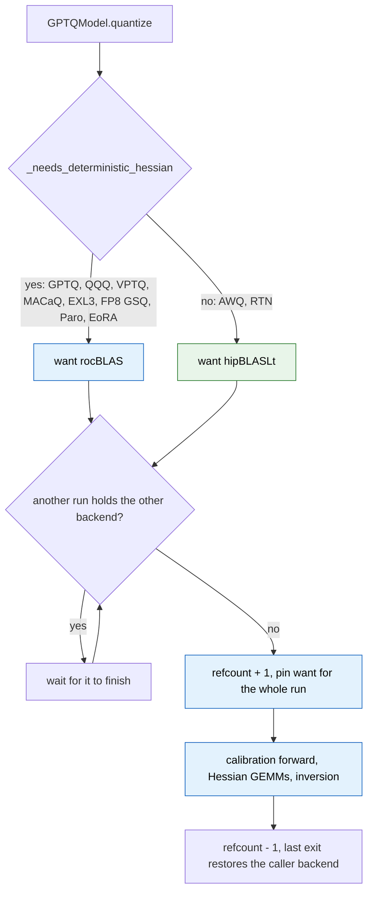

<!-- SPDX-FileCopyrightText: 2026 ModelCloud.ai -->
<!-- SPDX-License-Identifier: Apache-2.0 -->

# ROCm default process environment

`import gptqmodel` installs two process-wide defaults on ROCm that change the
numbers a quantization run produces. Both are installed before the first BLAS
call and both defer to a value the caller already set:

| Variable | ROCm default | Why |
|---|---|---|
| `PYTORCH_ALLOC_CONF` / `PYTORCH_CUDA_ALLOC_CONF` | `expandable_segments:False` | `expandable_segments:True` plus `torch.cuda.empty_cache()` corrupts ordinary Torch results on ROCm 10.1 / gfx1201 |
| `ROCBLAS_USE_HIPBLASLT` | `0` | rocBLAS forwards GEMMs to hipBLASLt, which selects a different kernel per process for the same shape; identical quantization runs then save different checkpoints |

CUDA installs `expandable_segments:True` only, and never has
`ROCBLAS_USE_HIPBLASLT` set by GPT-QModel. `max_split_size_mb` is deliberately
left unset on both backends: pinning it to 256 MiB stops the allocator from
splitting and reusing 256 MiB blocks, so a layer's churn grows reserved VRAM
while active memory stays flat (#4389 on CUDA, #5072 on ROCm, where one
14336x4096 MACaQ layer peaked at 5258 MiB reserved for 4224 MiB allocated and
4466 MiB after the cap was dropped, with identical tensors).
`garbage_collection_threshold` is omitted too:
without a memory fraction it only fires above a fraction of the whole device,
which a quantization run never reaches.

The ROCm default now pins exactly one thing, `expandable_segments:False`.
Everything else is Torch's own default, so a future Torch allocator change
reaches ROCm users unless it also needs this exclusion.

## The import-time flow



`apply_default_alloc_conf()` is also re-run from `gptqmodel/models/auto.py` so
importing that module directly still gets the default. The ROCm BLAS default is
applied once, from `gptqmodel/__init__.py`, before `gptqmodel.utils` is
imported.

## Quantization BLAS scope

`ROCBLAS_USE_HIPBLASLT=0` only keeps GEMMs deterministic when the GEMM actually
runs on rocBLAS. #4079 made that true for the whole quantization phase by
wrapping `_quantize_with_calibration` in `quant_blas_backend()`. On gfx1201
rocBLAS has no fast fp16/bf16 kernels, so that also routed AWQ's and RTN's
fp16/bf16 GEMMs through rocBLAS: 8-14x slower than hipBLASLt, with no
determinism gain for methods that never build a Hessian.

The pin is scoped to methods that accumulate a Hessian or input Gram from the
calibration activations (`_needs_deterministic_hessian` in
`gptqmodel/models/base.py:158`, keyed off `_HESSIAN_PROCESSOR_STEPS` at
`gptqmodel/models/base.py:148`):

| Method | Accumulates | Where |
|---|---|---|
| GPTQ (incl. GPTAQ, FOEM) | `X^T X` | `quantization/gptq.py` |
| QQQ | `X^T X` | `quantization/qqq.py:635` |
| VPTQ | `X^T X` | `quantization/vptq.py:283` |
| MACaQ | `X^T X` | `quantization/macaq.py:668` |
| EXL3 | reuses GPTQ's capture | `looper/exllamav3_processor.py:192` |
| FP8 GSQ | fp32 input Gram | `quantization/gsq_calibration.py:56` |
| EoRA | fp32 input Gram + `eigh` | `eora/eora.py:44` |

AWQ, Paro and weight-only (RTN) accumulate none of these and keep
hipBLASLt. EoRA is included even though it is a secondary processor: an
AWQ + EoRA plan would otherwise keep the adapter Gram on hipBLASLt, and the
saved adapter differed in 39/42 LoRA tensors between identical runs (#4614).

#4105 scoped the pin to `ProcessorStep.GPTQ in run_plan.processors`, which was
too narrow: QQQ also builds a Hessian, so it accumulated on hipBLASLt and lost
cross-process reproducibility. Four QQQ runs produced three distinct
checkpoints differing in 490/627 tensors, and its `add_batch` GEMMs ran on
`Cublaslt` (issue #4123). The gate is now "this run plan has any Hessian
builder", not "this run is GPTQ".

The Hessian methods keep the pin for their calibration forward and replay, not
only for the fp32 `X^T X` GEMM: those forward GEMMs produce the activations that
are accumulated into the Hessian. Pinning only `compute_hessian_xtx` regressed
Qwen2.5-0.5B-Instruct to **332/795** differing tensors across processes (the
#4075 no-pin baseline), because the captured inputs themselves differed. The
per-call contexts in `compute_hessian_xtx` (`gptqmodel/quantization/gptq.py:1207,1244,1260`)
and `hessian_inverse` (`gptqmodel/quantization/gptq.py:2108`) remain as
defense-in-depth for direct Hessian calls; the outer method-scoped context is
what keeps the forward reproducible.

Every run now pins its backend for the whole run - rocBLAS for a Hessian
builder, hipBLASLt for everything else - through one refcounted guard. A run
that needs the other backend waits for the active one to finish instead of
flipping the process-wide setting under it. Without that wait, a concurrent AWQ
run quantized some layers on rocBLAS and the rest on hipBLASLt depending on when
the GPTQ thread exited: 319/627 tensors differed from a serial AWQ run (issue
#4123). With the wait, both interleavings measured 0/627.

The refcount is #4094's `_QUANT_BLAS_GUARD_LOCK` / `_QUANT_BLAS_GUARD_DEPTH` /
`_QUANT_BLAS_GUARD_PREVIOUS` primitive (`gptqmodel/utils/rocm.py:290-293`),
which is reentrant (`threading.RLock`). #4123 added `_QUANT_BLAS_GUARD_TARGET`
(`gptqmodel/utils/rocm.py:296`) and a condition variable on the same lock, so
same-target runs share the refcount and different-target runs serialize.



| Mechanism | Before (#4079) | After (#4105 + #4123 + #4460) |
|---|---|---|
| Override scope | unconditional around the whole calibrated run (`gptqmodel/models/base.py:2128`) | only when `_needs_deterministic_hessian(run_plan)` (`gptqmodel/models/base.py:158`) |
| AWQ / RTN | forced rocBLAS for the whole run | pinned hipBLASLt for the whole run |
| Paro | forced rocBLAS for the whole run | pinned rocBLAS (no Hessian, but hipBLASLt kernel choice made seeded runs differ) |
| QQQ / VPTQ / MACaQ / EXL3 / FP8 GSQ | forced rocBLAS | pinned rocBLAS (they build a Hessian) |
| EoRA | forced rocBLAS | pinned rocBLAS (fp32 input Gram + `eigh`; #4614) |
| GPTQ calibration forward and replay | forced rocBLAS | pinned rocBLAS (their activations feed the Hessian) |
| Hessian `X^T X` and inversion | rocBLAS | rocBLAS, plus a nested per-call context |
| Nested scopes | not reference counted | reentrant refcount, restores only after the last worker exits |
| Mixed-backend concurrency | backend flipped mid-run | the later run waits for the active one |

### Measured on gfx1201 (R9700)

`F.linear` throughput in TFLOPS, median of 50 iterations after 10 warm-ups,
`torch.cuda.Event` timing. "rocBLAS" is the old whole-phase override; "default"
is torch's hipBLASLt backend, which methods without a Hessian now keep:

| Shape | dtype | rocBLAS (before) | hipBLASLt (after, no-Hessian methods) | speedup |
|---|---|---|---|---|
| 4096x4096x14336 | bf16 | 9.5 | 139.0 | 14.6x |
| 512x2048x8192 | fp16 | 10.2 | 119.8 | 11.7x |
| 16x896x4864 | bf16 | 0.5 | 7.3 | 13.4x |
| 8192x4096 `X^T X` | fp32 | 20.5 | 16.3 | 0.8x (rocBLAS wins) |

The fp32 Hessian GEMM is faster on rocBLAS, which is why the Hessian builders
keep the pin there. The fp16/bf16 rows are the AWQ/RTN paths that no longer pay
it. Paro pays the pin deliberately: hipBLASLt chose GEMM kernels per
process and made identically seeded checkpoints differ (issue #4460). GPTQ's
end-to-end time is unchanged by design (it keeps the old whole-run pin):
58.1 s / 61.4 s for Llama-3.2-1B, 128 samples, against the
issue's 61 s / 56 s. AWQ's 128-sample run measured 50.7 s / 45.5 s, against the
issue's 128 s / 124 s with the whole-run pin.

QQQ pays the pin again, but its Hessian GEMM is fp32 where rocBLAS is the faster
backend, so the end-to-end cost is small on this host: 14.2 s / 15.5 s before
(hipBLASLt) vs 14.2 s / 16.3 s after (rocBLAS), Qwen2.5-0.5B, 32 samples, 5376
`add_batch` calls. That is the price of the 490/627 to 0/627 improvement below.

### Cross-process determinism

Separate processes quantized the same model, hashed every saved tensor, and
compared the hashes. "Before" is `origin/main` at `13ee428f2`; "after" is this
branch:

| Model | Method | Runs | Before | After |
|---|---|---|---|---|
| Qwen2.5-0.5B-Instruct | GPTQ, 16 samples | 3 | 0 / 795 | 0 / 795 |
| Qwen2.5-0.5B-Instruct | QQQ, 16 samples | 4 | **490 / 627** (3 distinct checkpoints) | **0 / 627** |
| Qwen2.5-0.5B-Instruct | QQQ, 32 samples | 2 | 490 / 627 | 0 / 627 |
| Qwen2.5-0.5B-Instruct | EXL3, layer 0 | 4 | 5-7 / 312 | 0 / 312 |
| Qwen2.5-0.5B-Instruct | MACaQ, 8 samples | 4 | 0 / 795 | 0 / 795 |
| Qwen2.5-0.5B-Instruct | VPTQ, layer 0 | 4 | 12-14 / 305 | **11-12 / 305** |
| Llama-3.2-1B-Instruct | GPTQ, 128 samples | 2 | 0 / 483 | not re-run |
| Llama-3.2-1B-Instruct | AWQ, 128 samples | 2 | 0 / 371 | not re-run |

`tests/test_rocm_default_env.py::test_quantization_is_reproducible_across_processes`
now covers both `gptq` and `qqq`.

VPTQ is the one method that still differs. The pin is applied (its `add_batch`
GEMMs run on `Cublas`), but its k-means centroid update uses `index_add_`
(`gptqmodel/quantization/vptq.py:159-162`), whose duplicate-index accumulation
is atomic on this stack: five repeats of a bare `index_add_` with duplicate
indices produced five distinct results. That is independent of the BLAS backend
and predates #4105 (before: 12-14 differing). It needs a deterministic
segment-sum and is tracked separately; the Hessian pin alone cannot fix it.

On the merged tree (`origin/main` at `1997993fc`, which adds the `qzeros_format`
scalar to the checkpoint) four fresh GPTQ runs and four fresh QQQ runs each
produced 0 differing tensors: 0/963 and 0/627. The scalar is hashed too, so the
comparison still covers the whole checkpoint.

#4075 measured 332/794 differing without the pin and 0/794 with it.

## The opt-in gives up reproducibility

Two opt-ins are honoured, and neither is silently made deterministic because
the speed is why they exist:

- `KernelConfig(rocm_quant_blas="hipblaslt")` keeps torch's hipBLASLt backend instead
  of pinning rocBLAS for the run.
- `ROCBLAS_USE_HIPBLASLT=1` lets rocBLAS forward its GEMMs to hipBLASLt.

The opt-out spellings of `KernelConfig.rocm_quant_blas` (`""`, `0`, `off`,
`default`) skip the pin as well, so they also leave torch on hipBLASLt. They
are not silently treated as reproducible: `quantize_tuning` logs the same
warning for them, because the checkpoint reproducibility is what is given up
either way (issue #4123).

hipBLASLt selects its kernel per process from the process history, so identical
GPTQ runs in separate processes can diverge from layer 0. Measured on
Llama-3.2-1B (128 samples, every saved tensor hashed):

| Opt-in | Runs | Differing tensors |
|---|---|---|
| none (default) | 2 | 0 / 483 |
| `ROCBLAS_USE_HIPBLASLT=1` | 2 | **224 / 483** (`qweight` and `scales`, from layer 0) |
| `KernelConfig(rocm_quant_blas="hipblaslt")` | 4 | **222 / 483** between the two kernel-selection groups; 0 within a group |

The issue measured 224/482 for both opt-ins. The 4-run result is the useful
shape of the failure: runs 1, 2 and 4 matched and run 3 differed in 222/483
tensors, so a single matching pair does not make the opt-in reproducible — the
choice depends on process history. GPT-QModel logs a warning once whenever the
pin is skipped — either opt-in, or any opt-out spelling of
`KernelConfig.rocm_quant_blas` (`gptqmodel/utils/rocm.py:151`, called from
`quantize_tuning`).

```python
# Reproducible (default)
qcfg = QuantizeConfig(bits=4)

# Faster, not reproducible across processes: the warning is intentional
qcfg = QuantizeConfig(bits=4, runtime=RuntimeConfig(rocm_quant_blas="hipblaslt"))
```

## Failure and ambiguity paths

| Situation | Behaviour |
|---|---|
| Caller sets any allocator variable, including `PYTORCH_HIP_ALLOC_CONF` | GPT-QModel writes nothing; the caller's value is used verbatim |
| Caller sets `ROCBLAS_USE_HIPBLASLT` (including `1` or an empty string) | GPT-QModel writes nothing; rocBLAS sees the caller's value, and `1` warns that checkpoints may differ across processes |
| Caller sets `KernelConfig(rocm_quant_blas="hipblaslt")` | the run keeps hipBLASLt; `quantize_tuning` warns once that checkpoints may differ across processes |
| Caller sets `KernelConfig.rocm_quant_blas` to `""`, `0`, `off` or `default` | the pin is skipped, so the run stays on hipBLASLt; `quantize_tuning` warns once, the same as for the explicit opt-in |
| Caller sets an unrecognised `KernelConfig.rocm_quant_blas` value (for example `"hipblas_lt"`) | `KernelConfig` raises `ValueError` at construction; a typo never silently selects rocBLAS |
| Non-ROCm host | CUDA allocator default is installed; `ROCBLAS_USE_HIPBLASLT` is never written; the override is a no-op |
| BLAS call before `import gptqmodel` | rocBLAS has already fixed its kernel choice; the variable cannot change that process. Import GPT-QModel before the first BLAS call. |

## See also

- [AMD RDNA4 support](rocm-rdna4.md)
