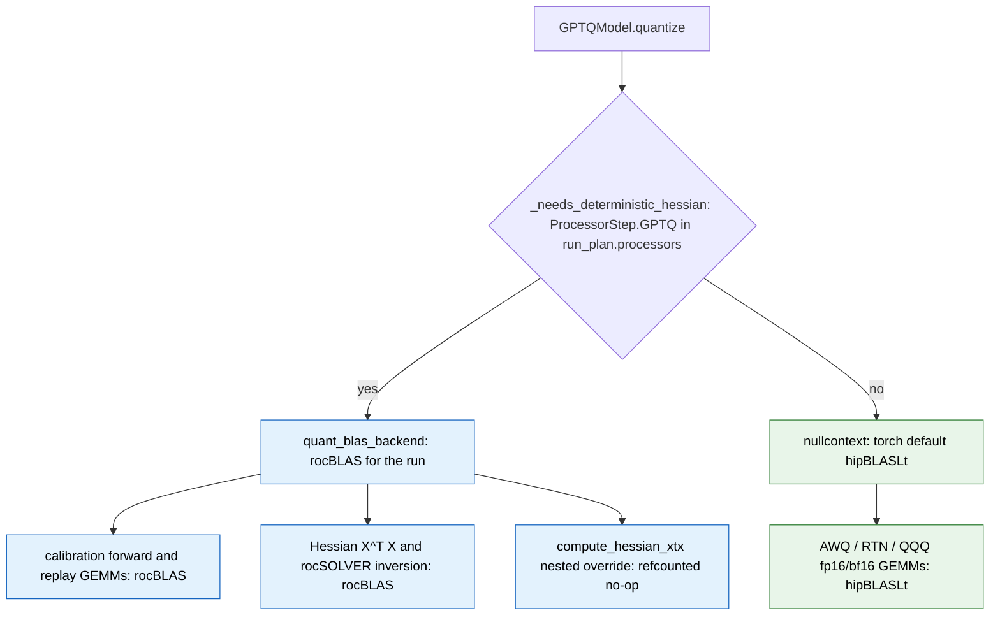

<!-- SPDX-FileCopyrightText: 2026 ModelCloud.ai -->
<!-- SPDX-License-Identifier: Apache-2.0 -->

# ROCm default process environment

`import gptqmodel` installs two process-wide defaults on ROCm that change the
numbers a quantization run produces. Both are installed before the first BLAS
call and both defer to a value the caller already set:

| Variable | ROCm default | Why |
|---|---|---|
| `PYTORCH_ALLOC_CONF` / `PYTORCH_CUDA_ALLOC_CONF` | `max_split_size_mb:256,garbage_collection_threshold:0.7` | `expandable_segments:True` plus `torch.cuda.empty_cache()` corrupts ordinary Torch results on ROCm 10.1 / gfx1201 |
| `ROCBLAS_USE_HIPBLASLT` | `0` | rocBLAS forwards GEMMs to hipBLASLt, which selects a different kernel per process for the same shape; identical quantization runs then save different checkpoints |

CUDA keeps the historical allocator default
(`expandable_segments:True,max_split_size_mb:256,garbage_collection_threshold:0.7`)
and never has `ROCBLAS_USE_HIPBLASLT` set by GPT-QModel.

## The import-time flow


`apply_default_alloc_conf()` is also re-run from `gptqmodel/models/auto.py` so
importing that module directly still gets the default. The ROCm BLAS default is
applied once, from `gptqmodel/__init__.py`, before `gptqmodel.utils` is
imported.

## Quantization BLAS scope

`ROCBLAS_USE_HIPBLASLT=0` only keeps GEMMs deterministic when the GEMM actually
runs on rocBLAS. #4079 made that true for the whole quantization phase by
wrapping `_quantize_with_calibration` in `quant_blas_backend()`. On gfx1201
rocBLAS has no fast fp16/bf16 kernels, so that also routed AWQ's and RTN's
fp16/bf16 GEMMs through rocBLAS: 8-14x slower than hipBLASLt, with no
determinism gain for methods that never build a Hessian.

The override is now scoped to methods whose run plan contains
`ProcessorStep.GPTQ` (`_needs_deterministic_hessian` in
`gptqmodel/models/base.py`). That covers the GPTQ family, including GPTAQ and
FOEM variants, and nothing else. AWQ, RTN and QQQ never enter the override.

The GPTQ family keeps the override for its calibration forward and replay, not
only for the fp32 `X^T X` GEMM: those forward GEMMs produce the activations that
are accumulated into the Hessian. Pinning only `compute_hessian_xtx` regressed
Qwen2.5-0.5B-Instruct to **332/795** differing tensors across processes (the
#4075 no-pin baseline), because the captured inputs themselves differed. The
per-call contexts in `compute_hessian_xtx` (`gptqmodel/quantization/gptq.py:970,982`)
and `hessian_inverse` (`gptqmodel/quantization/gptq.py:1800`) remain as
defense-in-depth for direct Hessian calls; the outer method-scoped context is
what keeps the forward reproducible.



| Mechanism | Before (#4079) | After |
|---|---|---|
| Override scope | unconditional around the whole calibrated run (`gptqmodel/models/base.py:2128`) | only when `_needs_deterministic_hessian(run_plan)` (`gptqmodel/models/base.py`) |
| AWQ / RTN / QQQ | forced rocBLAS for the whole run | torch default, hipBLASLt on this stack |
| GPTQ calibration forward and replay | forced rocBLAS | forced rocBLAS (their activations feed the Hessian) |
| Hessian `X^T X` and inversion | rocBLAS | rocBLAS, plus a nested per-call context |
| Nested / concurrent scopes | not reference counted | process-wide refcount restores only after the last worker exits (`gptqmodel/utils/rocm.py:274`) |

### Measured on gfx1201 (R9700)

`F.linear` throughput in TFLOPS, median of 50 iterations after 10 warm-ups,
`torch.cuda.Event` timing. "rocBLAS" is the old whole-phase override; "default"
is torch's hipBLASLt backend, which methods without a Hessian now keep:

| Shape | dtype | rocBLAS (before) | hipBLASLt (after, no-Hessian methods) | speedup |
|---|---|---|---|---|
| 4096x4096x14336 | bf16 | 9.6 | 141.5 | 14.7x |
| 512x2048x8192 | fp16 | 10.0 | 121.0 | 12.1x |
| 16x896x4864 | bf16 | 0.5 | 9.4 | 19.8x |
| 8192x4096 `X^T X` | fp32 | 20.5 | 8.6 | 0.4x (rocBLAS wins) |

The fp32 Hessian GEMM is faster on rocBLAS, which is why the GPTQ family keeps
the pin there. The fp16/bf16 rows are the AWQ/RTN/QQQ paths that no longer pay
it. GPTQ's end-to-end time is unchanged by design (it keeps the old whole-run
pin): 62.6 s / 64.7 s for Llama-3.2-1B, 128 samples, against the issue's
61 s / 56 s. AWQ's 128-sample run measured 54.4 s / 53.6 s, against the issue's
128 s / 124 s with the whole-run pin.

### Cross-process determinism is unchanged

Two separate processes quantized the same model, hashed every saved tensor, and
compared the hashes:

| Model | Method | Differing tensors (after) |
|---|---|---|
| Llama-3.2-1B-Instruct | GPTQ | 0 / 483 |
| Llama-3.2-1B-Instruct | AWQ | 0 / 371 |
| Qwen2.5-0.5B-Instruct | GPTQ | 0 / 795 (`tests/test_rocm_default_env.py`) |

#4075 measured 332/794 differing without the pin and 0/794 with it; the scoped
pin keeps the 0.

## The opt-in gives up reproducibility

Two opt-ins are honoured, and neither is silently made deterministic because
the speed is why they exist:

- `GPTQMODEL_ROCM_QUANT_BLAS=hipblaslt` keeps torch's hipBLASLt backend instead
  of switching to rocBLAS for the GPTQ-family run.
- `ROCBLAS_USE_HIPBLASLT=1` lets rocBLAS forward its GEMMs to hipBLASLt.

hipBLASLt selects its kernel per process from the process history, so identical
GPTQ runs in separate processes can diverge from layer 0. Measured on
Llama-3.2-1B (128 samples): `ROCBLAS_USE_HIPBLASLT=1` gave **224/483**
differing tensors (`qweight` and `scales`, starting at layer 0) against 0/483
on the default; the issue measured 224/482 for both opt-ins. The divergence
depends on process history, so a single matching pair does not make the opt-in
reproducible. GPT-QModel logs a warning once when either opt-in is active
(`gptqmodel/utils/rocm.py:149`, called from `quantize_tuning`).

```bash
# Reproducible (default)
python quantize.py

# Faster, not reproducible across processes: the warning is intentional
GPTQMODEL_ROCM_QUANT_BLAS=hipblaslt python quantize.py
```

## Failure and ambiguity paths

| Situation | Behaviour |
|---|---|
| Caller sets any allocator variable, including `PYTORCH_HIP_ALLOC_CONF` | GPT-QModel writes nothing; the caller's value is used verbatim |
| Caller sets `ROCBLAS_USE_HIPBLASLT` (including `1` or an empty string) | GPT-QModel writes nothing; rocBLAS sees the caller's value, and `1` warns that checkpoints may differ across processes |
| Caller sets `GPTQMODEL_ROCM_QUANT_BLAS=hipblaslt` | the GPTQ-family run keeps hipBLASLt; `quantize_tuning` warns once that checkpoints may differ across processes |
| Non-ROCm host | CUDA allocator default is installed; `ROCBLAS_USE_HIPBLASLT` is never written; the override is a no-op |
| BLAS call before `import gptqmodel` | rocBLAS has already fixed its kernel choice; the variable cannot change that process. Import GPT-QModel before the first BLAS call. |

## See also

- [AMD RDNA4 support](rocm-rdna4.md)
