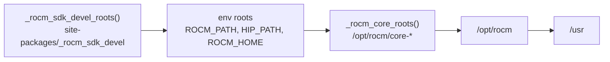
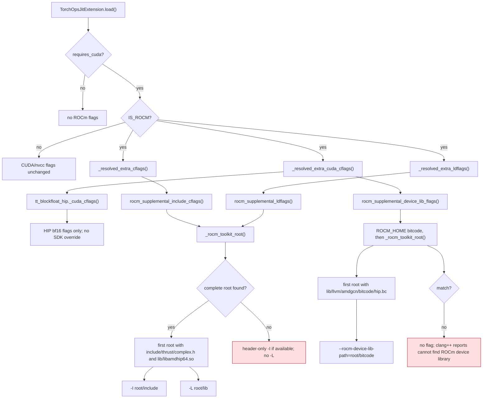

<!-- SPDX-FileCopyrightText: 2026 ModelCloud.ai
SPDX-License-Identifier: Apache-2.0 -->

# ROCm JIT toolkit path resolution

PyTorch reports the pip TheRock ROCm runtime package (`_rocm_sdk_core`) as
`ROCM_HOME`. That tree is deliberately sparse: it carries the HIP runtime
headers and versioned sonames (`libamdhip64.so.7`) but not the development
headers (`thrust/complex.h`, `hipsparse/hipsparse.h`), the unversioned
`libamdhip64.so` symlink, or a `hipcc` wrapper that translates
`ROCM_PATH`/`HIP_PATH` into `--rocm-path`. A JIT build against that tree alone
fails three separate ways:

```
clang++: error: cannot find ROCm device library
fatal error: hipsparse/hipsparse.h: No such file or directory
ld: cannot find -lamdhip64
```

The full SDK may live in a versioned `/opt/rocm/core-<version>` directory
instead of the pip `_rocm_sdk_devel` package. `gptqmodel/utils/cpp.py` now
resolves one development root and derives all three compiler/linker inputs
from it, preferring the tree that matches the runtime torch loaded.

Introduced by the ROCm JIT extension-resolution fix; the flow lives in
`gptqmodel/utils/cpp.py` and the regression tests in
`tests/test_torch_ops_jit_extension.py`.

## Resolution order

`_rocm_development_roots()` builds one ordered candidate list. Each consumer
filters it for the artifact it needs, so a sparse runtime root is skipped
rather than selected.



`_rocm_core_roots()` sorts versioned directories newest first and moves the
`core-<major>.<minor>` directory that `torch.version.rocm` names to the front,
so an installed `core-10.3` cannot shadow a torch build that reports `10.1`.
Dangling `/opt/rocm/core` alternatives symlinks are skipped by `is_dir()`.

When `ROCM_PATH`/`HIP_PATH` point at a complete SDK, that root is honored for
both the headers and the unversioned library. When they point at the sparse pip
`_rocm_sdk_core` or the legacy `/opt/rocm` root, the artifact filters skip them
and the versioned `core-*` tree supplies the headers and library, while the
device bitcode still comes from `ROCM_HOME`.

A legacy `/opt/rocm` that is not the torch-matched SDK is not a usable
override: torch selects `hipcc` from `ROCM_HOME`, so a root without
`bin/hipcc` fails before these flags apply. Point `ROCM_PATH`/`HIP_PATH` at
the complete versioned SDK (`/opt/rocm/core-<version>`) instead.

## Flags derived from the root



The include and link flags are taken from the same `_rocm_toolkit_root()` so a
legacy `/opt/rocm/lib` cannot be paired with a newer `core-*` include tree. A
header-only tree is used only when no root provides both artifacts.
In that case `rocm_supplemental_ldflags()` emits no `-L`; linking against a
library-only root from another SDK would violate the paired-root contract.
The block-float HIP loader also relies on these shared flags. Its local
`_cuda_cflags()` adds only kernel-specific BF16 flags, so it cannot put a
legacy `--rocm-path` or `-L` ahead of the selected SDK.

The device bitcode is resolved separately because the TheRock `hipcc` binary
does not turn `ROCM_PATH`/`HIP_PATH` into `--rocm-path`; it passes the
environment through untouched and clang++ falls back to its compiled-in
install root. `ROCM_HOME` is preferred for this flag because its bitcode is
guaranteed to match the runtime torch loaded. The selected complete toolkit is
the only fallback; an unrelated bitcode-only SDK is ignored.

## Before and after

The first four pre-fix pointers refer to `276605140` (before #3816). The
remaining pre-fix pointers refer to its merged head `35987dfb7`.

| Mechanism | Before | After |
| --- | --- | --- |
| Include fallback | `detected_rocm_include_paths()` at `cpp.py:641` probed `_rocm_sdk_devel`, env roots, `/opt/rocm`, `/usr`; `/opt/rocm/core-*` was never considered | `detected_rocm_include_paths()` at `cpp.py:745` takes `_rocm_toolkit_root()`, the first development root with both `thrust/complex.h` and `libamdhip64.so` |
| Library fallback | `_rocm_sdk_devel_lib_paths()` at `cpp.py:719` only looked next to `ROCM_HOME`; an expanded pip devel wheel was required | `_rocm_library_roots()` at `cpp.py:815` accepts a versioned `/opt/rocm/core-*` tree; `rocm_supplemental_ldflags()` at `cpp.py:825` links the same `_rocm_toolkit_root()` chosen for the headers |
| Device bitcode | No flag existed; `default_jit_cuda_cflags()` at `cpp.py:933` returned HIP flags only | `rocm_supplemental_device_lib_flags()` at `cpp.py:843` emits `--rocm-device-lib-path=<bitcode>` and `_resolved_extra_cuda_cflags()` at `cpp.py:1206` appends it for `requires_cuda` extensions |
| Version selection | First matching env/install root won | `_rocm_core_roots()` at `cpp.py:641` prefers the `core-<major>.<minor>` named by `torch.version.rocm`, then the newest version |
| Split-root fallback | `_rocm_sdk_devel_lib_paths()` at `cpp.py:825` chose a library-only root if no complete root existed, while `detected_rocm_include_paths()` chose a header-only root | `rocm_supplemental_ldflags()` at `cpp.py:825` emits no `-L` without `_rocm_toolkit_root()`; the compiler or linker reports the incomplete SDK |
| Block-float HIP override | `tt_blockfloat_hip.py:88-127` chose a separate root by `libamdhip64.so` alone and prepended `--rocm-path` / `-L` | `tt_blockfloat_hip._cuda_cflags()` adds only BF16 flags; `TorchOpsJitExtension` supplies the shared include, library and bitcode flags |
| Bitcode fallback | `rocm_supplemental_device_lib_flags()` at `cpp.py:859` scanned every development root after `ROCM_HOME`, even if a legacy bitcode-only root preceded the selected complete SDK | It now tries `ROCM_HOME` and then `_rocm_toolkit_root()`; if neither has bitcode, no device-library flag is added |

## Contracts

- Only the first matching include, library and bitcode root is used, so two
  ROCm versions are never mixed in one command line.
- A missing artifact does not fabricate a flag. The build then fails with the
  compiler or linker diagnostic instead of silently linking another SDK.
- `ROCM_HOME` remains the preferred device-bitcode source; the versioned
  `/opt/rocm/core-*` tree is a fallback, not an override.
- CUDA/nvcc builds are unchanged: every new helper returns `[]` when
  `IS_ROCM` is false.

## Validation

Measured on a ROCm 10.1 / HIP 7.16 host with `ROCM_PATH` and `HIP_PATH`
unset, so torch reported the pip `_rocm_sdk_core` as `ROCM_HOME`, and the only
full SDK was `/opt/rocm/core-10.1`.

| Check | Before | After |
| --- | --- | --- |
| `tests/kernels/test_exllamav3_kernel.py` | 12 failed | 9 passed, 9 skipped |
| `tests/kernels/test_exllamav3_quantize_tiles.py` | 3 failed | 3 passed |
| `tests/test_torch_ops_jit_extension.py` | 62 passed | 69 passed |

The same suites were rerun with the environment variables set explicitly:

| Environment | Before | After |
| --- | --- | --- |
| `ROCM_PATH`/`HIP_PATH` = complete `/opt/rocm/core-10.1` | 15 failed | 12 passed, 9 skipped |
| `ROCM_PATH`/`HIP_PATH` = sparse pip `_rocm_sdk_core` | 15 failed | 12 passed, 9 skipped |

The nine skips are `EXL3_EXLLAMA_V3 inference requires NVIDIA CUDA; use
EXL3_TORCH on ROCm or CPU`, which is the inference path's intentional ROCm
gate, not a JIT build failure.
