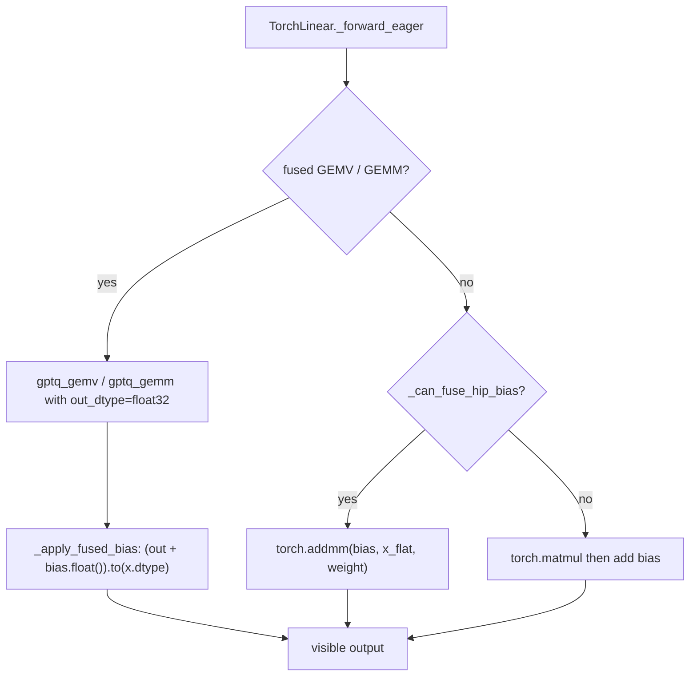
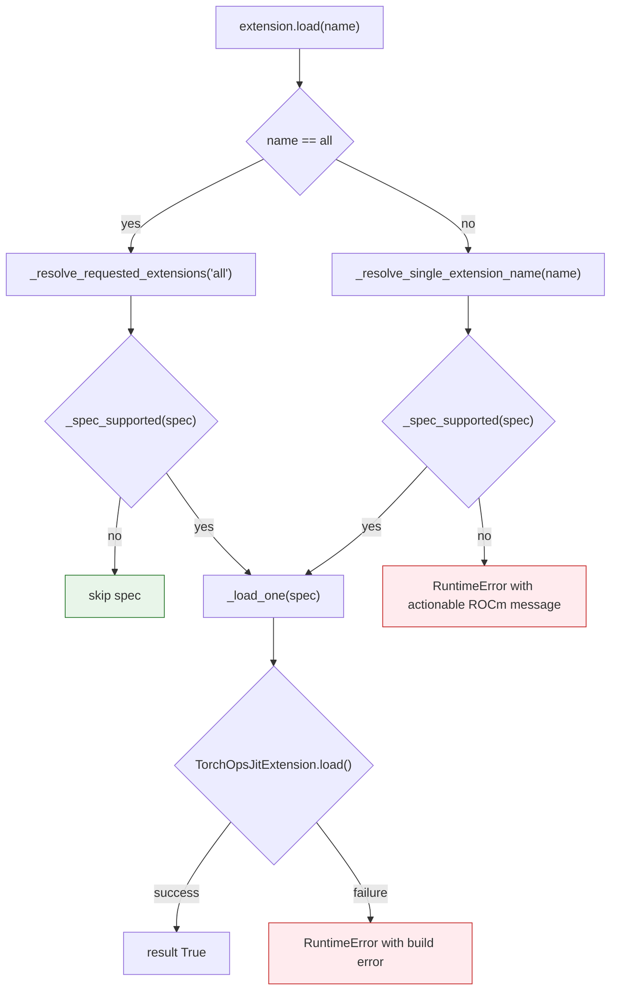
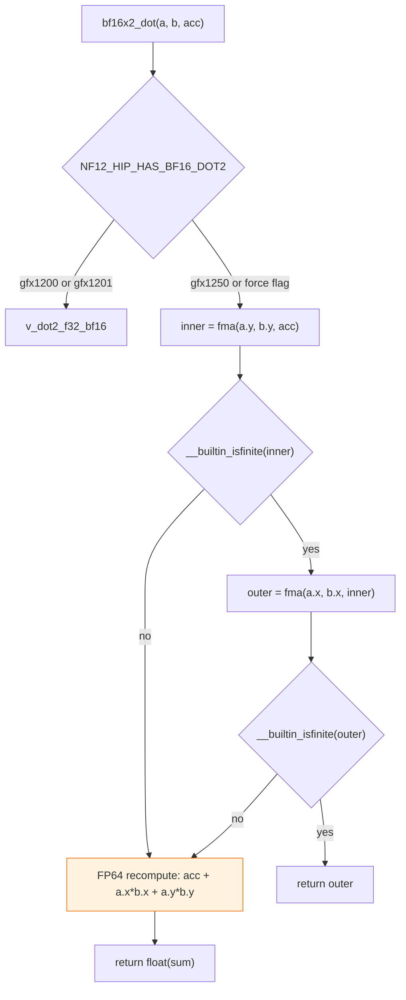
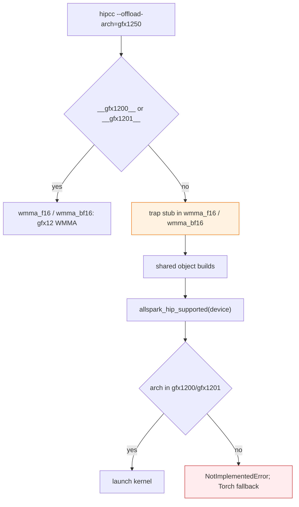

<!-- SPDX-FileCopyrightText: 2026 ModelCloud.ai -->
<!-- SPDX-License-Identifier: Apache-2.0 -->

# AMD RDNA4 (gfx1200 / gfx1201 / gfx1250) support

This page describes GPT-QModel behaviour on AMD RDNA4 consumer/workstation GPUs
(for example the Radeon AI PRO R9700, `gfx1201`). The CDNA baseline is
`gfx950` (MI350X/MI355X) and `gfx942`; its tuned values are unchanged.

> **ROCm requirement.** GPT-QModel supports **ROCm >= 10.1** only. On older
> runtimes `import gptqmodel` and model loading emit a warning asking you to
> upgrade to the latest ROCm release. ROCm 10.1 includes HIP 7.16;
> `torch.version.hip` is the HIP runtime version, not the ROCm release. The
> measurements below use ROCm 10.1.

> **Verification status.** Measured on an AMD Radeon AI PRO R9700 (`gfx1201`,
> HIP 7.16.26385, torch 2.16.0.dev20261029+rocm10.1). Kernel numerics, the
> fused/split crossover, `v_wmma` lowering and quantization stages below are
> **measured on that hardware**; rows without a measurement say so explicitly.
> No `gfx1200` or `gfx1250` SKU was available, so those entries share the
> `gfx1201` table by family and are **not** independently measured.

## Architecture families

Architecture detection lives in `gptqmodel/utils/arch.py`:

| Function | Meaning |
|---|---|
| `normalize_arch(name)` | strip `:sramecc+` / `:xnack-` style suffixes, lower-case |
| `rocm_arch(device)` | cached `gcnArchName` for a device, `None` off ROCm |
| `is_rocm_fused_arch(device)` | `gfx950` and `gfx120*` / `gfx125*` only |
| `arch_class(device)` | `cdna4` / `rdna4` / `rdna3` / `other` |
| `wave_size(device)` | 32 on RDNA, 64 on CDNA |
| `gate_limits(device)` | `(small_m_max, max_in_features)` for the fused GPTQ kernels |
| `gemm_fused_dtypes(device)` | activation dtypes the fused small-M GEMM is a measured win for |

`torch.cuda.get_device_capability()` is never used to classify AMD hardware; on
ROCm it returns an unrelated numeric pair.

RDNA4 is wave32 (the Triton AMD backend uses `warp_size = 32` for
`gfx_major >= 10`), while the historically tuned CDNA kernels assume wave64
scheduling. The fused GPTQ kernels therefore keep a per-architecture launch
table instead of a single module-level constant set.

## Backend support matrix

| Backend | gfx1200 | gfx1201 | gfx1250 | Notes |
|---|---|---|---|---|
| GPTQ Torch (fused GEMV / small-M GEMM / dequant) | ✅ (family table) | ✅ measured | ✅ (family table) | Per-arch launch table: RDNA4 GEMV `block_n=16/num_warps=4`, GEMM `(32, 32)/num_warps=4`, gate `(16, 17408)`; `tl.dot` lowers to `v_wmma_f32_16x16x16_f16`; **fused small-M GEMM is FP16-only** (BF16 goes through dequantize + matmul), GEMV keeps both dtypes |
| GPTQ Triton dequant (`triton_utils/dequant.py`) | ✅ (family table) | ✅ measured | ✅ (family table) | Per-arch launch table: RDNA4 `x_block=2048/num_warps=4/num_stages=1` (74.5 us geomean vs the CDNA tile's 81.7 us on gfx1201). Output is bit-identical to the CDNA tile; the tile only changes the launch shape |
| AWQ Triton GEMM (`FORMAT.GEMM` → `AwqGEMMTritonLinear`) | ✅ | ✅ measured (per-device plan table) | ✅ (family table) | portable Triton; capability-based dispatch removed for ROCm. A HIP host reports a seven-field `device_identity` (the HIP arch is appended, `capability` is `None`), and the scheduler now has an exact-match RDNA4 rule set instead of always falling back to the generic tile. Measured 1.67x-10.01x faster than that generic policy at the 4090 rule shapes (`(M,N,K,G)` in the M<=128 band), FP16 only. See *AWQ GEMM scheduler on RDNA4* below |
| AWQ `FORMAT.GEMV` / `GEMV_FAST` / `LLM_AWQ` | ❌ native / ✅ `AWQ_GEMV_TRITON` (explicit) | ❌ native / ✅ `AWQ_GEMV_TRITON` measured | ❌ native / ✅ `AWQ_GEMV_TRITON` (family table) | The native CUDA extension (`gemv_forward`/`gemmv2_forward`/`gemv_fast_forward_decode`) is still CUDA-only and hipcc rejects it (`cuda_fp16.h`, CUDA inline asm, 64-bit-only warp mask); `AwqGEMVLinear` keeps `SUPPORTS_DEVICES=[DEVICE.CUDA]` and loading it on ROCm raises `NotImplementedError` naming `AWQ_GEMM_TRITON`. **`BACKEND.AWQ_GEMV_TRITON`** now runs the same packed `FORMAT.GEMV` layout portably: a Triton kernel (`quantization/awq/modules/triton/gemv.py`) with FP32 accumulation, weights staying packed, output dtype == input dtype. Its `SUPPORTS_FORMATS` priority is `0`, so AUTO never picks it; select it explicitly. Measured 6.6-30.7x faster than the split dequantize+matmul path it replaces, and at parity (0.81-1.38x) with the shipped `FORMAT.GEMM` Triton GEMM at M==1 (see the AWQ table below); it is a portability fix, not a decode speedup over `FORMAT.GEMM`. Single-token / decode only; `FORMAT.GEMM` stays the prefill path |
| QQQ | ✅ `QQQ_TORCH` only | ✅ | ✅ | `QQQLinear` (Marlin-derived W4A8) is CUDA-only and there is **no** Triton port (see *QQQ* below); AUTO selects `QQQTorchLinear` |
| ParoQuant Triton | ✅ explicit `PAROQUANT_TRITON` only | ✅ measured (per-family tiles) | ✅ (family table) | portable Triton ops; AUTO keeps the Torch `ParoLinear` kernel. Per-family, row-banded launch table; the RDNA4 tiles are 1.31-1.72x faster than the historical CUDA tile (see *ParoQuant Triton* below) |
| GGUF | ✅ `GGUF_TRITON` (AUTO) or `GGUF_TORCH` | ✅ measured | ✅ (family table) | `GGUF_TRITON` now declares `DEVICE.ROCM` and validates there; on ROCm `_cuda_device_capability()` returns `None`, so only the generic launch configs run (no SM80/SM89 specialization). Measured 5.0-13.1x faster than `GGUF_TORCH` at decode **and** prefill, so AUTO (priority 45) selects it; `GGUF_TORCH` stays available via `BACKEND.GGUF_TORCH` |
| FP8 Torch | ✅ (family table) | ✅ measured | ✅ (family table) | `_scaled_mm` accepts `float8_e4m3fn`/`e5m2` and rejects the `fnuz` encodings on gfx1201; a rejected dtype is logged once and falls back to dequantize + matmul |
| VPTQ | ✅ via `VPTQ_TORCH` (`vptq_cuda` is CUDA-only and rejects ROCm explicitly) | ✅ | ✅ | |
| EXL3 | ✅ `EXL3_TORCH` only | ✅ | ✅ | tensor-core GEMM tables are `nullptr` on ROCm; AUTO selects `EXL3_TORCH` |
| Marlin / Machete / Swordfish / BitBLAS / W4A-NVFP4 | ❌ | ❌ | ❌ | deliberately unsupported: NVIDIA-only kernels (Marlin `mma.sync`/`cp.async` with tile permutes, Hopper/Blackwell CUTLASS for Machete/Swordfish, BitBLAS TensorCore IR, SM12.1 FP4 tensor cores for W4A-NVFP4) with no HIP lowering. None lists `DEVICE.ROCM`, so the AUTO candidate list filters them out before validation; an explicit selection fails with an actionable error naming the portable backend. See *Deliberately unsupported backends* below |

### hipBLASLt is present but untuned

The ROCm SDK ships Tensile libraries for `gfx1200`, `gfx1201`, and `gfx1250`
(check `hipblaslt/library/`). The claim that "RDNA4 has no hipBLASLt library" is
incorrect; the libraries exist but are not tuned for RDNA4. Cold hipBLASLt
library loading dominates a cold quantize on CDNA, so quantization still selects
rocBLAS by default. hipBLASLt is available only as an explicit experiment:

```bash
GPTQMODEL_ROCM_QUANT_BLAS=hipblaslt python quantize.py
```

`gptqmodel.utils.rocm.quantize_tuning(device)` returns
`{"blas_backend", "amp", "prewarm_ops"}`; `amp` stays disabled on ROCm
(including RDNA4) until autotune overhead is measured on RDNA4.

### ParoQuant Triton

`ParoQuantTritonLinear` now declares `DEVICE.ROCM` alongside `DEVICE.CUDA`,
which resolves the contradiction with the HIP `libdevice` branch in
`quantization/paroquant/modules/triton/sym_ste.py`. The decision is based on
inspection, not hardware: the runtime GEMM/GEMV kernels use only portable
Triton (`tl.load`/`tl.store`, shifts, `tl.interleave`, `tl.dot`) with no
CUDA-only intrinsic, inline PTX, or libdevice call, and the launch path uses
`torch.cuda.device`, which HIP also provides.

`SUPPORTS_FORMATS[FORMAT.PAROQUANT] = 0` means `PAROQUANT_TRITON` is never
chosen by `AUTO`; selecting it explicitly is required on every platform.

**Verified on gfx1201.** Both Triton kernels (`decode` and `prefill` launch
configs) were A/B'd against an independent FP64 Torch oracle that unpacks the
4-bit codes and applies `(code - zero) * scale` itself, for `group_size` 32/64/128
in the 256x256 to 4096x4096 shape range, `M` in {1, 2, 8, 16, 32, 64}, and FP16
and BF16 activations:

| Check | Result |
|---|---|
| `paroquant_dequantize_triton` vs FP64 oracle | max abs err 7.5e-09, max rel err 6.0e-08 (FP32 output = exact) |
| `decode` / `prefill` GEMM, FP16 | arithmetic error 2.8e-04 to 3.1e-04 relative to an FP64 truth; output dtype == input dtype |
| `decode` / `prefill` GEMM, BF16 | arithmetic error 2.2e-03 to 2.4e-03 relative; output dtype == input dtype |

The BF16 relative error is dominated by the BF16 output rounding, not the
kernel: against the output rounded once to BF16 the max absolute error is
4.8e-02 for a value range whose half-ULP is 5.8e-02 (< 1 ULP), and the FP16 case
is 5.4e-03 against a 7.2e-03 half-ULP (0.75 ULP). The fused ParoQuant rotation
(`gptqmodel_ext/paroquant`) also loads and runs on gfx1201; its error versus an
FP64 no-rounding oracle is smaller than the pure-Torch reference path's
(FP16 3.7e-04 vs 4.4e-04 at K=1024, BF16 3.4e-03 vs 3.6e-03).

### ParoQuant per-family launch table

`quantization/paroquant/modules/triton/gemm.py` used to hardcode the CUDA tiles
for every GPU: decode `(BLOCK_M=4, BLOCK_N=128, BLOCK_K=32, warps=4, stages=2)`
and prefill `(32, 128, 32, warps=8, stages=4)`. Those are wave64/CDNA shapes;
`num_warps=8` is 256 threads with a wave32 mapping on RDNA4, which is not the
scheduling the tile was tuned for.

It is now a per-`tuning_family` table with row bands (decode `M <= 8`,
medium `M <= 64`, large above):

| family | decode | prefills 9-64 rows | prefill > 64 rows |
|---|---|---|---|
| `rdna4` | `(4, 64, 64, 4, 1)` | `(32, 64, 64, 4, 2)` | `(64, 128, 64, 4, 2)` |
| every other family | `(4, 128, 32, 4, 2)` (historical) | `(32, 128, 32, 8, 4)` (historical) | same |

Only `rdna4` is retuned; `cdna4`/`ada`/`hopper`/`blackwell` keep the historical
tile until each is measured. A latent bug was fixed at the same time:
`block_size_k` is now clamped to `group_size` (`min(block_size_k, group_size)`),
because a K tile that spans more than one quantization group multiplies the
wrong scale into half of the tile (BLOCK_K=64 with group_size=32 gave 0.6-1.0
relative error before the clamp).

Measured on gfx1201, 4-bit, `group_size=128`, FP16, median of 21 iterations
after 5 warm-ups, 256 MiB L2 flush before every iteration and CUDA events
around the launch; new tile vs the historical tile:

| M | K | N | new us | old us | speedup |
|---|---|---|---|---|---|
| 1 | 14336 | 4096 | 181.30 | 269.13 | 1.48x |
| 4 | 4096 | 4096 | 77.72 | 102.18 | 1.31x |
| 16 | 14336 | 4096 | 206.87 | 288.76 | 1.40x |
| 64 | 14336 | 4096 | 222.37 | 325.10 | 1.46x |
| 128 | 5120 | 8192 | 186.06 | 296.69 | 1.59x |
| 1024 | 14336 | 4096 | 1680.99 | 2893.65 | 1.72x |

The new tile is bit-identical to the old one for group sizes 32/64/128 in FP16
and BF16 (the tile only changes which scale each lane loads), and against an
FP64 oracle FP16 stays at 4.99e-04 max relative error.

### QQQ has no Triton port (deliberate)

`QQQLinear` is a Marlin-derived W4A8 kernel (`gptqmodel_ext/qqq/qqq_gemm.cu`,
1122 lines) whose inner loop is CUDA inline PTX: `cp.async.{cg,ca}` pipeline
stages, `mma.sync.aligned.m16n8k16.row.col.satfinite.s32.s8.s8.s32`,
`ldmatrix.sync.aligned.m8n8.x2`, `__cvta_generic_to_shared`, `cvt.rn.f16.f32`
and `ld.global.acquire.gpu` for the split-K workspace lock. hipcc cannot lower
any of that, and a Triton rewrite would first have to reimplement the packed
format itself: the Marlin tile permutation `_perm`/`_perm_i`, the two
`_scale_perm*` permutations, the `(in_features/16, out_features*2)` int32
layout, the per-token INT8 `dynamic_quant` and the FP32 `s_channel`/FP16
`s_group` rescale. That is a new kernel plus a new logistic-quantization
contract, not a port, so it is **not** attempted here.

`AUTO` on ROCm selects the portable `QQQTorchLinear` (the same class the CPU
path uses) and `QQQLinear` rejects a HIP host in `validate_once()` without
attempting the ~18 s JIT build. `QQQ_ROCM_UNSUPPORTED` states this.

### Deliberately unsupported backends

Marlin, Machete, Swordfish, BitBLAS and W4A-NVFP4 are **not** ported:

| Backend | Why not |
|---|---|
| Marlin (`GPTQ Marlin`/`AWQ Marlin`) | CUDA `mma.sync`/`cp.async`/`ldmatrix` with Marlin tile permutes and a split-K workspace protocol; the same reason QQQ is not portable |
| Machete | Hopper-only CUTLASS (SM90) GEMM; no HIP target in the vendored sources |
| Swordfish | Blackwell (SM100/SM110) CUTLASS w4a16/w8a16 GEMM |
| BitBLAS | emits NVIDIA TensorCore IR and compiles CUDA modules; no ROCm backend |
| W4A-NVFP4 | block-scaled FP4 tensor cores, SM12.1 only; gfx1201 has no FP4 MMA |

None of them lists `DEVICE.ROCM`, so `get_auto_backend_kernel_mapping()`'s
candidate list is filtered by `SUPPORTS_DEVICES` before validation and `AUTO`
can never reach them (they are registered at priority 100+ for NVIDIA, which
does not matter on ROCm). An explicit selection fails with a message that names
the portable alternative: `Marlin kernel is not supported on ROCm.`,
`Swordfish (BACKEND.SWORDFISH) is CUDA-only: ... Use BACKEND.GPTQ_TORCH /
AWQ_GEMM_TRITON (or AUTO) on ROCm.`, the equivalent Machete/BitBLAS text, and
for any other CUDA-only kernel
`... is CUDA-only and does not run on ROCm; select a portable *Torch or
*Triton backend for this quantization method instead`.

## Measured RDNA4 numbers (gfx1201, R9700)

Fused (product kernel) vs `dequantize_weight() + matmul`, FP16, 4-bit,
group_size 128, median of 30 iterations after warm-up:

| K | N | M | fused us | split us | speedup |
|---|---|---|---|---|---|
| 2048 | 2048 | 8 | 23.8 | 43.9 | 1.85x |
| 4096 | 4096 | 8 | 69.6 | 94.6 | 1.36x |
| 5120 | 5120 | 8 | 111.0 | 108.8 | 1.01x |
| 6144 | 6144 | 8 | 134.0 | 246.4 | 1.84x |
| 8192 | 2048 | 8 | 84.7 | 146.6 | 1.73x |
| 11008 | 4096 | 8 | 121.1 | 370.5 | 3.06x |
| 14336 | 4096 | 8 | 179.1 | 482.3 | 2.69x |
| 17408 | 5120 | 8 | 331.1 | 686.2 | 2.07x |
| 6144 | 6144 | 128 | 396.6 | 269.2 | 0.68x (split wins) |

The fused path therefore covers `max_in_features=17408` on RDNA4 while
`small_m_max` stays 16 (M>=32 was 0.98x at K=4864/N=896 and M>=64 regressed).

Launch-table sweep (K=4096, N=4096, M=8, us): `(16,16)` 86.3, `(32,16)` 87.5,
`(16,32)` 85.4, `(32,32)` 69.6, `(16,64)` 146.6, `(32,64)` 186.6. Across all
swept shapes `(32,32)` had the lowest worst-case regret (1.138x) versus
`(16,16)`'s 1.365x. `.amdgcn` for the GEMM kernel contains
`v_wmma_f32_16x16x16_f16`; the GEMV kernel has no `tl.dot` and correctly
contains none.

GEMV tile sweep (us, K=4096/N=4096, M=1): `(bn=8,nw=4)` 43.5,
`(bn=16,nw=4)` 41.8, `(bn=16,nw=8)` 42.2, `(bn=32,nw=4)` 65.4. `(16, 4)` also
won at K=2048/3584/5120; `(16, 8)` was best at K=8192/N=2048 (44.1 vs 45.6).

Quantization stage timings (`scripts/benchmark_rdna4_quant.py`,
Qwen2.5-0.5B-Instruct, 4-bit, group_size 128, 32x128 calibration tokens,
BLAS backend `rocblas` throughout; single process, one R9700):

| Method | model load (s) | quantize (s) | save (s) | total (s) | peak VRAM (MiB) |
|---|---|---|---|---|---|
| GPTQ | 0.47 | 32.39 | 0.31 | 33.62 | 413.8 |
| AWQ | 0.41 | 47.84 | 0.35 | 48.90 | 354.2 |
| QQQ | 0.41 | 17.58 | 0.46 | 18.82 | 88.0 |
| ParoQuant | 0.53 | 194.61 | 0.41 | 195.84 | 298.1 |

ParoQuant's quantize stage includes the JIT build/load of the fused rotation
extension, so it is a cold-cache number. These are wall-clock measurements of a
single run, not a tuned or repeated benchmark.

### Inference numerics (fused GPTQ kernels, gfx1201)

`tests/kernels/test_gptq_rocm_gemv.py` (30 passed, 19 skipped) and
`tests/kernels/test_gptq_rocm_gemm.py` (70 passed, 73 skipped) compare the fused
kernels against an independent FP64 Torch oracle at `rtol=atol=2e-3` for
2/4/8-bit, group sizes 128 and 256, and several K/N shapes; both assert the
output dtype equals the input dtype. The skips are the CDNA4 (`gfx950`)-only
cases on an RDNA4 host. Dense-weight residency is judged from the module's
persistent state after the first *and* repeated forwards (the fused GEMV/GEMM,
the RDNA4 BF16 split path, and the CPU dequantize+matmul fallback at M=1 and
small M): no dense/dequantized copy is installed, `qweight`/`scales`/`qzeros`
remain the only full-size resident tensors, and `GPTQ_TORCH_CACHE_WEIGHTS` stays
unset.

### Bias epilogue on ROCm (fused before rounding)

`TorchLinear` adds the bias to the FP32 partial sum and rounds the result once.
The visible output is therefore `round(matmul + bias)`, not
`round(matmul) + bias`. Which matmul supplies the partial sum depends on
dispatch:

| Path | Partial sum | Epilogue |
|---|---|---|
| Fused GEMV (M=1) | `gptq_gemv(..., out_dtype=float32)` | `(raw + bias.float()).to(x.dtype)` |
| Fused small-M GEMM | `gptq_gemm(..., out_dtype=float32)` | `(raw + bias.float()).to(x.dtype)` |
| Split `dequantize + matmul` | `torch.addmm(bias, x, weight)` when `_can_fuse_hip_bias` | one rounding to `x.dtype` |
| Split path, autocast or broadcast bias | `torch.matmul(x, weight)` | standalone add in the promoted dtype |

`_can_fuse_hip_bias` (`gptqmodel/nn_modules/qlinear/_numerics.py`) is the single
decision point: it is enabled only for low-precision ROCm activations with a
matching-dtype bias, outside autocast, and only when the bias broadcasts to the
flattened 2D output.



The oracles in `tests/kernels/test_gptq_rocm_gemm.py` and
`tests/kernels/test_gptq_rocm_gemv.py` apply the same rule: they add the bias to
an independent FP64 accumulation and round once. FP32 arithmetic error is still
compared separately against the FP64 accumulation, and a visible difference from
the rounded FP64 oracle is only accepted when the FP32 and FP64 fused values
straddle the rounding boundary
(`|fp64_midpoint - fp64_fused| <= |fp32_fused - fp64_fused|`).

Representative measurement (4-bit, group size 128, `K=2048`, `N=1024`, one
seeded sample per row):

| Activation | Path | Fused-rule mismatches | Differs from `round(fp64 + bias)` | Unexplained |
|---|---|---|---|---|
| float16 | GEMV (M=1) | 0 | 0 | 0 |
| float16 | fused GEMM (M=2) | 0 | 17 elements | 0 |
| bfloat16 | GEMV (M=1) | 0 | 0 | 0 |
| bfloat16 | split `addmm` (M=2) | 0 | 0 | 0 |

The earlier contract compared the visible value with `round(matmul) + bias` and
rejected the shipped epilogue; it was a stale test rule, not a kernel regression.

### Activation dtype gate for the fused small-M GEMM (gfx1201)

`scripts/benchmark_rdna4_inference.py` (4-bit, group_size 128, median speedup of
fused module forward vs `dequantize + matmul`, M=2..16). The BF16 column is the
**pre-gate** measurement, i.e. what the fused kernel did when it was still
dispatched; it is the evidence for adding the gate, not the post-gate result
(post-gate BF16 small-M dispatch count is 0 and speedup is ~1.00x):

| K | N | FP16 (median, range) | BF16 (median, range) |
|---|---|---|---|
| 2048 | 2048 | 1.16x (1.11-1.52) | 0.90x (0.72-0.96) |
| 4096 | 4096 | 1.60x (1.43-1.68) | 0.78x (0.43-1.35) |
| 5120 | 8192 | 2.51x (2.10-2.53) | 1.17x (1.03-1.42) |
| 8192 | 2048 | 1.68x (1.52-1.83) | 0.70x (0.61-0.85) |

Band medians (pre-gate): FP16 small-M 1.64x / BF16 0.85x; decode 2.37x vs 3.01x; large-M
(64/128) 0.99x vs 0.98x (no fused dispatch, as designed).

BF16 loses to the split path at the shipped RDNA4 launch tile `(32, 32)` across
the swept shapes, so `torch.py` gates the fused small-M GEMM to the dtypes
returned by `gemm_fused_dtypes()`: `{float16}` on RDNA4, `{float16, bfloat16}`
on CDNA4 (unchanged). GEMV (M=1) is faster in both dtypes on gfx1201 (FP16
1.64x-3.67x, BF16 1.40x-2.84x) and is deliberately not dtype-gated.

The gate is applied in `_can_use_rocm_gemm()`; gated-off shapes take the exact
dequantize + matmul path an unregistered architecture takes, so correctness is
unaffected. `tests/kernels/test_gptq_rocm_gemm.py` asserts this by reproducing
the visible output from an independent decode of the packed weights and
checking dispatch against `gemm_fused_dtypes`.

A per-tile sweep suggests the BF16 loss is a tile-choice effect rather than a
kernel limitation, but that sweep crashed the GPU (`HSA_STATUS_ERROR_MEMORY_FAULT`)
and is not a trustworthy basis for shipping a second launch table; retuning BF16
on RDNA4 is left as future work.

Re-measured on 2026-11-04 at the shipped `(32, 32)` tile, 4-bit gs=128, M in
{2, 8, 16}, median of 21 iterations after 5 warm-ups with a 256 MiB L2 flush and
CUDA events (`scripts/benchmark_rdna4_inference.py` harness, BF16 module vs an
explicit `dequantize_weight() + matmul`), the gate still holds for BF16:

| K | N | FP16 | BF16 |
|---|---|---|---|
| 2048 | 2048 | 0.65x | 0.56-0.58x |
| 4096 | 4096 | 1.31-1.37x | 1.08-1.13x |
| 5120 | 8192 | 1.53-1.63x | 1.19-1.33x |
| 8192 | 2048 | 0.98-1.07x | 0.77-0.79x |

BF16 is never the larger win and loses outright at 2048x2048 and 8192x2048, so
`{float16}` stays the RDNA4 `gemm_fused_dtypes()` value. The programme-covered
shapes are unchanged: `(16, 17408)` gate, `(32, 32, 256, 4, 2)` tile, `(512,
block_n=16, 4)` GEMV.

Note for `(K=8192, N=2048)`: FP16 fused is ~1.0x, i.e. the bottom edge of the
gate's measured range. It is left enabled because it is not a regression, but it
is the shape to re-check if the tile ever changes.

### AWQ GEMV Triton (decode, M == 1)

`BACKEND.AWQ_GEMV_TRITON` (`quantization/awq/modules/triton/gemv.py`) consumes the
stored `FORMAT.GEMV` layout unchanged: `qweight [N, K/8]` int32 with nibble `i`
of word `w` addressing input column `w*8+i` (plain order, **not** the
`FORMAT.GEMM` `[0,2,4,6,1,3,5,7]` interleave), `qzeros [N, ceil(groups/8)]`
padded to a word, `scales [N, padded_groups]` FP16. The kernel expands the
nibbles in registers, accumulates in FP32 and writes `output.dtype ==
input.dtype`; `BLOCK_K` is clamped to `group_size` so a tile never spans two
groups.

Numerics, real `AwqGEMVTritonLinear` modules against an independent FP64 oracle
that unpacks `qweight`/`qzeros` itself (not by calling the kernel):

| Check | Result |
|---|---|
| FP16 max relative error vs FP64 truth | <= 4.5e-04 (2e-3 budget) |
| BF16 | within 1.25 ULP of the once-rounded truth |
| output dtype | equals input dtype in both dtypes and all row counts |
| deterministic | first forward bit-identical to repeated forwards |
| storage | `qweight`/`qzeros` stay int32 and byte-identical to the native pack; no dense cache |

Measured on gfx1201, M=1, FP16, 4-bit, `group_size=128`, median of 41
iterations after 20 warm-ups, 256 MiB L2 flush before every timed call and CUDA
events around each launch. Every column is a real module forward
(`AwqGEMVTritonLinear` vs the shipped `AwqGEMMTritonLinear`), so the ~15 us of
Python launch overhead each path pays is included; "split" is this package's own
dequantize-to-dense + `torch.matmul` from the same packed buffers:

| K | N | GEMV us | GEMM us | split us | vs GEMM | vs split |
|---|---|---|---|---|---|---|
| 2048 | 2048 | 68.0 | 93.5 | 448.6 | 1.38x | 6.6x |
| 4096 | 4096 | 111.8 | 117.1 | 2134.0 | 1.05x | 19.1x |
| 5120 | 8192 | 170.2 | 165.1 | 5222.8 | 0.97x | 30.7x |
| 14336 | 4096 | 248.4 | 200.5 | 7286.3 | 0.81x | 29.3x |
| 4096 | 11008 | 186.0 | 175.6 | 5593.1 | 0.94x | 30.1x |

The 6.6-30.7x gain is over the dequantize + matmul floor this fused kernel
replaces. Against the *shipped* `FORMAT.GEMM` Triton kernel at M==1 the two are
at parity (0.81-1.38x, i.e. within run-to-run noise on the large shapes): the
GEMV path is a portability/correctness fix for ROCm, not a decode speedup over
`FORMAT.GEMM`, and the matrix row above is worded that way.

Launch entry: `_AWQ_GEMV_LAUNCH_CONFIGS["rdna4"] = AwqGemvLaunch(block_n=64,
max_block_k=512, num_warps=4, num_stages=1)`; other families use the same
default. `SUPPORTS_FORMATS[FORMAT.GEMV] = 0` keeps it out of AUTO on every
platform.

### AWQ GEMM scheduler on RDNA4

`quantization/awq/modules/triton/scheduler.py` had a measured rule table only
for the RTX 4090. Its `_builtin_plan` also returned early whenever `identity[6]`
was set - which is *always* on ROCm - so every RDNA4 shape fell through to the
generic Triton tile (`BLOCK_M/N/K = 32/32/32`, `split_k_iters=8`), a wave64/CDNA
shape that pays a split-K atomic-reduction pass on wave32.

A HIP host reports a **seven**-field `device_identity`: the six CUDA fields plus
the normalized `gcnArchName` appended last, with `capability = None`
(`torch.cuda.get_device_capability` is unrelated to the GPU on ROCm). On the
reference R9700 the tuple is

```
('cuda', 0, 'AMD Radeon AI PRO R9700', None, 32, 34208743424, 'gfx1201')
```

The new `_VERIFIED_RDNA4_PROFILE` therefore matches `(name, gfx arch, compute
units, total_memory)` from indices 2/6/4/5 exactly - a different gfx arch, board
name, CU count or memory size does not inherit the tiles. The CUDA 4090 branch is
unchanged and is reached only by six-field CUDA identities, so neither profile
can match the other's device.

Measured on gfx1201, 4-bit AWQ `FORMAT.GEMM`, group_size 128, FP16,
`mode="auto"`, median of 41 iterations after 20 warm-ups, 256 MiB L2 flush
before every timed call and CUDA events around each launch. "generic" is the
`legacy_plan` tile the device used before this table:

| (M, N, K, G) | tile (BM, BN, BK, split, warps, stages) | us | generic us | speedup |
|---|---|---|---|---|
| (32, 8192, 2048, 128) | (32, 64, 64, 1, 4, 2) | 89.3 | 348.8 | 3.90x |
| (64, 8192, 2048, 128) | (64, 64, 64, 1, 4, 2) | 107.9 | 654.7 | 6.07x |
| (64, 4096, 4096, 128) | (32, 64, 64, 1, 4, 4) | 105.9 | 366.8 | 3.46x |
| (64, 2048, 8192, 128) | (16, 64, 64, 1, 4, 2) | 141.1 | 235.2 | 1.67x |
| (127, 8192, 2048, 128) | (64, 128, 64, 1, 4, 2) | 121.9 | 1220.7 | 10.01x |
| (128, 2048, 2048, 128) | (32, 64, 64, 1, 4, 4) | 78.0 | 339.6 | 4.35x |
| (128, 8192, 2048, 128) | (64, 128, 64, 1, 4, 2) | 123.4 | 1228.7 | 9.96x |
| (128, 4096, 4096, 128) | (64, 128, 64, 1, 4, 4) | 139.8 | 679.6 | 4.86x |

Every swept shape won, so no shape is left to the generic policy;
`split_k_iters=1` won everywhere and `num_warps=4` is 128 lanes on wave32. The
table is FP16-only because `awq_gemm_triton` rejects non-FP16 input and scales;
`_builtin_plan` enforces the dtype triple, so a BF16 call keeps the generic
tile. Independently checked against an FP64 Torch oracle that unpacks the packed
`qweight`/`qzeros` itself: max relative error 3.8e-04..4.6e-04 (budget 2e-3),
output dtype preserved, repeated forwards bit-identical, and no dense
dequantized weight is materialized.

`tests/kernels/test_awq_rdna4_plan.py` pins the guard without a GPU: the exact
profile matches, a wrong arch/name/CU/memory does not, non-FP16 returns `None`,
the CUDA 4090 profile still matches only a CUDA-shaped identity, and a
cross-shaped lookalike matches neither.


### GGUF Triton on ROCm

`GGUFTritonKernel` declares `DEVICE.ROCM`. `_cuda_device_capability()` returns
`None` on a HIP device, so the SM80/SM89 layout and fixed-launch selectors all
answer "no specialization" and the generic configs are used. The kernels only
use `tl.load`/`tl.dot`/`tl.store`, and the retained cache holds reshaped packed
metadata (sign bytes / `qs` / `qh` / scales / min) keyed by
`qweight.data_ptr()`; no dequantized weight is stored.

Measured on gfx1201, FP16, median of 21 iterations after 5 warm-ups with a
256 MiB L2 flush and CUDA events; `GGUFTorchLinear` and its own
`_forward_fused_k` decode path are the references:

| qtype | K | N | M | Triton us | Torch us | fused-K us | speedup vs Torch |
|---|---|---|---|---|---|---|---|
| Q4_K | 4096 | 4096 | 1 | 119.10 | 891.42 | 901.62 | 7.57x |
| Q4_K | 4096 | 4096 | 16 | 118.34 | 847.14 | 896.25 | 7.57x |
| Q4_K | 4096 | 4096 | 128 | 188.53 | 918.71 | 947.63 | 5.03x |
| Q4_K | 4096 | 11008 | 1 | 155.61 | 2313.50 | 2037.15 | 13.09x |
| Q4_K | 4096 | 11008 | 16 | 161.45 | 2048.70 | 2037.36 | 12.62x |
| Q4_K | 4096 | 11008 | 128 | 379.36 | 2351.67 | 2114.07 | 5.57x |
| Q6_K | 4096 | 4096 | 1 | 163.14 | 1126.65 | 1194.93 | 7.32x |
| Q6_K | 4096 | 4096 | 128 | 232.89 | 1197.67 | 1250.42 | 5.37x |
| Q5_K | 8192 | 2048 | 1 | 164.42 | 1149.65 | 1883.04 | 11.45x |
| Q5_K | 8192 | 2048 | 128 | 247.03 | 1169.68 | 1778.08 | 7.20x |
| Q4_K | 14336 | 4096 | 1 | 256.29 | 3040.09 | 3182.40 | 12.42x |
| Q4_K | 14336 | 4096 | 128 | 504.44 | 3654.16 | 3277.17 | 6.50x |

Smaller projections behave the same way (Q4_K 512x512 M=1 60.61 vs 293.25 us,
Q6_K 512x512 66.43 vs 242.06 us, Q1_0 1024x512 63.13 vs 115.51 us), so the win
is not shape-specific. Triton is faster at decode *and* prefill, which is why
AUTO (priority 45 vs 15) resolves to `GGUFTritonKernel` on ROCm; selecting
`BACKEND.GGUF_TORCH` still works.

Numerics against the independent numpy GGUF block dequantizer
(`_dequantize_gguf_tensor_numpy`): FP16 max relative error 2.3e-04 to 9.0e-04;
BF16 is within 1.25 ULP of the once-rounded truth (the raw relative error is
2.0e-03-3.4e-03 because BF16 output rounding dominates). Output dtype always
equals the input dtype and repeated forwards are bit-identical.

### bitsandbytes 4-bit (NF4/FP4)

bitsandbytes 0.50.2 installs and runs on ROCm 10.1, but its HIP 4-bit GEMM is
tuned for CDNA wave64 and falls off a cliff at `M >= 16` on RDNA4 (a different,
much slower kernel is selected). `BitsAndBytesLinear` routes that row band to
the fused Triton kernel in
`gptqmodel/nn_modules/qlinear/bitsandbytes_triton.py`, which dequantizes the
packed codes inside the matmul (no dense weight buffer). Below `M = 16`
bitsandbytes' own GEMV is faster and is kept.

| shape | M | bnb native | fused Triton | speedup |
|---|---:|---:|---:|---:|
| K=N=2048 | 16 | 109 us | 76 us | 1.44x |
| K=N=2048 | 64 | 133 us | 69 us | 1.93x |
| K=N=4096 | 16 | 378 us | 83 us | 4.55x |
| K=N=4096 | 64 | 327 us | 103 us | 3.17x |
| K=4096 N=11008 | 16 | 1025 us | 183 us | 5.59x |
| K=4096 N=11008 | 64 | 1006 us | 287 us | 3.51x |

Measured end to end through the module (FP16, median of 50 iterations) on
gfx1201. The packed layout was verified against
`bitsandbytes.functional.dequantize_4bit` for NF4/FP4, block sizes 32/64/128,
with and without `compress_statistics`: even element in the high nibble, odd
element in the low nibble, `absmax[(n * K + k) // block_size]`. Oracle error
against an independent FP64 decode: dequantize is exact to FP32; the matmul is
within 3.5e-04 (FP16) and 2.7e-03 (BF16) of the output maximum.

Ada keeps bitsandbytes' cublas-backed kernels, which are measured faster than
the Triton tile on every shape tested; the `ada` launch entry exists for the
parity contract and for forced A/B runs (`GPTQMODEL_BNB_TRITON=1`).

## Known limitations

- **EXL3:** the tensor-core GEMM implementation has no ROCm kernel (all entries
  are `nullptr` and the loader already raises a clear `TORCH_CHECK`). Loading
  EXL3 on ROCm uses `EXL3_TORCH`; AUTO now does the same instead of selecting
  `EXL3_EXLLAMA_V3`.
- **hipBLASLt:** libraries are shipped but not tuned for RDNA4.
- **Marlin / Machete / Swordfish / BitBLAS / W4A-NVFP4:** no ROCm support and
  deliberately not ported; see *Deliberately unsupported backends* for the
  per-backend reason. AUTO filters all of them out and an explicit selection
  fails with a message naming the portable backend.
- **QQQ:** `QQQLinear` (W4A8, CUDA inline PTX) has no Triton port; AUTO uses
  `QQQTorchLinear`. See *QQQ has no Triton port*.
- **AWQ GEMV:** the native `FORMAT.GEMV` extension is CUDA-only. On ROCm use
  `BACKEND.AWQ_GEMV_TRITON` (explicit; decode-shaped M==1) or `FORMAT.GEMM`.
- **bitsandbytes:** the fused Triton 4-bit kernel is enabled by default only on
  ROCm families with a measured tile (`rdna4`). CUDA keeps the vendor kernels
  because they are faster there. INT8 bitsandbytes already runs at a usable
  speed on RDNA4 and is not replaced.
- `tl.dot` may silently lower to FMA instead of WMMA on AMD targets
  (`get_min_dot_size()` returns `(1, 1, 1)`), so a fused kernel's speed must be
  proven from its `.amdgcn` (`v_wmma`) and measured timings, never assumed.
- **RDNA4 BF16 small-M GEMM:** the fused kernel is not a uniform win over
  dequantize + matmul in BF16 on gfx1201 (0.43x-1.42x, median 0.85x, at the
  shipped `(32, 32)` tile), so it is disabled for that dtype. BF16 inference
  still works, it just uses the split path; M=1 GEMV and large-M matmul are
  unaffected. Retuning the tile may recover it (see above), but is unmeasured.
- **RDNA4 support is measured on gfx1201 only.** `gfx1200` / `gfx1250` share the
  same family launch table but have not been run on this hardware.
- **Family-wide HIP builds compile.** A `PYTORCH_ROCM_ARCH` that lists
  `gfx1200;gfx1201;gfx1250` builds every RDNA4 kernel. The NF12 fused decode
  drops the `v_dot2_f32_bf16` packed dot on `gfx1250` (no `dot12-insts`) for an
  exact BF16-to-FP32 FMA fallback; AllSpark's gfx12 WMMA path is not implemented
  on `gfx1250`, so it compiles a trap stub and the host still rejects
  `gfx1250` at load time. `extension.load("all")` skips the CUDA-only AWQ, QQQ,
  Marlin, Machete, VPTQ, Swordfish, and ExLlamaV2 extensions on ROCm instead
  of starting a doomed hipcc build. See [Kernel selection and RDNA4 fallbacks](#kernel-selection-and-rdna4-fallbacks) for the flow diagrams and before/after evidence.

## Kernel selection and RDNA4 fallbacks

This section is the reference for how GPT-QModel decides which HIP kernels to
build on ROCm, why `extension.load("all")` no longer starts CUDA-only builds,
and how the RDNA4 targets differ. It covers PR #3686.

### Extension selection

`extension.load("all")` resolves the concrete extension list through
`_resolve_requested_extensions("all")`, which drops every spec whose
`supported` predicate is false. `_load_one` re-checks the same predicate, so an
explicit request cannot bypass it. On ROCm, AWQ, QQQ, Marlin fp16, and Marlin
bf16 use `_native_cuda_extension_supported` and are refused before any
`TorchOpsJitExtension` is resolved or built.



`_native_cuda_extension_supported()` is `not _host_is_rocm()`
(`gptqmodel/extension.py:42-54`). The gate is attached to the AWQ, QQQ, and
Marlin specs at `gptqmodel/extension.py` lines 78-96 and 132-147; the filter
runs in `_spec_supported` (line 198) and `_resolve_requested_extensions`
(line 207), and the explicit refusal is in `_load_one` (line 250).

| Area | Before (base `8a701a846`) | After (this PR) |
|---|---|---|
| `load("all")` on ROCm | AWQ/QQQ/Marlin specs had no `supported` predicate, so `all` selected them and started hipcc (`gptqmodel/extension.py` lines 63, 68, 106, 111) | `supported=_native_cuda_extension_supported`; `all` drops them (`gptqmodel/extension.py` lines 78-96, 132-147, 198, 207) |
| Explicit CUDA-only load on ROCm | resolved the extension and hit a raw hipcc failure (`gptqmodel/extension.py` line 216) | raises `_spec_unsupported_error` before resolving (`gptqmodel/extension.py` line 250) |
| Marlin/Machete nvcc flag | added whenever `is_nvcc_compatible()` was true (`gptqmodel/utils/marlin.py` line 239, `gptqmodel/utils/machete.py` line 626) | added only when `not IS_ROCM` (`gptqmodel/utils/marlin.py` line 240, `gptqmodel/utils/machete.py` line 627) |

### NF12 fused dot on gfx1250

The fused small-M decode kernel accumulates BF16 dot products in FP32. On
gfx1200/gfx1201 the packed `v_dot2_f32_bf16` instruction is used. gfx1250 has
no `dot12-insts`, so `bf16x2_dot` uses two FP32 FMAs and recomputes the pair in
FP64 when an intermediate is non-finite. The FP64 path is required because
finite BF16 operands can overflow FP32 before they cancel, and the packed dot
preserves that cancellation.



| Area | Before | After |
|---|---|---|
| gfx1200/gfx1201 fused dot | direct `__builtin_amdgcn_fdot2_f32_bf16` (`gptqmodel_ext/nf12_hip/nf12_ad_decode.hip` lines 203-221) | same builtin behind `bf16x2_dot` (`gptqmodel_ext/nf12_hip/nf12_ad_decode.hip` lines 144-165) |
| gfx1250 fused dot | same builtin; hipcc rejects the target with `needs target feature dot12-insts` | FMA fast path plus FP64 recompute on non-finite (`gptqmodel_ext/nf12_hip/nf12_ad_decode.hip` lines 147-165) |
| Finite-input overflow/cancellation | not reachable on gfx1250; the naive FMA fallback returned `-inf` | FP64 recompute matches the packed dot (`gptqmodel_ext/nf12_hip/nf12_ad_decode.hip` lines 153-160) |

`gptqmodel/utils/nf12_ad_hip.py` line 35 lists `gfx1200`, `gfx1201`, and
`gfx1250`; line 126 adds the `GPTQMODEL_NF12_AD_HIP_FORCE_DOT_FALLBACK`
validation switch.

### AllSpark gfx1250: compilation vs runtime support

AllSpark's HIP kernel is built on the 16x16x16 gfx12 WMMA instruction, which
gfx1250 does not provide. The source now compiles a trap stub for gfx1250 so a
family-wide `PYTORCH_ROCM_ARCH` build succeeds, but the host still refuses to
launch it. Compilation and runtime support are separate contracts.



| Area | Before | After |
|---|---|---|
| gfx1250 compilation | `#error` in `allspark_utils_hip.cuh` (`gptqmodel_ext/allspark_hip/allspark_utils_hip.cuh` lines 41-44) | compiles a trap stub (lines 44-52, 214-232) |
| gfx1250 runtime | unreachable because compilation failed | `allspark_hip_supported` returns false (`gptqmodel/utils/allspark_hip.py` lines 157-163), `validate_allspark_hip_device` raises (lines 166-180), Torch fallback |
| gfx1200/gfx1201 runtime | gfx12 WMMA path | unchanged (`gptqmodel_ext/allspark_hip/allspark_utils_hip.cuh` lines 214-232) |

The trap stub is never launched: `AllSparkLinear.validate_device` calls
`validate_allspark_hip_device` before the kernel
(`gptqmodel/nn_modules/qlinear/allspark.py` line 84), and `validate_once`
rejects the device when `allspark_hip_available()` is false (lines 87-92).

### Failure contract

| Situation | Before | After |
|---|---|---|
| ROCm `extension.load("all")` | AWQ/QQQ/Marlin started hipcc and failed | they are skipped; only supported specs build |
| ROCm explicit AWQ | raw hipcc error | `RuntimeError` naming `AWQ_GEMM_TRITON` / `AWQ_GEMV_TRITON` |
| ROCm explicit QQQ | raw hipcc error | `RuntimeError` naming `QQQ_TORCH` |
| ROCm explicit Marlin | raw hipcc error or nvcc flag error | `RuntimeError` "not supported on ROCm" |
| gfx1250 NF12 fused dot | compile error | FMA fallback; FP64 on non-finite |
| gfx1250 AllSpark | compile `#error` | compiles; runtime refuses and falls back to Torch |
| Marlin/Machete with nvcc on PATH | hipcc rejects `-static-global-template-stub` | flag is not added on ROCm |

### Tests that pin the contract

| Test | Invariant |
|---|---|
| `tests/test_extension_load_api.py::test_load_all_skips_cuda_only_extensions_on_rocm` | `all` excludes AWQ/QQQ/Marlin on ROCm |
| `tests/test_rocm_backend_gating.py::test_cuda_only_extensions_are_skipped_by_load_all_on_rocm` | explicit loads refuse with actionable, host-independent messages |
| `tests/test_nf12_ad_codec.py::test_hip_linear_preserves_finite_overflow_cancellation` | finite BF16 overflow/cancellation matches the FP64 oracle |
| `tests/test_allspark_hip.py::test_arch_allowlist` | gfx1250 is rejected at runtime |
| `tests/test_marlin_jit.py::test_marlin_extra_cuda_cflags_skip_nvcc_only_flag_on_rocm` | no nvcc-only flag on ROCm |
| `tests/test_machete_jit.py::test_machete_extra_cuda_cflags_skip_nvcc_only_flag_on_rocm` | same for Machete |

## Verification commands

Run these on the target hardware; without a GPU they must be treated as
unverified. Use the absolute interpreters from the task environment.

```bash
ROCM_PY=/root/miniconda3/envs/gp_314t_rocm/bin/python
CUDA_PY=/root/miniconda3/envs/gp_314t/bin/python
REPO=/root/projects/GPTQModel

# CPU-only (mock) coverage, safe on any host
cd $REPO && $ROCM_PY -m pytest tests/test_arch.py -p no:cacheprovider

# RDNA4 kernels + numerics (requires gfx120*)
cd $REPO && $ROCM_PY -m pytest tests/kernels/test_gptq_rocm_gemv.py tests/kernels/test_gptq_rocm_gemm.py -p no:cacheprovider

# Benchmarks
cd $REPO && $ROCM_PY scripts/benchmark_rdna4_quant.py --model <local-model> --method gptq --bits 4
cd $REPO && $ROCM_PY scripts/benchmark_rdna4_inference.py --device cuda:0
```
