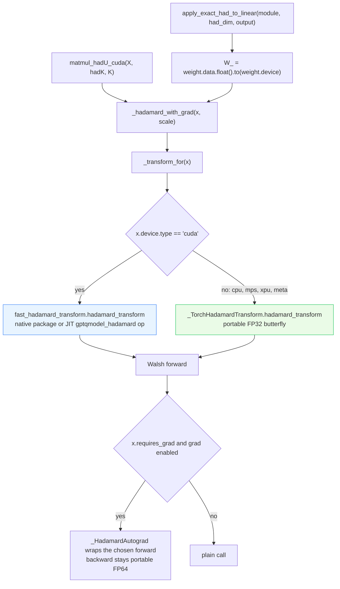

# Rotation Hadamard device dispatch

QuaRot/SpinQuant rotation fuses a normalized Walsh-Hadamard transform into the
weights and re-applies the same transform to activations at calibration and
inference time. Two interchangeable implementations exist:

- `_FastHadamardTransform` wraps the native `fast_hadamard_transform` package or
  the GPT-QModel JIT `gptqmodel_hadamard` extension. Both register a **CUDA
  kernel only**; the C++ entry point is `TORCH_CHECK(x.is_cuda(), ...)`.
- `_TorchHadamardTransform` is a portable FP32 butterfly that runs on any
  device and is the numerical reference for the CUDA kernel.

The backend is a property of the tensor, not of the process. Choosing one at
import time (the old behaviour) meant that on any CUDA host with the extension
built, every CPU tensor was handed to a CUDA-only op. Rotation therefore failed
for CPU inference of a rotated checkpoint and for CPU-only quantization, and the
MPS path in `models/base.py` — which deliberately rotates on the CPU because MPS
lacks float64 — could not run at all.

## Dispatch flow

`_transform_for` resolves the backend from `x.device.type` on every call.
`apply_exact_had_to_linear` keeps the weight on its own device, so the transform
it applies is the same one the activation path will pick later.

`_HadamardAutograd.backward` always differentiates through the portable FP64
butterfly, so a gradient path never depends on which forward backend ran.

## Before and after

| Mechanism | Before | After |
| --- | --- | --- |
| Backend selection | `import_fast_hadamard_transform` picked `_FastHadamardTransform` once per process whenever `hadamard_available()` (`gptqmodel/quantization/rotation/hadamard_utils.py:245` on `main`) | `_transform_for` selects per call from `x.device.type` (`hadamard_utils.py:232`) |
| Forward call | `transform = fast_hadamard_transform.hadamard_transform` regardless of device (`hadamard_utils.py:226` on `main`) | same symbol, but resolved for the tensor's device inside `_hadamard_with_grad` (`hadamard_utils.py:225`) |
| Weight placement | `W_ = W_.float().cuda()` and `b_ = b_.float().cuda()` (`hadamard_utils.py:327,336` on `main`) | `W_ = W_.float().to(dev)`, `b_ = b_.float().to(dev)` where `dev = module.weight.device` (`hadamard_utils.py:345,354`) |
| Head-dim branch | called `fast_hadamard_transform.hadamard_transform` directly (`hadamard_utils.py:353,363,372` on `main`) | routes through `_hadamard_with_grad`, so it follows the same dispatch (`hadamard_utils.py:371,381,390`) |

## Failure and ambiguity contract

| Situation | Before | After |
| --- | --- | --- |
| CPU tensor on a CUDA host with the extension built | `NotImplementedError: Could not run 'gptqmodel_hadamard::fast_hadamard_transform' with arguments from the 'CPU' backend` | portable butterfly runs on the CPU |
| CPU-only host, rotation quantization | `RuntimeError: No CUDA GPUs are available` from the unconditional `.cuda()` | exact Hadamard fusion runs on the CPU |
| CUDA tensor | CUDA op (unchanged) | CUDA op (unchanged) |
| MPS weight routed to CPU by `models/base.py` | crash before the first transform | portable butterfly on the CPU |
| Half precision on a non-CUDA device | portable path, FP32 accumulate | unchanged |

No fallback silently downgrades a CUDA call: a CUDA tensor still uses the
accelerator backend, and only non-CUDA devices take the portable path.

## Measured behaviour

| Case | Before | After |
| --- | --- | --- |
| `apply_online_hadamard(cpu_tensor)` on a CUDA host, JIT extension built | `NotImplementedError` (CPU backend) | returns the tensor, `device=cpu` |
| `apply_exact_had_to_linear` on a CPU-only host (`CUDA_VISIBLE_DEVICES=`) | `RuntimeError: No CUDA GPUs are available` | weight stays on `cpu`, finite result |
| `apply_exact_had_to_linear` with a CUDA-only backend installed, CPU weight | weight forced to `cuda:0` for the transform | weight never leaves `cpu` |

Regression coverage lives in `tests/test_rotation_persistence.py`
(`test_online_hadamard_dispatches_on_the_tensor_device`,
`test_online_hadamard_still_uses_the_accelerator_on_cuda`,
`test_exact_hadamard_fuses_on_the_weight_device`,
`test_exact_hadamard_head_dim_uses_the_weight_device`).

## Not in scope

`apply_exact_had_to_linear` rewrites `module.bias` at rank 2 when the bias is not
transformed (`had_dim=-1`, `output=False`). That shape rewrite predates this
change and is tracked separately; it is not a device-dispatch issue.
