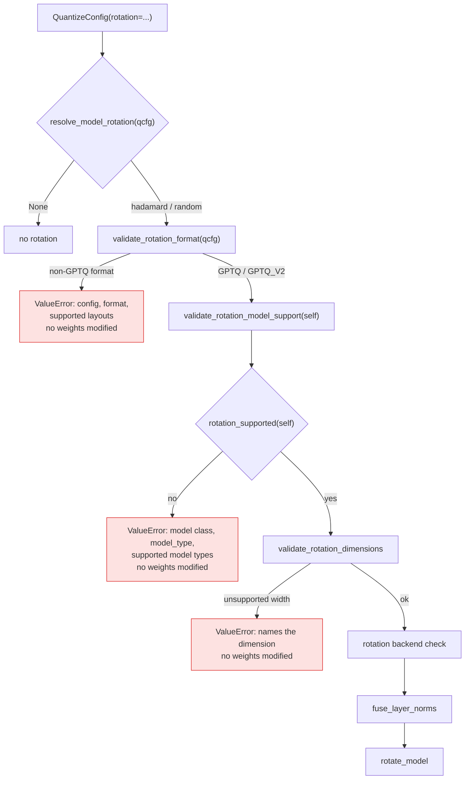
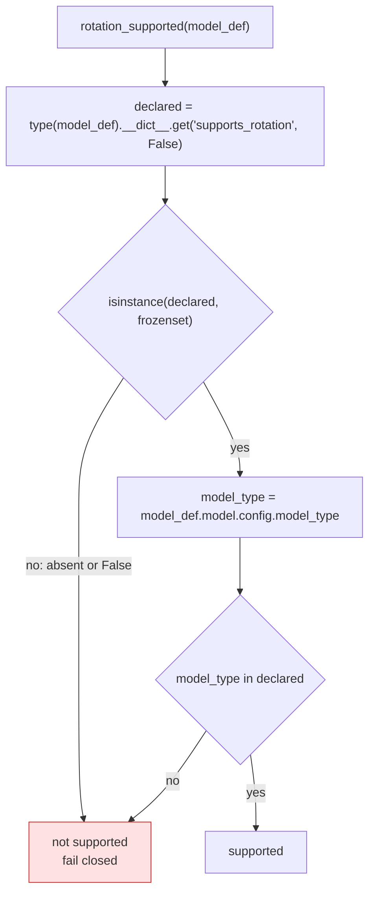

# Rotation model support

Model-wide rotation (`QuantizeConfig(rotation="hadamard" | "random")`)
fuses decoder norms into the adjacent projections and rotates the residual
stream. The fold is only an identity transform for a specific decoder layout,
so the feature is an explicit per-model-type opt-in rather than a check on the
definition's Python class.

The gate lives in `gptqmodel/models/base.py`:

- `rotation_supported(model_def)` reads
  `type(model_def).__dict__.get("supports_rotation", False)` and returns true
  only when the *exact* definition class declared the model type in a
  `frozenset`. The lookup never walks the MRO.
- `validate_rotation_model_support(model_def)` raises `ValueError` before any
  weight is touched, naming the model class, its `model_type`, and the model
  types that do support rotation.
- `ROTATION_SUPPORTED_MODEL_TYPES` is the set named by that message and is
  pinned to the declarations by `tests/test_rotation_opt_in.py`.

`LlamaQModel` is the definition for several model types with different norm
semantics (`llama`, `mistral`, `gemma`, `cohere`, `stablelm`, ...). A boolean
on the class would therefore admit `gemma` (RMSNorm is `x * (1 + w)`) and
`cohere`/`stablelm` (LayerNorm bias) even though only `llama` was verified.
The declaration is a set of model types for that reason.

## Why a non-inheriting lookup

`Gemma2QModel`, `Gemma3QModel`, `Qwen3QModel`, `Olmo2QModel` and the other
Llama-shaped definitions subclass `LlamaQModel`. Reading the attribute with
`getattr` would inherit the non-empty declaration from `LlamaQModel` and
re-admit exactly the layouts this gate exists to reject. The own-`__dict__`
lookup makes every new subclass fail closed until it declares (and tests) its
own opt-in.

## New flow

## Checkpoint-format gate

`rotation` is a base-class field, so every config accepted it, but only the
GPTQ layouts have a kernel that applies the online Hadamard the rotated weights
need. `from_quantized` already refused a rotated checkpoint whose format is not
GPTQ/GPTQ_V2, so a non-GPTQ run quantized a rotated model with kernels that
ignored the transform (FP8 nll 21.05 -> 30.20, AWQ 21.59 -> 30.68) and saved a
checkpoint that could not be loaded.

`validate_rotation_format` now rejects the option in
`BaseQuantizeConfig.__post_init__` (and in `EXL3Config.__post_init__`, which
does not call the base hook), naming the config, the resolved format and the two
supported layouts. `quantize()` runs the same check again before
`fuse_layer_norms`/`rotate_model`, and the backend check moved up with it, so a
refused run leaves the model exactly as loaded (#4666). MACaQ keeps its own
per-layer `rotation`: `MacaqConfig.model_rotation` is `None`, so the model-wide
gate does not apply.

The opt-in decision itself:

## Before and after

| Mechanism | Before | After |
| --- | --- | --- |
| Admission | `isinstance(self, (LlamaQModel, Qwen2QModel))` at `gptqmodel/models/base.py:2127` on `main` | `validate_rotation_model_support(self)` at `gptqmodel/models/base.py:226` |
| Declaration | None; the Python class was the contract | `supports_rotation = frozenset({...})` on the definition (`llama.py:20`, `qwen2.py:17`) |
| Lookup | Class hierarchy, so every `LlamaQModel` subclass passed | Own `__dict__` only, so subclasses do not inherit it |
| Error text | "rotation only supports: llama/qwen2 model" while 19 direct subclasses passed | Names the rejected class and `model_type`, then lists `llama, qwen2` |
| Per-model-type aliases | `gemma`, `cohere`, `stablelm`, ... mapped to `LlamaQModel` were admitted | Only the listed `model_type` values pass |

## Supported model types

| `model_type` | Definition | Neutral-rotation evidence |
| --- | --- | --- |
| `llama` | `LlamaQModel` | relative logits error `9.999e-08`, argmax agreement `1.000` |
| `qwen2` | `Qwen2QModel` | relative logits error `8.144e-08`, argmax agreement `1.000` |

Every other definition is rejected. The `LlamaQModel` family audit:

| Definition | Rotation | Reason |
| --- | --- | --- |
| `LlamaQModel` (`llama`) | yes | `x * w` RMSNorm; post-attention norm feeds the MLP; neutral test |
| `Qwen2QModel` (`qwen2`) | yes | Llama decoder layout; neutral test |
| `Gemma2QModel` | no | post-attention norm is on attention output; MLP input is `pre_feedforward_layernorm`; RMSNorm is `x * (1 + w)`; post-norms are not rotation-invariant |
| `Gemma3QModel` | no | same Gemma 2 layout plus per-head `q_norm`/`k_norm` |
| `Gemma3nTextQModel` | no | Gemma 3n norms and per-layer adapters; `x * (1 + w)` |
| `Gemma4TextQModel` | no | post-norms, per-head `q_norm`/`k_norm`/`v_norm`, per-layer input adapters |
| `Qwen3QModel` | no | per-head `q_norm`/`k_norm` are not rotation-invariant |
| `Qwen3_5QModel` | no | per-head `q_norm`/`k_norm`; linear-attention branch |
| `Qwen3_5TextQModel` | no | Qwen3.5 layout inherited through `Qwen3QModel` |
| `QwenDriveQModel` | no | Qwen3.5 layout with a vision tower |
| `ZDTaichu5QModel` | no | Qwen3.5 text layout |
| `Olmo2QModel` | no | per-head `q_norm`/`k_norm`; `post_attention_layernorm` is a post-norm on attention output; extra `post_feedforward_layernorm` |
| `HunYuanDenseV1QModel` | no | per-head `query_layernorm`/`key_layernorm` |
| `InstellaQModel` | no | Llama-shaped norm positions but not verified by a neutral-rotation test |
| `GraniteSWAQModel` | no | attention-sink parameters and sliding-window layout; not verified |
| `DeciLMQModel` | no | variable-depth/NAS layer selection; not verified |
| `DreamQModel` | no | diffusion language model, not a causal decoder forward |
| `Ernie4_5QModel` | no | Llama-shaped tree but the forward was not verified |
| `InternLMQModel` | no | Llama-shaped tree but the pinned remote code was not verified |
| `MimoQModel` | no | Qwen2-based remote code; not verified |
| `MobileLLMQModel` | no | remote code; not verified |
| `NanbeigeQModel` | no | looped physical layers; not verified |
| `XverseQModel` | no | pinned remote code; not verified |

Anything not proven by a neutral-rotation test stays `False`; enabling one of
the entries above requires adding it to `supports_rotation` together with its
own neutral-rotation case.

## Failure contract

| Situation | Before | After |
| --- | --- | --- |
| `rotation` on Gemma2 | admitted, silently corrupts logits | `ValueError` before mutation |
| `rotation` on Gemma3 | admitted, silently corrupts logits | `ValueError` before mutation |
| `rotation` on a new `LlamaQModel` subclass | inherited admission | rejected until it declares `supports_rotation` |
| `rotation` on `llama`/`qwen2` | worked | still works; neutral-rotation test asserts < `1e-3` |
| `rotation` with an unsupported width | `ValueError` from `validate_rotation_dimensions` | unchanged |

## Measured before/after

Tiny random CPU models (float64, one decoder layer, all norm gains drawn from
`normal_(0, 1)`), fused with the definition's module tree and rotated with
`hadamard`; the online Hadamard is applied to `mlp.down_proj`.

| Model | Relative logits error | Argmax agreement |
| --- | --- | --- |
| Llama (before and after) | `9.999e-08` | `1.000` |
| Gemma2 (before the gate) | `1.126` | `0.000` |
| Gemma2 (after the gate) | `ValueError` | n/a |

Regression coverage is `tests/test_rotation_opt_in.py`:
`test_rotation_is_neutral_for_every_opted_in_definition`,
`test_rotation_raises_for_definition_that_did_not_opt_in`,
`test_rotation_opt_in_is_not_inherited_by_a_subclass`, and
`test_supported_model_types_constant_matches_the_declarations`.

## Not in scope

The loader-side online Hadamard setup (`gptqmodel/models/loader.py`) still
applies to a checkpoint that already declares rotation. Preventing new rotated
checkpoints for unsupported layouts is this page's contract; auditing existing
checkpoint provenance is separate.
