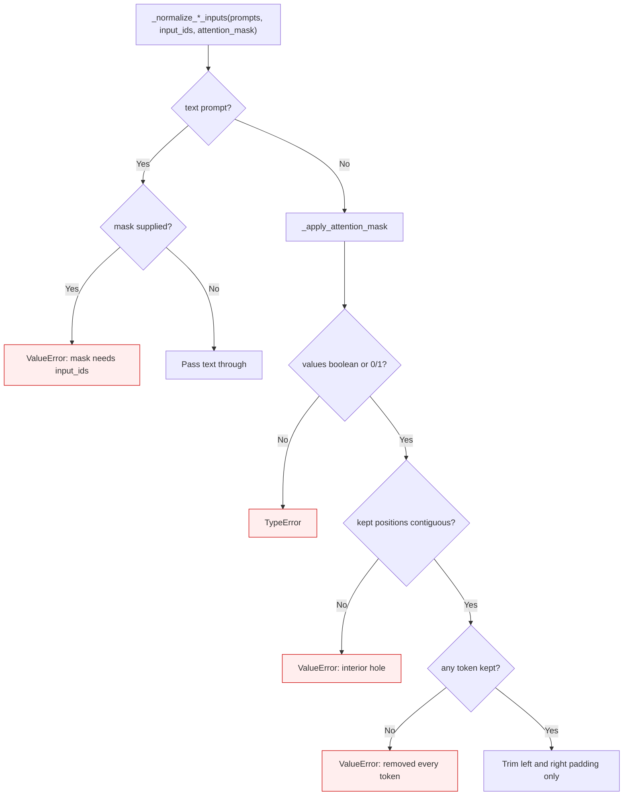

<!-- SPDX-FileCopyrightText: 2026 ModelCloud.ai -->
<!-- SPDX-License-Identifier: Apache-2.0 -->

# Runtime prompt input normalization

GPT-QModel translates Hugging Face style prompts and attention masks into the
token-prompt forms accepted by external runtimes. A vLLM or SGLang token prompt
is a bare sequence of token IDs: it carries no mask, so every mask must be
resolved before the prompt is handed over. This page defines which masks can be
resolved without changing the prompt.

## Contract

Only contiguous left or right padding may be removed. Deleting an interior
token would renumber every later position, so the adapter rejects that request
instead of sending a different prompt to the runtime. Non-binary mask values
are rejected rather than coerced with `bool()`, and a mask supplied with a text
prompt is rejected because there are no token positions to apply it to.

## Previous behavior

| Input | vLLM adapter before | Both adapters now |
| --- | --- | --- |
| `input_ids=[10, 20, 30]`, `mask=[1, 0, 1]` | `[[10, 30]]` (token `20` deleted, positions renumbered) | `ValueError` naming the interior hole |
| `input_ids=[10, 20]`, `mask=[1, 2]` | `[[10, 20]]` (`2` coerced to keep) | `TypeError` |
| `prompts="hello"`, `mask=[1, 0]` | mask silently ignored | `ValueError` |
| `input_ids=[0, 0, 10, 20]`, `mask=[0, 0, 1, 1]` | `[[10, 20]]` | `[[10, 20]]` (unchanged) |

The SGLang adapter already implemented this contract; the vLLM adapter now
matches it.

## Validation

| Test | Invariant |
| --- | --- |
| `tests/test_vllm_input_normalization.py::test_left_padding_is_removed` | Left padding trims to the same token sequence |
| `::test_right_padding_is_removed` | Right padding trims to the same token sequence |
| `::test_batched_padding_is_removed_per_row` | Per-row padding handling with tensor masks |
| `::test_interior_hole_is_rejected` | Interior holes raise instead of rewriting |
| `::test_non_binary_mask_is_rejected` / `::test_float_mask_is_rejected` | Only boolean/0-1 values are accepted |
| `::test_mask_removing_every_token_is_rejected` | An all-zero row raises |
| `::test_mask_with_text_prompt_is_rejected` | Text prompts reject a mask |
